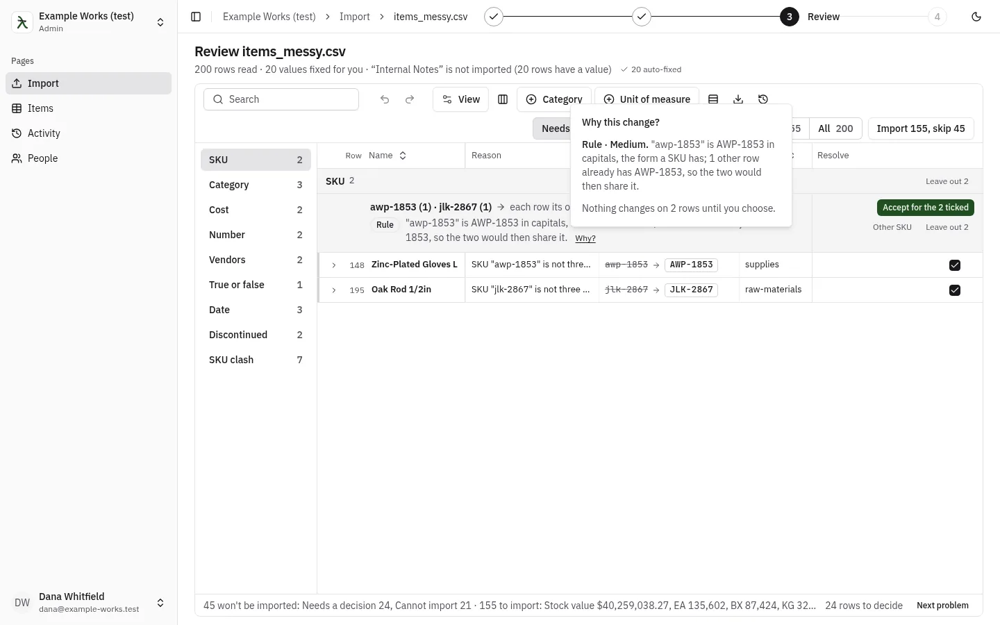
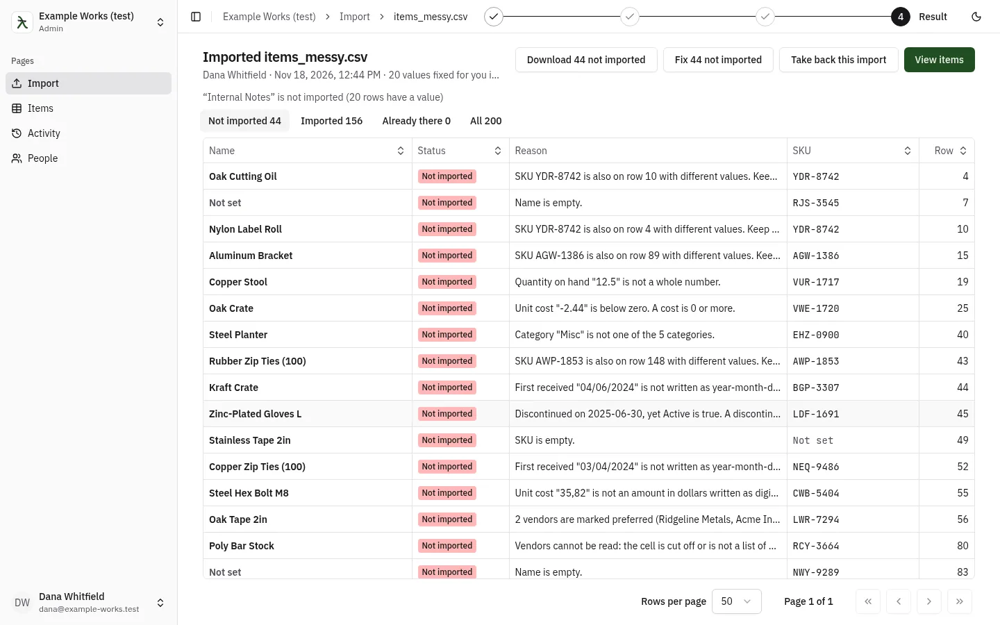

# Inventory import

For an operations admin at a warehouse who is moving off spreadsheets: load inventory items in bulk from a messy
.csv or .xlsx, see what was fixed for you, settle what is wrong in the app, and know exactly what got in.

This began as a one-hour take-home project. The first commit here is the app as I submitted it (v0.6.1), without
the company's brief and without the record of my working session; the two sample files are theirs. Everything after
that commit is later work.

Read [DECISIONS.md](DECISIONS.md) first. It says what was built, what was cut, and the product decisions behind the
import. [docs/architecture.md](docs/architecture.md) draws the data model, a row's path through the import and the
layers. Where the repository is going is in [explorations/](explorations/README.md) (questions being shaped, with
their research and decisions) and [goals/](goals/README.md) (work with a definition of done).

## What this started from

- This app is built on my own project starter: the frame, sign-in with organizations and roles, a four-step import
  of an example record with a review, undo and take-back, a searchable table with an assistant, and the toolchain.
- My own earlier app, stockroom, was the reference for the model suggestions: its guard and its way of turning a
  stored suggestion into a proposal were taken and rewritten for items (DECISIONS.md lists the files).

## A look at it



The review of the messy file: what needs a decision, with who proposed each change, how sure, and on what evidence.



The result: imported and not imported add up to the rows in the file, each row left out with its reason.

## Run it

Needs Bun and Node 22 or newer. Nothing else: no Docker, no accounts, no keys. In a fresh clone, one command installs
and starts it:

```bash
bun install && bun run dev
```

Open http://localhost:5173. In development the app opens already signed in, as the first test account, Dana
Whitfield, admin of Example Works (test); the others are one click away in the menu under her name. The
database is a local SQLite file created on first run. bun is the only package manager (`packageManager` in
`package.json`, one `bun.lock`).

What to try first, on the brief's messy file (`public/samples/items_messy.csv`, 200 items):

1. On Import, press "Use items_messy.csv". The review opens: 200 rows read, 20 values fixed for you (press
   "auto-fixed" to see each one, with "Why?" and an undo), and the views Needs a decision 24, Cannot import 21,
   Ready 155.
2. Under Cannot import, press "Fix dimensions" on row 91, type a height and save: Ready becomes 156. Ctrl+Z takes it
   back, Ctrl+Y redoes it. Under Needs a decision, open "Why?" on a proposal, accept one group, pick a reading of a
   date. Then press the button that says how many items it will import, and confirm.
3. The result counts what was stored, lists every row not imported with its reason, and offers the download. On
   Items, search "Fiberglass Crate": two items. Load the same file again: nothing is created twice, and the rows still open wait. Back on
   the result, take the import back.

`items_clean.csv` (25 items) imports as it is: all 25 Ready, nothing to decide.

AI features are optional. To turn them on, copy `apps/inventory/.dev.vars.example` to `apps/inventory/.dev.vars` and add an OpenRouter key. Without a key the app says so and uses its non-AI path.

The API reference (Scalar) is at http://localhost:5173/api/v1/docs while `bun run dev` runs; the OpenAPI document is
at `/api/v1/openapi.json` in development and production. Logs: `LOG_LEVEL` and `LOG_FORMAT` in `.dev.vars` (valid
values in `.dev.vars.example`). After pulling a change to `apps/inventory/migrations/0001_init.sql`, run `bun run db:reset` once.

| Command | What it does |
| --- | --- |
| `bun run dev` | App and API on http://localhost:5173, signed in as the first test account in development |
| `bun run check` | Through turbo: type-check with Effect diagnostics, lint (including two design lints), the fast tests, format check and the docs check; a second run with nothing changed replays from the cache |
| `bun run check:full` | `check` plus the slow tests and the production build |
| `bun run test` | Every test, fast and slow (Vitest, on Node) |
| `bun run db:reset` | Start again with an empty database (restart `bun run dev` afterwards) |
| `bun run preview` | The production build on http://localhost:4173, with every security header, compressed as Cloudflare compresses it (`PREVIEW_COMPRESSION=off` sends it as it is) |
| `bun run --cwd apps/inventory build:report` | The production build, and what each of its chunks is made of (`.scratch/bundle/client.html`, a treemap) |
| `bun run auth:schema` | After a change to Better Auth's options, prints the migration it still needs (Node 22.18 or newer) |
| `bunx alchemy deploy --stage <name>` | Host it on Cloudflare: the stack in `packages/infra` makes the database and the Worker (needs a Cloudflare login; [goals/infra/PLAN.md](goals/infra/PLAN.md) has the steps, in order) |

### Signing in

Sign-in is real: Better Auth, with email and password, sessions, organizations and three roles. Nobody has to sign
up: `bun run dev` adds five test accounts in two organizations, and the sign-in page offers each in one click (their
password is `local-test-password`). In development the app signs in as the first of them by itself, through a real
session, unless you signed out in that tab; a production build always shows the sign-in page and offers none:

| Email | Role |
| --- | --- |
| `dana@example-works.test` | admin of Example Works (test), viewer of Sample Supply Co. (test) |
| `marcus@example-works.test` | editor, Example Works (test) |
| `priya@example-works.test` | viewer, Example Works (test) |
| `elena@sample-supply.test` | admin, Sample Supply Co. (test) |
| `tom@sample-supply.test` | editor, Sample Supply Co. (test) |

"Create an account" makes a new person and their own organization, which they are the admin of. Someone in two
organizations switches in the menu under their name.

Sessions are signed with `BETTER_AUTH_SECRET`. The first `bun run dev` writes a random one into `apps/inventory/.dev.vars`
(git-ignored) when that file has none, so there is nothing to set up; to make your own, run `openssl rand -base64 32`
(`.dev.vars.example` has the line). A deployed copy gets its own from the stack in `packages/infra`, which mints one for each stage; a production build
refuses to start without it.

New passwords can be checked against known data breaches (Have I Been Pwned: only the first five characters of the
password's SHA-1 hash are sent). `PWNED_PASSWORD_CHECK` turns it on: on in a production build, off in development.
While it is on, sign-up is refused whenever the service cannot be reached (no connection, or a network that blocks it),
so turn it on locally only with a connection. The test accounts are offered while `TEST_ACCOUNTS` is on (development;
off in a production build). [docs/auth.md](docs/auth.md) says how it is wired.

### Optional: HTTPS in development

`bun run dev:https` serves the app over HTTPS with a certificate for localhost, so it behaves as a deployed copy (an
`https:` origin, Secure cookies, HSTS). It is not needed: `bun run dev` is the normal way. It needs
[mkcert](https://github.com/FiloSottile/mkcert); the first run makes a certificate in `.wrangler/certs`. Run
`mkcert -install` once if you want the browser to trust it without a warning (it adds mkcert's local authority to
your trust store, so it is your call). To use your own certificate instead, set `DEV_HTTPS_CERT` and `DEV_HTTPS_KEY`
to its PEM files. Pass Vite options after `--`: `bun run dev:https -- --port 5174`.

### Optional: telemetry

`bun run telemetry` starts Grafana's LGTM stack in Docker (Grafana on http://localhost:3000, an OpenTelemetry collector
on 4318) and prints the line to add to `apps/inventory/.dev.vars`: `OTEL_EXPORTER_OTLP_ENDPOINT=http://localhost:4318`. Restart
`bun run dev` and use the app: Grafana's Explore shows the Worker's and the browser's traces (Tempo), logs (Loki) and
metrics (Prometheus). `bun run dev` never starts it, and without that line nothing is built or sent.
`bun run telemetry:down` stops it and throws the data away.

## What is in the repository

What the starter held, now turned to the brief's inventory item:

- The frame (sidebar, breadcrumb, page header; the sidebar lists only screens that exist), and sign-in with Better
  Auth on D1: organizations, roles, sessions, rate limits, one-click test accounts.
- An import in four steps (`packages/catalog/web/src/`): upload in pieces, match columns, review every row with the
  review region (`docs/review-table.md`), and a result counted from what is stored, with a take-back.
- The Items page (paged by the server, one forgiving search box, a table assistant), Activity and People.
- One AI service on `effect/ai` and OpenRouter (`@beep/openrouter`) with one daily allowance of model calls; without a
  key its rules answer.
- The toolchain: Vite, React, Tailwind, every shadcn/ui component and more from Dice UI's and tablecn's registries
  (MIT; `docs/kit.md` says what was changed), Effect, Wrangler, Vitest, a .csv and .xlsx reader, and syncpack.
- Two design lints in `bun run check` that hold every screen to the theme and its components.
- `CLAUDE.md`, and the skills and agents my coding agent works from. Twenty-one skills come from my monorepo
  beep-effect; the rest are vendored unchanged, and [.agents/skills/README.md](.agents/skills/README.md) credits each
  author and licence.
- Better Auth's six skills and its docs server (read only), for sign-in work. Their repository has no licence file.
- `docs/`: my standards for this work, each rule with its check, and guides to the kit and the review region.
- `explorations/` and `goals/`: plain-markdown packets for planned work, checked by `bun run docs:check`.
- The skills, documentation and practices in this repository come from years of building software, including Rocket
  Inventory, a warehouse-management product I designed, built and led, where I designed its inventory import and
  review features.

## How it is put together

A bun workspace driven by Turborepo, with one app, its own CSV package and a vendored subset of beep-effect's kit
packages so far. `bun run dev` runs a Cloudflare Worker locally in workerd,
next to the React app, both built by one Vite config in `apps/inventory`.

```
packages/catalog/            The catalog context: contract (schemas, API groups), model (pure rules, ports),
                             host (D1 adapters) and web (screens)
packages/access/             The access context, in the same four packages
apps/inventory/src/api/      The HTTP contract, shared by server and browser (Effect HttpApi)
apps/inventory/src/server/   Worker: composition, group Layers, settings, the model service's setup
apps/inventory/src/web/      React 19, Tailwind 4, shadcn/ui, Effect atoms
apps/inventory/migrations/   D1 (SQLite) schema
packages/foundation/         @beep/csv and @beep/xlsx (the CSV and Excel readers and writers) and @beep/types,
                             @beep/identity, @beep/schema, @beep/utils, vendored from beep-effect and hash-checked
packages/infra/              What is deployed, per stage: the stage plan and the two Alchemy stacks
turbo.json                   check, lint, test, test:slow, build and dev per package; format, docs and key checks at the root
```

The browser calls the API through a client derived from the contract in `src/api/`, so payloads and errors are typed
end to end. Storage is Cloudflare D1.

### New to Effect

Effect runs the server because it gives a lot for little code. Every request and every function written with
`Effect.fn` is a span, and log lines carry who acted: the identity middleware stamps them, and one short file sets
the log format (`src/server/Observability.ts`). In development Effect DevTools can show the spans, the browser's and the
Worker's (`.dev.vars.example`), and `bun run telemetry` sends them to a local Grafana. Errors a caller can act on
are part of each function's type, so a missing case fails the type-check, not a request. One contract serves the
server and the browser. Start with `src/api/v1/Api.ts`, then `packages/catalog/host/src/ItemStore.adapter.ts`, then
`src/server/handlers.ts` (all under `apps/inventory/`).

## Secrets and security

- **Secrets** are read on the server only. Locally they come from `apps/inventory/.dev.vars`, which is git-ignored.
  `.dev.vars.example` explains what a real project would do instead (a secrets manager at start-up, the platform's
  encrypted store when deployed). `bun run check` fails when a string shaped like an OpenRouter or Anthropic key, or a
  private key, appears in any file git would commit (`bun run beep laws keys`).
- **Security headers** are set for every response in the production build: a content security policy with no inline
  scripts, HSTS, `nosniff`, no framing, a strict referrer policy, same-origin opener and resource policies and
  `Cross-Origin-Embedder-Policy: require-corp` (`public/_headers` for the app, `src/server/security.ts` for the API).
  The Vite dev server does not send the app's, because hot reload needs inline scripts; `bun run preview` serves the
  production build with them. A write sent from another site is refused, and no other origin may read the API.
- **Observability**: every request and every named Effect is a span, and log lines written inside a handler carry
  the actor and organization (the per-request access line does not). Logs are JSON in production for Cloudflare's
  Workers Logs. Spans leave the Worker one request at a time, after the answer (`src/server/RequestTelemetry.ts`):
  a client built once for the isolate goes silent after the first request. With `OTEL_EXPORTER_OTLP_ENDPOINT` set,
  traces, metrics and logs go to that collector, the browser's through `/api/otlp` on the app's own origin.
- **Identity** comes from the session cookie only (HttpOnly, SameSite=Lax, Secure in production). Permissions and
  tenancy are enforced on the server. [docs/auth.md](docs/auth.md) lists each security setting.

Scaffolded with create-beep-app 0.1.0: base, design-lints, docs, agent-kit, telemetry. The starter's time-boxed
workflow (clock, checkpoints, packing, the session record) was removed once the timed build was over.
