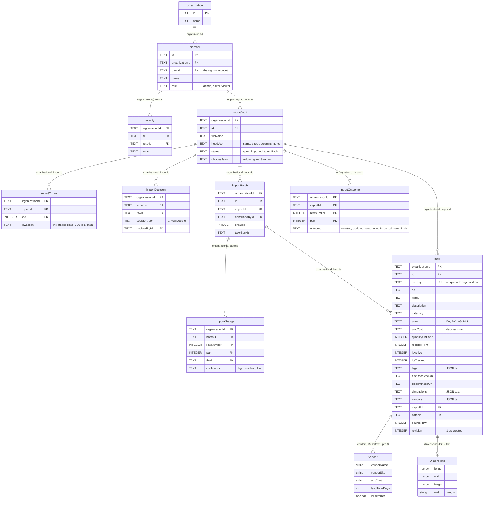
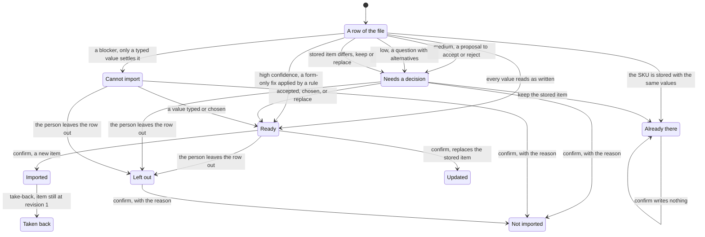
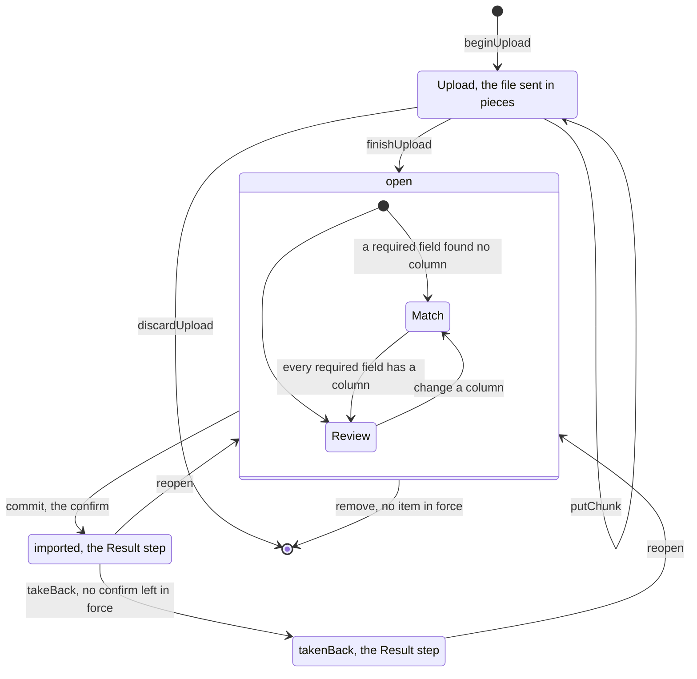
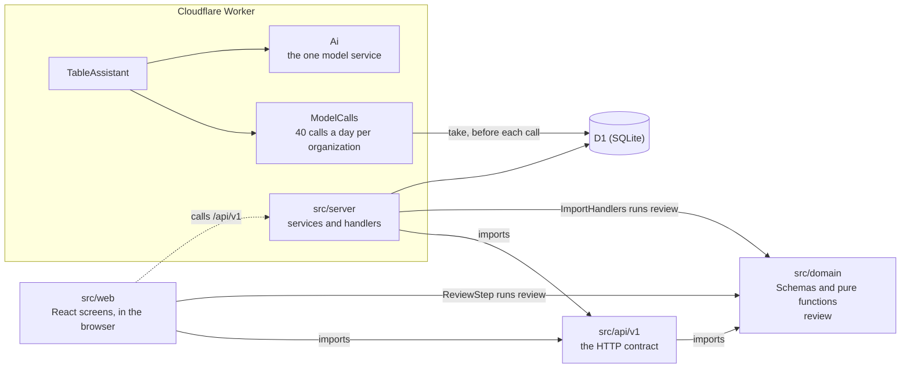

# Architecture in four diagrams

Each diagram was drawn from the files named under it, as they stood when this page was written. Every name in a
diagram is a name in that code. Where the code and this page disagree, the code is right.

## 1. What is stored

From `migrations/0001_init.sql` and `src/domain/Item.ts`.

An item has the fifteen fields of `ItemFields`, from `sku` to `vendors`; `Vendor` and `Dimensions` are not tables but
values inside the item, stored as JSON text and decoded through their Schemas. Every table of customer data has
`organizationId` first in its key and names its parent by `(organizationId, id)`, so a row of one organization cannot
point at a row of another. A file on its way in sits in `importUpload` and `importUploadChunk` (not drawn) until it is
whole, and then becomes an `importDraft` with the same id.

## 2. One row through the import

From `src/domain/ItemImport.ts` (`RowOutcome`, `Proposal.confidence`, `RowDecision`), `src/server/Imports.ts` and the
words in `packages/review/src/ReviewWords.words.ts` and `src/web/pages/import/format.tsx`.

The review puts every row in exactly one of `ready`, `decision`, `cannot`, `out` and `already`, and the counts add up
to the rows of the file. A proposal's confidence says how it arrives: high is a change of form with one reading, in
force and listed as Auto-fixed unless undone; medium waits for an accept; low is a question with nothing preselected.
After the confirm each row has one stored outcome (`created`, `updated`, `already`, `notImported`), and a take-back
turns `created` into `takenBack` only where nobody has changed the item since.

## 3. One import through its steps

From `src/server/Imports.ts` (`importDraft.status`, `commit`, `takeBack`, `reopen`, `remove`) and
`src/web/pages/ImportPage.tsx` (the steps Upload, Match, Review, Result).

An import is `open` while its rows are being matched and reviewed; the confirm writes the items, the outcomes and the
changed values in one batch and flips it to `imported`, and the page then shows the Result step whatever step the
address asks for. A take-back removes the items still at revision 1 and marks it `takenBack` once no confirm is in
force. Reopening puts it back in Review, where rows an earlier confirm created count as already there.

## 4. How the parts depend on each other

From the imports in `src/`, `src/server/ModelCalls.ts`, `src/server/TableAssistant.ts` and the two callers of `review`
(`src/web/pages/import/ReviewStep.tsx`, `src/server/ImportHandlers.ts`).

Dependencies point one way: the browser and the Worker both import the contract, the contract imports the domain, and
the browser never imports the server. The review screen and the confirm run the same pure `review` on the same staged
rows and decisions, so the server refuses what the preview refused. Every model call first takes one from the
organization's daily allowance in `modelCall`; when it is used up, or there is no key, the feature's rules answer.
