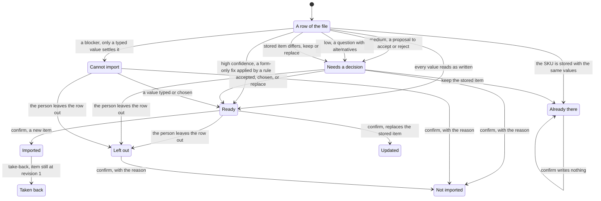
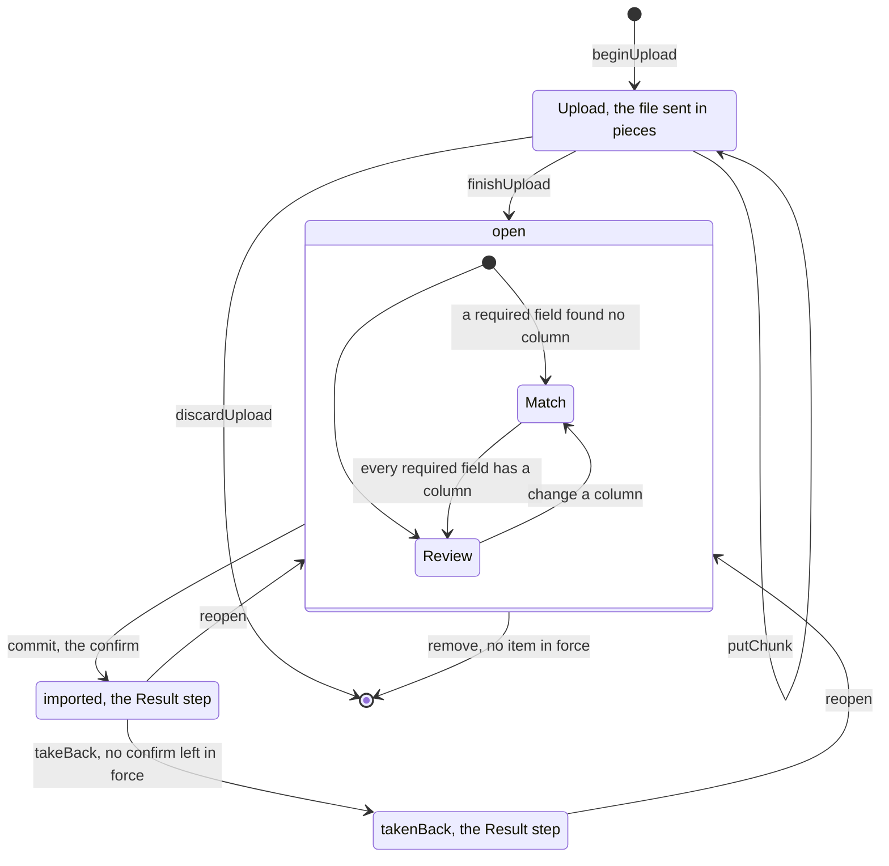
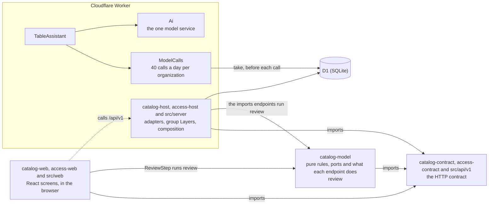

# Architecture in four diagrams

Each diagram was drawn from the files named under it, as they stood when this page was written. Every name in a
diagram is a name in that code. Where the code and this page disagree, the code is right.

## 1. What is stored

From `migrations/0001_init.sql` and `packages/catalog/contract/src/Item/Item.read.ts`.


An item has the fifteen fields of `ItemFields`, from `sku` to `vendors`; `Vendor` and `Dimensions` are not tables but
values inside the item, stored as JSON text and decoded through their Schemas. Every table of customer data has
`organizationId` first in its key and names its parent by `(organizationId, id)`, so a row of one organization cannot
point at a row of another. A file on its way in sits in `importUpload` and `importUploadChunk` (not drawn) until it is
whole, and then becomes an `importDraft` with the same id.

## 2. One row through the import

From `packages/catalog/model/src/Review/Review.rules.ts` (`RowOutcome`, `Proposal.confidence`, `RowDecision`), `packages/catalog/host/src/ImportStore.adapter.ts` and the
words in `packages/review/src/ReviewWords.words.ts` and `packages/catalog/web/src/internal/format.tsx`.



The review puts every row in exactly one of `ready`, `decision`, `cannot`, `out` and `already`, and the counts add up
to the rows of the file. A proposal's confidence says how it arrives: high is a change of form with one reading, in
force and listed as Auto-fixed unless undone; medium waits for an accept; low is a question with nothing preselected.
After the confirm each row has one stored outcome (`created`, `updated`, `already`, `notImported`), and a take-back
turns `created` into `takenBack` only where nobody has changed the item since.

## 3. One import through its steps

From `packages/catalog/host/src/ImportStore.adapter.ts` (`importDraft.status`, `commit`, `takeBack`, `reopen`, `remove`) and
`packages/catalog/web/src/ImportPage.screen.tsx` (the steps Upload, Match, Review, Result).



An import is `open` while its rows are being matched and reviewed; the confirm writes the items, the outcomes and the
changed values in one batch and flips it to `imported`, and the page then shows the Result step whatever step the
address asks for. A take-back removes the items still at revision 1 and marks it `takenBack` once no confirm is in
force. Reopening puts it back in Review, where rows an earlier confirm created count as already there.

## 4. How the parts depend on each other

From the imports in `src/`, `packages/access/host/src/AllowanceStore.adapter.ts`, `packages/catalog/model/src/Assistant/Assistant.handler.ts` and the two callers of `review`
(`packages/catalog/web/src/ReviewStep.screen.tsx`, `packages/catalog/model/src/Import/Imports.handler.ts`).



Dependencies point one way: the browser, the Worker and the domain all import the contract; the domain never imports a
driver, a host or the server; and the browser never imports the server. The review screen and the confirm run the same
pure `review` on the same staged rows and decisions, so the server refuses what the preview refused. Every model call
first takes one from the organization's daily allowance in `modelCall`; when it is used up, or there is no key, the
feature's rules answer.

<!-- The two sections below moved here from CLAUDE.md word for word on 2026-11-26 (goals/focus-and-friction, step 4). -->

## What is there

`bun install && bun run dev` is the whole setup: no key and no secret to make by hand (`bun run dev` writes the
sign-in secret into `.dev.vars` the first time).

- **The frame**: a sidebar with the organization (a picker when there are two), the pages and the signed-in person's
  menu (theme, sign-out, the test accounts), a breadcrumb in the bar beside it, and `PageHeader` for each page's
  title row (`src/web/components/app/AppShell.tsx`, `AppSidebar.tsx`, `PageHeader.tsx`, `src/web/Workspace.tsx`).
  **The sidebar lists only screens that exist**: each is one line in `appPages` (`AppSidebar.tsx`) and one branch in
  `Workspace.tsx`. A screen with no use is deleted, not hidden: its page file, its branch, its line, its endpoints
  and service if nothing else uses them, and its tests. Ask Benjamin before deleting one.
- **Sign-in** (Better Auth: accounts, organizations, roles, sessions; [docs/auth.md](auth.md)). In development
  the app opens already signed in as the first test account, Dana Whitfield, admin of Example Works (test),
  through a real session (the `developmentSignIn` atom in `src/web/components/app/SignedIn.tsx`); the other test accounts are
  one click away in the user menu ("Sign in as a test account"). After a sign-out that tab shows the sign-in page. A
  production build always shows the sign-in page, and offers no test accounts.
- **The import of a file of items**, in four steps, each its own file in `@inventory/catalog-web` (`packages/catalog/web/src/`), on the page
  `packages/catalog/web/src/ImportPage.screen.tsx` (the import and its step are in the address, so a refresh lands on the same step):

  | Step | File | What it does |
  | --- | --- | --- |
  | Upload | `UploadStep.screen.tsx` | A .csv or .xlsx read in a worker and sent up in pieces, with progress and Cancel (the upload's atoms, `@inventory/catalog-web/Upload`); "Use items_messy.csv" (each sample its own button) and a download link; the open imports with Continue and Remove |
  | Match | `MatchStep.screen.tsx` | Which file column fills which field, by heading, changed by hand; shown when a required field found no column. Review waits until every required field has a column and names the ones left |
  | Review | `ReviewStep.screen.tsx`, `ImportReview.controller.ts` | The review region (`@inventory/review`, `packages/review`) on the rows: accept a proposal for a row or a group, pick one of two readings, type a value, keep one of two rows, leave a row out, undo and redo; the confirm button says what it will import |
  | Result | `ResultStep.screen.tsx` | What the confirm did, counted from what is stored, the rows not imported downloadable with their reasons, and the take-back (a changed record is kept and named) |

  The server stages the file and runs the same pure `review` (`packages/catalog/model/src/Review/Review.rules.ts`) at the confirm
  (`packages/catalog/host/src/ImportStore.adapter.ts`, and `packages/catalog/model/src/Import/Imports.handler.ts`). Loading the same file again creates nothing: its rows are "Already
  there", counted from the stored SKU keys.
- **The Items page** (`packages/catalog/web/src/ItemsPage.screen.tsx`): the data table paged, sorted and filtered by the server
  (`packages/catalog/host/src/ItemStore.adapter.ts`), one search box that finds every word in any order and forgives one wrong letter (a
  full-text index in the migration, `packages/catalog/model/src/Item/ItemSearch.rules.ts`), the table assistant (a request in words becomes a
  checked change to the view: `packages/catalog/web/src/TableAssistant.screen.tsx`, `packages/catalog/model/src/Assistant/Assistant.handler.ts`), and an
  editor for one item (`ItemEditor.screen.tsx`, editors and admins). With no key the assistant's fixed rules answer and
  it says so.
- **Activity** (`src/web/pages/ActivityPage.tsx`): every value an import wrote that differs from its file, who decided
  it, and the audit trail of uploads, imports, take-backs and changes of role.
- **People** (`@inventory/access-web/People`): who is in the organization; an admin adds a person by the email they
  signed up with, changes a role or removes someone, and the organization always keeps an admin.
- **One model service** (`@beep/openrouter`, set up by the app in `src/server/Model.ts` and asked through `@inventory/catalog-host/Model`) with **one daily allowance** (the access context's `ModelAllowanceGateway`, 40 calls a
  day per organization, taken before each call): every model feature draws on it, and when it is used up the feature
  says so in plain words and its rules answer. `GET /api/v1/system/status` says whether a model is on.

The sample files are in `public/samples/` (`items_messy.csv`, 200 rows, and `items_clean.csv`, 25). The messy sample
is the standing end-to-end proof: imported through Confirm it stores 155 items, and the result screen, the Items
table and the stored rows agree.

## Layout

```
apps/inventory/         The app: the Worker and the SPA, one Vite build. Its own package.json, tsconfigs, wrangler.jsonc.
  src/api/v1/           The assembled HTTP contract (Effect HttpApi), served at /api/v1: the contexts' groups, the
                        system group, the OpenAPI document. Shared by server and browser.
  src/server/           Cloudflare Worker: the composition (App.ts), the group Layers (handlers.ts), settings, the model
                        service's setup, telemetry, security headers, worker.ts entry.
  src/web/              React app: the shell, the Activity page, the composition of the contexts' screens. Calls the
                        API through a client derived from src/api. Never imports src/server.
  migrations/           D1 (SQLite) migrations, applied in filename order.
  test/                 Unit tests (`*.slow.test.ts` need workerd, D1 or sign-in).
  public/samples/       The sample files the Upload step offers.
  scripts/              The app's development scripts (local migrations, HTTPS, deploy setup, strict count).
apps/model/             @inventory/model-app: the model's Worker (Benjamin, 2026-11-26), a second Worker that hosts the
                        models on Durable Objects, the usage model first. `src/ModelWorker.ts` is the Worker, its one
                        export to the stack (`@inventory/model-app/Worker`); `src/ModelRoutes.ts` sends a path under
                        `/member` to the member's Api and one under `/server` to the server's, and any other to a 404.
                        `src/Models.ts` puts it together on the platform it is given (Durable Objects in the Worker,
                        the memory host in its test). It has no public address (`src/Address.ts`): the stack binds it
                        to the site's Worker as `MODEL`. Not built yet,
                        each a seam named in its file: who is signed in (`src/Session.ts` refuses every call until
                        host-03), the database's binding (`src/Database.ts` holds the D1 client), its spans (host-05).
                        Its tests call it through its own `fetch` in process; `*.slow.test.ts` needs D1.
packages/ui/             @inventory/ui: the vendored shadcn, Dice UI and tablecn components and hooks (as published, one
                        exact export each), the theme (`theme.css`, the Tailwind entry) and the shared screen pieces.
packages/review/         @inventory/review: the review region and its saved progress.
packages/client/         @inventory/client: the browser's seam to the API with no contract in it (the API's atoms: reads,
                        writes and optimistic writes bound to a client; who is signed in, as an atom; `sayError`; the
                        early requests).
packages/access/         The access context (who may do what), as four packages: contract/ (the session, people and
                        audit-trail schemas, their API groups, the model allowance's gateway), model/ (rules, ports,
                        in-memory twins, handlers: no SQL, no HTTP), host/ (the D1 adapters, sign-in, the session
                        identity, the endpoints) and web/ (the session controller, sign-in, People, the audit events).
                        `bun run beep laws boundaries` holds which of them may import which.
packages/catalog/        The catalog context (items and the imports that write them), as four packages: contract/ (the
                        schemas of items, staged files, decisions, changes, suggestions and results, and the imports,
                        items and assistant groups), model/ (the pure rules the screen and the server both run: the
                        review, suggestions, the table view's checks, sheet layout, upload pieces; the six ports, their
                        in-memory twins and what each endpoint does: no SQL, no HTTP; and the review as a model of
                        `@alchemy.run/domain`, in memory only: the `Import`, `Row` and `Group` aggregates, the four
                        decisions that record an act on two of them, their stories and their proofs, docs/verify.md), host/ (the D1 adapters, the
                        model and the allowance as the catalog asks them) and web/ (the import's steps, the Items page,
                        the editor, the assistant, the upload).
packages/usage/          The usage context (the day's model calls), as two packages: contract/ (what the rest of the app
                        may know: an organization's calls in a UTC day, and what a call is for) and model/ (the
                        allowance as a model of `@alchemy.run/domain`: its aggregate, view, Apis, proof, stories and
                        mutants, hosted by apps/model).
packages/kernel/, packages/drivers/   @inventory/kernel and the @beep drivers (d1, better-auth, openrouter). The kernel
                        also holds the ERP vocabulary (`Terms.vocab.ts`: the one place a term's facts are written) and
                        the typed helpers a record is marked with (`Terms.pointer.ts`, `@inventory/kernel/TermsPointer`).
packages/ontology/       @inventory/ontology: what is made from the vocabulary and what checks it. The projector and the
                        writer (generated/ holds the OWL and SKOS Turtle, never edited by hand: `bun run
                        ontology:write`), the lift of a record to triples, the competency questions and their fixtures,
                        and seven of the vocabulary's nine gates as tests, the last a reasoner (`scripts/reason.ts`,
                        pinned in `robot.lock.json`); the other two are the type-check and the `ontology-terms` law. Nothing imports it. Its goals are goals/erp-vocabulary and goals/party-slice.
packages/infra/          @beep/infra: what is deployed, per stage. The stage plan as a schema and a pure function
                        (`StagePlan.rules.ts`: what each stage gets, decided from its name), the app's Alchemy stack
                        (`Inventory.stack.ts`: one D1 database and two Workers, the site's and the model's, the second
                        bound to the first as `MODEL`) and the repository's (`GitHub.stack.ts`: the deploy environments, their secrets,
                        the rule on main). Nothing in the app imports it, but for one test: `apps/inventory/test/stack/`
                        deploys `InventoryDev` on Alchemy's local providers (the boundaries law's exception,
                        `localStackEntry`). It imports one file of one app, the model's Worker (`workerEntry` of
                        `modelApp`, the boundaries law's one row for it, Benjamin's answer of 2026-11-26).
alchemy.run.ts          The app's stack, re-exported for `bunx alchemy deploy --stage <name>`. A deploy is Benjamin's:
                        no agent runs `alchemy deploy`, `plan`, `destroy`, `login` or `state`, nor
                        `bun run beep infra setup`, which runs them for him, except with `--dry-run`, which
                        starts nothing (goals/infra/PLAN.md).
vendor/alchemy/         The Alchemy packages as files, one commit of the library's main, with every sibling address
                        inside them rewritten so an install needs the library's registry for nothing. Its README says
                        why, and how the pin moves. Never edit a file there: `bun run alchemy:check`, part of `bun run check`, fails on a change.
packages/patches/        @inventory/patches: the repository's patches to its dependencies, applied by bun at every
                        install. One file a defect (alchemy-domain/01-computed-instance-id.patch) with a header that
                        says what it applies to, where the defect is reported, why we need it and when it goes; the
                        file bun reads beside each folder, built from it (`bun run beep patches build`), never edited;
                        and under test/ the test of each patch, which fails without it. Before making, changing or
                        dropping one, read docs/patches.md. Nothing imports it.
packages/foundation/     Product-neutral packages: this repository's own @beep/csv and @beep/xlsx (modeling/), which read
                        and write a CSV and an Excel workbook as Effect Schema codecs, and beep-effect's kit, vendored:
                        @beep/types (primitive/), @beep/identity, @beep/schema and @beep/utils (modeling/). Also this repository's own
                        @beep/vocabulary (modeling/vocabulary): the model a vocabulary is written in, its coherence
                        rules and the makers of the typed helpers; it knows no term of the ERP. `@beep/unsafe-assert` (typing/) holds
                        the sole explicit compiler claim for approved library typing gaps. Never edit
                        the kit: each vendor.json
                        records its beep-effect commit and file hashes, and `bun run vendor:check` fails on a change.
docs/                   Standards, the kit, patterns, the glossary and sign-in (`docs/index.md` lists them); qa/ is evidence.
explorations/           Questions being shaped: research, decisions, briefs.
goals/                  Work with a definition of done: SPEC.md and PLAN.md.
packages/tooling/tool/cli/  @beep/repo-cli: the repository's own rules as commands (`bun run beep <group> <command>`):
                        `laws` (boundaries: which package may import which; screens: every package with screens in
                        both stylesheet lists; block-files: every kind of block of a model in the file its ending names
                        (a command, its events and rejections in the file of the aggregate or decision that decides it
                        too, an event beside its view or stream, a rejection beside its saga), a file with a block's
                        ending holding only what it keeps, `.command.ts` and `.external.ts` only for their block, and a
                        contract declaring no block of the library outside those two, and in them nothing but their
                        block and a command's events and rejections, and every file of a context's contract, model,
                        host and web ending in a kind its layer holds, from the registry of kinds
                        (`commands/Laws/Kinds.schema.ts`), an event's and a command's file named for its tag and
                        exporting `Event` with `evolve` or `Command` with `decide`, never imported by name, and a
                        module's commands or events in a folder once they are more than five; model-inputs: every file a model, an Api, an aggregate or a decision imports an input of
                        each of its package's tasks that reads it (verify, the mutants, prove), the mutants' tasks also walking from each `mutants/mutants.json` and every file it names; ref-callbacks: no ref callback made on each draw; tags: no `_tag` compared or built by hand in any src or test folder; defaults: absence, starting values and clean-ups are a schema's, counted per file against a baseline that only falls; exports; keys; private-paths: no home path or private folder in the scratchpad; ontology-terms: a record is pointed at the vocabulary through the typed helpers only, and only the ontology package loads the vocabulary as a value; deprecated-apis: no deprecated API used, in any code file git would commit outside `.agents` and `scratchpad`; effect-imports: every Effect import from its own path
                        under its one name; and the six bans, each with a ledger in `ledgers/` of today's files whose
                        numbers only fall against the branch's base (where it left main; on a push, the last push whose
                        run passed): assertions, promises, diagnostics, dual,
                        readonly and fast-refresh), `quality` (strict, ceilings), `docs check` and `vendor` (check; sync,
                        which copies the kit from a beep-effect checkout); `deps update`, `version-sync` and
                        `config-sync`, which move dependencies and keep repeated versions and derived configuration in
                        step (`docs/sync-commands.md`); `patches` (check, installed, prove, build, and carry, which a
                        re-pin runs: `docs/patches.md`); `mutants <package>` (a model package's mutants, from its
                        `mutants/mutants.json`: `--all`, `--sample`, `--list`, `--only`;
                        `packages/catalog/model/mutants/README.md`); and `scratch` (new, list, check, graduate, drop). Nothing
                        imports it.
scratchpad/             A folder beside the workspaces, not one of them, where an idea is tried in a folder of its own
                        (experiments/<name>/: a NOTE.md, code and a test), importing every package from the root's
                        install. Its package.json and its own bun.lock hold only libraries experiments added; its
                        configuration is the CLI's. The root's install, the build and a deploy never read it; `bun run
                        check` reads it only for an import of it (`laws boundaries`), a key and a home path. The laws on
                        how code is written apply when an experiment's code graduates into a package. LOG.md keeps one line for each experiment that ended
                        (`docs/scratchpad.md`).
tsconfig.json           References every package's tsconfig.test.json and tsconfig.config.json, so a linter that reads
                        types and an editor find a test's project. Nothing compiles it. `bun run config-sync` writes
                        its list from the packages' projects.
turbo.json              The task graph: twelve package tasks and the root tasks (the repository's own rules, one each).
.agents/                Skills (see [agents](agents.md)). Not application code; the check ignores it.
```

Paths in this file and in `docs/` that start `src/`, `test/`, `migrations/`, `public/` or `scripts/` are inside
`apps/inventory/`.

A package with screens is named in two lists, or its classes are missing from the stylesheet and only the look is
wrong: an `@source` line in `src/web/index.css` (development) and `screenPackages` in `vite.config.ts` (the build).
`bun run check` holds both (`bun run beep laws screens`).

Dependencies point one way: a context's `web -> model -> contract` and `host -> model -> contract`, and the app composes
them (`src/web -> src/api`, `src/server -> src/api`). `bun run check` holds it (`bun run beep laws boundaries`).
