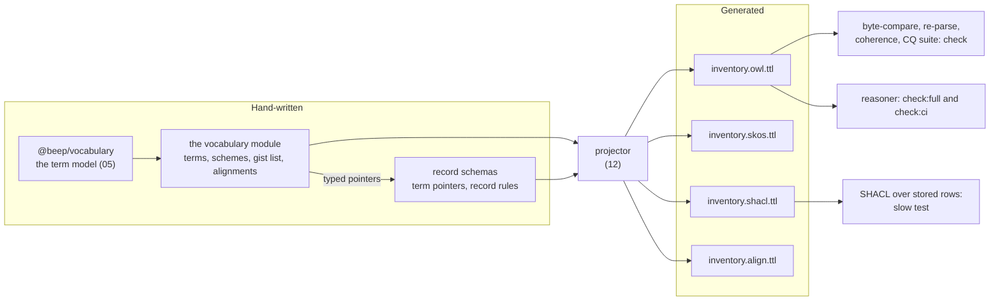

# Brief: the ERP vocabulary

Decisions 1 to 7 of [DECISIONS.md](DECISIONS.md) fixed the shape: the ontology is the model of record for this
repository's contexts, with Sutton a mapping (1); one TypeScript vocabulary module owns every term fact and all Turtle
is generated (2, 5); the upper ontology is a small gist projection (4); the checks are a byte-compare and re-parse, an
OWL reasoner from the start, and SHACL over the stored messy sample (6); the namespace is an `example.org` placeholder
(7). Reports 04 to 12 designed every part of that in parallel, and [report 13](research/13-term-index.md) reconciled
them into one index, which states its own counts of terms and properties. On 2026-11-22 Benjamin answered nineteen
more decisions (8 to 11, 13 to 16, 20, 21, 23, 25, 32, 34, 39, 40, 41, 43 and a new one, 93) and ruled how the open
ones are taken: each is put to him when the slice that needs it is being specified, with a concrete record in front of
him, and until then its recommendation is the agent's and nothing is built on it. The same day he answered seven more
(22, 26, 38, 46 and three new ones, 94 to 96), which settle the thin thread's terms, gates and engines. This brief
says what is built first, what follows, and what is never built. Sixty-three decisions are open (12, 17 to 19, 24, 27
to 31, 33, 35 to 37, 42, 44, 45 and 47 to 92). The first deliverable, the thin thread of decision 8, waits on none of
them.

## Problem

- **No record points at a term.** The contract packages hold about 150 exported schemas
  (`packages/catalog/contract/src`, `packages/access/contract/src`) and the kernel's records
  (`packages/kernel/src/Member.schema.ts`, `Role.schema.ts`, `Activity.schema.ts`, `AgentRun.schema.ts`); none says
  which thing in the business it stands for. Words drift: the code's `People/Person` is a membership, its `Activity`
  is an audit record, the item's `revision` is an edit counter and not an engineering revision (06, 07).
- **The rules that matter are not stated anywhere a check can read them.** "Identity never from a SKU or a name",
  "available, committed and reserved overlap", "an account is an organization, and its role flags sit on the tenant's
  record of it" live in reports and in reviewers' heads. Nothing fails when a record breaks them.
- **The Alchemy domain layer needs terms to point at.** Report 01 section 6: every aggregate, event and view carries
  the IRI of its term, and a check fails when one has none ([alchemy-domain BRIEF](../alchemy-domain/BRIEF.md),
  "Every single thing"). Nothing exists for them to point at.
- **The design is large and unbuilt.** Nine reports, 63 open decisions; nothing can be checked until something runs,
  and nothing in the design has yet been made to fail.

## Appetite

Decided (decision 8): **scope, not time**, and a thin thread before the party slice. The order is the thin thread,
then slice 1 (the party slice), then the later slices as the Map lists them. The party slice waited on about 34 of
Benjamin's answers; the thread proves every station with seven terms, two schemes and one lift.

### The thin thread

- **The terms.** Seven classes and two schemes. `Organization`; `Tenant`, a role class under `Organization`, keyed
  by `OrganizationId` (decision 38); `Person` (decision 94); `Member`; `Role`; `Grant` for the role lift (decision
  40); and `AuditEntry`, with "Activity" as an alternative label (decision 46; the page and the record keep their
  name). The schemes are `MemberRoleScheme` (viewer, editor, admin) and `GrantScopeKindScheme` with the one concept
  organization (decision 96). Each of the three roles is a concept of the scheme and, under the same IRI, an
  individual of `Role`, with one identity criterion, the concept's: its scheme and its notation (decision 41). `Role`
  ships without `permits`, so there is no `Permission`. The properties are the member's tenant (`membershipIn`, which
  ranges over `Tenant`), the one link from `Member` to its `Person` (`membershipOf` in report 06), the grant's member
  (`grantedTo`), the grant's role (`grantsRole`) and the grant's scope (`grantScope`). No path reaches a person's name
  or email (decision 93 stands).
- **The gist names.** Only the parents these terms need (decision 13), for `Person` `gist:Person` (decision 94) and
  for `Member` and `Grant` `gist:TemporalRelation` and `gist:Assignment`, each with its named gist ancestors as names
  and links (decision 14), and the `owl:disjointWith` pairs gist states between the classes taken (decision 15), the
  pair of person and organization among them. `Role` has no gist parent. No `gist:Permission`. Each name admitted is
  added to the profile's `gist-categories.md` then.
- **The stations.** The term model (05) in `@beep/vocabulary`; the terms in `@inventory/kernel` under `./Terms`, with
  the pointer helpers under `./TermsPointer`; the projector and the generated OWL and SKOS files in
  `@inventory/ontology` (decision 9). IRIs are decision 10's (`inv:MemberRoleScheme-admin`), labels and definitions
  are `skos:prefLabel` and `skos:definition` (decision 11), and every term in the module names the `rat-` record that
  holds Benjamin's answer (decision 32).
- **The pointers.** The typed helpers of decision 20 on the kernel's `Member`, `Role` and `Activity` records. `Role`
  is a Literals schema, so its pointer is `aboutScheme`, and its literals are checked against the scheme's notations
  (decision 23). The `Member` record's role field is the one lift: it becomes one `Grant` at organization scope
  (decisions 40 and 96). Every field of a pointed record carries a pointer or `noTerm` with a reason (decision 22).
  The `Member` record's fields that copy the person's name, the organization's name and the sign-in email are
  `noTerm`, reason `screen` (decisions 21 and 93). Gates 5 and 7 read the access contract and the four kernel
  records from the thread on (decision 95), so each schema there is placed too, with a pointer or with `noTerm`.
- **The gates.** Every gate that needs no stored row, gates 1 to 9 (decision 95): byte-compare (gate 1), re-parse
  (gate 2), forbidden constructs and the namespace guard (gate 3), the TypeScript coherence check (gate 4), record
  pointers on the AST (gate 5), the pointer type-check (gate 6), `laws ontology-terms` (gate 7), the question on its
  fixture (gate 8), and ROBOT with HermiT in `check:full` and `check:ci` (gate 9, decisions 6 and 25). Gates 5 and 7
  are enrolled on `packages/access/contract/src` and the four kernel records only (`Member.schema.ts`,
  `Role.schema.ts`, `Activity.schema.ts`, `AgentRun.schema.ts`). They do not scan `packages/catalog/contract/src`
  or other kernel schemas such as `Text.schema.ts`. The engines in Vitest are N3.js for the re-parse and Oxigraph for
  SPARQL (decision 26). SHACL over the stored sample (gate 11) and the alignment check (gate 12) wait for their
  slices, and gate 10 is decision 27's (pending Q27).
- **The question.** One, report 04's CQ-P06: who belongs to this organization and with which role. The fixture has
  two tenants and one `Person` with a `Member` in each, an admin in one and a viewer in the other (decision 94). Asked
  of each organization, the answer names that organization's member and role and never the other's. The role is read
  through the lifted `Grant`, not through a hand-written grant beside the record. The person's name and email are not
  asked.

The thread is done when that question passes on the two-organization fixture and every gate has been shown failing
once on a planted mistake: a hand edit to a generated file (gate 1), a generated file that no longer parses (gate 2),
a stray `owl:sameAs` (gate 3), a class placed under two parents gist states disjoint (gate 4, and gate 9 on the same
mistake without gate 4), `Role`'s pointer removed (gates 5 and 7), `aboutClass("inv:Organisation")` (gate 6), and
the fixture with the grant's role removed or the other organization's member admitted (gate 8).

The thread waits on no open decision. It waits on one approval that is not a decision: the Java pin and the jar
download for ROBOT, which Benjamin approves with the file, its source and its size named first (decision 25). The rest
of the thread can be built before the download; the thread is not done until the reasoner has run and has failed once.

Out of the thread: `SignInAccount`, `SourceRecord`, `Permission` and `permits`, every other party term, the name and
email paths, any grant scope but organization, gates 10 to 12, SHACL and shacl-engine, the alignment file, and
everything in the slices below.

### Slice 1, the party slice

Slice 1 follows the thread and extends what it built. Its open decisions (listed under the Map) are put to Benjamin
when it is specified. In it:

- The rest of the term model (05) as Effect Schemas with its `violations` rules, in `@beep/vocabulary` (decision 9).
- The vocabulary module grown to the party and access terms the party questions need, closed over each included
  property's domain and range and each included class's local gist ancestors, not report 06 as a whole. It includes
  the one provenance term they need: 04's `SourceRecord` with `recordOf` and its four properties, which hold a party's
  reidentification key, and the customer and vendor flags, which sit on the tenant's record and not on the shared
  organization (decision 34). It includes `ContactAssignment`, which links one `Person` to one account and carries the
  purpose and the contact point (decisions 39 and 43); a plain `isContactOf` link is not the model. A gist name is
  admitted only when a term of the slice needs it (decision 13), with its ancestors (decision 14) and the disjointness
  pairs gist states between the classes taken (decision 15), not 11's tables A and B wholesale. The schemes are the
  ranges of the properties this slice includes: `ContactPurposeScheme` (10, section 4.9), `GrantScopeKindScheme`
  (4.11, already in the thread with the one concept organization; a scope is added by the slice that needs it,
  decision 96), `MemberRoleScheme` (4.12, already in the thread), and `IdentityOutcomeScheme` and `ModelCallPurposeScheme`
  (those two from section 4.29; the rest of that section stays out). `AccountStatusScheme`, `ContactPointKindScheme`,
  `EvidenceKindScheme`, `MembershipStatusScheme` and `PortalModuleScheme` are not in this module. Neither are
  `accountStatus`, `contactPointKind`, `evidenceKind` and `resolves`. `permits` and `Permission` waited for this slice
  (decision 41); whether it takes them is settled when it is specified. No `citesIdentifier` while `PartyIdentifier`
  is withheld. Admitting a class does not admit every property designed for it.
- Term pointers at this slice's terms on the access records that wait for them (the kernel's `AgentRun`; the access
  contract's `Person`, `OrganizationChoice`, `ModelCallPurpose`), the paths for the `Member` record's copied fields
  (the name through the person, the email through the sign-in account, decision 93), and `noTerm` on the rest of the
  access contract, including `Membership` (a test-account row of organization name and role, with no member id,
  reason `screen`). Gates 5 and 7 keep the thread's enrolment in slice 1 (decision 95): `packages/access/contract/src`
  and the four kernel files (`Member.schema.ts`, `Role.schema.ts`, `Activity.schema.ts`, `AgentRun.schema.ts`). They
  do not scan `packages/catalog/contract/src`, and they do not scan other kernel schemas such as `Text.schema.ts`.
  The catalog contract's item folders join the scan in slice 2, and the rest of the catalog contract in slice 3. Law
  rule 2 stays on the Map's later row and is not part of slice 1's check.
- The thread's gates 1 to 9 on the larger module, and the party competency questions on `test_` fixtures in gate 8.
  Slice 1 builds no new gate.

Out of slice 1: the catalog terms, the import terms other than `SourceRecord`, the stock and commitment terms,
SHACL and its slow test, the alignment file. They follow in the order of the Map. Catalog lifts (`sku`, `vendors`,
`quantityOnHand`) stay out. The access lifts named under Rabbit holes are in this slice.

Slice 1 is done when the party questions run on artifacts it builds, ROBOT with HermiT (decision 25) finds the
OWL file consistent, and a record that points at a term that does not exist fails the type-check. CQ-P02, CQ-P03
and CQ-P07 have no query in section 4 yet (04 drafts CQ-P01, CQ-P04 and the CQ-P05 ASK only; CQ-P06's is written in
the thread). Slice 1 is not done until those three are written and run. A must-fail counts here only when gate 8 can
run it: a triple removed, a triple added, or another fixture.

CQ-P01: the query reads the flags on the tenant's `SourceRecord` of each organization (decision 34). It is green, and
red when `isCustomer` is removed from the tenant's record of `test_CoPacker`. A company that is only a customer here
and only a vendor in the second tenant is listed for neither. The disjoint-subclass must-fail (Customer and Vendor as
disjoint subclasses) is not a slice-1 exit. The gates load one generated OWL file.

CQ-P04 and the CQ-P05 ASK: green and red as section 4 writes them, once the fixture calls `test_AcmeA` and
`test_AcmeB` parties.

CQ-P02: the query lists only organizations whose record in this tenant states the flags false. The open-reading
fixture (no flag stated there, and it must not be listed, whatever another tenant states) is the slice-1 must-fail.
Report 04's closure (every flag stated true or false) and decision 35's `sh:minCount 1` (pending Q35) are SHACL and
wait for slice 2, when an organization record exists.

CQ-P03: stays, because `ContactPurposeScheme` is in this module. It reads each `ContactAssignment` (decisions 39 and
43). Its slice-1 must-fail is one person who is the billing contact at one account and the receiving contact at
another: each purpose appears at its own account and never at the other, and an assignment with no purpose appears
under no purpose. Two `Person` instances with one source id are not that case. Under decision 34 two persons stay two
until an `IdentityDecision`, and the source id is `SourceRecord`'s key, so that fixture cannot load.

CQ-P06: passed in the thread. Slice 1 runs it again with the person's name and email, on the same lifted member. "Fail the role
shape" is SHACL and moves to slice 2 with the member shape.

CQ-P07: a SPARQL constraint, one violation when the only admin is removed. It counts once the query is written.

CQ-P09's terms are only `inTenant`. The party half (a party record with no tenant, or with two) runs in slice 1. The
stock-position must-fail runs with the warehouse terms. CQ-P08 runs with the warehouse terms. CQ-P10 needs the
import's events, so it runs with slice 3.

## Sketch

Three things meet, and nothing else is hand-written:

1. **The term model** (05). A class term has one identity-bearing parent and may have category parents (pending Q12);
   a property has one direction, a domain and a range that may be none declared; a scheme's concepts carry the
   notations records store, and a concept may also be an individual of a class (a unit; a member role, decision 41).
   Twenty-six rules (`V1` to `V26`) are one pure function a fast test runs.
2. **The vocabulary module** (the closure in the Appetite, reconciled in 13). The thread's terms first:
   `Organization`, `Tenant` under `Organization` (decision 38), `Person` (decision 94), `Member`, `Grant`, `Role` and
   `AuditEntry` (decision 46). Then the party slice:
   `Party` (decision 12's recommended category, pending Q12, the range of `decidesOn`),
   `AgentRun`, `ModelCall`, `SignInAccount`, `SourceRecord` with `recordOf` and the role flags (decision 34;
   two flags while decision 89 is open), and the Sutton-only party terms a must or should question needs
   (`ContactAssignment`, `ContactPoint`, `IdentityDecision`, and `IdentityEvidence` without `evidenceKind`) though no
   record holds them yet. `eventTime` and `recordTime` are in this module, because CQ-P04 and `AuditEntry` need them,
   and they are the only keys for those two instants. `includesRole` is not in the slice: report 10 already keeps the
   rank in `hasRole`. `PostalAddress`, `PartyIdentifier`, `PortalAccess` and `SuspectedDuplicate` stay not proposed
   (report 13). A term with no record is an ordinary entry; one with several records (`Member`, pointed at by
   `Member.schema.ts` and `Person.read.ts`) gives one class. `Membership` is a screen-only `noTerm`, not a second
   pointer at `Member`.
3. **The record pointers** (05 section 4.8, decision 20). A record or field carries `aboutClass("inv:Member")` or
   `aboutProperty("inv:removedAt")`, typed by `Curie<V>` from the vendored
   `packages/foundation/modeling/identity/src/Vocab.ts`; a misspelt or wrong-kind term does not compile. A field that
   is not one property of its record's subject carries a lift path (`aboutPath`). A schema or field that stands for no
   term carries `noTerm` with a reason from the closed list: transport, request, screen, error, bookkeeping (decision
   21). Every field of a pointed record carries one or the other, and the SHACL shapes are closed (decision 22).

The projector (12) is pure: the module and the schemas' AST in, four files' bytes out, sorted by code point, no blank
node but lists, no clock. What each construct of the term model becomes is 12's section 3.1.

## Rabbit holes

- **The reasoner's route.** The reasoner is ROBOT with HermiT (decision 25). It needs a Java pin and a jar download;
  nothing is fetched before Benjamin is told the file, its source and its size and approves. Gate 4's TypeScript
  coherence check finds every unsatisfiable class of today's axioms without it. An inconsistency that needs an
  individual is only the reasoner's. The rest of the thread can be built before the download. The thread is not done
  until ROBOT has run, and gate 4 does not meet decision 6 (report 12).
- **Type inference in the module.** 05's F-bounded `defineClasses`, the per-kind CURIE registries (class, property,
  scheme, concept) derived from the module's keys, and gate 4's check of a record's literals against a scheme's
  notations were not tried under `tsrs` (TypeScript 7.1 beta). Try them in `scratchpad/experiments/` before the thread
  relies on them (`bun run scratch:new`); the fallback (one object per hierarchy level, and the rule held at run time)
  is written down.
- **Lift paths.** A flat field that becomes a node (`sku`, `vendors`, `quantityOnHand`) is the hard part of the
  projection. Those catalog lifts stay out of the thread and of slice 1. Neither projects every denormalized display
  field, and neither pulls catalog SHACL or a storage change into this goal. The thread has one lift, the role
  (decision 40): `Member.role` lifts to one `Grant` (`grantedTo` the member, `grantsRole` the `Role` concept,
  `grantScope` the organization concept of `GrantScopeKindScheme`, decision 96), not a property of `Member`. The
  witness is the member record. In the thread the record's copied
  name, organization name and email are `noTerm`, reason `screen` (decision 93). Slice 1 adds `Person.role` to the
  same lift and the two paths decision 93 names: the name through the person, and the
  email through the sign-in account (`Person.email` is not `accountEmail` of the member; that property's domain is
  `SignInAccount`, and the person is reached by `accountOf`). `Member.organizationName` is the tenant's name, not
  `inv:name` of the member. `Membership` is `noTerm` and is not lifted. Slice 1 specifies these paths and checks them
  on fixtures. Slice 2 still introduces SHACL over stored items.
- **Ratifying every term at once.** Ratify the thread's terms only, through the foundational auditor, each naming
  the `rat-` record that holds Benjamin's answer (decision 32), then each slice's terms as it is built. The answers of
  2026-11-22 are the first to need their `rat-` records. The rest stay proposals in their reports.
- **Modelling Sutton whole.** Sutton's schema is behind a token. A Sutton-only term enters when a competency question
  of rank must or should needs it, never to complete a picture. That exclusion is this brief's rule. Decision 87 only
  ranks the questions and does not state it.
- **Turtle formatting.** Write one small writer; do not tune a library serializer to be stable.

## No-gos

- Nothing is built on an open decision's recommendation (the ruling of 2026-11-22). A slice starts when its open
  decisions are answered.
- No term in the thread beyond `Organization`, `Tenant`, `Person`, `Member`, `Role`, `Grant`, `AuditEntry`,
  `MemberRoleScheme` and `GrantScopeKindScheme`, with their properties and gist parents: no `SignInAccount`,
  `SourceRecord`, `Permission` or `permits`, no path to a name or an email, no grant scope but organization, and no
  second question (decisions 8, 38, 41, 93, 94, 96).
- No gist name that no term of the slice being built needs (decision 13), and no disjointness beyond the pairs gist
  states between the classes taken (decision 15). No gist property's domain or range is copied (decision 16).
- No gate counts as built until it has failed once on a planted mistake.
- No hand-written `.ttl`, `.owl` or SHACL file states a term (decision 2); fixtures hold instance data only.
- No `owl:sameAs`, `owl:inverseOf`, `owl:equivalentClass`, `HasKey` or cardinality restriction.
- No IRI under Sutton's name, a customer's subdomain or any real domain (decision 7).
- No import of IOF, ISA-95, schema.org, FIBO or any other vocabulary; they are alignment rows (decision 4).
- No customer or vendor flag on the shared organization (decision 34), and no contact purpose on a person or a
  contact point alone (decisions 39 and 43).
- No change to a stored row, a table, a screen or a product rule in the thread or slice 1: pointers are annotations.
- No identity from a SKU, a name or an email.
- No FSMA, machine telemetry or planning terms (04, will-not).
- Nothing downloaded, published, committed or deployed without Benjamin asking. The Java pin and the ROBOT jar are
  his to approve (decision 25).

## Map

| Part | Goal | Cites |
| --- | --- | --- |
| The thin thread, one vertical cut through every station. As much of the term model as its terms use; `Organization`, `Tenant`, `Person`, `Member`, `Role`, `Grant`, `AuditEntry`, `MemberRoleScheme` and `GrantScopeKindScheme` (the one concept organization) in the vocabulary module, with their gist parents, those parents' named ancestors and the disjointness pairs gist states between them; typed pointers on the kernel's `Member`, `Role` and `Activity` records, every field of a pointed record carrying a pointer or `noTerm` with a reason, the role field lifted to a `Grant` with its scope, the copied name, organization name and email fields `noTerm` (reason `screen`); the projector's OWL and SKOS writers; gates 1 to 6 in `check`, gate 7 (`laws ontology-terms`, rule 1), gate 8 with the one question (CQ-P06) on the two-organization fixture, gate 9 in `check:full` and `check:ci`; gates 5 and 7 enrolled on the access contract and the four kernel records only; N3.js for the re-parse and Oxigraph for SPARQL. Each gate is shown failing once on a planted mistake | `erp-vocabulary`, the thin thread | NET-NEW: `@beep/vocabulary`, `@inventory/kernel` (`./Terms`, `./TermsPointer`), `@inventory/ontology`, each with its row in `laws boundaries` (decision 9); the gate 7 command beside `packages/tooling/tool/cli/src/commands/Laws/Boundaries.rules.ts`; `packages/kernel/src/Member.schema.ts`, `Role.schema.ts`, `Activity.schema.ts`, `AgentRun.schema.ts`; `packages/access/contract/src`; the fixture under `explorations/erp-ontology/assets/requirements/`; reports 05, 06, 10 (4.11, 4.12), 11 and 12. Decided: 8 to 11, 13 to 16, 20 to 23, 25, 26, 32, 38, 40, 41, 46, 93 to 96. Open: none. Owed: Benjamin's approval of the Java pin and the jar download (decision 25) |
| The rest of the term model: `ClassTerm`, `ObjectPropertyTerm`, `DatatypePropertyTerm`, `ConceptScheme`, `Concept`, `DisjointGroup`, `AlignmentRow`, `Vocabulary` and their small values, with `violations` (V1 to V26). The foundation package holds the checker. The inventory namespace guard, the source names and the seed names are the kernel module's policy, not literals of that package | `erp-vocabulary`, slice 1 | Begun in the thread (`@beep/vocabulary`, decision 9); patterns from `packages/foundation/modeling/identity/src/Vocab.ts` and `Curie.ts`, `LiteralKit` from `packages/foundation/modeling/schema`; report 05. Open: 12, 18 |
| The gist classes this slice's terms need beyond the thread's, each with its named ancestors, and the disjointness pairs gist states between the classes taken. Not tables A and B wholesale, and not all 24 pairs. The list is the inventory module's, not the foundation package's. Reports 10 and 11 stay references | `erp-vocabulary`, slice 1 | `.agents/skills/_shared/gist-categories.md`, which gains a name when a term needs it; gist 14.1.0 pinned by sha256 in the project profile; report 11 section (a). Decided: 13 to 16. Open: 17 |
| Party and access terms and their schemes in the vocabulary module, beyond the thread's: `SourceRecord` carrying the customer and vendor flags, `ContactAssignment` carrying the purpose and the contact point, `ContactPurposeScheme` (4.9), `IdentityOutcomeScheme`, `ModelCallPurposeScheme`, and any concept of `GrantScopeKindScheme` (4.11) beyond the thread's organization that a term of the slice needs. Not section 4.29 as a whole | `erp-vocabulary`, slice 1 | `@inventory/kernel`: `./Terms`, the vocabulary value, for the projector and tests; `./TermsPointer`, the pointer helpers, for record schemas; its registry import is type-only (decision 9). Report 05's app build-report check is part of slice 1's proof: do not infer the bundle from TypeScript imports. Reports 06 and 10 (4.9, 4.11, and the two schemes taken from 4.29); 04's `SourceRecord`. Decided: 34, 38, 39, 40, 41, 43, 46, 96. Open: 12 (for `Party` only), 18, 35 to 37, 44, 45, 47, 89 |
| Term pointers at this slice's terms on the kernel's `AgentRun` and the access contract's `Person`, `OrganizationChoice`, `ModelCallPurpose`; the paths for the `Member` record's name and email fields; `noTerm` on the rest of the access contract, including `Membership` (reason `screen`). The indirect access lifts are specified and checked on fixtures. Not every denormalized display field is projected. These files are the coverage gates 5 and 7 were enrolled on in the thread (decision 95) | `erp-vocabulary`, slice 1 | `packages/kernel/src/Member.schema.ts`, `Role.schema.ts`, `Activity.schema.ts`, `AgentRun.schema.ts` (these four only); `packages/access/contract/src/People/Person.read.ts`, `Session/SessionState.read.ts`, `Allowance/ModelAllowance.gateway.ts`; `./TermsPointer`. Decided: 20, 21, 22, 40, 93, 95 |
| The projector grown to the party terms. It may import the access contract and the kernel (`./Terms`). A contract may not import the ontology package, the ontology package may not import the app, and tooling may not import the kernel. Those boundary rows belong to the projector's package, not to the CLI | `erp-vocabulary`, slice 1 | Begun in the thread (`@inventory/ontology`, decision 9); report 12 sections 3, 3.1 and 5. Decided: 10, 11, 23. Open: 19, 24, 33 |
| Gates 3 and 5 in `bun run check` on the larger module, beside the thread's gates 1, 2, 4 and 6. Gate 5 reads the enrolled files only: the access contract and the four kernel files named above (report 12 section 6). It does not scan the catalog contract or other kernel schemas. Same coverage list as gate 7 | `erp-vocabulary`, slice 1 | Built in the thread: the tests in the ontology package. Decided: 26 (N3.js for the re-parse), 95 |
| Gate 7, `laws ontology-terms`. Rule 1 on those same enrolled files. Rule 2 stays off until the Alchemy row. The command only reads source text | `erp-vocabulary`, slice 1 | Built in the thread (decision 95): the command beside `packages/tooling/tool/cli/src/commands/Laws/Boundaries.rules.ts`. Decision 9's boundary rows are the ontology package's, not an import exception for this command |
| Gate 8, the party competency questions on `test_` fixtures. The queries for CQ-P02, CQ-P03 and CQ-P07 are NET-NEW (04 drafts CQ-P01, CQ-P04 and the CQ-P05 ASK only; CQ-P06's is the thread's) | `erp-vocabulary`, slice 1 | NET-NEW fixtures under `explorations/erp-ontology/assets/requirements/`, named as an input of the ontology package's `test` and `reason` tasks in its turbo.json (`$TURBO_ROOT$/explorations/erp-ontology/assets/requirements/**`, report 12 section 6.3), besides the package's own files, or a changed query or fixture replays a cached pass. A fixture-only edit must miss both caches, and a changed expected answer must re-run the comparison. Read by imports of the files' text, since `node:fs` is refused in tests. Report 04 CQ-P01 to CQ-P07, the party half of CQ-P09, and section 4. Decided: 26 (Oxigraph for SPARQL). Open: 27, 36, 87 |
| Gate 9, the reasoner on the larger module, in `bun run check:full` and `check:ci` | `erp-vocabulary`, slice 1 | Built in the thread: the package turbo task `reason`, and a Java setup in CI's main job. The task fails when Java or the jar is missing. ROBOT with HermiT (decision 25) and a download Benjamin approves |
| Gate 10, the reasoned competency-question suite. It runs in no slice unless decision 27 is answered (b). Under recommendation (a) each query walks subclasses itself in gate 8, so this gate has nothing to run | no slice while that recommendation holds | decision 27; report 12 |
| Catalog and value terms, the item records' pointers and lift paths, the item schemes from `categories` and `uoms`. Enrols the catalog contract's item folders in gates 5 and 7. Not in slice 1's coverage list. Under decision 76 (a) the `quantityOnHand` lift brings 08's `StockPosition`, `InventoryMeasure`, `hasMeasure`, `measureKind`, `positionBasis`, `asOf`, `reportedIn`, `forItem`, and the `onHand` and `reported` concepts, with their schemes, into this slice (report 13 marks these in the repository today). `reportedIn` declares no range, so the confirmation is written as an IRI before slice 3 types it. Under 76 (b) the field takes `noTerm` and gate 11 lists it as not validated. Decision 12 does not choose the item kinds' parent | `erp-vocabulary`, slice 2 | `packages/catalog/contract/src/Item/Item.read.ts`; reports 07 and 10 (4.3 to 4.7). Open: 50, 54, 55, 59 to 66, 74, 76, 88, 90, 92 |
| SHACL from the item record and gate 11 over the stored messy sample. The test stays in the app and imports the shapes and the lift from the ontology package. The ontology package does not import the app. Decisions 76 and 88 govern the on-hand lift and the currency of `unitCost` | `erp-vocabulary`, slice 2 | `apps/inventory/test/server/Imports.slow.test.ts` (155 items through Confirm); the generated shapes are an input of that test; report 12 section 4. Decided: 22 (the shapes are closed), 26 (shacl-engine for SHACL Core, added with this slice). Open: 48, 49, 51, 76, 88 |
| The import's terms and their pointers, with CQ-P10. Enrols the rest of the catalog contract. The aggregate paths are evidence for those terms. They are not a slice 1 model dependency, and they do not turn on the Alchemy block rule | `erp-vocabulary`, slice 3 | `packages/catalog/contract/src/Import/`, `Staging/`, `Suggestion/`; `packages/catalog/model/src/Import/Import.aggregate.ts`, `Row/Row.aggregate.ts`, `Group/Group.aggregate.ts`; reports 04 and 09. Open: 52, 53, 56 to 58, 91 |
| The alignment file and the SSSOM table generated from the same alignment rows (report 12 section 1.3), with gate 12. The rows include the four that decisions 39 and 43 bring back for `ContactAssignment` (Sutton "Contact", `org:Membership`, FIBO's Contact, schema.org's `ContactPoint`). The mapper's candidate file under `assets/mappings/` is its review input, not a second home | later, when decisions 28 to 31 are answered and a row is ratified, naming its `rat-` record (decision 32) | NET-NEW; report 11 section (b); report 12 section 1.3; gate 12 in `check`. Open: 28 to 31 |
| Pointers on Alchemy domain blocks (the law's rule 2). Not slice 1, and not turned on by slice 3's contract enrolment. Activation needs the designated model exports, a runtime check of the bindings (the annotations live on the class, not only in the source text), and those exports named as dependency and cache inputs | later, when the alchemy-domain build declares blocks with annotations on main | `packages/catalog/model/src/`; [alchemy-domain BRIEF](../alchemy-domain/BRIEF.md); report 12 section 7 |
| The rest of the warehouse and stock terms, with CQ-P08 and CQ-P09's stock-position must-fail, except the terms slice 2 takes for `quantityOnHand` under decision 76 (a) | later, when a stock, location or lot record is built | NET-NEW; report 08. Open: 42 (CQ-P08 reads it), 67 to 73, 75, 77 to 79; 74 and 76 if slice 2 has not answered them |
| Commitment, execution and accounting terms | later, when the first order or event record is built and its context named (decision 37) | NET-NEW; report 09. Open: 80 to 86 |
| A Sutton description from the same vocabulary | later, when Benjamin asks for one | report 11's Sutton rows; decision 1's reversal |

The first deliverable is the thin thread: seven terms and two schemes through the module, the pointers, the generated
OWL and SKOS and gates 1 to 9, proved by one question on the two-organization fixture and by each gate failing once.
It touches no table and no screen. Slice 1 follows it: the rest of the term model, the party and access terms with
their records' pointers and the access lifts, and the thread's gates on the larger module, proved by the party
questions on their fixtures. Slice 2 adds the first SHACL over real stored rows; slice 3 points the import at its
terms. Law rule 2 stays on its own later row.

What each part waits on, of the 63 open decisions. Each is put to Benjamin when its part is specified, with a concrete
record in front of him:

| Part | Open decisions it waits on | Count |
| --- | --- | --- |
| The thin thread | none | 0 |
| Slice 1, the party slice | 12, 17 to 19, 24, 27, 33, 35 to 37, 44, 45, 47, 87, 89 | 15 |
| Slice 2, the catalog terms and SHACL | 48 to 51, 54, 55, 59 to 66, 74, 76, 88, 90, 92 | 19 |
| Slice 3, the import's terms | 52, 53, 56 to 58, 91 | 6 |
| The alignment file | 28 to 31 | 4 |
| The warehouse and stock terms | 42, 67 to 73, 75, 77 to 79 | 12 |
| The commitment, execution and accounting terms | 80 to 86 | 7 |

Decisions 74 and 76 are counted once, with slice 2, which meets them first. Decision 37 is counted with slice 1 and
is read again when the commitment terms get a context.

Gate 10 (the reasoned CQ suite) is built only if decision 27 is answered (b).

## What would make this brief graduate

The packet scheme's four conditions ([explorations/README.md](../README.md)): the appetite answered (decision 8, on
2026-11-22); no open question blocking the first deliverable (the thin thread waits on none of the 63, by the ruling
of the same day); the Map as above; and Benjamin saying the brief matches, logged as a decision. Then
`goals/erp-vocabulary/SPEC.md` is seeded from this brief with the thread as its first deliverable. The thread's done
line is decision 8's question passing on the two-organization fixture and every gate shown failing once on a planted
mistake. Slice 1 and each later part is specified only after the decisions in its row above are put to Benjamin and
answered.
