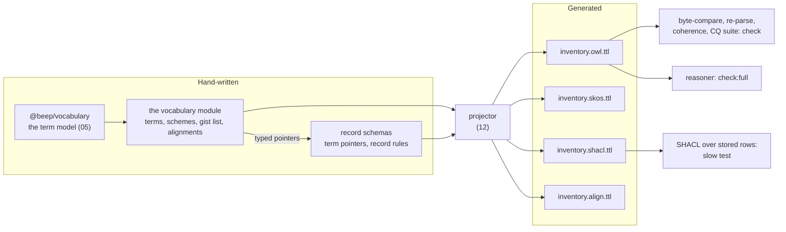

# Brief: the ERP vocabulary

Decisions 1 to 7 of [DECISIONS.md](DECISIONS.md) fixed the shape: the ontology is the model of record for this
repository's contexts, with Sutton a mapping (1); one TypeScript vocabulary module owns every term fact and all Turtle
is generated (2, 5); the upper ontology is a small gist projection (4); the checks are a byte-compare and re-parse, an
OWL reasoner from the start, and SHACL over the stored messy sample (6); the namespace is an `example.org` placeholder
(7). Reports 04 to 12 designed every part of that in parallel, and [report 13](research/13-term-index.md) reconciled
them into one index, now of 164 terms and 269 properties. This brief says what is built first, what follows, and what is
never built. Eighty-four questions are open (decisions 8 to 91); the first goal waits on 8 to 51 and 89.

## Problem

- **No record points at a term.** The contract packages hold about 150 exported schemas
  (`packages/catalog/contract/src`, `packages/access/contract/src`) and the kernel's records
  (`packages/kernel/src/Member.schema.ts`, `Role.schema.ts`, `Activity.schema.ts`, `AgentRun.schema.ts`); none says
  which thing in the business it stands for. Words drift: the code's `People/Person` is a membership, its `Activity`
  is an audit record, the item's `revision` is an edit counter and not an engineering revision (06, 07).
- **The rules that matter are not stated anywhere a check can read them.** "Identity never from a SKU or a name",
  "available, committed and reserved overlap", "an account is an organization with role flags" live in reports and
  in reviewers' heads. Nothing fails when a record breaks them.
- **The Alchemy domain layer needs terms to point at.** Report 01 section 6: every aggregate, event and view carries
  the IRI of its term, and a check fails when one has none ([alchemy-domain BRIEF](../alchemy-domain/BRIEF.md),
  "Every single thing"). Nothing exists for them to point at.
- **The design is large and unbuilt.** Nine reports, 80 open questions; nothing can be checked until something runs.

## Appetite

Proposed, and decision 8 for Benjamin: **scope, not time.** In the first goal:

- The term model (05) as Effect Schemas with its `violations` rules, in the package decision 9 names.
- One vocabulary module holding the party and access terms (06), the one provenance term they need (04's
  `SourceRecord` with `recordOf` and its four properties, which hold a party's reidentification key under decision
  34), the gist classes they need (11, tables A and B under decision 13), and the concept schemes those terms use (10,
  section 4.29, and `MemberRoleScheme`, `GrantScopeKindScheme`).
- Term pointers on the access records that exist today (the kernel's `Member`, `Role`, `Activity`, `AgentRun`; the
  access contract's `Person`, `Membership`, `OrganizationChoice`, `ModelCallPurpose`), and `noTerm` on the rest of the
  access contract.
- The projector writing the OWL and SKOS files, and the gates that need no stored row: byte-compare, re-parse,
  forbidden constructs, coherence, pointers, the type-check, `laws ontology-terms`, the competency questions on
  `test_` fixtures, and the reasoner in `check:full` (decision 6 asks for it from the start).

Out of the first goal: the catalog terms, the import terms other than `SourceRecord`, the stock and commitment terms,
SHACL and its slow test, the alignment file. They follow in the order of the Map. The goal is done when the party
questions of 04 that the first module's terms can answer (CQ-P01 to CQ-P07) run green on their fixtures and fail on
their must-fail cases (CQ-P08 and P09 need locations and stock positions, so they run with the warehouse terms; CQ-P10
needs the import's events, so it runs with slice 3), the reasoner finds the OWL file consistent, and a record that
points at a term that does not exist fails the type-check.

## Sketch

Three things meet, and nothing else is hand-written:

1. **The term model** (05). A class term has one identity-bearing parent and may have category parents (decision 12);
   a property has one direction, a domain and a range that may be none declared; a scheme's concepts carry the
   notations records store, and a concept may also be an individual of a class (a unit, a member role). Twenty-five
   rules (`V1` to `V25`) are one pure function a fast test runs.
2. **The vocabulary module** (06 to 11, reconciled in 13). Party and access first: `Organization` with its role flags
   (decision 3; two while decision 89 is open), `Tenant` under it, `Person`, `Member`, `Grant`, `Role`, `AuditEntry`,
   `AgentRun`, `ModelCall`, and the Sutton-only party terms a must or should question needs (`ContactPoint`,
   `IdentityDecision` and its evidence) though no record holds them yet; `PostalAddress` and `PartyIdentifier`, which
   none needs, stay proposals (report 13, "Not proposed"). A term with no record is an ordinary entry; one with several
   records (`Member`, pointed at by `Member.schema.ts`, `Person.read.ts` and `Membership`) gives one class.
3. **The record pointers** (05 section 4.8). A record or field carries `aboutClass("inv:Member")` or
   `aboutProperty("inv:removedAt")`, typed by `Curie<V>` from the vendored
   `packages/foundation/modeling/identity/src/Vocab.ts`; a misspelt term does not compile. A field that is not one
   property of its record's subject carries a lift path.

The projector (12) is pure: the module and the schemas' AST in, four files' bytes out, sorted by code point, no blank
node but lists, no clock. What each construct of the term model becomes is 12's section 3.1.

## Rabbit holes

- **The reasoner's route.** ROBOT needs Java and a jar download (decision 25); nothing is fetched before Benjamin is
  told the file, its source and its size. Gate 4's TypeScript coherence check finds every unsatisfiable class of
  today's axioms without it, so the slice does not stall on the download.
- **Type inference in the module.** 05's F-bounded `defineClasses` and gate 4's check of a record's literals against
  a scheme's notations were not tried under `tsrs` (TypeScript 7.1 beta). Try them in `scratchpad/experiments/` first
  (`bun run scratch:new`); the fallback (one object per hierarchy level, and the rule held at run time) is written down.
- **Lift paths.** A flat field that becomes a node (`sku`, `vendors`, `quantityOnHand`) is the hard part of the
  projection. None is in the first goal: the access records' fields are plain properties.
- **Ratifying 164 terms.** Ratify the first module's terms only, through the foundational auditor, and leave the rest
  as proposals in their reports.
- **Modelling Sutton whole.** Sutton's schema is behind a token; a Sutton-only term enters when a competency question
  of rank must or should needs it (decision 87), never to complete a picture.
- **Turtle formatting.** Write one small writer; do not tune a library serializer to be stable.

## No-gos

- No hand-written `.ttl`, `.owl` or SHACL file states a term (decision 2); fixtures hold instance data only.
- No `owl:sameAs`, `owl:inverseOf`, `owl:equivalentClass`, `HasKey` or cardinality restriction.
- No IRI under Sutton's name, a customer's subdomain or any real domain (decision 7).
- No import of IOF, ISA-95, schema.org, FIBO or any other vocabulary; they are alignment rows (decision 4).
- No change to a stored row, a table, a screen or a product rule in the first goal: pointers are annotations.
- No identity from a SKU, a name or an email.
- No FSMA, machine telemetry or planning terms (04, will-not).
- Nothing downloaded, published, committed or deployed without Benjamin asking.

## Map

| Part | Goal | Cites |
| --- | --- | --- |
| The term model: `ClassTerm`, `ObjectPropertyTerm`, `DatatypePropertyTerm`, `ConceptScheme`, `Concept`, `DisjointGroup`, `AlignmentRow`, `Vocabulary` and their small values, with `violations` (V1 to V25) | `erp-vocabulary`, slice 1 | NET-NEW (`@beep/vocabulary`, decision 9); patterns from `packages/foundation/modeling/identity/src/Vocab.ts` and `Curie.ts`, `LiteralKit` from `packages/foundation/modeling/schema`; report 05 |
| The gist projection list and its 24 disjointness pairs | `erp-vocabulary`, slice 1 | NET-NEW; `.agents/skills/_shared/gist-categories.md`, gist 14.1.0 pinned by sha256 in the project profile; report 11 section (a); decisions 13 to 16 |
| Party and access terms and their schemes in the vocabulary module | `erp-vocabulary`, slice 1 | NET-NEW (`@inventory/kernel`, `./Terms`, decision 9); reports 06 and 10 (4.29), and 04's `SourceRecord`; decisions 12, 18, 34 to 47, 89 |
| Term pointers on the access records, `noTerm` on the rest | `erp-vocabulary`, slice 1 | `packages/kernel/src/Member.schema.ts`, `Role.schema.ts`, `Activity.schema.ts`, `AgentRun.schema.ts`; `packages/access/contract/src/People/Person.read.ts`, `Session/SessionState.read.ts`, `Allowance/ModelAllowance.gateway.ts`; decisions 20 to 22 |
| The projector's OWL and SKOS writers | `erp-vocabulary`, slice 1 | NET-NEW (`@inventory/ontology`, decision 9); report 12 sections 3, 3.1 and 5; decisions 10, 11, 19, 23, 24, 33 |
| Gates 1 to 6 in `bun run check` | `erp-vocabulary`, slice 1 | NET-NEW tests in the ontology package; N3.js for the re-parse (decision 26) |
| Gate 7, `laws ontology-terms` | `erp-vocabulary`, slice 1 | NET-NEW command beside `packages/tooling/tool/cli/src/commands/Laws/Boundaries.rules.ts`, with the new boundary rows of decision 9 |
| Gate 8, the party competency questions on `test_` fixtures | `erp-vocabulary`, slice 1 | NET-NEW fixtures under `explorations/erp-ontology/assets/requirements/`; report 04 CQ-P01 to CQ-P07 and section 4; Oxigraph (decision 26); decisions 27, 36 |
| Gate 9, the reasoner in `bun run check:full` | `erp-vocabulary`, slice 1 | NET-NEW turbo task; decision 25 and a download Benjamin approves |
| Catalog and value terms, the item records' pointers and lift paths, the item schemes from `categories` and `uoms` | `erp-vocabulary`, slice 2 | `packages/catalog/contract/src/Item/Item.read.ts`; reports 07 and 10 (4.3 to 4.7); decisions 50, 54, 55, 59 to 66 |
| SHACL from the item record and gate 11 over the stored messy sample | `erp-vocabulary`, slice 2 | `apps/inventory/test/server/Imports.slow.test.ts` (155 items through Confirm); report 12 section 4; decisions 48, 49, 51 |
| The import's terms and their pointers, with CQ-P10 | `erp-vocabulary`, slice 3 | `packages/catalog/contract/src/Import/`, `Staging/`, `Suggestion/`; `packages/catalog/model/src/Import/Import.aggregate.ts`, `Row/Row.aggregate.ts`, `Group/Group.aggregate.ts`; reports 04 and 09; decisions 52, 53, 56 to 58 |
| The alignment file and a candidate SSSOM under `assets/mappings/` | later, when decisions 28 to 32 are answered and a row is ratified | NET-NEW; report 11 section (b) |
| Pointers on Alchemy domain blocks (the law's rule 2) | later, when the alchemy-domain build declares blocks with annotations on main | `packages/catalog/model/src/`; [alchemy-domain BRIEF](../alchemy-domain/BRIEF.md); report 12 section 7 |
| Warehouse and stock terms, with CQ-P08 and CQ-P09 | later, when a stock, location or lot record is built | NET-NEW; report 08; decisions 67 to 79 |
| Commitment, execution and accounting terms | later, when the first order or event record is built and its context named (decision 37) | NET-NEW; report 09; decisions 80 to 86 |
| A Sutton description from the same vocabulary | later, when Benjamin asks for one | report 11's Sutton rows; decision 1's reversal |

The first vertical slice is slice 1: the term model, the party and access terms with their records' pointers, and
every gate that needs no stored row, proved by the party questions on their fixtures. It touches no table and no
screen. Slice 2 adds the first SHACL over real stored rows; slice 3 points the import at its terms.

## What would make this brief graduate

The packet scheme's four conditions ([explorations/README.md](../README.md)): the appetite answered (decision 8); no
open question blocking slice 1 (decisions 9 to 51 answered or deferred with a reason); the Map as above; and Benjamin
saying the brief matches, logged as a decision. Then `goals/erp-vocabulary/SPEC.md` is seeded from this brief.
