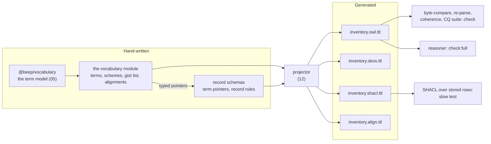

# Brief: the ERP vocabulary

Since this brief was signed (decision 119) the thin thread has been built, on 2026-11-23, as the goal
[erp-vocabulary](../../goals/erp-vocabulary/SPEC.md). The text below is the brief as signed. Some of its sentences
are no longer so: gate 9 is built (`packages/ontology/scripts/reason.ts`, two consistent runs and three
inconsistent), not "still unbuilt"; the forbidden conclusions are drafted and signed, five of them, in the goal's
SPEC (decision 121); gate 8 runs two questions, CQ-P06 and CQ-P11 (decision 120), not one; and the thread's done
line is the SPEC's acceptance list. More, from the Problem and the rabbit holes. The Problem's "no record points at a term" no longer holds for the five enrolled records: `Member`,
`Role`, `Activity` and `Person` carry marks (`Person` points at `inv:Member`), and `AuditTrail` is checked through
its element; every record the thread did not enrol still points at nothing. The Problem's "Nothing exists for them to point
at" and "nothing in the design has yet been made to fail" are no longer so either: a module exists, holding the
thread's terms and no others, and each of the nine gates has refused a planted mistake. Of the three things the brief says to
try in the scratchpad, the CURIE registries were tried in the kernel itself (the goal's PLAN, step 2) and gate 5's
notation check (rule P8) in `@inventory/ontology` (step 5); the F-bounded `defineClasses` was not tried and the
thread does not use it. The Map's later slices were untouched then.

Slice 1 has since been built, on 2026-11-26, as the goal [party-slice](../../goals/party-slice/SPEC.md) (decision
147), its terms the text of report 18 as decision 176 accepted it. Where the text below speaks of slice 1, and in the
Map's goal, Decided and Open cells, it is corrected to the decisions answered since it was signed, each named where
its sentence changed: 12, 17 to 19, 27 to 31, 33, 35 to 37, 44, 45, 87, 89, 124, 126 and P2, and the goal's 130, 133,
134, 137 to 139, 141, 143, 145, 146 and 148. The later slices are untouched: their rows still name their goal
"`erp-vocabulary`, slice 2" and "slice 3", names that predate decision 147 (one goal per slice, `erp-vocabulary`
closed), and each takes a goal of its own when it is specified.

Decisions 1 to 7 of [DECISIONS.md](DECISIONS.md) fixed the shape: the ontology is the model of record for this
repository's contexts, with Sutton a mapping (1); one TypeScript vocabulary module owns every term fact and all Turtle
is generated (2, 5); the upper ontology is a small gist projection (4); the checks are a byte-compare and re-parse, an
OWL reasoner from the start, and SHACL over the stored messy sample (6); the namespace is an `example.org` placeholder
(7). Reports 04 to 12 designed every part of that in parallel, and [report 13](research/13-term-index.md) reconciled
them into one index, which states its own counts of terms and properties. On 2026-11-22 Benjamin answered nineteen
more decisions (8 to 11, 13 to 16, 20, 21, 23, 25, 32, 34, 39, 40, 41, 43 and a new one, 93) and ruled how the open
ones are taken: each is put to him when the slice that needs it is being specified, with a concrete record in front of
him, and until then its recommendation is the agent's and nothing is built on it. The same day he answered seven more
(22, 26, 38, 46 and three new ones, 94 to 96), which settle the thin thread's terms, gates and engines, and after a
second review six more (24 and five new ones, 97 to 101). [Report 14](research/14-thin-thread.md) is the one
specification of the thin thread, written against the repository's code: where this brief and report 14 differ about
the thread, report 14 holds. Decisions 112 to 118 update the thread where this brief and report 14 still differ. This brief says what is built
first, what follows, and what is never built. Forty-seven decisions are open (42, 47 to 86, 88, 90 to 92, 116 and 127);
slice 1's and the alignment file's were answered on 2026-11-26. The first deliverable, the thin
thread of decision 8, waits on none of them.

## Problem

- **No record points at a term.** The contract packages hold about 150 exported schemas
  (`packages/catalog/contract/src`, `packages/access/contract/src`) and the kernel's records
  (`packages/kernel/src/Member.schema.ts`, `Role.schema.ts`, `Activity.schema.ts`, `AgentRun.schema.ts`); none says
  which thing in the business it stands for. Words drift: the code's `People/Person` is a membership, its `Activity`
  is an audit record, the item's `revision` is an edit counter and not an engineering revision (06, 07).
- **The rules that matter are not stated anywhere a check can read them.** "Identity never from a SKU or a name",
  "available, committed and reserved overlap", "an account is an organization, and its role flags sit on the tenant's
  record of it" live in reports and in reviewers' heads. Nothing fails when a record breaks them.
- **The Alchemy domain layer needs terms to point at.** Report 01 section 6: every aggregate, event and view carries
  the IRI of its term, and a check fails when one has none ([alchemy-domain BRIEF](../alchemy-domain/BRIEF.md),
  "Every single thing"). Nothing exists for them to point at.
- **The design is large and unbuilt.** Eleven reports (04 to 14), 47 open decisions; nothing can be checked until
  something runs, and nothing in the design has yet been made to fail.

## Appetite

Decided (decision 8): **scope, not time**, and a thin thread before the party slice. The order is the thin thread,
then slice 1 (the party slice), then the later slices as the Map lists them. The party slice waited on about 34 of
Benjamin's answers; the thread proves every station with seven classes, nine properties, two schemes and one lift.

### The thin thread

[Report 14](research/14-thin-thread.md) is the thread's one specification, and the section numbers in this part are
its. This brief keeps only what the order of the work needs.

- **The terms** (section 2). Seven classes, nine properties, two schemes and four concepts. The classes are
  `Organization`; `Tenant`, a role class under `Organization`, keyed by `OrganizationId` (decision 38); `Person`
  (decision 94); `Member`; `Role`; `Grant` for the role lift (decision 40); and `AuditEntry`, with "Activity" as an
  alternative label (decision 46; the page and the record keep their name). The schemes are `MemberRoleScheme`
  (viewer, editor, admin) and `GrantScopeKindScheme` with the one concept organization (decision 96). Each of the
  three roles is a concept of the scheme and, under the same IRI, an individual of `Role` (decision 41). `Role` ships
  without `permits`, so there is no `Permission`. The properties are `membershipIn`, `membershipOf`, `grantedTo`,
  `grantsRole` and `grantScope`, and the audit entry's four: `recordedActor`, `action`, `recordedAt` and `inTenant`
  (decision 98). No path reaches a person's name or email (decision 93 stands).
- **The gist names** (section 2.5). Seven gist classes: the five parents these terms need (decision 13) and two named
  ancestors, as names and links (decision 14), with the three `owl:disjointWith` pairs gist states between them
  (decision 15). None is a pair of `gist:Person` and `gist:Organization`: a person is kept off an organization
  through the ancestor `gist:PhysicalIdentifiableItem`. `Role` has no gist parent, by a stated exception on a
  committed list that gate 4 compares against (decision 97). No `gist:Permission`. Each name admitted is added to the
  profile's `gist-categories.md` then.
- **The stations** (section 7). The term model in `@beep/vocabulary`; the terms in `@inventory/kernel` under
  `./Terms`, with the pointer helpers under `./TermsPointer`; the projector and the generated files in
  `@inventory/ontology` (decision 9). IRIs are decision 10's (`inv:MemberRoleScheme-admin`), labels and definitions
  are `skos:prefLabel` and `skos:definition` (decision 11). The thread's seven classes, nine properties, two schemes
  and four concepts name decision 111 in the module, rather than `rat-` records (decisions 107 and 111). The version is a semantic
  version string written in the module, never taken from the clock, and `0.1.0` for the thread (decision 24, section
  8).
- **The pointers** (section 3). The typed helpers of decision 20 write three annotation keys: `term`, `path` and
  `noTerm`. Five records are enrolled, by name (decision 99, section 3.7): the kernel's `Member`, `Role` and
  `Activity`, and the access contract's `Person` and `AuditTrail`, which are views of them. `Role` is a Literals
  schema, so its pointer is `aboutScheme`, and its literals are checked against the scheme's notations (decision 23).
  The `Member` record's role field is the one lift: it becomes one `Grant` at organization scope (decisions 40 and
  96, section 4). Every field of an enrolled record carries a pointer, a path or `noTerm` with a reason (decision 22).
  The kernel's `Member` has five fields and no email; the two that copy the person's name and the organization's name
  are `noTerm`, reason `screen` (decisions 21 and 93). `Activity`'s fields are placed by decision 98, its agent field
  `noTerm` with a sixth reason, deferred, which names the party slice. The People page's `Person` record points at
  `Member`, and its `email` and `joinedAt` are `noTerm`, reason deferred, naming the party slice (decision 100). An
  export that is not enrolled carries no mark.
- **The gates** (section 6). Every gate that needs no stored row, gates 1 to 9 (decision 95): byte-compare (gate 1),
  re-parse (gate 2), forbidden constructs and the namespace guard (gate 3), vocabulary coherence (gate 4), record
  pointers on the AST (gate 5), the type-check (gate 6), `laws ontology-terms` (gate 7), the question suite (gate 8),
  and ROBOT with HermiT (gate 9, decisions 6 and 25). Gates 1 to 8 run in `check` and gate 9 in `check:full`. CI
  runs gate 9 in its own job with Java 17 and the jar restored from a cache keyed by its sha256. It fetches the jar
  only on a cache miss and checks the hash (decision 114). Gates 5 and 7 read the enrolment
  list and nothing else (decision 99, which replaces decision 95's "the access contract and the four kernel
  records"). The engines in Vitest are N3.js for the re-parse and Oxigraph for SPARQL (decision 26). SHACL over the
  stored sample (gate 11) and the alignment check (gate 12) wait for their slices, and gate 10 is decision 27's
  (pending Q27).
- **The question** (section 5). One, report 04's CQ-P06: who belongs to this organization and with which role. The
  fixture has two tenants and one `Person` with a `Member` in each, an admin in one and a viewer in the other
  (decision 94). The role is read through the `Grant`, and the grant triples come from the lift of two decoded
  `Member` values and from nowhere else (section 4.4). The person's name and email are not asked.

The thread is done when section 1.1's six conditions hold: the three generated files are written and a second run
changes no byte, the terms are in the module, the five enrolled records carry their marks, CQ-P06 returns its two
expected rows, gates 1 to 9 pass, and each gate has one committed test that plants a mistake and asserts that the gate
reports it. The nine planted mistakes are section 6's: a label changed in the committed text (gate 1), a Turtle
fixture with an unescaped quote (gate 2), a stray `owl:sameAs` in a Turtle fixture (gate 3), a parentless class that
is not on the exception list (gate 4), a record with one unplaced field (gate 5), `aboutProperty("inv:Member")` (gate
6), a `term` annotation written by hand (gate 7), the grants' role triples removed (gate 8), and the fixture's person
typed as a tenant (gate 9). A class under two parents gist states disjoint is no gate's mistake: a class has one
parent field, so it cannot be written (section 6.4).

The thread waits on no open decision. Nothing is owed from Benjamin for it now. ROBOT v1.9.11 is approved and was
tried outside the repository on 2026-11-23 (decision 112). The jar is 82,708,624 bytes, sha256
`53cd275c8e4c0dad1fc2c1c34174876795cd7d6b6926e1444adcbb0cb3c7ab26`, from
`https://github.com/ontodev/robot/releases/download/v1.9.11/robot.jar`. Under Java 17.0.2 the DL profile check
passed a small test ontology, HermiT found it consistent with exit 0, and the inconsistent variant exited 1. The pin
names Java 17 by major version (decision 113). Java 27 was never tried and is not the pin. This trial does not run
the thread's gate 9, which is still unbuilt.

Decision 117 adds three to five forbidden conclusions over the thread's terms to the goal's SPEC. The list is not
yet drafted. Each ban has a fixture that must be refused and a near miss that must pass, routed to the reasoner or
a must-fail query. The agent drafts the list and Benjamin rules on each ban. Decision 118 uses the expected rows
as the answer lock, with no new file or update flag. A commit that changes an expected-rows file says so, and the
release notes name the question with its old and new answer.

Out of the thread (section 1.3): `Party`, `SignInAccount`, `SourceRecord`, `AgentRun`, `Permission` and `permits`,
every other party term, the name and email paths, any grant scope but organization, the lift of `Activity`, any stored
row, gates 10 to 12, SHACL and shacl-engine, the alignment file, and everything in the slices below. Decision 115 keeps the audit notes outside the thread. Organization scope is
enough while it is the only kind; how a grant names a location or field stays open as decision 116.

### Slice 1, the party slice

Slice 1 follows the thread and extends what it built. Its open decisions (listed under the Map) are put to Benjamin
when it is specified. In it:

- The parts of the term model (05) its terms and the answered decisions need, as Effect Schemas with their
  `violations` rules, in `@beep/vocabulary` (decision 9); the rest comes back with the slice that needs it
  (decision 146). Report 05's rule V25, which let only a category class be parentless, gives way to decision 97's exception list
  (report 14 section 6.4, rule C4).
- The vocabulary module grown to the party and access terms the party questions need, closed over each included
  property's domain and range and each included class's local gist ancestors, not report 06 as a whole, and, since
  decisions 124 and 130, a term for each field of Sutton's slice-1 record types that points at no later slice and is
  no setting. It includes
  the one provenance term they need: 04's `SourceRecord` with `recordOf` and its four properties, which hold a party's
  reidentification key, and the customer and vendor flags, which sit on the tenant's record and not on the shared
  organization (decision 34). It includes `ContactAssignment`, which links one `Person` to one account and carries the
  purpose and the contact point (decisions 39 and 43), for a source that records a contact's purpose; a Sutton
  record's purpose is on its address (decisions 126 and 138). A plain `isContactOf` link is not the model. A gist name is
  admitted only when a term of the slice needs it (decision 13), with its ancestors (decision 14) and the disjointness
  pairs gist states between the classes taken (decision 15), not 11's tables A and B wholesale. The schemes are the
  ranges of the properties this slice includes: `ContactPurposeScheme` (10, section 4.9), `GrantScopeKindScheme`
  (4.11, already in the thread with the one concept organization; a scope is added by the slice that needs it,
  decision 96), `MemberRoleScheme` (4.12, already in the thread), and `IdentityOutcomeScheme` and `ModelCallPurposeScheme`
  (those two from section 4.29; the rest of that section stays out). `EvidenceKindScheme` and `PortalModuleScheme`
  are not in this module, and neither are `evidenceKind` and `resolves`. `MembershipStatusScheme` with
  `membershipStatus` is (decisions P2 and 137), and so are `AccountStatusScheme` with `accountStatus`,
  `ContactPointKindScheme` with `contactPointKind` (decision 130) and `ContactTypeScheme` (decision 139). `permits`
  and `Permission` waited for this slice (decision 41); it does not take them, and they come with slice 4 (decision
  141). No `citesIdentifier` while `PartyIdentifier`
  is withheld. Admitting a class does not admit every property designed for it.
- Term pointers at this slice's terms on the access records that wait for them. Slice 1 adds them to the enrolment
  list (decision 99): the kernel's `AgentRun` and the access contract's `OrganizationChoice` and `ModelCallPurpose`.
  The People page's `Person` is enrolled since the thread; slice 1 gives terms to the fields the thread marked
  deferred, its `email` and `joinedAt` (decision 100) and `Activity`'s agent field (decision 98). It adds the paths
  for the `Member` record's two copied names: the person's name through the person and the organization's name
  through the tenant (decision 93). The kernel's `Member` has no email field (report 14 section 3.3); the email is
  the People page record's. A record the slice enrols that stands for no term is `noTerm`, such as `Membership` (a
  test-account row of organization name and role, with no member id, reason `screen`); an export it does not enrol
  carries no mark (report 14 section 3.6). Gates 5 and 7 read the list and nothing else: they do not scan
  `packages/catalog/contract/src`, and they do not scan other kernel schemas such as `Text.schema.ts`. The catalog
  contract's item records join the list in slice 2, and the import's records in slice 3. Law rule 2 stays on the
  Map's later row and is not part of slice 1's check.
- The thread's gates 1 to 9 on the larger module, and the party competency questions on `test_` fixtures in gate 8.
  Slice 1 builds no new gate.

Out of slice 1: the catalog terms, the import terms other than `SourceRecord`, the stock and commitment terms,
SHACL and its slow test, the alignment file. They follow in the order of the Map. Catalog lifts (`sku`, `vendors`,
`quantityOnHand`) stay out. The access lifts named under Rabbit holes are in this slice.

Slice 1 is done when the party questions run on artifacts it builds, ROBOT with HermiT (decision 25) finds the
OWL file consistent, and a record that points at a term that does not exist fails the type-check. CQ-P02, CQ-P03
and CQ-P07 have no query in section 4 yet (04 drafts CQ-P01, CQ-P04 and the CQ-P05 ASK only; CQ-P06's is written in
the thread). Slice 1 is not done until those three are written and run. A must-fail counts here only when gate 8 can
run it: a triple removed, a triple added, or another fixture.

CQ-P01: the query reads the flags on the tenant's `SourceRecord` of each organization (decision 34). It is green, and
red when `isCustomer` is removed from the tenant's record of `test_CoPacker`. A company that is only a customer here
and only a vendor in the second tenant is listed for neither. The disjoint-subclass must-fail (Customer and Vendor as
disjoint subclasses) is not a slice-1 exit. The gates load one generated OWL file.

CQ-P04 and the CQ-P05 ASK: green and red as section 4 writes them, `test_AcmeA` and `test_AcmeB` being the source
records `decidesOn` ranges over, as section 4's fixture has them, not parties (decision 145).

CQ-P02: the query lists only organizations whose record in this tenant states the flags false. The open-reading
fixture (no flag stated there, and it must not be listed, whatever another tenant states) is the slice-1 must-fail.
Report 04's closure (every flag stated true or false, as decision 35 chose) and decision 35's `sh:minCount 1` are SHACL and
wait for slice 2, when an organization record exists.

CQ-P03: stays, because `ContactPurposeScheme` is in this module. It reads each `ContactAssignment` (decisions 39 and
43). Its slice-1 must-fail is one person who is the billing contact at one account and the receiving contact at
another: each purpose appears at its own account and never at the other, and an assignment with no purpose appears
under no purpose. Two `Person` instances with one source id are not that case. Under decision 34 two persons stay two
until an `IdentityDecision`, and the source id is `SourceRecord`'s key, so that fixture cannot load.

CQ-P06: passed in the thread (report 14 section 5). Slice 1 runs it again with the person's name, on the same lifted
member, and with the sign-in email, which is a field of the People page's `Person` record and not of `Member` (report
14 sections 3.3 and 3.6). "Fail the role shape" is SHACL and moves to slice 2 with the member shape.

CQ-P07: a SPARQL constraint, one violation when the only admin is removed. It counts once the query is written.

CQ-P09's terms are only `inTenant`. The party half (a party record with no tenant, or with two) runs in slice 1. The
stock-position must-fail runs with the warehouse terms. CQ-P08 runs with the warehouse terms. CQ-P10 needs the
import's events, so it runs with slice 3.

## Sketch

Three things meet in the projection:

1. **The term model** (05). A class term has one identity-bearing parent and may have category parents (decision 12);
   it has no gist parent only with a stated reason on the committed exception list (decision 97). A property has one
   direction, a domain and a range that may be none declared; a scheme's concepts carry the notations records store,
   and a concept may also be an individual of a class (a unit; a member role, decision 41). Report 05's twenty-six
   rules (`V1` to `V26`) are one pure function a fast test runs; the thread's gate 4 runs the thirteen of report 14
   section 6.4, whose rule C4 replaces V25.
2. **The vocabulary module** (the closure in the Appetite, reconciled in 13). The thread's terms first, as report 14
   section 2 lists them: `Organization`, `Tenant` under `Organization` (decision 38), `Person` (decision 94),
   `Member`, `Grant`, `Role` and `AuditEntry` (decision 46). Then the party slice:
   `Party` (decision 12's category, the range of `recordOf`; `decidesOn` ranges over `SourceRecord`, decision 145),
   `AgentRun`, `ModelCall`, `SignInAccount`, `SourceRecord` with `recordOf` and the role flags (decision 34;
   two flags, decision 89), and the party terms no record holds yet (`ContactAssignment`, `ContactPoint`,
   `IdentityDecision`, and `IdentityEvidence` without `evidenceKind`), with the terms of Sutton's slice-1 records,
   since decision 124 took back the limit to those a must or should question needs (decision 130). `eventTime` is in
   this module, because CQ-P04 needs it. The audit entry's instant is the
   thread's `recordedAt`, whose domain is `AuditEntry` (decision 98); report 06's `recordTime`, with a domain of
   `gist:Event`, is not its key (report 14 section 3.5). `includesRole` is not in the slice: report 10 already keeps the
   rank in `hasRole`. `PartyIdentifier`, `PortalAccess` and `SuspectedDuplicate` stay not proposed (report 13);
   `PostalAddress` is in the module (decisions 126 and 138). A term with no record is an ordinary entry; one with several records (`Member`, pointed at by
   `Member.schema.ts` and `Person.read.ts`) gives one class. `Membership` is a screen-only `noTerm`, not a second
   pointer at `Member`.
3. **The record pointers** (decision 20; report 14 section 3). A record or field carries `aboutClass("inv:Member")` or
   `aboutProperty("inv:membershipIn")`, typed by `Curie<V>` from the vendored
   `packages/foundation/modeling/identity/src/Vocab.ts`, with one registry for each kind of term; a misspelt or
   wrong-kind term does not compile. A field that is not one property of its record's subject carries a lift path
   (`aboutPath`). The foundation package knows no term of this repository: it exports generic makers and the kernel
   binds them to its registries, so nothing in foundation imports the kernel (report 14 sections 3.2 and 7.2). A
   schema or field that stands for no term carries `noTerm` with a reason from the closed list: transport, request,
   screen, error, bookkeeping (decision 21) and deferred, which names the slice that will place the field (decision
   98). Every field of a pointed record carries a pointer, a path or `noTerm`, and the SHACL shapes are closed
   (decision 22).

The projector (12) is pure: the module and the schemas' AST in, four files' bytes out, sorted by code point, no blank
node but lists, no clock. The thread writes three: the OWL file, the SKOS file and the question's graph (report 14
section 8). What each construct of the term model becomes is 12's section 3.1.

## Rabbit holes

- **The reasoner's route.** ROBOT v1.9.11 with HermiT and Java 17 by major version are approved (decisions 112 and
  113). The small Java 17.0.2 trial passed the DL profile and consistency checks and rejected an inconsistent variant. Gate 4's TypeScript
  coherence check reads the module only. A class there has one parent, so a class under two disjoint parents cannot
  be written, and disjointness is the reasoner's to show, on an individual (report 14 sections 6.4 and 6.9). Gates 1
  to 8 need no Java. The thread is not done until its gate 9 has run and rejected its planted mistake; gate 4 does not meet
  decision 6 (report 12).
- **Type inference in the module.** 05's F-bounded `defineClasses`, the per-kind CURIE registries (class, property,
  scheme, concept) derived from the module's keys, and gate 5's check of a record's literals against a scheme's
  notations (report 14 section 6.5, rule P8) were not tried under `tsrs` (TypeScript 7.1 beta). Try them in `scratchpad/experiments/` before the thread
  relies on them (`bun run scratch:new`); the fallback (one object per hierarchy level, and the rule held at run time)
  is written down.
- **Lift paths.** A flat field that becomes a node (`sku`, `vendors`, `quantityOnHand`) is the hard part of the
  projection. Those catalog lifts stay out of the thread and of slice 1. Neither projects every denormalized display
  field, and neither pulls catalog SHACL or a storage change into this goal. The thread has one lift, the role
  (decision 40): `Member.role` lifts to one `Grant` (`grantedTo` the member, `grantsRole` the `Role` concept,
  `grantScope` the organization concept of `GrantScopeKindScheme`, decision 96), not a property of `Member`. The
  witness is the member record. The path's last step ranges over the class `Role` and is fed by a code, a case
  report 12's path rules did not list; the path rule, the IRIs of lifted nodes and the refusal of a path with more
  than one created node are report 14 section 4. In the thread the record's copied name and organization name are
  `noTerm`, reason `screen` (decision 93); the kernel's `Member` has no email. The People page's `Person.role`
  carries the same path in the thread, checked by gates 5 and 7 and not lifted, since that record has no tenant field
  (report 14 sections 3.6 and 4.1). Slice 1 lifts it, and adds the two paths decision 93 names: the person's name
  through the person, and the organization's name through the tenant (`Member.organizationName` is the tenant's name,
  not `inv:name` of the member). No record holds the human's id (report 14 section 3.3), so slice 1 says which node a
  path through the person names before it builds one: none, the lift writing no person node (decision 133). The
  email is `Person.email` of the People page's record, deferred to this slice by decision 100: it is not
  `accountEmail` of the member; that property's domain is `SignInAccount`, which the member reaches by `memberAccount`,
  one node step, and not through the person by `accountOf` (decision 134). `Membership` is `noTerm` and is not lifted. Slice 1
  specifies these paths and checks them on fixtures. Slice 2 still introduces SHACL over stored items.
- **Ratifying every term at once.** Ratify the thread's terms only, through the foundational auditor, each naming
  the `rat-` record that holds Benjamin's answer (decision 32), then each slice's terms as it is built. The thread
  needs 18 records, for seven classes, nine properties and two schemes (decision 101), and the entry for `Role`'s
  exception (decision 97); none is written, and report 14 section 2 is the text they would ratify. The rest stay
  proposals in their reports.
- **Modelling Sutton whole.** Sutton's schema is behind a token. A Sutton-only term enters when a competency question
  of rank must or should needs it, never to complete a picture. That exclusion is this brief's rule. Decision 87 only
  ranks the questions and does not state it.
  Taken back on 2026-11-26 (decision 124): Benjamin has the schema through a demo key and chose to model it all.
  [Report 16](research/16-sutton-schema-check.md) is the first reading, and [report 17](research/17-sutton-whole-model-plan.md) plans the rest in eight slices.
- **Turtle formatting.** Write one small writer; do not tune a library serializer to be stable.

## No-gos

- Nothing is built on an open decision's recommendation (the ruling of 2026-11-22). A slice starts when its open
  decisions are answered.
- No term in the thread beyond `Organization`, `Tenant`, `Person`, `Member`, `Role`, `Grant`, `AuditEntry`,
  `MemberRoleScheme` and `GrantScopeKindScheme`, with their nine properties, four concepts and gist parents (report
  14 section 1.2): no `SignInAccount`, `SourceRecord`, `Permission` or `permits`, no path to a name or an email, no
  grant scope but organization, and no third question: decision 120 adds CQ-P11 beside CQ-P06 (decisions 8, 38, 41, 93, 94, 96, 98, 120).
- No gist name that no term of the slice being built needs (decision 13), and no disjointness beyond the pairs gist
  states between the classes taken (decision 15). No gist property's domain or range is copied (decision 16).
- No gate counts as built until it has failed once on a planted mistake.
- No hand-written `.ttl`, `.owl` or SHACL file is a source for a term fact, such as a class's definition or parent.
  Those facts come from the vocabulary module (decision 2). Hand-written Turtle may supply instance data for a
  question or a mistake for a gate to reject. The negative fixtures in report 14 sections 6.2 and 6.3 are test
  inputs only, not inputs to the projector, the question or the reasoner.
- No `owl:sameAs`, `owl:inverseOf`, `owl:equivalentClass`, `HasKey` or cardinality restriction in the vocabulary.
- No IRI under Sutton's name, a customer's subdomain or any real domain (decision 7).
- No import of IOF, ISA-95, schema.org, FIBO or any other vocabulary; they are alignment rows (decision 4).
- No customer or vendor flag on the shared organization (decision 34), and no contact purpose on a person or a
  contact point alone (decisions 39 and 43).
- No change to a stored row, a table, a screen or a product rule in the thread or slice 1: pointers are annotations.
- No identity from a SKU, a name or an email.
- No FSMA, machine telemetry or planning terms (04, will-not).
- Nothing downloaded, published, committed or deployed without Benjamin asking. The Java 17 pin and the ROBOT
  v1.9.11 jar are approved (decisions 112 and 113).

## Map

| Part | Goal | Cites |
| --- | --- | --- |
| The thin thread, one vertical cut through every station, as [report 14](research/14-thin-thread.md) specifies it (its section 1.2 counts the parts). As much of the term model as its terms use; seven classes (`Organization`, `Tenant`, `Person`, `Member`, `Role`, `Grant`, `AuditEntry`), nine properties, `MemberRoleScheme` and `GrantScopeKindScheme` (the one concept organization) in the vocabulary module, with seven gist classes and the three disjointness pairs gist states between them; typed marks on the five enrolled records (the kernel's `Member`, `Role` and `Activity`, the access contract's `Person` and `AuditTrail`), every field carrying a pointer, a path or `noTerm` with a reason, the role field lifted to a `Grant` with its scope; the projector's OWL and SKOS writers and the question's graph; gates 1 to 8 in `check` (gate 7 is `laws ontology-terms`, every rule but rule 2; gate 8 the one question, CQ-P06, on the two-organization fixture), gate 9 in `check:full` and its own CI job (decision 114); gates 5 and 7 reading the enrolment list only; N3.js for the re-parse and Oxigraph for SPARQL. Each gate has one committed test that plants a mistake | `erp-vocabulary`, the thin thread | NET-NEW: `@beep/vocabulary`, `@inventory/kernel` (`./Terms`, `./TermsPointer`), `@inventory/ontology`, with two new lines for the `ontology` family in `laws boundaries` (decision 9; report 14 section 7.2); the gate 7 command beside `packages/tooling/tool/cli/src/commands/Laws/Boundaries.rules.ts`; `packages/kernel/src/Member.schema.ts`, `Role.schema.ts`, `Activity.schema.ts`; `packages/access/contract/src/People/Person.read.ts`, `Activity/AuditTrail.read.ts`; the query and the fixture inside the ontology package (`packages/ontology/fixtures/cq/`); report 14, and reports 05, 06, 10 (4.11, 4.12), 11 and 12 where it does not replace them. Decided: 8 to 11, 13 to 16, 20 to 26, 32, 34, 38, 40, 41, 46, 93 to 115, 117 and 118. Open: none. Owed: nothing. The goal SPEC will carry the three to five forbidden conclusions, not yet drafted (117), and the expected-rows change rule (118) |
| The rest of the term model: `ClassTerm`, `ObjectPropertyTerm`, `DatatypePropertyTerm`, `ConceptScheme`, `Concept`, `DisjointGroup`, `AlignmentRow`, `Vocabulary` and their small values, with `violations` (V1 to V26, V25 rewritten to decision 97's exception list). The foundation package holds the checker. The inventory namespace guard, the source names and the seed names are the kernel module's policy, not literals of that package | `party-slice` | Begun in the thread (`@beep/vocabulary`, decision 9); patterns from `packages/foundation/modeling/identity/src/Vocab.ts` and `Curie.ts`, `LiteralKit` from `packages/foundation/modeling/schema`; report 05. The vendored `Vocab.ts` is never edited: an OWL or XSD term it lacks is added in a registry of this repository's own that extends it (report 14 section 7.3). Decided: 12, 18, 97, and 146: slice 1 builds what its terms and the answered decisions need, with V18's refusal of a criterion resting on a name or an email; V16's disjoint groups, the alignment rows (143) and the rest come back with the slice that needs them |
| The gist classes this slice's terms need beyond the thread's, each with its named ancestors, and the disjointness pairs gist states between the classes taken. Not tables A and B wholesale, and not all 24 pairs. The list is the inventory module's, not the foundation package's. Reports 10 and 11 stay references | `party-slice` | `.agents/skills/_shared/gist-categories.md`, which gains a name when a term needs it; gist 14.1.0 pinned by sha256 in the project profile; report 11 section (a). Decided: 13 to 17 |
| Party and access terms and their schemes in the vocabulary module, beyond the thread's: `SourceRecord` carrying the customer and vendor flags, `ContactAssignment` carrying the purpose and the contact point, `ContactPurposeScheme` (4.9), `IdentityOutcomeScheme`, `ModelCallPurposeScheme`, and any concept of `GrantScopeKindScheme` (4.11) beyond the thread's organization that a term of the slice needs. Not section 4.29 as a whole | `party-slice` | `@inventory/kernel`: `./Terms`, the vocabulary value, for the projector and tests; `./TermsPointer`, the pointer helpers, for record schemas; its registry import is type-only (decision 9). That no browser bundle carries the vocabulary is proved by gate 7's rule 7, on the imports; report 05's app build-report check cannot be the proof, since that report prints only each chunk's largest owners (report 14 section 6.7). Reports 06 and 10 (4.9, 4.11, and the two schemes taken from 4.29); 04's `SourceRecord`. Decided: 12, 18, 34 to 41, 43 to 46, 89, 96. Open: 47, deferred, which blocks no slice |
| Term pointers at this slice's terms on the kernel's `AgentRun` and the access contract's `OrganizationChoice` and `ModelCallPurpose`, which join the enrolment list (decision 99); terms for the fields the thread marked deferred (`Person.email`, `Person.joinedAt`, `Activity`'s agent field); the paths for the `Member` record's two copied names (it has no email field, report 14 section 3.3); `noTerm` on a record the slice enrols that stands for no term, such as `Membership` (reason `screen`), and no mark on an export it does not enrol (report 14 section 3.6). The indirect access lifts are specified and checked on fixtures. Not every denormalized display field is projected. Gates 5 and 7 read the list, which the thread began with five records | `party-slice` | `packages/kernel/src/Member.schema.ts`, `Role.schema.ts`, `Activity.schema.ts`, `AgentRun.schema.ts`; `packages/access/contract/src/People/Person.read.ts`, `Session/SessionState.read.ts`, `Allowance/ModelAllowance.gateway.ts`; `./TermsPointer`. Decided: 20, 21, 22, 40, 93, 95, 98 to 100 |
| The projector grown to the party terms. It may import the access contract and the kernel (`./Terms`). A contract may not import the ontology package, the ontology package may not import the app, and tooling may not import the kernel. The law decides by family, in `allowed` of `packages/tooling/tool/cli/src/commands/Laws/Boundaries.rules.ts`; the thread adds the two lines for the `ontology` family there (report 14 section 7.2) | `party-slice` | Begun in the thread (`@inventory/ontology`, decision 9); report 12 sections 3, 3.1 and 5. Decided: 10, 11, 19, 23, 24, 33 |
| Gates 1 to 6 in `bun run check` on the larger module, all built in the thread. Gate 5 reads the records on the enrolment list only (decision 99; report 14 section 3.7), with the records slice 1 adds. It does not scan the catalog contract or other kernel schemas. Same list as gate 7 | `party-slice` | Built in the thread: the tests in the ontology package. Decided: 26 (N3.js for the re-parse), 95, 99 |
| Gate 7, `laws ontology-terms`. The thread's rules on the same enrolment list (report 14 section 6.7). Rule 2 stays off until the Alchemy row. The command only reads source text | `party-slice` | Built in the thread (decision 95): the command beside `packages/tooling/tool/cli/src/commands/Laws/Boundaries.rules.ts`. It imports no package of the repository, so it needs no import exception |
| Gate 8, the party competency questions on `test_` fixtures. The queries for CQ-P02, CQ-P03 and CQ-P07 are NET-NEW (04 drafts CQ-P01, CQ-P04 and the CQ-P05 ASK only; CQ-P06's is the thread's) | `party-slice` | NET-NEW fixtures under `explorations/erp-ontology/assets/requirements/`, named as an input of the ontology package's `test` task in its turbo.json (`$TURBO_ROOT$/explorations/erp-ontology/assets/requirements/cq/**`, report 12 section 6.3), besides the package's own files, or a changed query or fixture replays a cached pass; the `reason` task is never cached and reads its fixtures through the imports of `src/Reason.ts`. A fixture-only edit must miss the `test` cache, and a changed expected answer must re-run the comparison. Read by imports of the files' text, since `node:fs` is refused in tests. The thread's own query and fixture are inside the package instead (`packages/ontology/fixtures/cq/`), and its `reason` task reads only committed files of the package (report 14 section 6.10); slice 1's are in the folder `cq/` there (decisions 36 and 148). Report 04 CQ-P01 to CQ-P07, the party half of CQ-P09, and section 4. Decided: 26 (Oxigraph for SPARQL), 27, 36, 87 |
| Gate 9, the reasoner on the larger module, in `bun run check:full` | `party-slice` | Built in the thread: the package turbo task `reason` (report 14 sections 6.9 and 6.10). The task fails when Java or the jar is missing. ROBOT v1.9.11 with HermiT and Java 17 by major version (decisions 112 and 113). CI runs gate 9 in its own job, restoring the jar from a cache keyed by its sha256, fetching only on a miss and checking the hash (114) |
| Gate 10, the reasoned competency-question suite. It runs in no slice unless decision 27 is answered (b). Under recommendation (a) each query walks subclasses itself in gate 8, so this gate has nothing to run | no slice while that recommendation holds | decision 27; report 12 |
| Catalog and value terms, the item records' pointers and lift paths, the item schemes from `categories` and `uoms`. Adds the catalog contract's item records to the enrolment list of gates 5 and 7 (decision 99). Not on slice 1's list. Under decision 76 (a) the `quantityOnHand` lift brings 08's `StockPosition`, `InventoryMeasure`, `hasMeasure`, `measureKind`, `positionBasis`, `asOf`, `reportedIn`, `forItem`, and the `onHand` and `reported` concepts, with their schemes, into this slice (report 13 marks these in the repository today). `reportedIn` declares no range, so the confirmation is written as an IRI before slice 3 types it. Under 76 (b) the field takes `noTerm` and gate 11 lists it as not validated. Decision 12 does not choose the item kinds' parent | `erp-vocabulary`, slice 2 | `packages/catalog/contract/src/Item/Item.read.ts`; reports 07 and 10 (4.3 to 4.7). Open: 50, 54, 55, 59 to 66, 74, 76, 88, 90, 92 |
| SHACL from the item record and gate 11 over the stored messy sample. The test needs the stored rows, the shapes and the lift together. The ontology package does not import the app, and the thread's boundary row refuses every import of the ontology package, a test's included, since the law does not tell test code from production code (report 14 section 7.2). So this slice either puts the test in the ontology package or teaches the law a test-only row. Decisions 76 and 88 govern the on-hand lift and the currency of `unitCost` | `erp-vocabulary`, slice 2 | `apps/inventory/test/server/Imports.slow.test.ts` (155 items through Confirm); the generated shapes are an input of that test; report 12 section 4. Decided: 22 (the shapes are closed), 26 (shacl-engine for SHACL Core, added with this slice). Open: 48, 49, 51, 76, 88 |
| The import's terms and their pointers, with CQ-P10. Adds the import's records in the catalog contract to the enrolment list. The aggregate paths are evidence for those terms. They are not a slice 1 model dependency, and they do not turn on the Alchemy block rule | `erp-vocabulary`, slice 3 | `packages/catalog/contract/src/Import/`, `Staging/`, `Suggestion/`; `packages/catalog/model/src/Import/Import.aggregate.ts`, `Row/Row.aggregate.ts`, `Group/Group.aggregate.ts`; reports 04 and 09. Open: 52, 53, 56 to 58, 91 |
| The alignment file and the SSSOM table generated from the same alignment rows (report 12 section 1.3), with gate 12. The rows include the four that decisions 39 and 43 bring back for `ContactAssignment` (Sutton "Contact", `org:Membership`, FIBO's Contact, schema.org's `ContactPoint`). The mapper's candidate file under `assets/mappings/` is its review input, not a second home | later, when a row is ratified, naming its `rat-` record (decision 32) | NET-NEW; report 11 section (b); report 12 section 1.3; gate 12 in `check`. Decided: 28 to 31 |
| Pointers on Alchemy domain blocks (the law's rule 2). Not slice 1, and not turned on by slice 3's contract enrolment. The thread enrols no block, so decision 20's augmentation of `@alchemy.run/domain`'s `Annotations` is written here, not in the thread (report 14 section 1.3). Activation needs the designated model exports, a runtime check of the bindings (the annotations live on the class, not only in the source text), and those exports named as dependency and cache inputs | later, when the alchemy-domain build declares blocks with annotations on main | `packages/catalog/model/src/`; [alchemy-domain BRIEF](../alchemy-domain/BRIEF.md); report 12 section 7 |
| The rest of the warehouse and stock terms, with CQ-P08 and CQ-P09's stock-position must-fail, except the terms slice 2 takes for `quantityOnHand` under decision 76 (a) | later, when a stock, location or lot record is built | NET-NEW; report 08. Open: 42 (CQ-P08 reads it), 67 to 73, 75, 77 to 79, 116; 74 and 76 if slice 2 has not answered them |
| Commitment, execution and accounting terms | later, when the first order or event record is built and its context named (decision 37) | NET-NEW; report 09. Open: 80 to 86 |
| A Sutton description from the same vocabulary | later, when Benjamin asks for one | report 11's Sutton rows; decision 1's reversal |

The first deliverable is the thin thread: seven classes, nine properties and two schemes through the module, the
pointers, the generated OWL and SKOS and gates 1 to 9, proved by one question on the two-organization fixture and by
each gate failing once on a mistake a committed test plants (report 14).
It touches no table and no screen. Slice 1 follows it: the parts of the term model its terms need (decision 146), the party and access terms with
their records' pointers and the access lifts, and the thread's gates on the larger module, proved by the party
questions on their fixtures. Slice 2 adds the first SHACL over real stored rows; slice 3 points the import at its
terms. Law rule 2 stays on its own later row.

What each part waits on, of the 47 open decisions. Each is put to Benjamin when its part is specified, with a concrete
record in front of him:

| Part | Open decisions it waits on | Count |
| --- | --- | --- |
| The thin thread | none | 0 |
| Slice 1, the party slice | 47 (deferred; the rest were answered on 2026-11-26) | 1 |
| Slice 2, the catalog terms and SHACL | 48 to 51, 54, 55, 59 to 66, 74, 76, 88, 90, 92 | 19 |
| Slice 3, the import's terms | 52, 53, 56 to 58, 91 | 6 |
| The alignment file | none (28 to 31 were answered on 2026-11-26) | 0 |
| The warehouse and stock terms | 42, 67 to 73, 75, 77 to 79, 116, 127 | 14 |
| The commitment, execution and accounting terms | 80 to 86 | 7 |

Decisions 74 and 76 are counted once, with slice 2, which meets them first. Decision 37 was answered with slice 1 and
is read again when the commitment terms get a context.

Gate 10 (the reasoned CQ suite) is not built: decision 27 was answered (a) on 2026-11-26.

## What would make this brief graduate

The packet scheme's four conditions ([explorations/README.md](../README.md)): the appetite answered (decision 8, on
2026-11-22); no open question blocking the first deliverable (the thin thread waits on none of the open decisions, by the ruling
of the same day); the Map as above; and Benjamin saying the brief matches, logged as a decision. Then
`goals/erp-vocabulary/SPEC.md` and `PLAN.md` are written from this brief, report 14 and decisions 112 to 118, with
the thread as the first deliverable. The SPEC includes decision 117's list for Benjamin to rule on and decision
118's rule for changed expected answers.
The thread's done line is report 14 section 1.1: decision 8's question returning its two expected rows on the
two-organization fixture, gates 1 to 9 passing, and each gate's planted mistake kept as a committed test. Slice 1 and each later part is specified only after the decisions in its row above are put to Benjamin and
answered.
