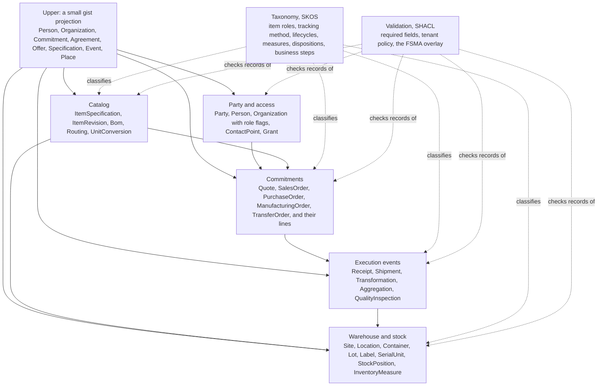

# A starting model for an ERP and WMS ontology

This is a proposal to argue with, not a decision. Inputs: the two seed reports of 2026-11-22 (the "architecture
seed", `SUTTON_ARCHITECTURAL_CONTEXT_SEED.md`, and the "API design report", `Sutton API Ontology Design.md`),
`~/YeeBois/Career/ontology/tbox.ttl` (30 classes), `~/YeeBois/Career/ERP_ONTOLOGY/DECISIONS.md` (G1 to G15),
`~/YeeBois/Career/sutton/product/PRODUCT-MODEL.md`, and this repository's `explorations/ideal-architecture/research/01-alchemy-domain.md`.
Nothing here was loaded into a reasoner yet.

## 1. The one distinction everything else rests on

An ERP table blurs three things that an ontology must keep apart:

| Layer | What it describes | Example | Changes when |
| --- | --- | --- | --- |
| Referent | The thing in the business | a pallet of 40 kg flour, lot L-221 | the world changes |
| Record | What a system holds about it | Sutton's label row, our `Item` row | someone edits a system |
| Representation | How a record travels | a GraphQL node, a CSV row, an Effect Schema | an API version changes |

The ontology's classes name referents and commitments. Effect Schemas and Alchemy domain classes are records and
representations, and each points at the term it stands for. A CSV column `sku` is not the class `Item`; it is one
identifier of an item specification, which may be missing (Sutton allows an item with no SKU).

## 2. Proposed layers

Upper ontology: both seeds land on the same answer, and I agree with it. A small projection of Semantic Arts' gist
(everyday enterprise words, OWL 2 DL), not BFO or DOLCE at the core. IOF and ISA-95 are alignments kept in a separate
graph, never imported into the core.

## 3. The party model: the gap in both seeds

Neither seed models parties. The architecture seed has one `TradingAccount`; the API design report puts
`customerAccount` and `fromSupplier` straight on orders. Sutton's own words: "Accounts represent customers and vendors
and have associated contacts", and portals give an outside customer or vendor a view of their own records. One account
can be both a customer and a vendor (a co-packer buys your packaging and sells you finished goods).

What the five sources Benjamin named agree on, once the vocabulary is lined up:

| Idea | IBM MDM party domain | Salesforce party model | W3C ORG | FIBO (Parties and Situations) | schema.org |
| --- | --- | --- | --- | --- | --- |
| A party is a person or an organization | Party: Person, Organization | Individual vs Account | `foaf:Agent`, `org:Organization` | `IndependentParty`, `LegalPerson` | `Person`, `Organization` |
| Customer and vendor are roles, not kinds | Party role | Account and Contact roles | `org:Role`, `org:Post` | `PartyInRole` | `customer`, `seller` properties |
| A person's place at an organization is its own record | Party relationship | `AccountContactRelation` | `org:Membership` | relationship situations | `worksFor`, `member` |
| Contact details are separate records with a purpose | Contact method | `ContactPointEmail`, `ContactPointPhone`, `ContactPointAddress` | `org:Site` with an address | addresses as their own class | `ContactPoint`, `PostalAddress` |
| Identifiers are records, many per party | Party identification | `PartyIdentification` | `org:identifier` | LEI, registration identifiers | `identifier`, `taxID` |
| Two records may be one party, decided with evidence | Suspect duplicate processing | matching and Individual | not covered | not covered | not covered |

Oracle's Siebel access control adds the authorization half: what a person sees follows their position in an
organization, the organizations it belongs to, and access groups, not their name. Sutton's custom roles with location
permissions (October and November 2026 releases) are the same shape: a grant is a role at a scope.

Proposed classes, in OntoClean terms (rigid kinds carry identity; roles do not):

| Class | Kind of thing | Identity from | Notes |
| --- | --- | --- | --- |
| `Party` | abstract, rigid | its subclass | never instantiated directly |
| `Person` | rigid kind | tenant and a source id, never a name | the same person can be a contact for two accounts |
| `Organization` | rigid kind | tenant and a source id | Sutton's Account; also the tenant itself and its sites' operators |
| `Organization.isCustomer`, `isVendor`, `isCarrier`, `isContractManufacturer` | role flags on the organization | the organization | Sutton's Account is an `Organization` with these flags (decision 3). Several can be true at once |
| `ContactAssignment` | relator, a person at an organization for a purpose | person, organization, purpose | Sutton's Contact; schema.org `ContactPoint` and ORG `Membership` both fit |
| `ContactPoint`, `PostalAddress` | records with a purpose (billing, shipping, receiving dock) | owner and purpose | a ship-to address is not the customer |
| `PartyIdentifier` | value with a scheme | scheme and value | tax id, GLN, LEI, the source system's id |
| `IdentityDecision` | record of a person's decision | its own id | two party records are the same party: evidence, who decided, when. Never `owl:sameAs` |
| `Grant` | relator: a party in a role at a scope | member, role, scope (tenant, site, field) | authorization; a role label alone authorizes nothing |

Decision 3 (2026-11-22) replaced the first draft's `TradingRelationship` relator and role classes with flags on
`Organization`. What that gives up, so it is known: a role has no dates of its own, terms and portal access sit on the
organization, and a person cannot be an Account. A flag can later become a role record without loss.

`IdentityDecision` is where this repository already lives: the import's review of near-duplicate rows is master-data
matching, and its rule "two rows that look alike are still two records" is the same rule as "never `owl:sameAs`".

## 4. The rest of the spine

The architecture seed's distinctions are the right ones and I would keep them whole: an item specification versus
stock; a lot versus a label versus a unit serial; an order versus its execution; a reservation versus actual
consumption; packaging (aggregation) versus transformation; a source assertion versus an inference; a validation result
versus compliance. Its class list, by context:

- **Catalog**: `ItemSpecification` (inventory, service and alias kinds), `ItemRevision`, `BomRevision`, `BomLine`,
  `BomExpansion`, `RoutingRevision`, `OperationDefinition`, `ItemUnitConversion`. Buy, Make and Sell are roles from the
  taxonomy, several at once, not subclasses.
- **Warehouse and stock**: `Site`, `Warehouse`, `Bin` (a location hierarchy), `WorkCenter`, `Container`,
  `LogisticUnit`, `MaterialLot`, `InventoryLabel`, `SerialUnit`, `StockPosition`, `InventoryMeasure`,
  `InventoryReservation`.
- **Commitments** (gist `Commitment`, `Offer`): `Quote`, `SalesOrder`, `PurchaseOrder`, `ManufacturingOrder`,
  `WorkOrder`, `TransferOrder`, each with lines; lines meet execution through quantity allocations, so one order ships
  in parts and one shipment serves several orders.
- **Execution events** (EPCIS 2.0 views): `Receipt`, `Shipment`, `OperationExecution`, `TransformationEvent`,
  `AggregationEvent`, `QualityInspection`, `QualityHold`, `RecallCase`, `MachineStateInterval`.
- **Values**: `QuantityValue` (exact decimal and a unit, QUDT-aligned), `MoneyAmount` (currency required),
  `CostObservation` (basis, pending or final).
- **Accounting boundary**: `SupplierBill`, `Invoice`, `AccountingSyncRecord`. Sutton has no general ledger; these are
  documents that leave for QuickBooks or Xero.

## 5. Where the two seeds disagree, and which I would follow

| Point | API design report | Architecture seed | Follow | Why |
| --- | --- | --- | --- | --- |
| SKU | required, unique per tenant | optional; identity never from SKU | architecture seed | Sutton allows an item with no SKU; a tenant overlay can require it |
| Inventory state | one `hasInventoryState` per balance | several measures that overlap | architecture seed | Available, Committed and Reserved overlap; summing one enum double counts |
| Namespace | `w3id.org/heysutton/...` | `example.org` placeholder, project-owned | architecture seed | our vocabulary must not claim Sutton's name |
| BOM depth | "up to 10 levels" as an invariant | acyclic, checked on a resolved expansion | architecture seed | the depth limit is a product setting, not a meaning |
| Telemetry | Uptime or Downtime | Running, Setup, Idle, planned and unplanned downtime, Unknown | architecture seed | Unknown is not Running |

The API design report is still useful for its standards survey and its EPCIS mapping; its class tables need the fixes
above before anything is built from them.

## 6. Where the Alchemy domain layer fits

The ontology says what things are; `@alchemy.run/domain` says how records change. They line up without being the same
artifact:

| Ontology | Alchemy domain | Example |
| --- | --- | --- |
| rigid kind with an identity criterion | an `Aggregate` keyed by that identity (`keyOf`) | `PurchaseOrder` keyed by tenant and id |
| commitment and its lifecycle (SKOS workflow scheme) | aggregate state, `Command`, `Rejection` | "Receive 40 kg" refused because the line is closed |
| execution event (EPCIS view) | `Event`, append-only | `ReceiptRecorded` with the lot and the location |
| derived classification, reachability | `Projection`, `View` | "every shipment that contains lot L-221" |
| SHACL shape | the Schema of a command's payload, plus a check run on the projection | a receipt line needs a quantity and a unit |
| `IdentityDecision`, `Grant` | a command a person issues, recorded with its actor | decide that two vendor records are one party |

The point of contact is one rule: every domain class carries the IRI of the term it represents, and a check fails when
a class has none or points at a term that does not exist. The RDF graph is then one projection of the event stream,
not a second source of truth.

## 7. What I have not checked

- None of the sources Benjamin linked was fetched in this session; the comparison table in section 3 is from my
  knowledge of those models and needs a pass against each page before it becomes a decision.
- The architecture seed's files (`sutton-core.ttl`, the shapes, the taxonomy) were read only as section headings and
  class lists; they were not run through a reasoner here.
- Sutton's GraphQL schema is behind a token. Every Sutton field name in this report is from public docs only.
