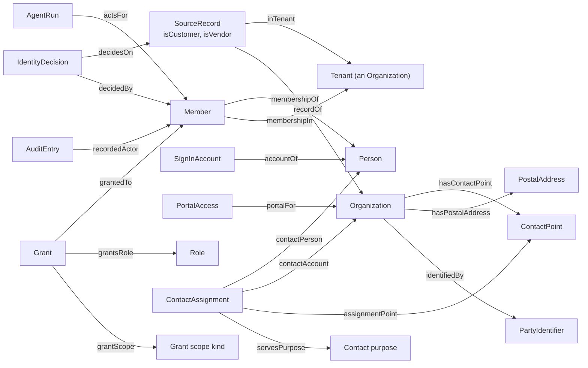

# Party and access terms

The [decisions](../DECISIONS.md) settle the choices cited below. A term enters the module only when it names the
`rat-` record of Benjamin's answer (decision 32). A pending choice goes to Benjamin with a concrete record when its
slice is specified. Nothing is built on the recommendation before then.

[Report 14](14-thin-thread.md) specifies the thin thread: sections 2 and 3 give its terms and record marks,
sections 4 and 5 its lift and membership question, and section 6 its gates. The party slice follows it (decision 8).
Under decision 101, a scheme's ruling covers the concepts listed in its proposal. A concept added later needs its own ruling (report 14 section 1.5).

The section "Questions for Benjamin" maps each Qn to its decision. Keys were matched against 04, 05 and 07 to 12 on
2026-11-22 (report 13): where two reports named one relation, one key now stands, and its row says whose it is.

Nothing in this document is built: there is no vocabulary module, no projector, no generated Turtle, no SHACL and no
competency-question suite. The code below is a sketch, not code.

## What this rests on

- Decisions 3 and 34: a Sutton Account is the organization. Its customer and vendor flags belong to the tenant's
  `SourceRecord`, not the body. There is no trading-relationship relator or role class for accounts.
- Decision 4: gist is the only parent; W3C ORG, FIBO, schema.org, IBM's and Salesforce's models are comparisons and
  alignment candidates only (alignment rows belong to report 11).
- Decisions 7 and 24: `inv:` stays under `example.org` until publication at `1.0`. Before then each change advances `y` in the module's `0.y.0` version, never the clock. A change that invalidates earlier data or answers is recorded as breaking (report 14 section 8).
- Report rules (report 01 and 02, carried by the project profile): no `owl:sameAs`, no `owl:inverseOf`, identity
  never from a SKU or a name, Turtle always generated.
- Report 01 section 5 where the two seeds disagree. On parties they do not disagree: the API design report has no
  party model (it puts `customerAccount` and `fromSupplier` on orders), and the architecture seed has `Organization`,
  `Person`, `Tenant`, `TradingAccount`, `PermissionGrant`, `AuditEntry`, `AgentAction` and `ExternalIdentifier`.
  Its `TradingAccount` is replaced by decision 3.

## What was read

| Source | How | What it gave |
| --- | --- | --- |
| `.agents/skills/_shared/project-profile.md`, the packet's `DECISIONS.md`, reports 01 and 02 | read whole | the decisions and the open questions this design must not settle |
| `_shared/gist-categories.md`, `naming-conventions.md`, `anti-patterns.md`, `foundational-analysis.md`, the conceptualizer's `SKILL.md` | read whole | parents, naming, the review list |
| The gist 14.1.0 reference copy (`gistCore.ttl`, sha256 matches the profile's) | grep of class lines and of the definitions named below | `gist:TemporalRelation`, `gist:Assignment`, `gist:Permission`, `gist:AddressUsageType` exist; none is in `gist-categories.md` |
| The architecture seed | sections 1, 2.2 to 2.4, 4, 5.5 to 5.8; the `core:` class and property blocks for parties and governance; the source list | `Tenant`, `PermissionGrant`, `AuditEntry`, `AgentAction`, `ExternalIdentifier`, the identity recipe, the no-`sameAs` rule |
| The API design report | section 1.3, the context tables 4.1 (governance row), the `GovernanceArtifact` class | "Customer accounts, contacts, activity history", "Customer Portals", "custom roles, granular location permissions, API tokens" |
| `packages/access/contract/src` (every file), `packages/kernel/src` (`Member`, `Role`, `Activity`, `Actor`, `Agent`, `AgentRun`, `Ids`) | read whole | what the repository records today |
| `packages/catalog/contract/src` | grep for vendor, supplier, customer, contact, address | the only party data: `Vendor` inside an item (a name, a code, a cost) |
| `apps/inventory/migrations/0001_init.sql` | the `organization`, `member`, `user`, `activity`, `modelCall` tables | keys, removal, tenancy |
| `docs/auth.md`, `docs/glossary.md`, `DECISIONS.md` (root) | read whole; grep | identity is the id; agents act for a person; "Supplier: matched by name" as a mistake |
| `explorations/alchemy-domain` README, DECISIONS (decisions 20 to 22, 36, 39), BRIEF (decision 20, the trial notes) | read in part | `Organization` aggregate and one `Member` instance per member are the record; the activity table stays the trail |

Pages fetched on 2026-11-22 (each claim below about these models comes from one of them, or is marked not checked):

- W3C ORG, https://www.w3.org/TR/vocab-org/ (fetched twice).
- schema.org `ContactPoint`, `PostalAddress`, `Organization` (fetched).
- IBM MDM 14.0 "party domain model" overview, and IBM MDM 11.6 "suspected duplicate processing for party data"
  (fetched).
- OMG Commons `PartiesAndSituations.ttl` (fetched), which FIBO's parties module is mirrored in. The FIBO site itself
  was not fetched; a search result summarised FIBO's `IndependentParty` and `PartyInRole`.
- Oracle Siebel access control page Benjamin linked (fetched).
- Salesforce: the party overview and `AccountContactRelation` pages answered 403. Not checked; only search snippets.
- Sutton public (all fetched): the "Accounts and contacts key features" article, the "Portals: setting up customer
  and vendor portals" article, the "Managing user accounts" article, the CRM feature page, and the changelog entries
  of 2026-10-15 (custom roles) and 2026-11-10 (location permissions, API token permissions).

## Sutton facts used (public sources only)

- Accounts are stored as companies; "a company can be marked as a customer, a vendor, or both"; status is Active or
  Archived; several contacts link to one company; a company has default billing and shipping addresses; contacts
  appear on sales and purchase orders and their emails receive order emails. No account number is described.
  (Accounts and contacts article.) Carrier and contract manufacturer are not named by Sutton: those two flags came
  from report 01 and the project profile, and are held back until Benjamin answers decision 89.
- Portals: each account gets its own unique link; no sign-in step is described; modules (items, sales orders,
  shipments, manufacturing orders) are switched on per portal; a price list may be attached; the outside party can
  create a sales order request with shipping and billing addresses. Deactivating and reactivating makes a new link.
  (Portals article.)
- Users are invited (Pending, then Active), suspended (history kept, sign-in blocked) and reactivated; one of three
  roles is given. (Users article.) The default roles are now named Admin, Manager and Operator, and admins build
  custom roles from a copy of a default one, with permissions grouped by app area and dependencies flagged.
  (Changelog 2026-10-15.) Site pickers show only the locations a user is assigned to; API tokens carry permissions.
  (Changelog 2026-11-10.)
- Activity history shows "who said what and when"; customer portals give customers order, invoice and shipment
  views. (CRM page.)

## The shape in one view

Where a local class has a parent, its gist parent is given where it exists in `gist-categories.md`.

- `Party` (category, pending Q2)
  - `Person` under `gist:Person`
  - `Organization` under `gist:Organization`, described by a tenant's `SourceRecord` (decision 34)
    - `Tenant` (role)
- `SignInAccount`, `PartyIdentifier`, `IdentityEvidence`, `SuspectedDuplicate`, `AuditEntry` under `gist:Content`
  (`PartyIdentifier` under `gist:ID`)
- `ContactPoint` under `gist:ElectronicAddress`; `PostalAddress` under `gist:PhysicalAddress`
- `Member` under `gist:TemporalRelation`; `Grant` under `gist:Assignment`. Admit a gist name to the profile when the slice needs it, with its named ancestors (decisions 13 and 14).
- `Role` has no gist parent: its individuals are the role concepts, and `gist:Permission` fits once `permits` exists. Decision 97 requires a stated reason on the committed list of exceptions Benjamin ratifies (report 14 sections 2.1 and 6.4). `Permission` waits for Slice 1 (decision 41).
- `ContactAssignment` relates a person to an account, a purpose and a contact point (decisions 39 and 43).
- `IdentityDecision` under `gist:Determination`; `AgentRun` and `ModelCall` under `gist:Event`



## Contacts under decision 3: ContactAssignment or a plain link

Decisions 39 and 43 choose `ContactAssignment`. In the fixture, one person handles billing for account A and
receiving for account B. Each assignment names the person, account, purpose and contact point. Asking for A's
billing contact returns only the point on A's billing assignment. It must not return B's receiving point, even
though both assignments name the same person. A plain `isContactOf` link loses that distinction.

Report 11 restores four alignment rows: Sutton's Contact, `org:Membership`, FIBO's Contact and schema.org's
`ContactPoint`. They compare parts of this design; none asserts equivalence.

## Classes

| Key | Label | Definition | Tag | gist parent | Identity | Source | Status |
| --- | --- | --- | --- | --- | --- | --- | --- |
| Party | Party | An agent that is either a human being or an organized body, named so that the properties persons and organizations share have one range. | category | none: gist 14.1.0 has no party class; a category class over `Person` and `Organization`, which name it as their category parent beside their gist parents (pending Q2) | n/a | report 01 section 3; IBM MDM party domain (fetched); OMG Commons `cmns-pts:Party` (fetched) | later (pending Q2) |
| Person | Person | A human being that a tenant deals with, as a member of its workspace or as a contact at another organization. | kind | gist:Person | the human being (decision 34). Tenant, source system, record type and opaque source id locate a source record, not a human. Neither Member view has a human id. An identified account can help reidentify the human when present; a tenant and `MemberId` locate only the membership | report 01 section 3; the architecture seed (`core:Person`); `packages/kernel/src/Ids.id.ts` (`UserId`); Sutton public (contacts) | thin thread (membership); Sutton only (contacts) |
| Organization | Organization | An organized body of people or of other organizations formed for a purpose, such as a company the tenant buys from, sells to, ships with or has goods made by, or the tenant itself. | kind | gist:Organization | the organized body (decision 34). Tenant, source system, record type and opaque source id locate the account record, not the body. Its trading flags are that tenant's assertions about the body | decision 3; report 01; `apps/inventory/migrations/0001_init.sql` (`organization`); Sutton public (accounts as companies) | thin thread (tenant); Sutton only (trading accounts) |
| Tenant | Tenant | An organization for which this application keeps a workspace, whose records are scoped to it and hidden from every other organization. | role | none: specializes `inv:Organization`, which carries `gist:Organization` (decision 38) | inherited: Organization's criterion; its repository key is `OrganizationId` | the architecture seed (`core:Tenant`); `packages/kernel/src/Ids.id.ts` ("The organization (tenant) a row belongs to"); `CLAUDE.md` "Identity and permissions" | in the repository today (decision 38) |
| SignInAccount | Sign-in account | A credential record that lets one person sign in to this app before any organization is chosen. | information | gist:Content | the app's `UserId` | `packages/kernel/src/Ids.id.ts` (`UserId`); `packages/access/contract/src/Session/SessionState.read.ts` (`AccountEmail`); `docs/auth.md`; migration `user` table | later |
| Member | Member | A relationship between one person and one tenant that lets the person act in the tenant's workspace from the day it is made until it is removed. | relator | gist:TemporalRelation (thin thread, decision 13) | the opaque `MemberId` in its tenant, kept after removal. The membership relates to a person with or without an account; its id does not identify that person across memberships | `packages/kernel/src/Member.schema.ts`; migration `member` table (`removedAt`); `explorations/alchemy-domain/DECISIONS.md` decision 20; W3C ORG `org:Membership` (fetched) | in the repository today |
| Role | Role | A named level of access a grant gives a member, such as viewer, editor or admin. | information | no gist parent in the thin thread (decisions 13 and 41) | one criterion: the concept's scheme and notation. A custom role is another individual, not another class | `packages/kernel/src/Role.schema.ts`; Sutton public (Admin, Manager, Operator, custom roles) | thin thread (fixed roles); Sutton only (custom roles) |
| Permission | Permission | A description of one kind of action its holder may take in one area of the app, such as running the shipping flow or deleting a pack container. | information | gist:Permission (not in the thin thread, decisions 13 and 41) | the app area and the action, as the app names them | Sutton public (permissions grouped by app area; API token permissions); the API design report (governance row) | Sutton only |
| Grant | Grant | An assignment of one role to one member at one scope (the whole tenant, one site or one field), made by a member allowed to make it. | relator | gist:Assignment (decision 13) | the membership and the field the grant is read from. There is no grant id. Replacing this criterion with a stored id would be a breaking change under decision 24 (report 14 sections 2.1 and 8) | report 01 section 3; the architecture seed (`core:PermissionGrant`, "effective tenant/location/field authorization"); Sutton public (site pickers per assigned location); Oracle Siebel positions (fetched) | thin thread (organization scope); Sutton only (site scope); later (field scope) |
| PortalAccess | Portal access | A permission a tenant gives one account organization to see its own records, and to request orders, through one link and the modules switched on for it. | information | gist:Permission (not in the thin thread, decisions 13 and 41) | its own id; each link issued is a new one (Sutton makes a new link on reactivation); the link's secret is never a term value | decision 3 ("portal access sit on the organization"); Sutton public (portals article) | Sutton only (pending Q11) |
| ContactAssignment | Contact assignment | A relationship naming one person to reach at one account for a stated purpose using a particular contact point. | relator | gist:Assignment | the assignment, not the person or the email address alone | decisions 39 and 43; Sutton public (contacts) | Slice 1 |
| ContactPoint | Contact point | An electronic address, an email address or a telephone number, at which a party is reached. | information | gist:ElectronicAddress | its own record id within the tenant; two parties with one email have two contact points | report 01; schema.org `ContactPoint` (fetched); Sutton public (contact emails receive order emails) | Sutton only |
| PostalAddress | Postal address | A physical address, written as lines, locality, region, postal code and country, at which a party receives goods, documents or invoices. | information | gist:PhysicalAddress | its own record id within the tenant; equal text on two parties is two addresses | report 01; schema.org `PostalAddress` (fetched); Sutton public (default billing and shipping addresses) | Sutton only |
| PartyIdentifier | Party identifier | An identifier issued under a named scheme (a tax number, a GLN, an LEI, a DUNS number, a source system's id) that a party carries, kept as evidence of identity and never as identity itself. | information | gist:ID | the scheme, the issuer where the scheme has one, and the value normalized as the scheme says | report 01; the architecture seed (`core:ExternalIdentifier`, the identity recipe); schema.org `taxID`, `globalLocationNumber`, `leiCode`, `duns` (fetched); W3C ORG `org:identifier` (fetched) | later |
| IdentityDecision | Identity decision | A determination by a member that two source records the tenant holds describe the same party, or different parties, resting on the evidence it cites. | event | gist:Determination | its own id | report 01 ("never `owl:sameAs`"); the architecture seed section 4.2 ("Store the match evidence, reviewer, confidence"); IBM MDM suspected duplicate processing (fetched: "Data stewards review suspected duplicates") | later |
| IdentityEvidence | Identity evidence | A statement of one observed likeness or difference between two source records the tenant holds, such as a shared tax number or names one letter apart, cited by a suspicion or a decision. | information | gist:Content | its own id within the suspicion or decision that cites it | the architecture seed section 4.2; NEW: a decision must say what it rested on, and one piece of evidence can be cited by a suspicion and then by the decision | later |
| SuspectedDuplicate | Suspected duplicate | A proposal, from rules or an agent, that two source records the tenant holds may describe one party, open until a member decides it. | information | gist:Content | the two records it names and the rule or agent run that proposed it | IBM MDM suspected duplicate processing (fetched); `CLAUDE.md` ("The person decides; the app proposes"); NEW: keeps a proposal apart from a decision | later |
| AgentRun | Agent run | An event in which a software agent acts for one signed-in member, never above that member's role nor above its own role cap. | event | gist:Event | the request it runs in and the agent; no id is stored today | `packages/kernel/src/AgentRun.schema.ts`, `Agent.context.ts`, `Actor.context.ts`; `docs/auth.md` "Agents act for a person"; the architecture seed (`core:AgentAction`) | in the repository today (held per request, not stored) (pending Q12) |
| AuditEntry | Audit entry | A record of one change to a tenant's data, written in the same batch as the change, naming who made it, the agent that acted for them if any, and what was done. | information | gist:Content | the tenant and the entry's id (`activity` primary key) | `packages/kernel/src/Activity.schema.ts`; `AuditTrail` returns a collection of these entries, zero when empty; migration `activity` table; `explorations/alchemy-domain/DECISIONS.md` decision 36; the architecture seed (`core:AuditEntry`) | in the repository today (decision 46) |
| ModelCall | Model call | An event in which the app asks a language model one question for a tenant, taken from that tenant's daily allowance before it is asked. | event | gist:Event | the tenant and the call's id (`modelCall` primary key) | `packages/access/contract/src/Allowance/ModelAllowance.gateway.ts`; migration `modelCall` table | later |

## OntoClean note per class

Rigidity: rigid (every instance is one in every world it exists in), anti-rigid (an instance can stop being one and
go on existing), non-rigid otherwise. Dependence: existential (cannot exist without the other) or relational (is one
only while a relation holds).

| Key | Rigidity | Identity | Dependence | Note |
| --- | --- | --- | --- | --- |
| Party | rigid, non-sortal | supplies none; each instance gets it from Person or Organization | none | a union, never instantiated directly; a property typed Party says "a person or an organization" |
| Person | rigid | the human being (decision 34) | none | a person can hold a `ContactAssignment` or a membership without becoming a different kind of person |
| Organization | rigid | the organized body (decision 34) | none | customer and vendor describe how one tenant trades with the body. Both flags sit on that tenant's `SourceRecord`. Carrier and contract manufacturer wait for decision 89 |
| Tenant | anti-rigid | `IdentityCriterion` inherited from Organization, not `notApplicable`: V17 allows a role under a local class to inherit | relational: on the app that holds its workspace | an organization stops being a tenant when it leaves (alchemy-domain decision 39) and goes on existing as a record elsewhere; a role under its kind, which OntoClean allows |
| SignInAccount | rigid | supplies it (`UserId`) | existential on the person it lets in | information, not the person; Better Auth's own `account` table (a provider credential) is part of its mechanism, not a second term |
| Member | rigid (as a relator: a membership is always a membership) | supplies it (`MemberId`) | existential on one Person and one Tenant | its being removed is a phase (`membershipStatus`), not a subclass; the audit trail still points at a removed member |
| Role | rigid | the concept's scheme and notation, no second criterion | existential on the tenant for a custom role; none for the app's three | one IRI names both the concept and the role individual (decision 41) |
| ContactAssignment | rigid | the assignment | existential on its person and account | the purpose and contact point apply only to this assignment |
| Permission | rigid | supplies it | none | its dependence on another permission (Sutton flags it) is `requiresPermission` |
| Grant | rigid | supplies it | existential on one Member and one Role; on a Site when scoped to one | the scope kind is stated, never inferred from a missing site (no negative inference without closure) |
| PortalAccess | rigid | supplies it | existential on one account Organization and its Tenant | a link, not a person: who uses it is unknown to the record (Q11) |
| ContactPoint | rigid | supplies it (record id) | existential on its Party | the email text alone is not its identity |
| PostalAddress | rigid | supplies it (record id) | existential on its Party | the address names a place; the place itself (a `gist:GeoLocation`) is not needed here |
| PartyIdentifier | rigid | scheme, issuer, value | none (an identifier can exist before a party carries it) | gist itself notes two IDs with one text can identify different things |
| IdentityDecision | rigid | supplies it | existential on the two source records and on the member who decided | an occurrence that settles an outcome; a later decision supersedes it, never edits it |
| IdentityEvidence | rigid | supplies it | existential on the two records it compares | a statement, not proof: "evidence is not truth" |
| SuspectedDuplicate | rigid | supplies it | existential on the two records and on its proposer | being open is a phase read from decisions, which needs a closure contract to query (see the axiom plan) |
| AgentRun | rigid | the request and the agent | existential on the member it acts for | the agent itself has no term yet (Q12) |
| AuditEntry | rigid | supplies it | existential on the tenant and the acting member | the record of an act, not the act: the act is report 09's event |
| ModelCall | rigid | supplies it | existential on the tenant and the member | the allowance (40 a day) is a product setting in code, not a term |

## Properties

One direction only; the other way is a SPARQL `^p` path. A property's domain and range, including a datatype
property's datatype, belong in the vocabulary. The record sets its cardinality and the values its field admits.
“Datatype from the record field” means the field is the evidence for that choice, not a substitute for it. An object
property needs a class or scheme as its range before it enters the module (report 14 section 6.4, C8). Which
context's contract package owns a new record is Q10.

| Key | Label | Definition | Domain | Range | Source |
| --- | --- | --- | --- | --- | --- |
| inTenant | in tenant | The tenant whose workspace holds this record, not the owner of the body it describes. Read that account's assertions in the tenant's graph. | none: any record a tenant holds (kept broad, anti-pattern 10) | Tenant | the architecture seed (`core:inTenant`); every table's `organizationId` (`CLAUDE.md` "Identity and permissions") |
| gist:name | name | Use the gist property directly, not a second `inv:name`. The name people read for a party or an item, which is never unique and never decides identity or permission. | none declared: a party here, an item specification in 07 (kept broad) | datatype from the record field | `packages/kernel/src/Text.schema.ts` (`DisplayName`); `Member.name`; `organization.name` |
| isCustomer | is customer | Whether this tenant's account records the body as buying from the tenant. Read the flag from this record (decision 34). | SourceRecord | datatype from the record field (pending Q8) | decision 3; Sutton public ("customer, vendor, or both") |
| isVendor | is vendor | Whether this tenant's account records the body as selling to the tenant. Read the flag from this record (decision 34). | SourceRecord | datatype from the record field (pending Q8) | decision 3; Sutton public |
| accountStatus | account status | Whether the tenant still trades with the organization or has archived its record. | Organization | a concept of `AccountStatusScheme` (10); property and scheme withheld from slice 1 | Sutton public (Active or Archived) |
| contactPerson | contact person | The person to reach on this assignment. | ContactAssignment | Person | decision 39 |
| contactAccount | contact account | The account at which the person serves this purpose. | ContactAssignment | Organization | decision 39 |
| assignmentPoint | assignment point | The point to use for this contact at this account for this purpose. | ContactAssignment | ContactPoint | decisions 39 and 43 |
| hasContactPoint | has contact point | Links a party to an email address or telephone number at which it is reached. | Party | ContactPoint | report 01; schema.org `contactPoint` (fetched); `gist:hasAddress` direction |
| hasPostalAddress | has postal address | Links a party to a postal address at which it receives goods, documents or invoices. | Party | PostalAddress | report 01; schema.org `address` (fetched); Sutton public (billing and shipping addresses) |
| contactPointKind | contact point kind | What kind of electronic address a contact point is: an email address or a telephone number. | ContactPoint | a concept of `ContactPointKindScheme` (10); property and scheme withheld from slice 1. CQ-P03 asks for purpose, not kind | schema.org `email`, `telephone` (fetched) |
| contactValue | contact value | The text of the email address or telephone number, as written in the source. | ContactPoint | datatype from the record field | schema.org (fetched) |
| servesPurpose | serves purpose | The business exchange for which to reach this person at this account using the assigned point. | ContactAssignment | a concept of `ContactPurposeScheme` (decisions 39 and 43) | report 01 ("billing, shipping, receiving dock"); Sutton public |
| defaultFor | default for | A purpose for which this postal address is the one used when an order names no other. | PostalAddress | a concept of the `ContactPurposeScheme` scheme (report 10); an address default is not a person's contact purpose | Sutton public (default billing and shipping addresses) |
| addressLines | address lines | The street lines of a postal address, in order, as written. | PostalAddress | datatype from the record field | schema.org `streetAddress` (fetched) |
| locality | locality | The town or city of a postal address. | PostalAddress | datatype from the record field | schema.org `addressLocality` (fetched) |
| region | region | The state, province or other region of a postal address. | PostalAddress | datatype from the record field | schema.org `addressRegion` (fetched) |
| postalCode | postal code | The postal code of a postal address, kept as text so leading zeros survive. | PostalAddress | datatype from the record field | schema.org `postalCode` (fetched); `docs/glossary.md` ("Leading zeros") |
| countryCode | country code | The country of a postal address as a two-letter ISO 3166 code. | PostalAddress | datatype from the record field | schema.org `addressCountry` (fetched); NEW: a code, so "USA" and "United States" are one country |
| accountOf | account of | Links a sign-in account to the person it lets in. | SignInAccount | Person | `docs/auth.md`; migration `user` table |
| accountEmail | account email | The email a sign-in account signs in with, compared whatever its case. | SignInAccount | datatype from the record field | `packages/access/contract/src/Session/SessionState.read.ts` (`AccountEmail`) |
| membershipOf | membership of | Links a membership to the human who holds it, independently of any account. | Member | Person, under `gist:Person` from the thin thread (decision 94) | fixture or separate reidentification evidence only: neither Member view has a human id; nullable `member.userId` links to a sign-in account, not this human; W3C ORG `org:member` (fetched) |
| membershipIn | membership in | Links a membership to the tenant it lets its person act in. | Member | Tenant, the role class under Organization (decision 38) | `Member.organizationId`; W3C ORG `org:organization` (fetched) |
| membershipStatus | membership status | Where a membership stands: invited, active, suspended or removed. | Member | a concept of the `MembershipStatusScheme` scheme (10) | not proposed for slice 1: the member table stores `removedAt`, not a status; Sutton public (Pending, Active, suspended) |
| joinedAt | joined at | When the membership began. | Member | datatype from the record field | `packages/access/contract/src/People/Person.read.ts` (`joinedAt`) |
| removedAt | removed at | When the membership was removed, its row kept so the audit trail still names it. | Member | datatype from the record field | migration `member.removedAt`; `docs/auth.md` |
| grantedTo | granted to | Links a grant to the member who holds it. | Grant | Member | report 01 ("a role at a scope"); the API design report (`grantedToUser`) |
| grantsRole | grants role | Links a grant to the role it gives. | Grant | Role | `Member.role`; report 01 |
| grantScope | grant scope | Which kind of scope a grant applies to: the whole tenant, one site or one field. | Grant | a concept of the `GrantScopeKindScheme` scheme (10) | report 01 ("tenant, site, field"); NEW: stated, so a tenant-wide grant is never read from a missing site |
| onField | on field | The term of the record field a field-scoped grant applies to, as the CURIE of that field's term. | Grant | datatype from the record field | the architecture seed ("field authorization"); NEW: a text CURIE, because pointing a property at a property's IRI would pun in OWL 2 DL |
| grantedBy | granted by | Links a grant to the member who made it. | Grant | Member | `gist:hasGiver` (gist 14.1.0, on `gist:Assignment`); alchemy-domain decision 20 ("an admin is changed only by an admin in the record") |
| permits | permits | Links a role to a permission its holders have. | Role | Permission (property and class wait for Slice 1, decision 41) | Sutton public (custom roles built from permissions) |
| includesRole | includes role | Links a role to a lower role whose every permission it also has, as an editor's includes a viewer's. | Role | Role | `packages/kernel/src/Role.schema.ts` (`hasRole`, "from least to most access") |
| requiresPermission | requires permission | Links a permission to another permission it cannot be used without. | Permission | Permission | Sutton public ("flags when one depends on another") |
| portalFor | portal for | Links a portal access to the account organization whose records it shows. | PortalAccess | Organization | Sutton public (one link per account) |
| opensModule | opens module | A part of the tenant's records a portal shows, such as sales orders or shipments. | PortalAccess | a concept of the `PortalModuleScheme` scheme (10) | Sutton public (portal modules) |
| portalPriceList | portal price list | The price list whose items and rates a portal shows. | PortalAccess | PriceList (07) | Sutton public ("connect a price list") |
| openedAt | opened at | When the portal link was made. | PortalAccess | datatype from the record field | NEW: a regenerated link is a new access, so its period matters |
| closedAt | closed at | When the portal link stopped working. | PortalAccess | datatype from the record field | NEW: same reason |
| decidesOn | decides on | Links an identity decision to one of the two source records it compares. | IdentityDecision | SourceRecord | report 01 |
| identityOutcome | identity outcome | What the decision found: the two records denote one party, or two. | IdentityDecision | a concept of the `IdentityOutcomeScheme` scheme (10) | IBM MDM (fetched: "collapse" and "persistence"); report 01 |
| decidedBy | decided by | Links an identity decision to the member who made it. | IdentityDecision | Member | report 01 ("who decided"); `docs/auth.md` ("compares ids") |
| supersedes | supersedes | Links a record to an earlier one of the same kind about the same thing that it replaces, the earlier being kept. | none declared: an identity decision here, a cost observation in 07 (kept broad) | not yet placed: needs a class covering both kinds of record before admission (report 14 section 6.4, C8) | NEW: a decision is replaced, never edited, so the trail keeps both |
| resolves | resolves | Links an identity decision to the suspicion it settles. | IdentityDecision | SuspectedDuplicate | IBM MDM (fetched: stewards review suspects) |
| citesEvidence | cites evidence | Links a suspicion or a decision to a piece of evidence it rests on. | none: SuspectedDuplicate and IdentityDecision (kept broad) | IdentityEvidence | the architecture seed section 4.2 |
| evidenceKind | evidence kind | What kind of likeness or difference a piece of evidence states. | IdentityEvidence | a concept of `EvidenceKindScheme` (10); property and scheme withheld from slice 1. CQ-P04 needs `evidenceText`, not a classification | IBM MDM (fetched: name, address and identification are the default critical data) |
| evidenceText | evidence text | The evidence in a sentence a person reads, naming the two values compared. | IdentityEvidence | datatype from the record field | `CLAUDE.md` ("a reason a person can act on") |
| citesIdentifier | cites identifier | Links a piece of evidence to an identifier it compares. | IdentityEvidence | PartyIdentifier (property and class withheld from slice 1) | CQ-P04 needs the evidence sentence, not a link to the identifiers it mentions |
| suspects | suspects | Links a suspected duplicate to one of the two source records it names. | SuspectedDuplicate | SourceRecord | IBM MDM (fetched) |
| proposedByRun | proposed by run | Links a suspected duplicate to the agent run that proposed it, when an agent did. | SuspectedDuplicate | AgentRun | `CLAUDE.md` "AI features" ("A model proposes; it never writes") |
| matchScore | match score | How strongly the proposer rated the likeness, kept as the proposer gave it. | SuspectedDuplicate | datatype from the record field | the architecture seed (`core:confidence`); IBM MDM (fetched: scores decide match or suspect) |
| actsFor | acts for | Links an agent run to the member it acts for, whose organization scopes everything it does. | AgentRun | Member | `packages/kernel/src/Agent.context.ts`; `docs/auth.md` |
| agentName | agent name | The agent's name as people read it in the activity list, such as "Table assistant". | AgentRun | datatype from the record field | `packages/kernel/src/AgentRun.schema.ts` (`agent`) |
| maxRole | max role | The highest role an agent run may act with, whatever the role of the member it acts for. | AgentRun | Role | `packages/kernel/src/AgentRun.schema.ts` (`maxRole`) |
| callPurpose | call purpose | What a model call is for: reading a table request, checking the key, or suggesting fixes for an import. | ModelCall | a concept of the `ModelCallPurposeScheme` scheme (10) | `ModelCallPurpose`; migration `modelCall.kind` |
| calledFor | called for | Links a model call to the member whose action asked for it. | ModelCall | Member | migration `modelCall.actorId` |
| calledAt | called at | When the call was taken from the allowance. | ModelCall | datatype from the record field | migration `modelCall.createdAt` |

Left out on purpose: `hasMember` (the reverse of `membershipIn` is `^membershipIn`), reverse properties for the contact assignment, and any
property from a tenant to its records. Each reverse is a query path. Held back until decision 89 is answered:
`isCarrier` (whether the organization carries the tenant's shipments) and `isContractManufacturer` (whether it makes
goods for the tenant to the tenant's order, as a co-packer does), which report 01 and the project profile added and
no public Sutton page shows.

Used here and owned elsewhere since the 2026-11-22 reconciliation (report 13), each with its domain kept broad so it
serves both areas: an identifier is reached by 07's `identifiedBy` (range `gist:ID`, so `PartyIdentifier` too), its text
is 07's `identifierText`, its scheme 07's `identifierKind` (a concept of 10's `IdentifierKindScheme`, which holds this
document's `taxId`, `gln`, `lei`, `duns` and `sourceRecordId`), and its issuer 07's `issuedBy`. A party's source
record is 04's `SourceRecord`, keyed by tenant, source system, source type and exact source id, and linked to the party by `recordOf`. Only an `IdentityDecision` joins two records that may describe one party (decision 34).
A location-scoped grant names its place with 08's `atLocation` (any location, so a grant at a bin is sayable, as 04's
CQ-P08 fixture needs), not a site-only `atSite`. A grant's period is 09's `startedAt` and `endedAt`, whose domain now
admits a grant. Neither applies to `Member`: its interval is `joinedAt` to `removedAt`. An `IdentityDecision` uses
09's `eventTime`; “decided at” is its field label. An `AuditEntry` is a record, not an event. Decision 98 gives it
`recordedAt` (when it was written), `action`, `inTenant` and `recordedActor` (a `Member`). The actor of a portal
request is still pending decision 44. Report 14 sections 2.2 and 3.5 give the properties and their fields.

## SKOS schemes this area needs

The record stores the notation. The projector lifts it to the concept IRI, such as `inv:MemberRoleScheme-admin`,
and `sh:in` lists the concepts the field admits, not every concept in the scheme (decisions 10 and 23).

| Scheme | Concepts | Source |
| --- | --- | --- |
| AccountStatusScheme | active, archived | Sutton public |
| ContactPointKindScheme | email, phone | schema.org (fetched); Sutton public ("contact information") |
| ContactPurposeScheme | billing, shipping, receiving, ordering | report 01; Sutton public (billing and shipping addresses; order emails); 10 holds the concepts and spells the last `ordering` |
| IdentifierKindScheme | sourceRecordId, taxId, gln, lei, duns, among 10's others | the architecture seed (source id recipe); schema.org (fetched); report 01 ("tax id, GLN, LEI, the source system's id") |
| IdentityOutcomeScheme | sameParty, differentParties | report 01; IBM MDM (fetched) |
| EvidenceKindScheme | sharedIdentifier, similarName, sharedPostalAddress, sharedContactPoint, statementByParty | IBM MDM (fetched: critical data); NEW: a party's own statement ("we are the same company") |
| GrantScopeKindScheme | organization in the thin thread; location and field only when their slices need them (decision 96) | report 01; 10 holds the concepts (this document first wrote tenant, site, field) |
| MembershipStatusScheme | invited, active, suspended, removed | Sutton public (invited and suspended); the repository (active, removed) |
| PortalModuleScheme | items, salesOrders, shipments, manufacturingOrders | Sutton public (portals article) |
| ModelCallPurposeScheme | view, check, suggest | `packages/access/contract/src/Allowance/ModelAllowance.gateway.ts` |

Every scheme key ends in `Scheme`. Report 14 sections 2.3 and 2.4 specify the thread's schemes and role individuals;
report 10 covers the later concepts. A field need not admit the whole scheme (decision 23).

## Axiom plan

The table distinguishes the decisions from proposed axioms for later slices. The thread states only the disjoint pairs copied from gist, none between local classes (report 14 section 2.1).

| Axiom | Why |
| --- | --- |
| `Person` and `Organization` subclasses of `Party` (pending Q2) | both are agents the same properties apply to |
| `Person` and `Organization` are disjoint by inheritance | `gist:PhysicalIdentifiableItem`, an ancestor of `Person`, is disjoint with `gist:Organization`; no local pair is needed (report 14 section 6.9) |
| `Tenant subClassOf Organization` (decision 38) | a role under its bearer kind (OntoClean allows it); never disjoint with anything |
| No disjointness among the role flags, and none between `Tenant` and an account organization | roles overlap: a co-packer is a customer and a vendor at once |
| `ContactPoint disjointWith PostalAddress` | inherited from the disjoint gist parents once both are admitted (decision 15) |
| `Person` and `Organization` each disjoint with each of `SignInAccount`, `ContactPoint`, `PostalAddress`, `PartyIdentifier`, `IdentityEvidence`, `SuspectedDuplicate`, `AuditEntry`; never `Party`, a category, which is in no disjoint group (05's V21) | a record about a party is not the party (report 01 section 1); gist states `gist:Content` disjoint with `gist:Organization`, and with `gist:Person` only through `gist:PhysicalIdentifiableItem` (decision 14), so the projection includes the stated gist pairs as their classes enter (decision 15) |
| `Role`, `Permission`, `Grant`, `PortalAccess`, `Member` pairwise disjoint | five different things a reasoner should never merge |
| `IdentityDecision`, `AgentRun`, `ModelCall` pairwise disjoint, and each disjoint with `Person` and with `Organization` | occurrences are not agents |
| `AuditEntry` disjoint with each of `AgentRun`, `ModelCall` and `IdentityDecision` | one individual typed both `AuditEntry` and `AgentRun` is inconsistent; two distinct individuals, the run and its entry, are allowed |
| No `owl:sameAs`, no `owl:inverseOf`, no `owl:equivalentClass`, no `HasKey`, no cardinality restriction | project rules; "exactly two source records per identity decision" and "at most one default address per purpose" are record-schema rules projected to SHACL |
| Rules that are not axioms: an organization always keeps an admin; a member never acts above their role; an agent run never above its cap; an organization or member id never comes from a payload | Alchemy decisions and handler checks (alchemy-domain decision 20, `requireRole`), each with its own test |

A closure note for report 12: "open suspected duplicates" means a suspicion no decision resolves. Read with `FILTER NOT
EXISTS`, that is a closed-world reading and is valid only over a snapshot declared complete for decisions (the
foundational analysis's "negative inference requires declared closure").

## How the repository's records point at these terms

Decision 99 enrols named records, not folders. Report 14 section 3 specifies their marks, including `path` for a lift
and `noTerm` with a named later slice for a deferred field (decisions 20 and 98). The table describes what the party
slice adds or uses. Its SHACL shapes are closed (decision 22). No pointer is built yet.

| Record or table | Term | Note |
| --- | --- | --- |
| `Member` (`packages/kernel/src/Member.schema.ts`); `member` table | inv:Member | In Slice 1, `organizationName` follows `membershipIn/gist:name`; `name` follows `membershipOf/gist:name` only with separate human identity evidence. The kernel record has neither an email nor a person id (report 14 section 3.3). The table is stored evidence, not a schema pointer. |
| `Person` (`packages/access/contract/src/People/Person.read.ts`) | inv:Member | `memberId` identifies the membership in the request's tenant. Decision 100 defers `email` and `joinedAt` to the party slice (report 14 section 3.6). Then `joinedAt`, when known, belongs to the membership; `name` needs separate human identity evidence. A present `email` follows `membershipOf/^accountOf/accountEmail` only with the human and that account identified; an absent email emits nothing. |
| `Membership` (`Session/SessionState.read.ts`) | none | The test-account menu has no member id. It is not enrolled and carries no mark (report 14 section 3.6). |
| `OrganizationChoice` (`Session/SessionState.read.ts`) | inv:Tenant in the party slice | A view of a tenant, not of a membership. It carries no thread mark (report 14 section 3.6). |
| `OrganizationId`, `MemberId`, `UserId` (`packages/kernel/src/Ids.id.ts`) | the identity keys of Tenant, Member and SignInAccount | ids are keys, not `PartyIdentifier` instances |
| `AccountEmail` | inv:accountEmail | property of `SignInAccount` only, never of the member |
| `Role` (`packages/kernel/src/Role.schema.ts`) | `aboutScheme(inv:MemberRoleScheme)` | the three fixed codes bind the scheme, not the `Role` class that `grantsRole` and `maxRole` range over. Each lifted concept is also a `Role` individual (decision 41) |
| `AgentRun` (`packages/kernel/src/AgentRun.schema.ts`) | inv:AgentRun | |
| `Activity` (`packages/kernel/src/Activity.schema.ts`); one `activity` row | inv:AuditEntry | The copied actor name and detail are for the screen. The agent field is deferred to `AgentRun` in the party slice (decision 98; report 14 section 3.5). |
| `AuditTrail` | collection, no mark of its own | Its element is `Activity.json`. The variant carries the fields' marks, not the class pointer (report 14 sections 3.5 and 3.6). |
| `ModelCallPurpose` | `aboutScheme(inv:ModelCallPurposeScheme)` | the literals bind the scheme |
| one `modelCall` row | inv:ModelCall | `kind` denotes `callPurpose`; the table is evidence, not a schema binding |
| `AddPerson`, `ChangeRole`, `AddPersonProblem`, `PersonNotFound`, `LastAdmin` | none: commands and refusals, not terms | an Alchemy `Command` or `Rejection` carries the term of what it acts on |
| `SessionState`, `TestAccount`, `SignUpOffer`, `SignInFeatures`; `session`, `account`, `verification`, `rateLimit`, `invitation` tables | none | sign-in mechanisms, not business referents (anti-pattern 14) |
| `Vendor` inside an item (`packages/catalog/contract/src/Item/Item.read.ts`) | report 07's term for an item's vendor line | `vendorName` is a name, never a party's identity; linking it to an `Organization` record is a person's choice, not a match by name (`docs/glossary.md`, "Supplier") |

Both membership views mark `role` the same way; the thread lifts only the kernel `Member` (report 14 sections 3.6
and 4). Neither view supplies a grantor or a grant time. A copied name names the person or tenant, not the membership.
A name or email never mints a party.

## What the terms must answer

For report 04 to turn into competency questions; each is a need, not a numbered question.

- CQ-P01: select the tenant's `SourceRecord` by `inTenant`, require both `isCustomer` and `isVendor` true on that record, then follow `recordOf` to the organization (decision 34). A customer flag in one tenant and a vendor flag in another must not qualify the same body for either.
- CQ-P03: find the account's `ContactAssignment` by `contactAccount` and `servesPurpose`. Read `contactPerson` and `assignmentPoint` from that same assignment, then `contactValue` from its point (decisions 39 and 43).
- Where an account wants goods shipped when an order names no address (`hasPostalAddress`, `defaultFor`).
- Which records an identity decision says are one party, who decided, when, and on what evidence (`decidesOn`,
  `identityOutcome`, `decidedBy`, `eventTime`, `citesEvidence`, `evidenceText`).
- Which suspected duplicates are still open (`suspects`, `resolves`; needs the closure note above).
- May member M change items at site S on day D (`Grant`, `grantsRole`, `grantScope`, `atLocation`, `startedAt`,
  `endedAt`, `permits`, `includesRole`).
- Which changes did an agent make for member M, and with what cap (`AuditEntry`, `AgentRun`, `actsFor`, `maxRole`)? The party slice must relate the entry to the run; a display name does not identify a run.
- Which accounts can see their records through a portal, and which modules (`PortalAccess`, `portalFor`,
  `opensModule`).
- How many model calls a tenant made in the last 24 hours, and for what (`ModelCall`, `callPurpose`, `calledAt`).

The messy sample stores items only, with vendors as names inside each item. Report 14 section 5 specifies the thread's fixture. Named `test_` fixtures for the wider party questions are a proposal (pending decision 36).

## Comparison with published party models

What each model does, as far as the fetched page showed it; a cell says "not checked" otherwise. Alignment rows are
report 11's; the last column is a candidate for it, not a decision.

| Idea | This design | IBM MDM (14.0 overview, 11.6 SDP) | Salesforce | W3C ORG | OMG Commons and FIBO | schema.org | Candidate for report 11 |
| --- | --- | --- | --- | --- | --- | --- | --- |
| A party is a person or an organization | `Party` over `Person`, `Organization` | Party with Person and Organization subtypes; "Clients don't create further subtypes of Party" | not checked (403) | `org:Organization` under `foaf:Agent`; no party class | `cmns-pts:Party`, "a person or organization"; FIBO `IndependentParty` (search summary only) | `Person`, `Organization` | `inv:Party closeMatch cmns-pts:Party` |
| Customer and vendor are roles, not kinds | flags on the tenant's `SourceRecord` of the organization (decisions 3 and 34) | "A role-based approach connects Party to Contract" | not checked | no customer or supplier term; `org:linkedTo` is generic | `cmns-pts:PartyRole`, possibly time-limited | `customer`, `seller` properties (not fetched) | none: a flag has no class to match |
| A person's place at an organization | `Member` (members of a tenant); `ContactAssignment` (contacts) | party relationships (overview names "other Parties") | `AccountContactRelation` not checked (403) | `org:Membership`: an n-ary relation of agent, organization and role; `org:memberDuring` optional | not checked | `member`, `employee` on Organization | `inv:Member closeMatch org:Membership` |
| A role is a concept | each concept is a `Role` individual (decision 41) | not checked | not checked | `org:Role` is a subclass of `skos:Concept` | `cmns-pts:AgentRole` | not checked | `inv:Role closeMatch org:Role` |
| Contact details are their own records | `ContactPoint` on the assignment that gives its purpose; `PostalAddress` with its default use | Address is a related entity; contact methods and usage types not on the page | `ContactPointEmail` references its party (search snippet only) | `org:siteAddress` on a Site | not checked | `ContactPoint` (a `StructuredValue`); `PostalAddress` is a subtype of `ContactPoint` | `inv:ContactPoint broadMatch schema:ContactPoint`; `inv:PostalAddress closeMatch schema:PostalAddress` |
| Identifiers, many per party | `PartyIdentifier` with a scheme | Party Identification, a related entity | Party Identification (search snippet only) | `org:identifier`, a subproperty of `skos:notation` | FIBO tax identifier (search summary only) | `identifier`, `taxID`, `globalLocationNumber`, `leiCode`, `duns` (Text) | `inv:identifiedBy closeMatch schema:identifier` |
| Two records may be one party | `SuspectedDuplicate`, `IdentityDecision`, never `owl:sameAs` | suspected duplicates; stewards review them; collapse or persistence | identity resolution (search summary only) | not covered | not covered | not covered | none |
| Who may see what | `Grant`: a role at a scope | not checked | not checked | `org:Post`, `org:holds` | not checked | not covered | Oracle Siebel: positions and organizations decide visibility; no match term |

ORG makes `org:Role` a `skos:Concept`. Decision 41 keeps one IRI for each role individual and its concept. schema.org files `PostalAddress` under `ContactPoint`,
while gist keeps physical and electronic addresses apart under `gist:Address`; this design follows gist (decision 4)
and records schema.org as a broader match.

## A sketch of the vocabulary entries

Sketch, not code: a party-slice property and a proposed alignment in report 05's shapes. Report 14 section 2.6 gives the thread's module. The sketch does not assume a category parent (pending Q2).

```ts
// sketch, not code
export const alignments = [{ subject: { kind: "class", key: "Organization" }, predicate: "relatedMatch",
  object: { kind: "named", standard: "Sutton", name: "Account", document: "Accounts and contacts key features" } }]
export const objectProperties = defineProperties<ClassKey, SchemeKey>()({
  decidesOn: { domain: { kind: "local", key: "IdentityDecision" }, range: { kind: "local", key: "SourceRecord" } },
})
```

Every entry also carries its `source`, `scope` and `ratification`, left out above. Sutton publishes no namespace, so
the sketch proposes a named external term rather than a CURIE (pending decision 29).

## Anti-pattern review

| # | Anti-pattern | Finding |
| --- | --- | --- |
| 1 | Singleton hierarchy | `Organization` has one local subclass, `Tenant`. Kept: a role under its kind is a real distinction (decision 38). `Party` has two |
| 2 | Role as kind | none: account roles are flags; `Tenant` is anti-rigid and placed under its kind, never above one; contact and member are links |
| 3 | Process and object | `IdentityDecision`, `AgentRun`, `ModelCall` under `gist:Event`; `AuditEntry` is the record of an act, not the act |
| 4 | Missing disjointness | planned above; roles and flags deliberately overlap |
| 5 | Circular definition | none: no equivalence is written; definitions do not use their own label |
| 6 | Quality as class | none: statuses, kinds, purposes and scopes are SKOS schemes |
| 7 | Information and physical | addresses and identifiers are content about a party, disjoint with it |
| 8 | Orphan class | `Party` as a category is pending Q2. `Member` and `Grant` bring their gist parents into the thin thread; `gist:Permission` waits for Slice 1 (decisions 13 and 41) |
| 9 | Polysemy | the code's `People/Person` denotes a member; the code's `Activity` would collide with `prov:Activity` (an event), so the key is `AuditEntry` and "Activity" is its alternative label (decision 46); `SignInAccount` avoids `gist:Account` and Sutton's Account |
| 10 | Domain and range overcommitment | `inTenant` and `citesEvidence` keep no narrow domain; `servesPurpose` describes the contact assignment; ranges are the broadest local class that fits |
| 11 | Individuals in the T-box | each app role is an individual, not a class (report 14 section 2.4) |
| 12 | Negation | none in the T-box; the "open suspicion" query needs a closure contract |
| 13 | False is-a from OO | none: no `*Manager` or `*Service` class; the allowance gateway is not a term |
| 14 | System blueprint | sessions, test accounts, rate limits and Better Auth's tables are left out |
| 15 | Technical perspective | `onField` holds a CURIE as text; that is a DL constraint, said so in its row |
| 16 | Individuals mixed with classes | none: under decision 41 each app role is one IRI that is a concept and an individual of `Role`, never a class |

## Left out, and why

- A plain `isContactOf` property: the account and person are reachable through `ContactAssignment`, which also keeps their purpose and contact point together (decisions 39 and 43).
- `ApiToken`: Sutton public says tokens carry permissions and `docs/auth.md` says outside agents have "no tokens,
  grants or approval flow". No record and no need above; it comes with Q12's second option.
- `Session`, `Invitation`, a test account, sign-up settings: mechanisms (anti-pattern 14). Sutton's invited users
  are covered by `membershipStatus` invited.
- A place of business for an organization: gist 14.1.0 has no place class (project profile); sites are report 08's.
- Price lists, terms and payment terms that decision 3 puts on the organization: report 07 or 09 owns them, with a
  property from them to `Organization`.
- The item's vendor line and its link to a vendor organization: report 07's.

## Questions for Benjamin

The packet's [decision log](../DECISIONS.md) holds the answers: Q1 is decision 34, Q3 is 13, Q4 is 38, Q5 is 39,
Q6 is 40, Q7 is 41, Q9 is 43 and Q13 is 46. Still open: Q2 is decision 12, Q8 is 35, Q10 is 37, Q11 is 44 and
Q12 is 45. Each goes to Benjamin with a concrete record in the slice that needs it.

## Not checked

- The decisions cited here settle the design. No term here was run through the auditor, projected, reasoned over or queried; nothing is built.
- Salesforce's party pages answered 403; every Salesforce cell is from search snippets or marked not checked. FIBO's
  own site was not fetched; FIBO cells are from the OMG Commons file and a search summary. IBM's address usage types
  and contact methods were not on the overview page fetched.
- schema.org `customer` and `seller` were not fetched.
- Sutton facts are from its public help articles, feature page and changelog only; the GraphQL schema is behind a
  token. Whether a Sutton contact can belong to two companies, whether companies carry account numbers, and whether
  portal requests name a person were not found either way.
- The gist reference copy was checked by its sha256 and by grep for the class lines and definitions named here; the
  restrictions inside `gist:Assignment` and `gist:Permission` were read, not loaded into a tool.
- Report 04's competency questions, report 07's item vendor line, report 08's `Site`, report 09's orders and events
  and report 10's scheme form were being written at the same time and were not read by this report's author; the
  keys were reconciled with them afterwards (report 13), which moved seven property rows to their owners and renamed
  `displayName` to `name`.
- The alchemy-domain brief was read in part (decision 20 and the trial notes); the `Access` model's events and
  commands were not read whole.
- `bun run docs:check` passed on the earlier report; it checks frontmatter and structure, not the content. Neither
  `docs:check` nor `check` was run for this document revision.
