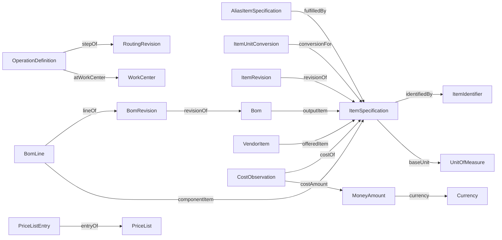

# Catalog and value terms

This is a design to argue with, written by the `ontology-conceptualizer` skill for the `ontology-architect`. It is not
ratified. The skill takes only terms with a `rat-` record, and none exists yet (decisions 1 to 7 ratify no term by
name), so every row below is a proposal that still goes through the `ontology-foundational-auditor` and Benjamin. No
vocabulary module, projector, generated Turtle, SHACL or competency-question suite exists; nothing here was run.

Inputs: the packet's decisions and reports 01 and 02, the skills' `_shared` files, the architecture seed and the API
design report (where they disagree, report 01 section 5 is followed), the catalog and access contract packages,
`docs/glossary.md`, the product `DECISIONS.md`, migration `0001_init.sql`, and the alchemy-domain packet (an item is
its own aggregate keyed by its id, decision 17 there). Sutton facts are from public Sutton help articles as the two
seeds cite them; none was fetched in this session, and each is marked "public Sutton".

Terms owned by the other eight documents are named by their likely key and the document number, such as
`Organization` (06) or `InventoryMeasure` (08). Every key is the local name under the placeholder prefix `inv:`
(decision 7). On 2026-11-22 the keys were matched against the other eight documents (report 13): where a key named
here was another document's, its owner is named now, and where two documents defined one key, one row stands. Open
choices are numbered decisions in [DECISIONS.md](../DECISIONS.md); "Questions for Benjamin" maps each Qn here to one.

## 1. What "Item" is in this repository today

The word "item" names one term and many records. The term is `ItemSpecification`: what a kind of good is, not a unit
of it on a shelf (gist's own common mistake, `gist-categories.md`). The records point at it and own their own rules
(report 02, verdict).

The repository holds only inventory items. Every stored item is an `InventoryItemSpecification` with a base unit, a
cost in US dollars, one stock number, a lot-tracked switch, a lifecycle and up to three vendors. It holds no
service or alias item, no revision, no bill of materials, no routing and no price list: those terms are "Sutton
only" or "later" below.

Two readings in the code need care:

- `StoredItem.revision` counts edits of the record (1 as created, one more per change, used so an edit names the
  revision it was made on). It is not an `ItemRevision`, which is an engineering version of what the item is. They
  share a word and nothing else; the record's counter points at no term.
- `ItemEdit` says the SKU "is the item's identity", and the item table holds `UNIQUE (organizationId, skuKey)`. In the
  ontology the SKU is an identifier, never the identity (report 01; the architecture seed: "Identifier resolution
  continues to use the opaque source identity"). The repository's rule stays a record rule: one item per SKU key per
  organization. Whether the SKU may ever change is Q9.

### One term, many records

Every record and field of the catalog that is about an item, and the term each points at. A field with "no term" is a
fact about the record, not about the item.

| Record | Where | Field | Term it points at | Note |
| --- | --- | --- | --- | --- |
| `ItemFields` | `packages/catalog/contract/src/Item/Item.read.ts` | (the record) | `ItemSpecification`, as `InventoryItemSpecification` | What one item needs before it is stored |
| `ItemFields` | same | `sku` | `ItemIdentifier` via `identifiedBy`, `identifierText`, `identifierKind` `sku` (10's `IdentifierKindScheme`), `issuedBy` the tenant: a lift path (05) | An identifier, never the identity |
| `ItemFields` | same | `name` | `name` (06; candidate `gist:name`) | Not a key (glossary, "Item code") |
| `ItemFields` | same | `description` | `description` | |
| `ItemFields` | same | `category` | `itemCategory`, a concept of `ItemCategoryScheme` (10) | A closed list of five today |
| `ItemFields` | same | `uom` | `baseUnit`, a concept of 10's `UnitOfMeasureCodeScheme` that is also a `UnitOfMeasure` | EA, KG, M, L are units; BX is a `PackagingUnit` (Q7) |
| `ItemFields` | same | `unitCost` | a `CostObservation`: `costAmount` a `MoneyAmount`, currency USD, scale 4, `costPerUnit` the base unit | The currency is implied by the description, not stored (Q1, Q2) |
| `ItemFields` | same | `quantityOnHand` | `InventoryMeasure` (08), on hand, at a position the record does not name | Not a property of the item: stock is not the specification |
| `ItemFields` | same | `reorderPoint` | `reorderPoint`, a `QuantityValue` in the base unit | |
| `ItemFields` | same | `stocking` | `lifecycleState` (10), a concept of `ItemLifecycleScheme` (10), and `discontinuedOn` | Active, inactive, discontinued on a day |
| `ItemFields` | same | `lotTracked` | `trackingMethod`: true is `lot`, false is `untracked` (10's `TrackingMethodScheme`) | The repository has no serialized tracking |
| `ItemFields` | same | `tags` | `taggedWith`, a `gist:Tag` (11, table A) | |
| `ItemFields` | same | `firstReceivedOn` | `firstReceivedOn` | A stated date today; later a view over receipts (09) |
| `ItemFields` | same | `dimensions` | `length`, `width`, `height`, each a `QuantityValue` in cm or in | Stored as floats (`S.Finite`): see section 5 |
| `ItemFields` | same | `vendors[]` | one `VendorItem` each (Q8) | Nested values with no id of their own |
| `Vendor` | same | `vendorName` | `vendorName` today; `offeredBy`, an `Organization` (06), once a person links one | Only a name today: the organization is not resolved |
| `Vendor` | same | `vendorSku` | `ItemIdentifier`, kind supplier part number (10), `issuedBy` that vendor | Glossary: "used as your own item code" is the mistake |
| `Vendor` | same | `unitCost` | `unitPrice` of the `VendorItem`, a `MoneyAmount` | The vendor's price is the tenant's cost of buying |
| `Vendor` | same | `leadTimeDays` | `leadTime`, a `QuantityValue` in days | |
| `Vendor` | same | `isPreferred` | `isPreferred` | At most one per item: a record rule |
| `StoredItem` | same | `id` | the identity of the `ItemSpecification`, with `organizationId` | Report 01's "tenant and a source id" |
| `StoredItem` | same | `createdAt`, `createdBy` | no term: record bookkeeping (`noTerm`, decision 21); who made the item is the confirm's `performedBy` (09), reached through `recordedFromRow` (04) | |
| `StoredItem` | same | `revision` | no term | A record's edit counter, not an `ItemRevision` |
| `ItemEdit` | same | every field but `sku`, tags, dimensions, vendors | the same terms as `ItemFields` | The SKU is left out as "the item's identity" (Q9) |
| `item` table | `apps/inventory/migrations/0001_init.sql` | `organizationId` | the tenant, an `Organization` (06) | Every key starts with it |
| `item` table | same | `skuKey` | `identifierKey` | The import's match key, normalised: a reidentification key |
| `item` table | same | `isActive`, `discontinuedOn` | `lifecycleState`, `discontinuedOn` | Two columns, one value (`Stocking`) |
| `item` table | same | `importId`, `batchId`, `sourceRow`, `sourcePart` | `recordedFromRow` (04) to a `FileRow` (09) | Which file row and which confirm made the item |
| `item` table | same | `updatedById`, `updatedAt` | no term: bookkeeping (decision 21); an edit is 09's `ItemEdit` event | |
| `StagedRow`, `StagedCell` | `packages/catalog/contract/src/Staging/Staged.read.ts` | (the record) | `FileRow` (09) | The file's text, never an item and never corrected |
| `Field` | same | `sku` ... `vendors` | the property terms above, one each | `isActive` and `discontinuedOn` both point at the lifecycle |
| `RowId` | `packages/catalog/contract/src/Catalog.id.ts` | (the id) | no term | Names a part of a source row, not an item |
| `ChangeRecord` | `packages/catalog/contract/src/Import/Import.read.ts` | `sku` | `identifierText` as it was when written | A snapshot of the text, not a reference |
| `ItemQuery` | `packages/catalog/contract/src/Item/ItemQuery.command.ts` | sort and filter column ids | the property terms above (`unitCost` is `costAmount`, `quantityOnHand` is 08's measure) | A question about records: no term of its own |
| `ItemSearchText` | `packages/catalog/contract/src/Item/ItemSearch.read.ts` | (the text) | no term | Searches name, SKU and description |
| `Suggestion` | `packages/catalog/contract/src/Suggestion/Suggestion.read.ts` | `name`, `category` kinds | proposals of `name` and `itemCategory` values | A model proposes; it is not a term |
| Item aggregate (planned) | `explorations/alchemy-domain/BRIEF.md`, decision 17 | keyed by `ItemId` | `ItemSpecification` | One instance per item, its record held as text |

## 2. The competency questions this area must answer

`04` is writing the requirements at the same time, so these carry no numbers yet. Each term below is needed by at
least one of them, or by a seed, a public Sutton document or a repository record.

1. Which items carry stock, which are services, which are aliases, and which item fills an alias's orders?
2. Which identifiers find an item, who issued each, and are two identifiers with one text two items?
3. In which unit is an item's stock held, and how many base units is one box of it on a given day?
4. Which components, and how much of each, make the stated output quantity of an item under the BOM revision in force
   on a day?
5. Does any resolved BOM contain a cycle?
6. At which work center is each step of an item's routing planned, and for how long?
7. What price does an organization pay for a quantity of an item on a day, and does it include tax?
8. What did one unit of an item cost, on which basis, and is that figure pending or final?
9. Which vendors sell an item, at what price and lead time, and which one is preferred?
10. How is an item's stock told apart: standard, lot, or serialized label?

## 3. Classes

| Key | Label | Definition | Tag | gist parent | Identity | Source | Status |
| --- | --- | --- | --- | --- | --- | --- | --- |
| `ItemSpecification` | Item | A catalog item that describes one kind of good or service an organization stocks, buys, makes or sells, precise enough to tell whether a delivery matches it. | kind | `gist:CatalogItem` | The tenant organization and the source system's id for it (here `organizationId` and `ItemId`); never the SKU or the name. Whether this is the identity criterion or a reidentification key is open (profile): an identity card records it `unresolved` | the architecture seed (5.1, `ItemDefinition`); report 01 (`ItemSpecification`); `packages/catalog/contract/src/Item/Item.read.ts` | in the repository today |
| `InventoryItemSpecification` | Inventory item | An item specification whose goods are held as stock and counted in a base unit. | subkind | none: under `ItemSpecification` (pending Q3) | As its parent | the architecture seed; public Sutton items guide (Inventory items) | in the repository today |
| `ServiceItemSpecification` | Service item | An item specification for work done or a charge made for a party, such as freight or labour, that never has stock. | subkind | none: under `ItemSpecification` (pending Q3) | As its parent | the architecture seed; public Sutton items guide (Service items); `docs/glossary.md` ("Non-stock item") | Sutton only |
| `AliasItemSpecification` | Alias item | An item specification that sells another item specification under a second commercial identity and holds no stock, every order for it being filled from the other one. | subkind | none: under `ItemSpecification` (pending Q3) | As its parent | the architecture seed (alias carries no independent stock); public Sutton items guide (Alias items) | Sutton only |
| `ItemRevision` | Item revision | A specification that fixes the exact content of one item from a stated date, so that stock and orders can name the version they were made or bought to. | kind | `gist:Specification` | Its item and the source's id for the revision; never the revision code alone | the architecture seed (`ItemRevision`) | later |
| `ItemIdentifier` | Item identifier | An identifier that one issuer assigned to an item, such as a SKU, a supplier part number or a barcode, used to find the item and never to decide which item it is. | information | `gist:ID` | The tenant, the issuer, the kind and the exact text together; the same text from two issuers is two identifiers. While the issuer cannot be stated (a vendor known only by name, section 5), the record that carries the identifier stands in for it: the item for a SKU, the `VendorItem` for a vendor's part number, so two name-only vendors' "A-1" stay two identifiers | the architecture seed ("SKU is an identifier attribute, not its persistent IRI"); `Item.read.ts` (`sku`, `vendorSku`, `skuKey`); `docs/glossary.md` ("Item code", "Barcode", "Supplier or manufacturer part number") | in the repository today |
| `VendorItem` | Vendor item | An offer by which one organization sells one item to the tenant, with its own price, lead time and whether it is the usual source. | relator | `gist:Offer` (pending Q8) | The tenant and a source id; not the pair of vendor and item, since one vendor may sell one item in two pack sizes. The repository's nested `Vendor` has no id (section 5) | `Item.read.ts` (`Vendor`); `docs/glossary.md` ("Supplier", "Lead time") | in the repository today |
| `UnitOfMeasure` | Unit of measure | A standard amount in which quantities of goods are counted or measured, such as each, kilogram, metre, litre or day. | kind | `gist:UnitOfMeasure` (pending Q7) | The unit it stands for in the governed list, aligned to a QUDT unit; never its code. Its codes are the concepts of 10's `UnitOfMeasureCodeScheme`, each also an individual of this class (pending Q7) | `Item.read.ts` (`Uom`, `Dimensions.unit`); the architecture seed (`UnitReference`, 7.3); `docs/glossary.md` ("Unit of measure") | in the repository today |
| `PackagingUnit` | Packaging unit | A unit of measure for a pack level, such as a box, case or pallet, whose size in base units is set separately for each item. | subkind | none: under `UnitOfMeasure` (pending Q7) | As its parent | `Item.read.ts` (`BX`); the architecture seed ("item-specific packaging units remain contextual"); `docs/glossary.md` ("Each, inner, case, pallet") | in the repository today |
| `Currency` | Currency | A unit of measure for amounts of money, as listed in ISO 4217, such as the US dollar. | kind | `gist:UnitOfMeasure` (pending Q10) | The ISO 4217 entry it stands for | the architecture seed (`MoneyAmount` requires currency); `Item.read.ts` ("in US dollars"); NEW as a class: a currency must be a thing a money amount points at | in the repository today |
| `ItemUnitConversion` | Item unit conversion | A specification that states how many of one unit make one of another unit for one item, from a stated date. | kind | `gist:Specification` | The tenant and a source id; not the item and its two units, since a factor changes over time | the API design report (`ItemUnitConversion`); the architecture seed (7.3: "Case-to-each needs an item-specific packaging factor and effective interval"); public Sutton release note of 2026-10-15 (units editable on existing items), as both seeds cite it | Sutton only |
| `Bom` | Bill of materials | A specification that names the item it makes and holds the successive versions of the components needed to make it. | kind | `gist:Specification` | The tenant and a source id; never the output item's SKU | NEW as its own class: the public Sutton BOM guide (versions, defaults) needs the enduring bill a default points from; the architecture seed has only the revision | Sutton only |
| `BomRevision` | BOM revision | A specification that lists, for one bill of materials from a stated date, the component lines needed to make a stated output quantity. | kind | `gist:Specification` | The tenant and a source id; never the revision code alone | the architecture seed (`BomRevision`); public Sutton BOM guide (versions, a version bound to a manufacturing order) | Sutton only |
| `BomLine` | BOM line | A specification of one component requirement within a BOM revision: which item, how much for the revision's output quantity, and its expected scrap. | kind | `gist:Specification` | The tenant and a source id; not its sequence, which can be edited | the architecture seed (`BomLine`); the API design report (`BomComponentLine`) | Sutton only |
| `BomExpansion` | BOM expansion | A content record of one resolution of a BOM revision for a site, a day and a choice of alternatives, laid out as the graph of every component it needs. | information | `gist:Content` | The tenant and its own id; two expansions resolved from the same inputs are two records | the architecture seed (5.1: "one resolved site/date/alternative choice") | later |
| `BomExpansionNode` | BOM expansion node | A content record that stands for one selected item and BOM revision within one BOM expansion, shared by every line that requires that item there. | information | `gist:Content` | Its expansion, the item and the selected revision: one node per pair in an expansion, so a cycle shows as a path back to a node | the architecture seed (`BomDependencyNode`: "Reuse the same dependency node for repeated references") | later |
| `Routing` | Routing | A task template that names the item a sequence of operations makes and holds the successive versions of that sequence. | kind | `gist:TaskTemplate` (pending Q4: in gist 14.1.0, not yet in `gist-categories.md`) | The tenant and a source id | NEW as its own class, parallel to `Bom`; the API design report (`Routing`) | Sutton only |
| `RoutingRevision` | Routing revision | A task template that lists, from a stated date, the ordered operation definitions by which one routing's output is made. | kind | `gist:TaskTemplate` (pending Q4: in gist 14.1.0, not yet in `gist-categories.md`) | The tenant and a source id | the architecture seed (`RoutingRevision`) | Sutton only |
| `OperationDefinition` | Operation | A task template for one planned step of a routing revision: the work center it needs and the setup and run time it is expected to take. | kind | `gist:TaskTemplate` (pending Q4: in gist 14.1.0, not yet in `gist-categories.md`) | The tenant and a source id; not its sequence | the architecture seed (`OperationDefinition`); the API design report (`OperationStep`) | Sutton only |
| `WorkCenter` | Work center | A grouping of equipment, people and capacity against which an organization schedules production work, which need not be one machine or one place. | kind | `gist:Collection` (pending Q5; in gist 14.1.0, not yet in `gist-categories.md`) | The tenant and a source id; not its members, which change | the architecture seed (5.2: "A functional `WorkCenter` can be linked to a physical location without becoming a bin or machine"); the API design report | Sutton only |
| `PriceList` | Price list | An offer by which the tenant states the prices it asks for items, to the organizations it is assigned to, for a period. | kind | `gist:Offer` | The tenant and a source id; never its name | the API design report (customer, group and volume price lists, from Sutton's public learning-centre collections); decision 3 (price lists sit on the organization) | Sutton only |
| `PriceListEntry` | Price list entry | An offer within one price list that states the price of one item per unit, from a minimum quantity. | relator | `gist:Offer` | The tenant and a source id; not the item and the minimum quantity, which may repeat over periods | the API design report (volume price lists); `gist-categories.md` ("a price-list line" as an Offer) | Sutton only |
| `QuantityValue` | Quantity | A magnitude given as an exact decimal number together with the unit of measure it counts. | value | `gist:Magnitude` | The decimal and the unit: 12 kg and 12000 g are two values of one amount, never merged | the architecture seed (5.8, `QuantityValue`); `docs/glossary.md` ("Quantity with its unit") | in the repository today |
| `MoneyAmount` | Money amount | A magnitude of money given as a whole number of counting units at a stated scale of a stated currency. | value | `gist:Magnitude` | The whole number, the scale and the currency (pending Q1) | the architecture seed (`MoneyAmount` requires currency); `CLAUDE.md` ("Money is whole cents read from the digits"); `Item.read.ts` (`UnitCost`, `decimalUnits`) | in the repository today |
| `CostObservation` | Cost observation | A content record that states what one unit of an item cost, on a stated basis, as known at a stated time, and whether that figure is pending or final. | information | `gist:Content` | The tenant and a source id; a recomputation is a new observation that supersedes the old one | the architecture seed (`CostObservation`, 5.8); public Sutton costing guide (pending and final costs); `Item.read.ts` (`unitCost`, pending Q2) | in the repository today |

The tracking method of an item is not a class: it is the property `trackingMethod` with a concept of 10's
`TrackingMethod` scheme. The architecture seed's scheme (Standard, Label, Lot, Unit serial) says only Standard and
Serialized are publicly established by Sutton; its Label concept is Sutton's serialized tracking, where one label may
cover a batch, a pallet or a part quantity (public Sutton tracking guide, as the seed cites it). The label itself is
08's `InventoryLabel`.

### The hierarchy, as a nested list

- `gist:CatalogItem`
  - `ItemSpecification`
    - `InventoryItemSpecification`, `ServiceItemSpecification`, `AliasItemSpecification` (pairwise disjoint)
- `gist:Specification`: `ItemRevision`, `ItemUnitConversion`, `Bom`, `BomRevision`, `BomLine`
- `gist:TaskTemplate` (pending Q4): `Routing`, `RoutingRevision`, `OperationDefinition`
- `gist:Offer`: `VendorItem`, `PriceList`, `PriceListEntry`
- `gist:UnitOfMeasure`: `UnitOfMeasure` (with `PackagingUnit` under it), `Currency`
- `gist:Collection`: `WorkCenter`
- `gist:Magnitude`: `QuantityValue`, `MoneyAmount`
- `gist:ID`: `ItemIdentifier`
- `gist:Content`: `BomExpansion`, `BomExpansionNode`, `CostObservation`



## 4. Properties

One direction only; the reverse is a SPARQL `^p` path. Where a domain or range is a gist class, it is written as its
CURIE and depends on 11's projection. A range "datatype from the record field" is read by the projector from the field
that fills it (report 02); where no record exists yet, the provisional datatype is given and "moves to the record
schema".

### Identification and the item

| Key | Label | Definition | Domain | Range | Source |
| --- | --- | --- | --- | --- | --- |
| `identifiedBy` | identified by | A relation from a thing to an identifier some issuer assigned to it. | none declared: an item here, a party (06), a lot, label, serial unit or logistic unit (08) (kept broad) | `gist:ID` (11), so `ItemIdentifier`, 06's `PartyIdentifier` and 08's `TrackingCode` | the architecture seed (SKU an attribute); `Item.read.ts` (`sku`) |
| `identifierText` | identifier text | The exact characters of an identifier as its issuer wrote them, with case, leading zeros and punctuation kept. | `gist:ID` (11) | datatype from the record field | `Item.read.ts` (`sku`, `vendorSku`); `docs/glossary.md` ("Leading zeros") |
| `identifierKey` | identifier key | The normalised form of an identifier's text, without spaces and in upper case, punctuation kept (decision 90), that the import compares to find a stored record. | `ItemIdentifier` | datatype from the record field | `Item.read.ts` (`skuKey`); `0001_init.sql` (`item.skuKey`) |
| `identifierKind` | identifier kind | A relation from an identifier to the concept saying what sort of code it is and who issues such codes: a SKU, a supplier part number, a barcode, a lot code, a tax number and the others 10 lists. | `gist:ID` (11) | a concept of `IdentifierKindScheme` (10) | NEW: `docs/glossary.md` names the three kinds |
| `issuedBy` | issued by | A relation from an identifier to the organization that assigned it. | `gist:ID` (11) | `Organization` (06) | the architecture seed (identity recipe names source scope); `docs/glossary.md` ("Supplier or manufacturer part number") |
| `itemRole` | item role | A relation from an item to a concept of buying, making or selling it, several of which may hold at once. | `ItemSpecification` | a concept of `ItemRoleScheme` (10) | public Sutton items guide (Buy, Make, Sell), as the architecture seed cites it |
| `itemCategory` | item category | A relation from an item to the category concept it is filed under. | `ItemSpecification` | a concept of `ItemCategoryScheme` (10) | `Item.read.ts` (`category`) |
| `taggedWith` | tagged with | A relation from an item to a tag a person filed it under. | `ItemSpecification` | `gist:Tag` (11) | `Item.read.ts` (`tags`) |
| `discontinuedOn` | discontinued on | The calendar day from which an item is no longer stocked. | `ItemSpecification` | datatype from the record field | `Item.read.ts` (`Discontinued.on`) |
| `trackingMethod` | tracking method | A relation from an item to the concept saying how its stock is told apart: standard, by lot, or by serialized label. | `ItemSpecification` | a concept of `TrackingMethodScheme` (10) | `Item.read.ts` (`lotTracked`); public Sutton tracking guide, as the architecture seed cites it |
| `baseUnit` | base unit | A relation from an item to the one unit its stock is held and costed in. | `ItemSpecification` | `UnitOfMeasure` | `Item.read.ts` (`uom`); `docs/glossary.md` ("Base unit") |
| `purchaseUnit` | purchase unit | A relation from an item to the unit it is usually bought in. | `ItemSpecification` | `UnitOfMeasure` | `docs/glossary.md` ("Conversion factor"); the API design report (units across purchasing) |
| `salesUnit` | sales unit | A relation from an item to the unit it is usually sold in. | `ItemSpecification` | `UnitOfMeasure` | `docs/glossary.md` ("Conversion factor"); the API design report |
| `fulfilledBy` | fulfilled by | A relation from an alias to the item whose stock fills every order for it. | `AliasItemSpecification` | `ItemSpecification` | the architecture seed (`fulfillmentItem`); public Sutton items guide |
| `reorderPoint` | reorder point | The stock level of an item, in its base unit, at or below which it is to be ordered again. | `ItemSpecification` | `QuantityValue` | `Item.read.ts` (`reorderPoint`); `docs/glossary.md` |
| `length` | length | The measured length of one base unit of an item. | `ItemSpecification` | `QuantityValue` | `Item.read.ts` (`Dimensions.length`) |
| `width` | width | The measured width of one base unit of an item. | `ItemSpecification` | `QuantityValue` | `Item.read.ts` (`Dimensions.width`) |
| `height` | height | The measured height of one base unit of an item. | `ItemSpecification` | `QuantityValue` | `Item.read.ts` (`Dimensions.height`) |
| `firstReceivedOn` | first received on | The calendar day the first stock of an item came in, as a source stated it. | `ItemSpecification` | datatype from the record field | `Item.read.ts` (`firstReceivedOn`) |
| `description` | description | The words that say what an item is, for people choosing or checking it, beside its name. | `ItemSpecification` | datatype from the record field | `Item.read.ts` (`description`); NEW as a row: this document named it as 05's, and 05 holds no domain terms |
| `vendorName` | vendor name | The name of the organization offering an item, as the source wrote it, kept while no organization record is linked and never used to decide which organization it is. | `VendorItem` | datatype from the record field | `Item.read.ts` (`Vendor.vendorName`); NEW as a row: 04's CQ-C04 asks which offers name a vendor known only by name |
| `primaryBom` | primary bill of materials | A relation from an item to the bill of materials used to make it when an order names no other, which marks one of the bills whose `outputItem` is this item: it must point at one of them (a check of 12's), and is not a second home for that link (pending Q6). | `ItemSpecification` | `Bom` | public Sutton BOM guide (defaults), as the architecture seed cites it; the API design report (primary and alternate BOMs) |

Used here and owned elsewhere since the 2026-11-22 reconciliation (report 13): an item's lifecycle is 10's
`lifecycleState` (one property for items, labels, orders and imports, its domain kept broad); a BOM line's revision
is 09's `lineOf` (domain and range `gist:Intention`, so a BOM line and an order line share it); a cost observation
that replaces an earlier one is 06's `supersedes`; the item's name is 06's `name`.

### Versions of a specification

| Key | Label | Definition | Domain | Range | Source |
| --- | --- | --- | --- | --- | --- |
| `revisionOf` | revision of | A relation from a dated version of a specification or a routing to the enduring one it is a version of. | none declared: an item or BOM version (`gist:Specification`) or a routing one (`gist:TaskTemplate`, which is not a specification in gist 14.1.0), kept broad | none declared, as the domain | the architecture seed (`ItemRevision`, `BomRevision`, `RoutingRevision`); public Sutton BOM guide (versions) |
| `revisionCode` | revision code | The label a source gives a version, such as "B", unique only within its enduring specification or routing. | none declared: an item or BOM version (`gist:Specification`) or a routing one (`gist:TaskTemplate`, which is not a specification in gist 14.1.0), kept broad | datatype from the record field (no record yet: a string; moves to the record schema) | the architecture seed (`revisionCode`) |
| `defaultRevision` | default revision | A relation from an enduring specification or routing to the version used when an order names none, which marks one of its `revisionOf` links: it must point at a version whose `revisionOf` is this one (a check of 12's), and is not a second home for that link. | none declared: an item or BOM version (`gist:Specification`) or a routing one (`gist:TaskTemplate`, which is not a specification in gist 14.1.0), kept broad | none declared, as the domain | public Sutton BOM guide (defaults), as the architecture seed cites it |
| `effectiveFrom` | effective from | The instant from which a specification, a routing revision or an offer applies, inclusive. | none declared: a specification or an offer (`gist:Intention`) or a routing revision (`gist:TaskTemplate`), kept broad | datatype from the record field (no record yet: a timestamp with offset; moves to the record schema) | the architecture seed (`effectiveFrom`) |
| `effectiveUntil` | effective until | The instant at which a specification, a routing revision or an offer stops applying, exclusive; absent while open. A quote's last day of acceptance is this property (09's `validUntil` folded into it). | none declared: as `effectiveFrom` | datatype from the record field (as `effectiveFrom`) | the architecture seed (`effectiveUntil`) |

### Bills of materials and their expansion

| Key | Label | Definition | Domain | Range | Source |
| --- | --- | --- | --- | --- | --- |
| `outputItem` | output item | A relation from a bill of materials or a routing to the item it makes. | none declared: a `Bom` (`gist:Specification`) or a `Routing` (`gist:TaskTemplate`), kept broad | `ItemSpecification` | the architecture seed (`outputItem`); the API design report (`producesItem`) |
| `outputQuantity` | output quantity | The quantity of the output item that one pass of a BOM revision's lines makes, so that each line is read for that quantity. | `BomRevision` | `QuantityValue` | NEW: `docs/glossary.md` ("Bill of materials": a batch quantity read as per unit) |
| `expectedYield` | expected yield | The expected share of good output over the planned output of a BOM revision, as an exact decimal. | `BomRevision` | datatype from the record field (no record yet: an exact decimal; moves to the record schema) | the API design report (`expectedYieldRatio`); `docs/glossary.md` ("Yield, scrap") |
| `withRouting` | with routing | A relation from a BOM revision to the routing revision its output is usually made by. | `BomRevision` | `RoutingRevision` | the API design report (`hasRouting`) |
| `componentItem` | component item | A relation from a BOM line to the item it requires. | `BomLine` | `ItemSpecification` | the architecture seed (`componentItem`) |
| `quantityPer` | quantity per output | The quantity of a component that a BOM line requires for its revision's output quantity. | `BomLine` | `QuantityValue` | the API design report (`hasRequiredQuantity`) |
| `scrapRatio` | scrap ratio | The expected share of a component lost in making, as an exact decimal from 0 up to but not including 1. | `BomLine` | datatype from the record field (no record yet: an exact decimal; moves to the record schema) | the API design report (`scrapFactor`); `docs/glossary.md` ("Yield, scrap") |
| `isOptional` | optional | Whether a BOM line's component may be left out without the revision being broken. | `BomLine` | datatype from the record field (no record yet: a boolean; moves to the record schema) | the architecture seed (`BomLine`: optionality) |
| `sequence` | sequence | The position of a line or a step in its revision's order, as a whole number, since RDF keeps no order of its own. | none declared: a `BomLine` (`gist:Specification`) or an `OperationDefinition` (`gist:TaskTemplate`), kept broad | datatype from the record field (no record yet: an integer; moves to the record schema) | the architecture seed (`sequence`) |
| `expansionOf` | expansion of | A relation from a BOM expansion to the BOM revision at its root. | `BomExpansion` | `BomRevision` | the architecture seed (`BomExpansion`) |
| `expandedForSite` | expanded for site | A relation from a BOM expansion to the site whose choices it resolved. | `BomExpansion` | `Site` (08) | the architecture seed ("site/date/alternative choice") |
| `expandedOn` | expanded on | The calendar day whose effective revisions a BOM expansion selected. | `BomExpansion` | datatype from the record field (no record yet: a calendar day; moves to the record schema) | the architecture seed |
| `nodeOf` | node of | A relation from a BOM expansion node to the expansion it belongs to. | `BomExpansionNode` | `BomExpansion` | the architecture seed (`inBomExpansion`) |
| `representsItem` | represents item | A relation from a BOM expansion node to the item it stands for. | `BomExpansionNode` | `ItemSpecification` | the architecture seed (`representedItem`) |
| `selectedRevision` | selected revision | A relation from a BOM expansion node to the BOM revision chosen for it in its expansion. | `BomExpansionNode` | `BomRevision` | the architecture seed (`selectedBomRevision`) |
| `requiresComponent` | requires component | A relation from one node of a BOM expansion to a node it needs as a component, the graph it forms having no cycle. | `BomExpansionNode` | `BomExpansionNode` | the architecture seed (`requiresComponent`; acyclic, checked as `requiresComponent+`) |

### Routings and work centers

| Key | Label | Definition | Domain | Range | Source |
| --- | --- | --- | --- | --- | --- |
| `stepOf` | step of | A relation from an operation to the routing revision it is a step of. | `OperationDefinition` | `RoutingRevision` | the architecture seed (`hasOperationDefinition`, turned to run from the step) |
| `atWorkCenter` | at work center | A relation from an operation, planned here or performed in 09's `OperationExecution`, to the work center it is planned or performed at. | none declared: `OperationDefinition` here and 09's `OperationExecution` (kept broad) | `WorkCenter` | the API design report (`assignedWorkCenter`) |
| `setupTime` | setup time | The time an operation is expected to take to prepare its work center, once for each run. | `OperationDefinition` | `QuantityValue` | the API design report (`setupTime`) |
| `runTime` | run time | The time an operation is expected to take for one unit of its routing's output. | `OperationDefinition` | `QuantityValue` | the API design report (`runTime`) |

### Units and conversions

| Key | Label | Definition | Domain | Range | Source |
| --- | --- | --- | --- | --- | --- |
| `conversionFor` | conversion for | A relation from an item unit conversion to the item it applies to. | `ItemUnitConversion` | `ItemSpecification` | the API design report (`forItem`) |
| `fromUnit` | from unit | A relation from an item unit conversion to the unit one of which its factor counts. | `ItemUnitConversion` | `UnitOfMeasure` | the API design report (`fromUnit`) |
| `toUnit` | to unit | A relation from an item unit conversion to the unit its factor is counted in. | `ItemUnitConversion` | `UnitOfMeasure` | the API design report (`toUnit`) |
| `conversionFactor` | conversion factor | The exact decimal number, above zero, of to-units in one from-unit for the item. | `ItemUnitConversion` | datatype from the record field (no record yet: an exact decimal; moves to the record schema) | the API design report (`conversionFactor`); `docs/glossary.md` ("Conversion factor": inverted 1/12 is the mistake) |

### Quantities, money and cost

| Key | Label | Definition | Domain | Range | Source |
| --- | --- | --- | --- | --- | --- |
| `numericValue` | numeric value | The exact decimal number of a quantity, read from its digits. | `QuantityValue` | datatype from the record field: stated `xsd:decimal`, since integer and float fields both fill it (05's V11; pending decision 50) | the architecture seed (`numericValue`, exact decimal); `Item.read.ts` (`Count`, `Measure`) |
| `unit` | unit | A relation from a quantity to the unit it counts. | `QuantityValue` | `UnitOfMeasure` | the architecture seed (`unit`); `Item.read.ts` (`uom`, `Dimensions.unit`) |
| `convertedFrom` | converted from | A relation from a quantity to the original quantity it was converted from, the original being kept. | `QuantityValue` | `QuantityValue` | the architecture seed (5.8: "Preserve original and normalized values plus conversion provenance") |
| `byConversion` | by conversion | A relation from a converted quantity to the item unit conversion that produced it. | `QuantityValue` | `ItemUnitConversion` | the architecture seed (5.8) |
| `minorUnits` | minor units | The whole number of counting units in a money amount at its scale, read from its digits (pending Q1). | `MoneyAmount` | datatype from the record field | `CLAUDE.md` (money rule); `Item.read.ts` (`decimalUnits`) |
| `minorUnitScale` | scale | The number of decimal places of a money amount's counting unit: 2 for cents, 4 for ten-thousandths (pending Q1). | `MoneyAmount` | datatype from the record field (fixed at 4 for `UnitCost` today) | NEW: `Item.read.ts` (`decimalPattern`: up to four decimals) |
| `currency` | currency | A relation from a money amount to its currency, which it always has. | `MoneyAmount` | `Currency` | the architecture seed (`currency`); `Item.read.ts` ("in US dollars") |
| `currencyCode` | currency code | The ISO 4217 alphabetic code of a currency. | `Currency` | datatype from the record field (no record yet: three capital letters; moves to the record schema) | NEW: ISO 4217, a public standard |
| `costOf` | cost of | A relation from a cost observation to the item whose unit it costs. | `CostObservation` | `ItemSpecification` | the architecture seed (`CostObservation`: a label, item or position cost; lots, labels and positions wait for 08) |
| `costAmount` | cost amount | A relation from a cost observation to the money one unit cost. | `CostObservation` | `MoneyAmount` | `Item.read.ts` (`unitCost`) |
| `costPerUnit` | per unit | A relation from a cost observation to the unit its amount is for. | `CostObservation` | `UnitOfMeasure` | the architecture seed (5.8: "denominator unit") |
| `costBasis` | cost basis | A relation from a cost observation to the concept saying how its figure was reached. | `CostObservation` | a concept of `CostBasisScheme` (10) | the architecture seed (`costBasis`); `docs/glossary.md` ("Valuation") |
| `costFinality` | cost finality | A relation from a cost observation to the concept saying whether its figure is pending or final. | `CostObservation` | a concept of `CostFinalityScheme` (10) | public Sutton costing guide (pending and final costs), as the architecture seed cites it |
| `observedAt` | observed at | The instant a figure was known to the source that recorded it. | `gist:Content` (11) | datatype from the record field | the architecture seed (`observedAt`) |
| `hasQuantity` | has quantity | A relation from a line, an event line, an allocation, a reservation, a movement or an adjustment to the quantity it promises, records, counts, sets aside, moves or changes. | none declared: 09's lines and allocations, 08's `InventoryReservation`, `StockMovement`, `InventoryAdjustment` and `InventoryMeasure` (kept broad) | `QuantityValue` | NEW as a row: 09 used it as this document's and none defined it; 08's `reservedQuantity`, `movedQuantity` and `adjustmentQuantity` are folded into it (naming-conventions: no class in a property's name) |

### Offers: vendor items and price lists

| Key | Label | Definition | Domain | Range | Source |
| --- | --- | --- | --- | --- | --- |
| `offeredBy` | offered by | A relation from an offer to the organization making it. | `gist:Offer` (11) | `Organization` (06) | `Item.read.ts` (`vendorName`); `gist-categories.md` (`gist:hasGiver`) |
| `offeredItem` | offered item | A relation from an offer to the item it offers. | `gist:Offer` (11) | `ItemSpecification` | `Item.read.ts` (`vendors`); the API design report (price lists) |
| `unitPrice` | unit price | A relation from an offer to the money asked for one price unit of its item. | `gist:Offer` (11) | `MoneyAmount` | `Item.read.ts` (`Vendor.unitCost`); `docs/glossary.md` ("Cost, price") |
| `priceUnit` | price unit | A relation from an offer to the unit its price is for. | `gist:Offer` (11) | `UnitOfMeasure` | `docs/glossary.md` ("Base unit": the case price entered as the each price) |
| `leadTime` | lead time | The time from order to delivery that a vendor item states. | `VendorItem` | `QuantityValue` | `Item.read.ts` (`leadTimeDays`) |
| `isPreferred` | preferred | Whether a vendor item is the one its item is usually bought from. | `VendorItem` | datatype from the record field | `Item.read.ts` (`isPreferred`) |
| `entryOf` | entry of | A relation from a price list entry to the price list it belongs to. | `PriceListEntry` | `PriceList` | the API design report (price lists) |
| `minimumQuantity` | minimum quantity | The smallest quantity of the offered item from which a price list entry's price applies. | `PriceListEntry` | `QuantityValue` | the API design report (volume price lists) |
| `pricesIncludeTax` | prices include tax | Whether the prices of a price list contain sales tax. | `PriceList` | datatype from the record field (no record yet: a boolean; moves to the record schema) | `docs/glossary.md` ("Tax-inclusive price") |
| `assignedPriceList` | assigned price list | A relation from an organization to a price list it buys at. | `Organization` (06) | `PriceList` | decision 3 (price lists sit on the organization); the API design report (customer price lists) |

### gist properties each local property would sit under

For 11 to decide; nothing here is a parent link until it does. Every name is from `gist-categories.md`.

| Local | gist candidate | Why it is local at all |
| --- | --- | --- |
| `identifiedBy` | `gist:isIdentifiedBy` | Narrower domain and range |
| `identifierText` | `gist:idText` | Same meaning; kept so the record field has one local target |
| `taggedWith`, `itemCategory` | `gist:isCategorizedBy` | Two kinds of categorizing kept apart |
| `numericValue` | `gist:numericValue` | Same meaning |
| `unit` | `gist:hasUnitOfMeasure` | The same relation from a magnitude (`QuantityValue`) to its unit. `baseUnit`, `costPerUnit` and `priceUnit` take no gist super-property: their subjects are an item, a cost observation and an offer, not magnitudes, and gist states `gist:hasUnitOfMeasure` from `gist:Magnitude`, which it disjoins from `gist:Intention` (decision 16) |
| `offeredBy` | `gist:hasGiver` | Same meaning, narrower domain |
| `offeredItem` | `gist:offersToProvide` | Same meaning, narrower range |
| `hasDimension` (10) | `gist:hasAspect` | From a unit to its measurement dimension (count, mass, length, volume), a concept of 10's `MeasurementDimensionScheme` that is also a `gist:Aspect` (pending Q7) |
| (none) | `gist:conformsTo` | Used by 08 from a lot or a serial unit to an `ItemSpecification` or an `ItemRevision` |

## 5. Design notes

**Versioned specifications.** Items, bills of materials and routings each come as an enduring specification that
people name ("the BOM for SHH-9574") and dated versions that fix its content. The two are sibling kinds under
`gist:Specification`, joined by `revisionOf`, never a subclass of each other: a revision is not a kind of bill of
materials. The enduring one points at its default version with `defaultRevision`. An order binds a version, not the
default (public Sutton BOM guide: a chosen version is bound to the manufacturing order); that binding is 09's.

**Acyclic BOMs.** No transitive or property-chain axiom is written. Acyclicity is a check over a resolved
`BomExpansion`: the path `requiresComponent+` from a node back to itself fails, and an edge between two expansions
fails (the architecture seed, 8.1). The depth limit "up to 10 levels" in the API design report is a product setting,
not a meaning (report 01, section 5), and is left out. An alias's `fulfilledBy` chain is checked the same way. Both
checks are 12's.

**Units.** A standard unit (each, kilogram, metre, litre, day, centimetre, inch) converts by its QUDT coefficients
and needs no item. A packaging unit (box) has a size only per item, through an `ItemUnitConversion` with a date from
which it holds; a factor changed later never rewrites stored quantities (the architecture seed, 7.3). Mass to volume
needs a density and is not a unit conversion at all. QUDT is an alignment only (decision 4).

**Quantities are exact.** `quantityOnHand` and `reorderPoint` are integers, which write as exact decimals. The
dimensions are `S.Finite` floats. The projector would write the shortest decimal that reads back as the same float,
which is exact for any value typed with up to 15 significant digits; a record schema that reads dimensions from their
digits as decimals would remove the question, and is a change for Benjamin to the record, not to a term.

**Money.** The repository's unit cost holds up to four decimals and adds costs as ten-thousandths of a dollar
(`decimalUnits`), while `CLAUDE.md` says money is whole cents. A whole number at a stated scale holds both without a
float: a total in cents is scale 2, a unit cost is scale 4 (Q1). No stored record names a currency; which one a stored
cost is in is decision 88 (recommended: US dollars, stated once as a rule of the item record, never read from a
field's description text), and a check fails when a `MoneyAmount` has no currency.

**Cost against price.** The glossary's first money mistake is cost and price swapped. A `CostObservation` is what one
unit cost the tenant; a `unitPrice` is what an offer asks. The vendor's `unitCost` in the repository is a price the
vendor asks, so it is `unitPrice` on the `VendorItem`; buying at it later becomes a cost observation (09).

**The item's stock number is not the item's.** `quantityOnHand` points at 08's `InventoryMeasure` (on hand), because
an item specification is not stock and measures overlap (report 01). The repository's record names no location, so
the measure's position is "the organization, everywhere".

**A vendor known only by name.** `vendorName` is a string; no party record exists (profile, "Not decided"). Until 06's
party records exist, `offeredBy` cannot be stated and the supplier part number's `issuedBy` cannot either; matching a
name to an organization is a recorded identity decision, never `owl:sameAs`. The nested `Vendor` value has no id, so
a `VendorItem` IRI cannot come from a source id today; 12 (section 2) names it by position, from the item's IRI, the
field path and the list index, so two equal vendor lines stay two offers. Its name is kept
as `vendorName` until a person links an organization.

## 6. Axiom plan

Each entry is proposed for the architect and decided by Benjamin.

| Axiom | Classes | Why |
| --- | --- | --- |
| All disjoint | `InventoryItemSpecification`, `ServiceItemSpecification`, `AliasItemSpecification` | Rigid subkinds (the architecture seed's `AllDisjointClasses`) |
| All disjoint | `ItemSpecification`, `ItemRevision`, `ItemUnitConversion`, `Bom`, `BomRevision`, `BomLine`, `Routing`, `RoutingRevision`, `OperationDefinition` | Rigid sibling kinds: a version, a line or a conversion is never the thing it belongs to |
| All disjoint | `VendorItem`, `PriceList`, `PriceListEntry` | Rigid sibling kinds under `gist:Offer` |
| Disjoint | `UnitOfMeasure`, `Currency` | Keeps "12 USD" out of quantities (Q10) |
| Disjoint | `QuantityValue`, `MoneyAmount` | A money amount has a currency, never a unit |
| All disjoint | `ItemIdentifier`, `BomExpansion`, `BomExpansionNode`, `CostObservation` | Distinct content kinds |
| None | Item roles, tracking methods, lifecycle states | SKOS concepts in 10, never classes (enum-is-taxonomy) |

Not used, by the packet's rules: `owl:sameAs`, `owl:inverseOf`, HasKey, transitive and functional characteristics,
cardinality restrictions. Required fields, one preferred vendor per item, a factor above zero, a scrap ratio below 1,
a currency on every money amount, and one item per SKU key per organization are record rules, projected to SHACL.

### Sketch, not code: entries in the vocabulary module

The module does not exist; the entries below are in 05's shapes (section 4.7), definitions as in the tables above.

```ts
// sketch, not code
export const classes = defineClasses({
  ItemSpecification: { prefLabel: "Item", definition: "…", tag: "kind",
    parent: { kind: "gist", term: "gist:CatalogItem" },
    identity: { kind: "unresolved", question: "the tenant and its id: the criterion, or a reidentification key?",
      reidentifiedBy: "the tenant and the item's id; never the SKU or the name" } },
  AliasItemSpecification: { prefLabel: "Alias item", definition: "…", tag: "subkind",
    parent: { kind: "local", key: "ItemSpecification" }, identity: { kind: "inherited" } },
  MoneyAmount: { prefLabel: "Money amount", definition: "…", tag: "value",
    parent: { kind: "gist", term: "gist:Magnitude" }, identity: { kind: "stated", criterion: "…", restsOn: [] } },
})
export const disjointGroups = [{ members: ["InventoryItemSpecification", "ServiceItemSpecification",
  "AliasItemSpecification"], ratification: "rat-…" }]
export const objectProperties = defineProperties<ClassKey, SchemeKey>()({
  fulfilledBy: { domain: { kind: "local", key: "AliasItemSpecification" },
    range: { kind: "local", key: "ItemSpecification" } },
})
// no datatype: the field that fills it gives it
export const datatypeProperties = { minorUnits: { domain: { kind: "local", key: "MoneyAmount" } } }
// and on a record field, the pointer only, through 05's helper (section 4.8):
// uom: Uom.pipe(S.annotateKey({ ...aboutProperty("inv:baseUnit"), description: "The unit the item is counted in" }))
```

### Sketch, not code: one stored item as a test A-box

A fixture shape for a competency question, under the placeholder namespace; how a concept's IRI is written is not
decided (profile), so concepts are shown by notation in a comment.

```turtle
# sketch, not code
ex:item-org1-0001 a inv:InventoryItemSpecification ;
  inv:identifiedBy ex:item-org1-0001-sku ;
  inv:baseUnit ex:unit-each .                       # notation EA
ex:item-org1-0001-sku a inv:ItemIdentifier ;
  inv:identifierText "SHH-9574" ; inv:identifierKey "SHH-9574" .   # kind: SKU (10)
ex:cost-org1-0001 a inv:CostObservation ;
  inv:costOf ex:item-org1-0001 ; inv:costPerUnit ex:unit-each ;
  inv:costAmount ex:cost-org1-0001-costAmount .     # a lifted node, named by path (12 section 2)
ex:cost-org1-0001-costAmount a inv:MoneyAmount ;
  inv:minorUnits 123300 ; inv:minorUnitScale 4 ; inv:currency ex:usd .   # decisions 59 and 88
```

## 7. Anti-pattern review

| # | Anti-pattern | Finding |
| --- | --- | --- |
| 1 | Singleton hierarchy | `PackagingUnit` is the only child of `UnitOfMeasure`. It is kept because it carries a rule its parent has not (size per item); if Q7 drops it, the singleton goes with it |
| 2 | Role as kind | Buy, Make and Sell are concepts (10), not subclasses; vendor is a flag on `Organization` (decision 3). None found |
| 3 | Process and object | Expansions and observations are content, not events; executing a routing is 09's `OperationExecution`. None found |
| 4 | Missing disjointness | Proposed in section 6 for every set of rigid siblings |
| 5 | Circular definition | No definition uses its own label; no equivalence is written |
| 6 | Quality as class | Lifecycle, tracking and cost basis are values in schemes, not `DiscontinuedItem` classes |
| 7 | Information and physical | The item is a specification; stock that conforms to it is 08's |
| 8 | Orphan class | Every class has one gist parent or one local parent |
| 9 | Polysemy | "Revision" (record counter against engineering version) and "unit cost" (cost against vendor price) split, section 1 and 5 |
| 10 | Domain and range overcommitment | Shared properties take broad gist domains (`gist:Specification`, `gist:Offer`, `gist:Intention`, `gist:Content`). `fulfilledBy` has the leaf domain `AliasItemSpecification` on purpose: only an alias has a fulfilling item, so the inference is the meaning |
| 11 | Individuals in the T-box | Units are concepts of 10's `UnitOfMeasureCodeScheme`, each also an individual of `UnitOfMeasure`, in the SKOS file; currencies are individuals of `Currency` in a reference module, not in the term graph (Q7) |
| 12 | Negative universals | None |
| 13 | False is-a from inheritance | `ItemRevision` is not under `ItemSpecification`; `BomRevision` is not under `Bom` |
| 14 | System blueprint | `ItemFields`, `StoredItem`, `ItemEdit` and the staged row are records pointing at one term, not classes; `ItemQuery` and `RowId` point at none |
| 15 | Technical perspective | The repository's float dimensions and four-decimal costs did not shape a term: they are notes for the record schemas |
| 16 | Individuals and classes mixed | None |

## 8. Considered and left out

- **Kit or bundle** (glossary "Kit"; the API design report's `BundledItemSpecification`): no public Sutton evidence
  read here and no record. Later, through the auditor, with whether it is a fourth subkind.
- **Variant** (glossary "Variant, option"; the API design report's item variants): no record and no question needs it
  yet.
- **Customer group** for group price lists: a party term, 06's if it comes.
- **A work center's capability list** (what a work center can do, beyond being assigned): no source names its values.
- **Landed cost, catch weight** (glossary): a cost basis concept and a pricing rule, for 10 and a later pass.
- **Valuation method as a property of the item** (the API design report's `valuationMethod`): a basis is stated on
  each cost observation instead, since one item can be costed several ways.
- **A dimensional unit conversion class**: standard conversions come from QUDT's coefficients through the alignment.

## Questions for Benjamin

Moved on 2026-11-22 to the packet's [DECISIONS.md](../DECISIONS.md), "Open", merged with the other reports'
questions. A "(pending Qn)" mark in this report means: Q1 is decision 59, Q2 is 60, Q3 is 12, Q4 is 13, Q5 is 67,
Q6 is 66, Q7 is 61, Q8 is 64, Q9 is 55, Q10 is 62, Q11 is 37. The ratification gap stands: no term has a `rat-`
record.

## Not checked

- None of the public Sutton help articles (items, tracking, BOMs, costing, price lists, the release note of
  2026-10-15) was fetched or read in this session; every Sutton fact is as the two seeds cite it.
- The gist release file was not opened. Every gist name is from `gist-categories.md`; the meaning of `gist:Collection`
  and the existence of `gist:TaskTemplate` in 14.1.0 were not verified.
- The other eight documents were being written at the same time; the keys were matched with them afterwards
  (report 13). This document keeps `effectiveFrom`, `effectiveUntil`, `observedAt` and `sequence`; no other defines
  them.
- No competency-question number from 04 exists to cite; section 2's questions are drafts for it.
- The catalog model package was read only for the shape of a row (`Review.rules.ts`, `CellReading.rules.ts` exports);
  the host adapters and the web package were not read. The access contract was listed, not read beyond its ids.
- The alchemy-domain brief was read only at its README and decision 17; its other decisions on items were not.
- The seeds' Turtle, shapes and taxonomy were read as text; none was parsed or reasoned over.
- `bun run docs:check` passed with this file in place; it checks the frontmatter and links, not the content.
