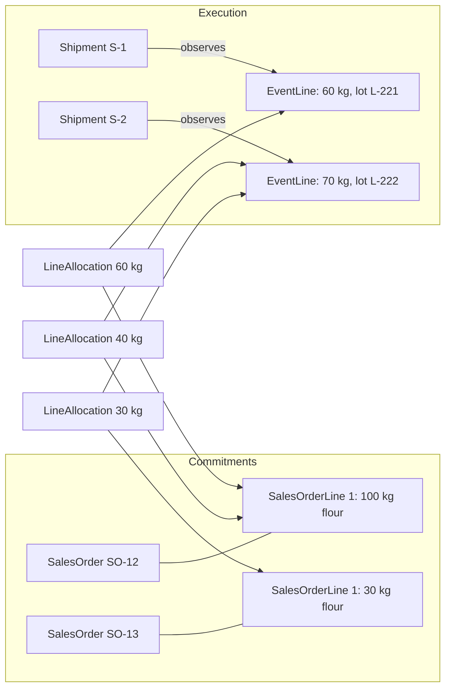

# Commitment and event terms

This is a design to argue with, not a ratified model. No term below has a ratification record: the packet holds no
`rat-` file and decisions 1 to 7 ratify no term by name. The conceptualizer skill works on ratified terms only, so
every row here is a candidate for `ontology-foundational-auditor` and for Benjamin, and every edge, disjointness and
domain or range is `proposed`. Nothing here is built: there is no vocabulary module, projector, generated Turtle, SHACL
or competency-question suite.

Inputs: the packet's decisions and reports 01 and 02; the skills' `_shared` files; the architecture seed and the API
design report (where they disagree, report 01 section 5 is followed); the catalog and access contracts; the import's
Alchemy blocks in `packages/catalog/model/src`; the root `DECISIONS.md`; and `explorations/alchemy-domain`. Sutton
facts are from public sources only, cited by the architecture seed or the API design report, and marked "public".

## What this document owns, and what it borrows

It owns five groups of terms: commitments and their lines, the allocation of a line's quantity to its execution,
execution events, the accounting boundary, and the import's own events. It borrows, by their likely keys, from the
other eight documents (listed again at the end of each table that uses them):

| Borrowed term (likely key) | Owner | Used for |
| --- | --- | --- |
| `Organization`, `Person`, `Party` | 06 party and access | `counterparty`, `carriedBy`, `performedBy` |
| `ItemSpecification`, `BomRevision`, `RoutingRevision`, `OperationDefinition` | 07 catalog and value | what a line promises, what an order makes from |
| `QuantityValue`, `MoneyAmount`, `hasQuantity` | 07 catalog and value | every quantity and price here |
| `Location`, `Site`, `Machine`, `MaterialLot`, `InventoryLabel`, `SerialUnit`, `LogisticUnit`, `InventoryReservation`, `QualityHold`, `StockMovement` | 08 warehouse and stock | where an event happens and what stock it involves |
| `WorkCenter` | 07 catalog and value | where an operation runs |
| the concepts of each scheme named here | 10 taxonomies | lifecycle states, business steps, outcomes, reasons |
| gist parents and the alignment rows (EPCIS, CBV, ISA-95, IOF, OWL-Time) | 11 gist projection and alignments | the EPCIS view below is input to its rows |
| the term entry's shape, the tag values, how `skos:Concept` ranges are written | 05 term model, 12 projection and checks | every row here |

The keys were matched with the other eight documents on 2026-11-22 (report 13). Where two documents named one thing,
one key stands and the row that lost says whose it is; open choices are numbered decisions in
[DECISIONS.md](../DECISIONS.md), mapped from each Qn here under "Questions for Benjamin". `Machine` is 08's and
`WorkCenter` is 07's; every scheme named here is 10's, under 10's key.

## The shape in one picture

Promise and performance are kept apart. A commitment line promises a quantity; an event line records a quantity that
moved, was made or was used; a `LineAllocation` counts part of one against the other. One line met by several events,
and one event meeting several lines, are then plain data, not special cases.



Read: SO-12 line 1 shipped in two parts (60 kg in S-1, 40 kg in S-2); S-2 served two orders. Whether a line is met is
not stored: it is the sum of its allocations against its quantity, a View.

## Commitments

Each order class is a kind whose phase is a concept of 10's one `OrderLifecycleScheme` (decision 82); each line
class is a subkind of `CommitmentLine`. The gist
parents of the order classes are Benjamin's (Q1), as `gist-categories.md` says ("Whether an order is an offer, a
commitment or an agreement at each stage is a question for Benjamin").

| Key | Label | Definition | Tag | gist parent | Identity | Source | Status |
| --- | --- | --- | --- | --- | --- | --- | --- |
| `Quote` | Quote | An offer, made by the organization to one customer, to supply listed items at stated prices until a stated date. | kind | `gist:Offer` | the tenant and the quote's source id (a reidentification key; the criterion is open, project profile) | the architecture seed 5.6; the API design report 4.1; public Sutton documents on quotes | Sutton only |
| `SalesOrder` | Sales order | An agreement in which a customer commits to pay the organization and the organization commits to deliver listed items (pending Q1, Q2). | kind | `gist:Agreement` (pending Q1) | the tenant and the order's source id | the architecture seed 5.6; public Sutton document "Sales orders: key features" | Sutton only |
| `PurchaseOrder` | Purchase order | An agreement in which the organization commits to pay a vendor and the vendor commits to deliver listed items (pending Q1, Q2). | kind | `gist:Agreement` (pending Q1) | the tenant and the order's source id | the architecture seed 2.1, 5.5; public Sutton document "Purchase orders: key features" | Sutton only |
| `ManufacturingOrder` | Manufacturing order | A commitment by the organization to make a stated quantity of one item from a chosen bill of materials and routing by a due date (pending Q1, Q2). | kind | `gist:Commitment` (pending Q1) | the tenant and the order's source id | the architecture seed 5.4; public Sutton document "Manufacturing & work orders: key features" | Sutton only |
| `WorkOrder` | Work order | A commitment, part of one manufacturing order, to perform one operation of its routing with stated materials and resources (pending Q1, Q2). | kind | `gist:Commitment` (pending Q1) | the tenant and the work order's source id | the architecture seed 5.4; public Sutton document "Working through work orders" | Sutton only |
| `TransferOrder` | Transfer order | A commitment by the organization to move listed stock from one of its sites to another (pending Q1, Q2). | kind | `gist:Commitment` (pending Q1) | the tenant and the order's source id | the API design report 1.3, 4.1 (public: inter-site transfer orders) | Sutton only |
| `CommitmentLine` | Line | A commitment, part of one quote or order, to supply, make or move one quantity of one item by one date. | kind | `gist:Commitment` | the commitment it belongs to and the line's source id; never its item, SKU or position on screen | the architecture seed 5.5, 5.6 (`PurchaseOrderLine`, `SalesOrderLine`); NEW as the common parent, so allocation has one range | Sutton only |
| `QuoteLine` | Quote line | A line of a quote that offers one quantity of one item at one price. | subkind | none: below `CommitmentLine` | as `CommitmentLine` | the architecture seed 5.6 (quotes with versioned terms); NEW as a class | Sutton only |
| `SalesOrderLine` | Sales order line | A line of a sales order that promises one quantity of one item to the customer by a date. | subkind | none: below `CommitmentLine` | as `CommitmentLine` | the architecture seed 5.6 | Sutton only |
| `PurchaseOrderLine` | Purchase order line | A line of a purchase order that the vendor promises to deliver: one quantity of one item at one price by a date. | subkind | none: below `CommitmentLine` | as `CommitmentLine` | the architecture seed 5.5 | Sutton only |
| `ManufacturingOrderLine` | Manufacturing order line | A line of a manufacturing order that names one material to consume or one output to produce, with its quantity. | subkind | none: below `CommitmentLine` | as `CommitmentLine` | the architecture seed 5.4 (actual input and output allocations); NEW as a class | Sutton only |
| `WorkOrderLine` | Work order line | A line of a work order that names one material to issue or one output to report at that operation, with its quantity. | subkind | none: below `CommitmentLine` | as `CommitmentLine` | the architecture seed 5.4 (material picks per work order); NEW as a class | Sutton only |
| `TransferOrderLine` | Transfer order line | A line of a transfer order that names one quantity of one item, lot or label to move. | subkind | none: below `CommitmentLine` | as `CommitmentLine` | the API design report 4.1 (`transferredLabel`); NEW as a class | Sutton only |
| `LineAllocation` | Allocation | Content that counts one exact quantity of one event line against one commitment line, so that one line is met by several events and one event meets several lines. | information | `gist:Content`, as the architecture seed's `LotAllocation` (pending Q5; this row first had none) | the commitment line and the event line it joins: one allocation per pair, its quantity summed | the architecture seed 5.5, 5.6 ("resolve many-to-many relationships through line allocations"); report 01 section 4 | Sutton only |

A manufacturing order's output and its components are both `ManufacturingOrderLine`s; which one a line is comes from
the property that joins its execution (`produces` or `consumes`, below), not from a subclass. An alias item sold on a
line keeps its own item on the line (`promisedItem`) while the event line names the stock item that left
(`involvesItem`), as the architecture seed 5.1 and 5.6 ask.

A reservation (stock set aside for a line before anything moves) is 08's `InventoryReservation`, not an allocation.
Allocation counts what happened; reservation holds what may.

### Lifecycle schemes

The lifecycles are SKOS schemes, never subclasses (state-is-kind). Their concepts are document 10's. One scheme per
commitment kind is the design; one shared scheme is the alternative (Q3). The architecture seed's `WorkflowStatus`
(Draft, Planned, Released, In progress, Complete, Cancelled) is its "proposed common reporting vocabulary, not source
SDL" and becomes, under the recommended answer, the target of `skos:broadMatch` rows from each scheme's concepts.

A line's state (open, partly met, met) is not a scheme: it is the sum of the line's allocations against its quantity,
worked out by a View. Storing it would be a second, drifting copy of the allocations.

Under the recommended answer to Q3 (decision 82) there are no per-kind schemes: every order's phase is a concept of
10's `OrderLifecycleScheme`, and fulfilment, payment and invoicing progress are 10's `FulfilmentProgressScheme`,
`PaymentProgressScheme` and `InvoicingProgressScheme`; a quote's own phases are later. This document first proposed
six schemes, `QuoteLifecycleScheme`, `SalesOrderLifecycleScheme`, `PurchaseOrderLifecycleScheme`,
`ManufacturingOrderLifecycleScheme`, `WorkOrderLifecycleScheme` and `TransferOrderLifecycleScheme`, each with a
`skos:broadMatch` to the architecture seed's `WorkflowStatus`: that is decision 82's other answer.

## Execution events

Every class here is an occurrence (gist step 1, "Does it happen over time?"), except `QualityResult` (content).
`QualityHold` is 08's (its gist parent is Q4 here, decision 77); this document keeps the two events that begin and end
it. The schemes these events draw on (`BusinessStepScheme`, `QualityOutcomeScheme`, `HoldReasonScheme`,
`ReceivingRejectReasonScheme`) are 10's. Machine telemetry is will-not (04's CQ-E05): the machine state interval,
the machine reading and their properties (`stateOf`, `machineState`, `readFrom`) are kept as a note below, not
proposed. The architecture seed groups
them under one `TraceabilityEvent`; that class is not proposed here. Under it, a receipt could not also be a
`gist:Transaction` nor an inspection a `gist:Determination` without a second parent, and every question it would answer
("every event that involved lot L-221") is answered through `EventLine`. Each event takes its own gist parent instead,
and the properties they share have the broad domain `gist:Event`. Every class under a gist event class is tagged
`event`, as 05's kind tag defines it (this document first tagged them `kind`, while 06 and 08 tagged theirs `event`;
report 13).

`EventLine` carries the "lines" of every event: what a receipt brought in, what a shipment carried, what a
transformation consumed and produced, what a pack put in a pallet. Its role is the property that joins it to its event
(`observes`, `consumes`, `produces`, `packs`, `unpacks`), so the role is never a free text field.

| Key | Label | Definition | Tag | gist parent | Identity | Source | Status |
| --- | --- | --- | --- | --- | --- | --- | --- |
| `EventLine` | Event line | An event, part of one execution event, in which one quantity of one item, lot, label, serial unit or logistic unit is received, moved, shipped, consumed, produced, packed, unpacked, inspected or held. | event | `gist:Event` | the event it is part of and the line's source id | the architecture seed 5.5, 5.6, 7.1 (`ReceiptLine`, `ShipmentLine`, `LotAllocation`); EPCIS `QuantityElement` and EPC lists; NEW as one class for all of them | Sutton only |
| `Receipt` | Receipt | A transaction in which goods arrive at a site of the organization and pass into its custody, from a vendor, a carrier or another of its sites. | event | `gist:Transaction` | the tenant and the receipt's source id; never its time and place | the architecture seed 5.5; public Sutton document "Receiving: key features"; report 01 section 6 | Sutton only |
| `ReceivingRejection` | Receiving rejection | An event in which the organization refuses part or all of what one receipt brought in, for a stated reason. | event | `gist:Event` | the tenant and the rejection's source id | the architecture seed 5.5 ("receiving rejection, a quality hold ... are separate decisions/events"); the API design report 1.3 (public: custom supplier reject reasons) | Sutton only |
| `Putaway` | Putaway | An event in which received or produced stock is moved from where it arrived into a storage location. | subkind | none: below 08's `StockMovement` (pending decision 79) | as `StockMovement` (08): the tenant and the move's source id | NEW: named in this document's brief; CBV `BizStep-storing` | Sutton only |
| `Pick` | Pick | An event in which stock is taken from a storage location to meet an order line or a production need. | subkind | none: below 08's `StockMovement` (pending decision 79) | as `StockMovement` (08): the tenant and the move's source id | the architecture seed 5.4, 5.6 (material picks, picks); the API design report 1.3 (pick lists) | Sutton only |
| `Shipment` | Shipment | A transaction in which goods leave a site of the organization and pass out of its custody, to a customer, a carrier or another of its sites. | event | `gist:Transaction` | the tenant and the shipment's source id | the architecture seed 5.6; public Sutton document "Shipping: key features" | Sutton only |
| `OperationExecution` | Operation run | An event in which one operation is actually performed at a work center or on a machine, by a person or an organization, over an observed interval. | event | `gist:Task` (pending Q8: in gist 14.1.0 and recommended by 11; this document first kept `gist:Event`) | the tenant and the execution's source id | the architecture seed 5.4 ("`OperationExecution` is the performed activity") | Sutton only |
| `TransformationEvent` | Transformation | An event in which input material is consumed and output material is produced, so that what the material is changes. | event | `gist:PhysicalEvent` (pending decision 13: in gist 14.1.0, recommended by 11) | the tenant and the event's source id | the architecture seed 7.1; EPCIS `TransformationEvent` | Sutton only |
| `AggregationEvent` | Packing | An event in which items or units are put into a parent logistic unit without changing the material. | event | `gist:PhysicalEvent` (pending decision 13: in gist 14.1.0, recommended by 11) | the tenant and the event's source id | the architecture seed 7.1; EPCIS `AggregationEvent` with action ADD | Sutton only |
| `DisaggregationEvent` | Unpacking | An event in which items or units are taken out of a parent logistic unit without changing the material. | event | `gist:PhysicalEvent` (pending decision 13: in gist 14.1.0, recommended by 11) | the tenant and the event's source id | the architecture seed 7.1 ("no invented EPCIS disaggregation class": it exports as `AggregationEvent` DELETE) | Sutton only |
| `ObjectObservation` | Sighting | An event in which identified stock or a quantity of an item is seen at a place and time without being received, shipped, moved, transformed or packed. | event | `gist:PhysicalEvent` (pending decision 13: in gist 14.1.0, recommended by 11) | the tenant and the event's source id | the architecture seed 7.1 (`ObjectObservation` for `epcis:ObjectEvent`) | Sutton only |
| `QualityInspection` | Quality check | A determination that establishes whether stated stock, or the output of an operation, meets stated acceptance criteria. | event | `gist:Determination` | the tenant and the check's source id | the architecture seed 5.7; public Sutton document "Logging quality checks on manufacturing orders" | Sutton only |
| `QualityResult` | Quality result | Content that records what one quality check found: its measurements, outcome, evidence and who recorded it, kept by revision when edited. | information | `gist:Content` | the check it is of and the result's revision | the architecture seed 5.7 ("Preserve revisions when source results are edited") | Sutton only |
| `HoldPlacement` | Hold placed | An event in which one quality hold begins on stated stock. | event | `gist:Event` | the tenant and the event's source id | the architecture seed 5.7, 7.1 (CBV `BizStep-holding`); NEW as its own event | Sutton only |
| `HoldRelease` | Hold released | An event in which one quality hold ends, by an explicit decision, for all or part of the stock it held. | event | `gist:Event` | the tenant and the event's source id | the architecture seed 5.7 ("An inspection passing does not release stock without an explicit release policy"); NEW as its own event | Sutton only |
| `RecallCase` | Recall | An event in which the organization questions material, finds the shipments it reached and decides what becomes of it, from opening to close. | event | `gist:Event` | the tenant and the case's source id | the architecture seed 5.7; public Sutton page "Traceability" | Sutton only |

Not proposed, kept as a note for a reopened CQ-E05 (04, will-not): a machine state interval (an event during which
one machine stays in one state, as a detector classifies it, from an inclusive start to an exclusive end, identified
by the machine and its start), a machine reading (a detector's one signal from one machine at one instant), and their
properties `stateOf` and `readFrom` (to 08's `Machine`) and `machineState` (to 10's machine state scheme, also a
note). The architecture seed 5.4 is the source of each.

## Accounting boundary

Sutton keeps no general ledger; invoices and bills leave for QuickBooks or Xero (public, the architecture seed 2.1).
The two schemes this area uses are 10's `AccountingSyncDirectionScheme` and `AccountingSyncStateScheme` (this
document first named the second `AccountingSyncOutcomeScheme`).
So these are documents and records of sending them, never postings. No `gist:Account` (an agreement with a balance)
appears here.

| Key | Label | Definition | Tag | gist parent | Identity | Source | Status |
| --- | --- | --- | --- | --- | --- | --- | --- |
| `Invoice` | Invoice | Content that asks a customer to pay for goods or services delivered under a sales order or a shipment, sent to an outside accounting system. | information | `gist:Content` | the tenant and the invoice's source id | the architecture seed 2.1 (public: outward invoice sending); the API design report 1.3 (suffix-free when a whole order or shipment is invoiced) | Sutton only |
| `SupplierBill` | Vendor bill | Content in which a vendor asks the organization to pay for goods or services under a purchase order, matched against what was received. | information | `gist:Content` | the tenant and the bill's source id | the architecture seed 2.1 (public: three-way matching) | Sutton only |
| `AccountingSyncRecord` | Accounting sync | Content that records one attempt to send a document to an outside accounting system, or to read one from it, with the outside id, the outcome and any error. | information | `gist:Content` | the document, the direction and the attempt's time | the architecture seed 2.1 ("Model each synchronization direction and document type separately") | Sutton only |

## The import's own events

These are grounded in what the repository has today: the catalog contract (`Import/Import.read.ts`,
`Import/Decision.command.ts`, `Import/Change.read.ts`, `Staging/Staged.read.ts`, `Staging/Upload.command.ts`,
`Staging/FileProblem.read.ts`, `Catalog.contract.ts`), the Alchemy blocks merged into
`packages/catalog/model/src` (`Import/Import.aggregate.ts`, `Row/Row.aggregate.ts`, `Group/Group.aggregate.ts`) and the
root `DECISIONS.md`. Whether they belong in the ontology at all is Q7; they are designed here under its recommended
answer.

Each class is a referent, not a record. The import is what the operations admin does; `ImportView`, `ImportResult` and
`RowDecisionFlags` are records of it. Records name their term through the `term` annotation (report 02).

| Key | Label | Definition | Tag | gist parent | Identity | Source | Status |
| --- | --- | --- | --- | --- | --- | --- | --- |
| `ItemImport` | Import | An event in which a person brings one file of item records into the organization's catalogue, from its upload through review to its confirms, and possibly their take-back (pending Q7). | event | `gist:Event` | `ImportId`, which is its upload's id | `packages/catalog/contract/src/Import/Import.read.ts` (`ImportView`); `packages/catalog/model/src/Import/Import.aggregate.ts` (`Import`) | in the repository today |
| `FileUpload` | Upload | An event in which a person sends one .csv or .xlsx file to the organization in numbered pieces, ending finished, cancelled or expired (pending Q7). | event | `gist:Event` | the browser's `UploadKey` for that file, then the `ImportId` it is given | `packages/catalog/contract/src/Staging/Upload.command.ts` (`UploadStart`, `UploadChunk`); `Catalog.contract.ts` (four upload endpoints) | in the repository today |
| `StagedFile` | Staged file | Content that holds one uploaded file as its reader found it: its sheet, columns, rows of uncoerced cells and the reader's notes, unchanged until the import ends (pending Q7). | information | `gist:FormattedContent` (pending decision 13: in gist 14.1.0; `gist:Content` otherwise) | the import it was staged for | `packages/catalog/contract/src/Staging/Staged.read.ts` (`StagedTable`: "a staged cell is what the file said, never a corrected value") | in the repository today |
| `FileRow` | File row | Content that holds one data row of a staged file, named by its row number as Excel numbers it and, for a row holding several items, its part (pending Q7). | information | `gist:Content` | the import and the `RowId` (`row-7`, `row-8.2`); never its SKU | `packages/catalog/contract/src/Catalog.id.ts` (`RowId`); `Staging/Staged.read.ts` (`StagedRow`) | in the repository today |
| `FileProblem` | File problem | Content that says why a whole file cannot be read or staged, naming the file, and what the person can do about it (pending Q7). | information | `gist:Content` | the upload and the problem's kind | `packages/catalog/contract/src/Staging/FileProblem.read.ts` ("a problem in the person's file is data the screen shows ... never a request error") | in the repository today |
| `ColumnMatching` | Column match | An event in which a person, or the heading rule when the file is staged, sets which file column fills one item field, or that none does (pending Q7). | event | `gist:Event` | the import and the match's number in its matching | `packages/catalog/contract/src/Import/Mapping.read.ts` (`ColumnMatch`, `MappingChoice`); `Import.aggregate.ts` (`ColumnMatched`) | in the repository today |
| `ValueProposal` | Proposal | Content that offers one value for one field of one file row, from a rule or a model, with its basis and confidence, and changes nothing until a person accepts it (pending Q7). | information | `gist:Content` | the import, the row, the field and the proposal's source | `packages/catalog/contract/src/Suggestion/Suggestion.read.ts`; `Import/Change.read.ts` (`AcceptedProposal`); CLAUDE.md "A model proposes; it never writes" | in the repository today |
| `RowDecision` | Row decision | An event in which a person settles one file row: leaves it out, keeps it over a row with the same SKU, accepts or undoes a proposal, types a value, or keeps or replaces a stored item (pending Q7). | event | `gist:Event` | the import and the change number that recorded it | `packages/catalog/contract/src/Import/Decision.command.ts` (`RowDecisionFlags`); `Row/Row.aggregate.ts` (`RowDecided`) | in the repository today |
| `GroupDecision` | Group decision | An event in which a person settles several file rows by one act, such as accepting one proposal for every row it explains (pending Q7). | event | `gist:Event` | the import and the change number that recorded it | `Group/Group.aggregate.ts` (`GroupDecided`); CLAUDE.md "One decision where one settles a column" | in the repository today |
| `DecisionUndo` | Undo | An event in which a person takes back an earlier row or group decision, so that the decision under it stands again (pending Q7). | event | `gist:Event` | the import and the change number that recorded it | `Row/Row.aggregate.ts` (`StepUndone`); `Group/Group.aggregate.ts` (`GroupUndone`) | in the repository today |
| `ImportConfirmation` | Confirm | An event in which a person confirms an import, and every Ready row is written to the catalogue as created or replaced items in one batch (pending Q7). | event | `gist:Event` | `ConfirmId` | `Import/Import.read.ts` (`ImportEvent` `Confirmed`, `batchId`); `Import.aggregate.ts` (`ImportConfirmed`); CLAUDE.md "Nothing is written until the person confirms" | in the repository today |
| `RowOutcome` | Row outcome | Content that says what an import's confirms did with one file row (created, updated, already there, not imported, taken back), with a reason wherever one is owed (pending Q7). | information | `gist:Content` | the import and the `RowId` (pending decision 53: 04 recommends one outcome per confirmation, identified by the confirm and the `RowId`) | `Import/Import.read.ts` (`RowOutcome`, `OutcomeKind`) | in the repository today |
| `ValueChange` | Changed value | Content that records one value an import wrote in place of what its file said, with how it came to stand (by a rule, by an accepted proposal, typed) and who decided it (pending Q7). | information | `gist:Content` | the confirm, the `RowId` and the field | `Import/Import.read.ts` (`ChangeRecord`); `Import/Change.read.ts` (`Change`) | in the repository today |
| `ImportTakeBack` | Take-back | An event in which a person reverses the confirms of an import still in force, removing the items they created and restoring the items they replaced, except items changed since, which are kept and named (pending Q7). | event | `gist:Event` | the import and the first confirm it reverses (`batchId`) | `Import/Import.read.ts` (`ImportEvent` `TakenBack`, `TakeBackState`); `Import.aggregate.ts` (`ImportTakenBack`); root `DECISIONS.md` ("Take-back after a replace") | in the repository today |
| `ImportReopening` | Reopen | An event in which a person opens a confirmed or taken-back import again, to finish the rows it left out (pending Q7). | event | `gist:Event` | the import and the change number that recorded it | `Catalog.contract.ts` (`reopen`); `Import.aggregate.ts` (`ImportReopened`) | in the repository today |
| `ImportRemoval` | Remove | An event in which a person removes an import that has nothing in force (pending Q7). | event | `gist:Event` | the import | `Catalog.contract.ts` (`remove`); `Import.aggregate.ts` (`ImportRemoved`, `HasItemsInForce`) | in the repository today |
| `ItemEdit` | Item edit | An event in which a person changes the stored values of one item after an import created or replaced it, outside any import (pending Q7). | event | `gist:Event` | the item and the revision the edit was made on | `Catalog.contract.ts` (`PUT /items/:id`); `TakeBackState.changed` ("a take-back keeps them"); CLAUDE.md "a changed record kept and named" | in the repository today |

The schemes the import uses are 10's: `ImportLifecycleScheme`, `ReviewOutcomeScheme` (three concepts or five,
decision 56), `ImportResultOutcomeScheme` (first written here as `RowOutcomeScheme`), `ValueChangeMethodScheme`
(first `ChangeHowScheme`) and `ValueChangeSourceScheme` (first `ChangeSourceScheme`). A file problem's kind gets no
scheme: 10 lists `FileProblemKind` among the code lists that are file-reading mechanics (decision 52).

Two "already there" rules stay record rules, not terms: a second load of the same file adds nothing (counted from the
stored SKU keys), and a row's identity is its `RowId`, never its SKU (rows 4 and 10 of the messy sample share one).

## Properties

One direction only; the reverse is a SPARQL `^p` path. Domains and ranges are broad where several classes use a
property (anti-pattern 10). Where no record schema exists yet, a datatype range "moves to the record schema", and the
owning context is Q6. A range written `skos:Concept (X)` means a concept of scheme X; how that is projected is 05's
and 12's.

### Commitments and allocation

| Key | Label | Definition | Domain | Range | Source |
| --- | --- | --- | --- | --- | --- |
| `lineOf` | line of | Relates a line to the quote, order or bill of materials revision it is part of. | `gist:Intention`: a `CommitmentLine` here, a `BomLine` in 07 | `gist:Intention` (quotes, manufacturing, work and transfer orders are commitments and sales and purchase orders agreements, pending Q1; 07's BOM revisions are specifications; all are intentions) | the architecture seed (`hasLine`, turned to run from the part, as gist's `isPartOf` does) |
| `promisedItem` | promised item | Relates a line to the item it promises, as the commitment names it (an alias item stays the alias). | `CommitmentLine` | `ItemSpecification` (07) | the architecture seed 5.1, 5.6 |
| `agreedUnitPrice` | agreed unit price | Relates a line to the price per unit agreed for it. | `CommitmentLine` | `MoneyAmount` (07) | the architecture seed 5.5 ("price ... line") |
| `dueOn` | due on | Gives the calendar date a line is promised for. | `CommitmentLine` | datatype from the record field (moves to the record schema; the seed writes an ISO date string) | the architecture seed 5.8 (`dueDate`) |
| `counterparty` | counterparty | Relates a quote or an order to the organization on the other side of it: the customer of a quote or sales order, the vendor of a purchase order. | `gist:Intention` | `Organization` (06) | decision 3 (an Account is an `Organization` with role flags; the flag a counterparty needs is a record rule) |
| `acceptsQuote` | accepts quote | Relates a sales order to the quote it was made from. | `SalesOrder` | `Quote` | the API design report 4.1 (Quote to Sales order conversion) |
| `raisedFor` | raised for | Relates a commitment to a line of another commitment it was raised to supply (a manufacturing order made for a sales order line, a purchase order bought for a manufacturing order line). | `gist:Intention` | `CommitmentLine` | the API design report 4.1 (`fulfillsSalesOrder`); the architecture seed 5.3 |
| `workOrderOf` | work order of | Relates a work order to the manufacturing order it is part of. | `WorkOrder` | `ManufacturingOrder` | the architecture seed (`hasWorkOrder`, turned to run from the part) |
| `subOrderOf` | sub-order of | Relates a manufacturing order to the manufacturing order it makes a component for. | `ManufacturingOrder` | `ManufacturingOrder` | the API design report 4.1 (`hasParentManufacturingOrder`) |
| `usesBomRevision` | uses BOM revision | Relates a manufacturing order to the bill of materials revision bound to it, whatever the item's default is now. | `ManufacturingOrder` | `BomRevision` (07) | the architecture seed 5.1 ("Preserve that selected revision") |
| `usesRoutingRevision` | uses routing revision | Relates a manufacturing order to the routing revision its work follows. | `ManufacturingOrder` | `RoutingRevision` (07) | the architecture seed 5.4 |
| `followsOperation` | follows operation | Relates a work order to the operation definition it is an instruction for. | `WorkOrder` | `OperationDefinition` (07) | the architecture seed (`implementsOperation`) |
| `sourceLocation` | from | Relates a transfer order, a stock movement, a pick or a putaway to the place the stock leaves. | none declared: used by `TransferOrder`, 08's `StockMovement`, `Pick`, `Putaway`, which share no parent below gist's top; a record rule holds it | `Location` (08) | the API design report 4.1 (`sourceSite`) |
| `destinationLocation` | to | Relates a transfer order, a stock movement, a pick or a putaway to the place the stock goes. | none declared, as `sourceLocation` | `Location` (08) | the API design report 4.1 (`destinationSite`) |
| `allocatesLine` | allocates line | Relates an allocation to the commitment line it counts against. | `LineAllocation` | `CommitmentLine` | the architecture seed 5.5, 5.6 |
| `allocatedTo` | allocated to | Relates an allocation to the event line whose quantity it counts. | `LineAllocation` | `EventLine` | the architecture seed 5.5, 5.6 |

The quantity of a line, an event line and an allocation is 07's `hasQuantity`; it is not minted again here. A
lifecycle phase is 10's `lifecycleState`, one property for orders, imports, items and labels. A quote's last day is
07's `effectiveUntil` (this document's `validUntil` folded into it: one fact).

### Execution events

| Key | Label | Definition | Domain | Range | Source |
| --- | --- | --- | --- | --- | --- |
| `observes` | observes | Relates an event to an event line it received, shipped, moved, sighted, inspected, held, released or refused, without transforming or packing it. | `gist:Event` | `EventLine` | the architecture seed (`observedAllocation`); EPCIS `epcList`, `quantityList` |
| `consumes` | consumes | Relates a transformation to an event line it used up as input. | `TransformationEvent` | `EventLine` | the architecture seed (`inputAllocation`); EPCIS `inputEPCList`, `inputQuantityList` |
| `produces` | produces | Relates a transformation to an event line it made as output. | `TransformationEvent` | `EventLine` | the architecture seed (`outputAllocation`); EPCIS `outputEPCList`, `outputQuantityList` |
| `packs` | packs | Relates a packing to an event line it put into the parent unit. | `AggregationEvent` | `EventLine` | the architecture seed (`childLogisticUnit`); EPCIS `childEPCs`, `childQuantityList` |
| `packedInto` | packed into | Relates a packing to the logistic unit it filled. | `AggregationEvent` | `LogisticUnit` (08) | the architecture seed (`parentLogisticUnit`); EPCIS `parentID` |
| `unpacks` | unpacks | Relates an unpacking to an event line it took out of the parent unit. | `DisaggregationEvent` | `EventLine` | the architecture seed 7.1 |
| `unpackedFrom` | unpacked from | Relates an unpacking to the logistic unit it emptied. | `DisaggregationEvent` | `LogisticUnit` (08) | the architecture seed 7.1; EPCIS `parentID` |
| `involvesLogisticUnit` | logistic unit | Relates an event line to a whole logistic unit it concerns, such as a pallet shipped or packed as one. | `EventLine` | `LogisticUnit` (08) | the architecture seed (`container`); EPCIS `childEPCs` |
| `occursAt` | at | Relates an event to the place it happened at. | `gist:Event` | `Location` (08) | EPCIS `bizLocation`, `readPoint`; gist `occursIn` (alignment, 11) |
| `businessStep` | business step | Relates an event to the step of a business process it belongs to. | `gist:Event` | `skos:Concept` (`BusinessStepScheme`) | the architecture seed (`businessStep`); EPCIS `bizStep` |
| `resultingDisposition` | disposition after | Relates an event to the disposition the stock it involves has afterwards. | `gist:Event` | `skos:Concept` (10's `QualityDispositionScheme`) | the architecture seed (`disposition`); EPCIS `disposition` |
| `eventTime` | happened at | Gives the instant an event happened, with its time zone. | `gist:Event` | datatype from the record field | the architecture seed (`eventTime`); EPCIS `eventTime` |
| `recordTime` | recorded at | Gives the instant a system recorded an event, which may be long after it happened. | `gist:Event` | datatype from the record field | the architecture seed (`recordTime`); EPCIS `recordTime` |
| `startedAt` | started at | Gives the inclusive start of an event that lasts, or of a grant (06). | none declared: an event that lasts, under `gist:Event`, and 06's `Grant` (kept broad) | datatype from the record field | the architecture seed (`startTime`) |
| `endedAt` | ended at | Gives the exclusive end of an event that lasts, or of a grant (06); absent while it has not ended. | none declared: as `startedAt` | datatype from the record field | the architecture seed (`endTime`; "absent for an open interval") |
| `correctsEvent` | corrects | Relates an event to an earlier event it corrects, which is kept as it was recorded. | `gist:Event` | `gist:Event` | the architecture seed 7.1 (`correctsEvent`; not an EPCIS `errorDeclaration` by itself) |
| `performedBy` | by | Relates an event to the member, person or organization that did it or answers for it. | `gist:Event` | none declared: a `Member` (06) for an act in the app, a person or an organization for an act outside it; each record's SHACL says which (pending decision 91) | the architecture seed (`performedBy`); CLAUDE.md "People are told apart by id" |
| `carriedBy` | carrier | Relates a receipt or a shipment to the organization that carried the goods. | `gist:Transaction` | `Organization` (06) | decision 3 (no carrier flag while decision 89 is open); public Sutton shipping document (bills of lading) |
| `executesWorkOrder` | runs | Relates an operation run to the work order it carries out. | `OperationExecution` | `WorkOrder` | the architecture seed 5.4 |
| `usesMachine` | machine | Relates an operation run to a machine it used. | `OperationExecution` | `Machine` (08) | the architecture seed (`usesMachine`) |
| `duringRun` | during | Relates a transformation to the operation run it happened in. | `TransformationEvent` | `OperationExecution` | the architecture seed 5.4 ("Do not infer that material was consumed simply because a scheduled WO exists") |
| `rejectsPartOf` | refuses part of | Relates a receiving rejection to the receipt whose goods it refuses. | `ReceivingRejection` | `Receipt` | the architecture seed 5.5 |
| `inspectionOutcome` | outcome | Relates a quality check to what it concluded. | `QualityInspection` | `skos:Concept` (`QualityOutcomeScheme`) | the API design report 4.1 (`checkOutcome`) |
| `resultOf` | result of | Relates a quality result to the check it records. | `QualityResult` | `QualityInspection` | the architecture seed (`inspectionResult`, turned to run from the result) |
| `placesHold` | places | Relates a hold placement to the hold it begins. | `HoldPlacement` | `QualityHold` | the architecture seed 5.7 |
| `releasesHold` | releases | Relates a hold release to the hold it ends. | `HoldRelease` | `QualityHold` | the architecture seed 5.7 |
| `hasReason` | reason | Relates a hold or a receiving rejection to the reason given for it. | none declared: used by `QualityHold` and `ReceivingRejection`; the scheme each draws on is a record rule | `skos:Concept` (`HoldReasonScheme`, `ReceivingRejectReasonScheme`, `MachineStopReasonScheme`) | the architecture seed (`holdReason`); one property, not one per class (naming-conventions, "encoding class in the property name") |
| `questionsLot` | questions | Relates a recall to a lot it puts in question. | `RecallCase` | `MaterialLot` (08) | the architecture seed 5.7 ("the questioned material") |
| `affectsShipment` | affects | Relates a recall to a shipment it decided was affected; a trace that finds candidates is a View, not this. | `RecallCase` | `Shipment` | the architecture seed 5.7 ("affected shipments") |

An event line names its item, lot, label and serial unit with 08's `forItem`, `forLot`, `forLabel` and
`forSerialUnit`, whose domain is left open for every scoped record (this document first wrote `involvesItem`,
`involvesLot`, `involvesLabel`, `involvesSerialUnit`); `involvesLogisticUnit` stays, since 08's `inLogisticUnit`
says where stock was, not what a line concerns. An operation run's work center is 07's `atWorkCenter`.

### Accounting boundary

| Key | Label | Definition | Domain | Range | Source |
| --- | --- | --- | --- | --- | --- |
| `invoicesOrder` | invoices order | Relates an invoice to the sales order it bills. | `Invoice` | `SalesOrder` | the API design report 1.3 (invoicing an entire sales order) |
| `invoicesShipment` | invoices shipment | Relates an invoice to the shipment it bills. | `Invoice` | `Shipment` | the API design report 1.3 (invoicing an entire shipment) |
| `billsOrder` | bills order | Relates a vendor bill to the purchase order it bills. | `SupplierBill` | `PurchaseOrder` | the architecture seed 2.1 (three-way matching) |
| `matchesReceipt` | matched to | Relates a vendor bill to a receipt it was matched against. | `SupplierBill` | `Receipt` | the architecture seed 2.1 |
| `syncsDocument` | document | Relates a sync record to the document it sent or read. | `AccountingSyncRecord` | `gist:Content` | the architecture seed 2.1 |
| `syncDirection` | direction | Relates a sync record to the direction the document travelled. | `AccountingSyncRecord` | `skos:Concept` (`AccountingSyncDirectionScheme`) | the architecture seed 2.1 |
| `syncOutcome` | outcome | Relates a sync record to how the attempt ended. | `AccountingSyncRecord` | `skos:Concept` (10's `AccountingSyncStateScheme`) | the architecture seed (`AccountingSyncRecord`) |
| `externalDocumentId` | outside id | Gives the id the outside accounting system holds the document under. | `AccountingSyncRecord` | datatype from the record field (moves to the record schema) | the architecture seed (`AccountingSyncRecord`: "external ID") |
| `attemptedAt` | attempted at | Gives the instant the sync was attempted. | `AccountingSyncRecord` | datatype from the record field (moves to the record schema) | the architecture seed (`AccountingSyncRecord`) |

### The import

| Key | Label | Definition | Domain | Range | Source |
| --- | --- | --- | --- | --- | --- |
| `partOfImport` | of import | Relates an upload, a column match, a decision, an undo, a confirm, a take-back, a reopen or a remove to the import it is part of. | `gist:Event` | `ItemImport` | `Catalog.contract.ts` (every import endpoint is under `/imports/:id`) |
| `stagedFrom` | staged from | Relates a staged file to the upload it was read from. | `StagedFile` | `FileUpload` | `Catalog.contract.ts` (`finishUpload`: "Turns the upload into an import") |
| `importsFile` | imports | Relates an import to the staged file it reviews. | `ItemImport` | `StagedFile` | `Import/Import.read.ts` (`ImportView`; rows from `table`) |
| `rowOf` | row of | Relates a file row to the staged file it is in. | `FileRow` | `StagedFile` | `Staging/Staged.read.ts` (`StagedTable.rows`) |
| `reportsProblemWith` | problem with | Relates a file problem to the upload whose file it is about. | `FileProblem` | `FileUpload` | `Staging/FileProblem.read.ts` (`StagingOutcome`) |
| `matchedField` | field | Gives the item field a column match sets. | `ColumnMatching` | datatype from the record field (`Field` in `Staging/Staged.read.ts`) | `Catalog.contract.ts` (`match` payload) |
| `matchedColumn` | column | Gives the file column's position a match points the field at; absent for none. | `ColumnMatching` | datatype from the record field (`column`, null for none) | `Catalog.contract.ts` (`match` payload) |
| `proposesFor` | for row | Relates a proposal to the file row it offers a value for. | `ValueProposal` | `FileRow` | `Suggestion/Suggestion.read.ts` |
| `proposedField` | field | Gives the item field a proposal offers a value for. | `ValueProposal` | datatype from the record field (`Field`) | `Suggestion/Suggestion.read.ts`; NEW as a row: the proposal's identity names the field, and CQ-I06 compares it with the changed value's |
| `proposedBy` | proposed by | Relates a proposal or a changed value to where it came from. | none declared: used by `ValueProposal` and `ValueChange` | `skos:Concept` (10's `ValueChangeSourceScheme`) | `Import/Change.read.ts` (`ChangeSource`) |
| `decidesRow` | decides | Relates a row decision or a group decision to a file row it settles. | none declared: used by `RowDecision` and `GroupDecision` | `FileRow` | `Decision.command.ts`; `Group/Group.aggregate.ts` ("its rows, what it does to each") |
| `acceptsProposal` | accepts | Relates a row decision or a group decision to a proposal it accepts. | none declared, as `decidesRow` | `ValueProposal` | `Decision.command.ts` (`accepted`) |
| `undoes` | undoes | Relates an undo to the decision it takes back. | `DecisionUndo` | `gist:Event` (a `RowDecision` or a `GroupDecision`) | `Row/Row.aggregate.ts`; `Group/Group.aggregate.ts` |
| `reviewOutcome` | review says | Relates a file row to what the review says of it as of the import's last change; worked out by the pure `review`, never stored as a fact. | `FileRow` | `skos:Concept` (`ReviewOutcomeScheme`) | `packages/catalog/model/src/Review/Review.rules.ts` (not opened here); CLAUDE.md |
| `writesItem` | writes | Relates a confirm to an item it created or replaced. | `ImportConfirmation` | `ItemSpecification` (07) | `ImportResult` (`created`, `updated`) |
| `takesBack` | takes back | Relates a take-back to a confirm it reverses. | `ImportTakeBack` | `ImportConfirmation` | `TakeBackState.confirms`; `ImportEvent` `TakenBack` |
| `removesItem` | removes | Relates a take-back to an item it removed. | `ImportTakeBack` | `ItemSpecification` (07) | `ImportEvent` `TakenBack` (`removed`) |
| `restoresItem` | restores | Relates a take-back to a stored item it put back as it was before a replace. | `ImportTakeBack` | `ItemSpecification` (07) | `ImportEvent` `TakenBack` (`restored`) |
| `keepsItem` | keeps | Relates a take-back to an item it kept because someone changed it since. | `ImportTakeBack` | `ItemSpecification` (07) | `TakeBackState.kept`, `ChangedItem` |
| `outcomeFor` | for row | Relates a row outcome to the file row it is about. | `RowOutcome` | `FileRow` | `RowOutcome` (`rowNumber`, `part`) |
| `outcomeKind` | outcome | Relates a row outcome to what was done with the row. | `RowOutcome` | `skos:Concept` (10's `ImportResultOutcomeScheme`) | `OutcomeKind` |
| `recordedBy` | recorded by | Relates a row outcome or a changed value to the confirm or take-back whose batch stored it. | none declared: used by `RowOutcome` and `ValueChange` | `gist:Event` | `ImportResult` ("counted from the stored rows") |
| `changeIn` | in row | Relates a changed value to the file row it went into. | `ValueChange` | `FileRow` | `ChangeRecord` (`rowNumber`, `part`) |
| `changedField` | field | Gives the item field whose value differs from the file. | `ValueChange` | datatype from the record field (`Field`) | `Change` (`field`) |
| `fileValue` | file said | Gives the value as the file gave it. | `ValueChange` | datatype from the record field | `Change` (`from`) |
| `writtenValue` | written | Gives the value the import wrote in its place. | `ValueChange` | datatype from the record field | `Change` (`to`) |
| `changeHow` | how | Relates a changed value to how it came to stand. | `ValueChange` | `skos:Concept` (10's `ValueChangeMethodScheme`) | `ChangeHow` |
| `decidedIn` | decided in | Relates a changed value to the row decision or group decision that settled it, when a person did. | `ValueChange` | `gist:Event` (a `RowDecision` or a `GroupDecision`) | `Import/Import.read.ts` (`ChangeRecord`: who decided it); NEW as a row: CQ-I04 and CQ-I06 ask who decided each value and whether an accepted proposal had its accept |
| `edits` | edits | Relates an item edit to the item it changed. | `ItemEdit` | `ItemSpecification` (07) | `PUT /items/:id` |

Who acted is `performedBy` for every import event too, read from the actor's id, never the `DisplayName` the records
keep for the screen. When an agent acts for the person (`asAgent`, CLAUDE.md), how that is said is 06's.

## The Alchemy domain layer

The alchemy-domain packet's blocks are records and their changes, the ontology's classes are what they record (report
01 section 6). A commitment is an `Aggregate`; an ontology event is recorded by an Alchemy `Event`, append-only, after
a `Command` is accepted; a refusal is a `Rejection`; information content (row outcomes, changed values) is written by
a `Projection` and read by a `Query` or a `View`. A Command, a Rejection, a Projection or a View is never an ontology
term: they are how records change and are read, not what the business deals in.

### The import, as built on main

Names read from the declarations in `packages/catalog/model/src` (`Import.aggregate.ts`, `Row.aggregate.ts`,
`Group.aggregate.ts`) and from the brief's "Every single thing" and "The contract and the ports" tables. Which
rejection each command raises was read only where the brief pairs them.

| Term | Aggregate | Command | Event | Rejection | Projection, Query or View |
| --- | --- | --- | --- | --- | --- |
| `FileUpload` | `Upload` (move 5, not built) | today HTTP: `beginUpload`, `putChunk`, `finishUpload`, `discardUpload`; `ExpireUpload` deadline (move 5) | begun, finished, expired: names not fixed (brief) | today the contract's `UploadNotFound` (HTTP). A `FileProblem` is not a rejection: it is data in `StagingOutcome` | none |
| `ItemImport`, `StagedFile` | `Import` | `StageImport` | `ImportStaged` | `AlreadyStaged` | `ImportStatus` View, `ImportReview` Query (planned) |
| `ColumnMatching` | `Import` | `MatchColumn` | `ColumnMatched` | `MatchedSince`, `NotOpen`, `NotPermitted` among those declared | `DraftRows` Projection |
| `ValueProposal` | `Import` | `RecordSuggestion` | `SuggestionRecorded` ("it writes nothing") | none read | `SuggestOnAsk` Policy, `SuggestionPass` Saga (move 5) |
| `RowDecision` | `Row`, through the `Deciding` Decision | `DecideRow` | `RowDecided`, and `ActCounted` on `Import` | `GroupedSince` (brief); `DecidedSince`, `ConfirmedSince`, `NotYourStep`, `StepTaken`, `NotWhatWasUnder`, `DecidedBeforeTheConfirm` declared, pairing not read | `DraftRows` Projection, `ImportActs` Stream, `MySteps` Query |
| `GroupDecision` | `Group`, through `DecidingGroup` | `DecideGroup` | `GroupDecided`, and `GroupCounted` on `Import` | `GroupedAfter` (brief) | `DraftRows` reads each row through its groups |
| `DecisionUndo` | `Row` or `Group`, through `Undoing` or `UndoingGroup` | `UndoRowStep`, `UndoGroup` | `StepUndone`, `GroupUndone` | `HistoryEnds` declared, pairing not read | `DraftRows` |
| `ImportConfirmation` | `Import` | `ConfirmImport` (sent through `ServerApi` by the handler, with a plan staged in D1, brief decision 18) | `ImportConfirmed` | `ReviewMovedOn`, `PlanBehind`, `NotWhatWasShown`, `CountsDoNotAddUp` (the contract's `DraftMoved` becomes the first three) | the confirm's batch writes `importBatch`, `importOutcome`, `importChange`; `ImportResultCounts` Query |
| `RowOutcome` | none | none | none: stored by the confirm's or take-back's batch | none | `ImportResultCounts` Query |
| `ValueChange` | none | none | none: stored by the confirm's batch (`importChange`) | none | a Query over `importChange` (move 5), today `GET /imports/changes` |
| `ImportTakeBack` | `Import` | `TakeBackImport` | `ImportTakenBack` | `NotImported`, `MoreKeptThanInForce`, `ReviewMovedOn` | the take-back's batch, with its marker |
| `ImportReopening` | `Import` | `ReopenImport` | `ImportReopened` | `NotClosed` | `OpenImports` Query (move 5) |
| `ImportRemoval` | `Import` | `RemoveImport` | `ImportRemoved` | `HasItemsInForce` | `OpenImports` |
| `ItemEdit` | `Item` (brief decision 17, first option; move 4, not built) | today `PUT /items/:id`; `EditItem` (move 4) | `ItemEdited` in the trial only (`research/04-trial.md`), not built | none read | `ItemRows` Projection (decision 17) |

### Commitments and execution, proposed

Nothing here is in the alchemy-domain packet beyond report 01 section 6's examples (`PurchaseOrder` keyed by tenant and
id; `ReceiptRecorded`; "Receive 40 kg" refused because the line is closed). Every other name is proposed here, in the
brief's naming pattern (a command in the imperative, its event in the past tense, a rejection that says what stood in
the way).

| Term | Aggregate | Command | Event | Rejection (example) | Projection or View |
| --- | --- | --- | --- | --- | --- |
| each commitment kind | one per kind, keyed by tenant and source id | one per lifecycle transition (`ReleasePurchaseOrder`) | one per transition (`PurchaseOrderReleased`); the state is the lifecycle concept | `NotReleased`, `AlreadyClosed` | `OpenPurchaseLines`, `OpenSalesLines` Views |
| `CommitmentLine` | inside its commitment's aggregate | `AddLine`, `ChangeLine` | `LineAdded`, `LineChanged` | `LineClosed` (report 01) | `LineFulfilment` View: allocations summed against the line |
| `LineAllocation` | inside the line's commitment | `AllocateToLine` | `QuantityAllocated` | `MoreThanTheEventLineHas`; whether over-delivery is refused is Q9 | `LineFulfilment` |
| `Receipt` | `Receipt` | `RecordReceipt` | `ReceiptRecorded` (report 01) | `LineClosed` (report 01) | 08's stock projection |
| `ReceivingRejection` | `Receipt` | `RejectReceived` | `ReceivedRejected` | `MoreThanReceived` | 08's stock projection |
| `Putaway`, `Pick` | none: each is one event of a move | `PutAway`, `PickForLine` | `StockPutAway`, `StockPicked` | `NotAtThatLocation` | 08's stock projection |
| `Shipment` | `Shipment` | `RecordShipment` | `ShipmentRecorded` | `NothingPicked` | 08's stock projection; `LineFulfilment` |
| `OperationExecution`, `TransformationEvent` | `WorkOrder` | `StartOperation`, `RecordTransformation` | `OperationStarted`, `MaterialTransformed` | `WorkOrderNotReleased` | genealogy View (lot to lot) |
| `AggregationEvent`, `DisaggregationEvent` | `LogisticUnit` (08) | `Pack`, `Unpack` | `Packed`, `Unpacked` | `NotInThatUnit` | contents-at-time View (replayed at a shipment's time) |
| `QualityInspection` | `QualityInspection` | `RecordInspection` | `InspectionRecorded` | `ResultEditedSince` | none |
| `QualityHold`, `HoldPlacement`, `HoldRelease` | `QualityHold` | `PlaceHold`, `ReleaseHold` | `HoldPlaced`, `HoldReleased` | `NoReleasePolicyMet`, `NotOnHold` | open-holds View |
| `RecallCase` | `RecallCase` | `OpenRecall`, `DecideAffected`, `CloseRecall` | `RecallOpened`, `ShipmentFoundAffected`, `RecallClosed` | `AlreadyClosed` | forward and backward trace Views |
| `Invoice`, `SupplierBill`, `AccountingSyncRecord` | the document, keyed by tenant and id | `SendToAccounting` | `SentToAccounting`, `AccountingRefused` | `QuantityBeyondReceived` (public three-way matching rule) | sync status View |

## The EPCIS 2.0.0 and CBV view

How each event would export. The names were read from GS1's published `epcis-ontology.ttl` and `cbv-ontology.ttl` at
`ref.gs1.org/standards/epcis/2.0.0/` on 2026-11-22, through a fetch that listed the file's names (not byte-compared).
The alignment rows themselves are 11's; this table is their input.

Found there: the classes `ObjectEvent`, `AggregationEvent`, `TransformationEvent`, `TransactionEvent`,
`AssociationEvent`, `QuantityElement`, `BizTransaction`, `ErrorDeclaration`, `SensorElement`; the properties `action`
(a datatype property: ADD, OBSERVE and DELETE are literals, not individuals), `bizStep`, `disposition`, `bizLocation`,
`readPoint`, `eventTime`, `recordTime`, `parentID`, `childEPCs`, `childQuantityList`, `inputEPCList`,
`inputQuantityList`, `outputEPCList`, `outputQuantityList`, `transformationID`, `bizTransactionList`; among the CBV
business steps `receiving`, `accepting`, `storing`, `stocking`, `picking`, `packing`, `unpacking`, `shipping`,
`inspecting`, `holding`, `commissioning`, and no `transforming`, as the architecture seed says; the dispositions
`non_sellable_other`, `non_conformant`, `recalled`, `in_transit`, `available`; the transaction types `BTT-po`,
`BTT-prodorder`, `BTT-inv`, `BTT-bol`, `BTT-desadv`, `BTT-rma`.

| Our event | EPCIS class | action | CBV business step | Notes |
| --- | --- | --- | --- | --- |
| `Receipt` | `ObjectEvent` | OBSERVE | `BizStep-receiving` | `bizTransactionList` names the purchase order (`BTT-po`) or dispatch advice (`BTT-desadv`) |
| `ReceivingRejection` | `ObjectEvent` | OBSERVE | `BizStep-accepting` or `BizStep-inspecting` (candidate) | `Disp-non_conformant` is a candidate, for 11 to review |
| `Putaway` | `ObjectEvent` | OBSERVE | `BizStep-storing` (`BizStep-stocking` when it makes stock pickable) | which one is 10's crosswalk |
| `Pick` | `ObjectEvent` | OBSERVE | `BizStep-picking` | a production pick names the manufacturing order (`BTT-prodorder`) |
| `Shipment` | `ObjectEvent` | OBSERVE | `BizStep-shipping` | bill of lading `BTT-bol`, invoice `BTT-inv`; between two own sites `Disp-in_transit` until the receipt |
| `TransformationEvent` | `TransformationEvent` | none (it has no action field) | none fixed | `transformationID` groups several events of one transformation; the identities of lots and units must be resolved, never made up from a SKU (the architecture seed 7.1) |
| `AggregationEvent` | `AggregationEvent` | ADD | `BizStep-packing` | `parentID` is the logistic unit's identifier, never a bin code |
| `DisaggregationEvent` | `AggregationEvent` | DELETE | `BizStep-unpacking` | |
| `ObjectObservation` | `ObjectEvent` | OBSERVE | by case | |
| `QualityInspection` | `ObjectEvent` | OBSERVE | `BizStep-inspecting` | |
| `HoldPlacement` | `ObjectEvent` | OBSERVE | `BizStep-holding` | `Disp-non_sellable_other` only when the hold prevents sale (the architecture seed's alignment file) |
| `HoldRelease` | `ObjectEvent` | OBSERVE | none in CBV 2.0.0 | the disposition after is what changes |
| `RecallCase` | none | | | events on recalled stock carry `Disp-recalled` |
| `OperationExecution` | none | | | ISA-95 and IOF are 11's; the API design report's `MachineTelemetryInterval` alignment belongs to the will-not telemetry note |
| the import's events | none | | | they are not supply-chain events |

## Sketches

Sketch, not code: a few entries in 05's shapes (section 4.7), definitions as in the tables above.

```ts
// sketch, not code
export const classes = defineClasses({
  SalesOrder: { prefLabel: "Sales order", definition: "…", tag: "kind", // pending Q1
    parent: { kind: "gist", term: "gist:Agreement" }, identity: { kind: "stated", criterion: "…", restsOn: [] } },
  CommitmentLine: { prefLabel: "Line", definition: "…", tag: "kind",
    parent: { kind: "gist", term: "gist:Commitment" }, identity: { kind: "stated", criterion: "…", restsOn: [] } },
  SalesOrderLine: { prefLabel: "Sales order line", definition: "…", tag: "subkind",
    parent: { kind: "local", key: "CommitmentLine" }, identity: { kind: "inherited" } },
  LineAllocation: { prefLabel: "Allocation", definition: "…", tag: "information", // pending Q5
    parent: { kind: "gist", term: "gist:Content" }, identity: { kind: "stated", criterion: "…", restsOn: [] } },
  Shipment: { prefLabel: "Shipment", definition: "…", tag: "event",
    parent: { kind: "gist", term: "gist:Transaction" }, identity: { kind: "stated", criterion: "…", restsOn: [] } },
})
export const disjointGroups = [{ members: ["Quote", "SalesOrder", "PurchaseOrder", "ManufacturingOrder", "WorkOrder",
  "TransferOrder"], ratification: "rat-…" }]
// EPCIS view rows are alignment rows, 11's; a class entry has no match field
```

Sketch, not code: the picture's example as fixture data (instance data, `test_` names, never a term fact).

```turtle
# sketch, not code
inv:test_SO12_L1 a inv:SalesOrderLine ; inv:lineOf inv:test_SO12 ; inv:hasQuantity inv:test_q100kg .
inv:test_S2 a inv:Shipment ; inv:observes inv:test_S2_E1 .
inv:test_S2_E1 a inv:EventLine ; inv:forLot inv:test_L222 ; inv:hasQuantity inv:test_q70kg .
inv:test_A2 a inv:LineAllocation ; inv:allocatesLine inv:test_SO12_L1 ; inv:allocatedTo inv:test_S2_E1 ;
  inv:hasQuantity inv:test_q40kg .
inv:test_A3 a inv:LineAllocation ; inv:allocatesLine inv:test_SO13_L1 ; inv:allocatedTo inv:test_S2_E1 ;
  inv:hasQuantity inv:test_q30kg .
# "which shipments served SO-12?" walks ^inv:allocatesLine / inv:allocatedTo / ^inv:observes
```

Questions this design is built to answer (document 04 owns their numbers and their SPARQL): which shipments served a
sales order, and how much of each line is still open; which orders one shipment served; what a transformation consumed
and produced, and every lot downstream of a questioned lot; what a pallet held at the time it shipped; which stock is
on hold and why, and which holds were released by whom; which
invoices and bills went to the accounting system and which failed; what an import did with each row, which values it
wrote that differ from its file, who decided each, and which items a take-back kept because they had changed.

## Axiom plan

All `proposed`. The vocabulary module holds them; the architect formalizes them.

- Subsumption: as the tables' gist parent column, and the six line subkinds under `CommitmentLine`.
- Disjointness, each as one all-disjoint set: the six commitment kinds; the six line subkinds; `Receipt` and
  `Shipment`; the local classes directly under `gist:Event` (`EventLine`, `ReceivingRejection`, `HoldPlacement`,
  `HoldRelease`, `RecallCase`, and the import's eleven events), with
  `OperationExecution` (under `gist:Task`) and the four under `gist:PhysicalEvent` when decision 13 brings those in;
  `Putaway` and `Pick` as subkinds of 08's `StockMovement` (decision 79); the local classes under `gist:Content`
  (`QualityResult`, `Invoice`, `SupplierBill`, `AccountingSyncRecord`, `FileRow`, `FileProblem`, `ValueProposal`,
  `RowOutcome`, `ValueChange`, and `StagedFile` unless it moves under `gist:FormattedContent`).
  Disjointness across gist's top classes (an event that is also content) is gist's own axiom and is not copied unless
  Benjamin says so (project profile).
- No `owl:inverseOf`, no `owl:sameAs`, no keys, no cardinality, no property characteristics. A line's quantity, a
  required `eventTime`, an allocation that names both ends, a counterparty whose customer flag is set: record rules, in
  the record schemas and the SHACL generated from them, or Alchemy invariants.

## Anti-pattern review

| # | Anti-pattern | Finding |
| --- | --- | --- |
| 1 | Singleton hierarchy | `CommitmentLine` has six subkinds. `gist:Offer` and `gist:Determination` have one local child each; the checklist reads `inv:` terms only, so an imported parent with one child is expected |
| 2 | Role-as-kind | No customer, vendor or carrier class: `counterparty` and `carriedBy` point at an `Organization` whose flag is a record rule (decision 3) |
| 3 | Process-object confusion | Promise and performance are split: a manufacturing order is not an operation run, a work order not a transformation, a receipt is the event and the receiving ticket is the record |
| 4 | Missing disjointness | Planned above for every set of sibling kinds; none of the siblings is a role or a phase |
| 5 | Circular definition | Checked by reading each definition against its key: none uses the term it defines (a pick is "stock taken", not "a picking") |
| 6 | Quality-as-class | Lifecycle states, outcomes and reasons are SKOS concepts; no `OpenOrder` class |
| 7 | Information-physical conflation | A quality check (event) and its result (content); a sale and its invoice; an upload (event) and the staged file (content) |
| 8 | Orphan class | none: `LineAllocation` sits under `gist:Content` (pending Q5, decision 83); `QualityHold` is 08's, under `gist:Restriction` (pending Q4, decision 77) |
| 9 | Polysemy | "Receipt" is the event here, not the document; "allocation" (counting what happened) is kept apart from 08's reservation (holding what may); "decision" in the import (`RowDecision`) is not 06's `IdentityDecision`; "import" is the item import only, hence `ItemImport` |
| 10 | Domain/range overcommitment | Shared properties take `gist:Event` or `gist:Intention`; where no common parent exists the domain is left undeclared rather than made a union. Narrow ranges (`affectsShipment` to `Shipment`) are intended: anything they point at is a shipment |
| 11 | Individuals in the T-box | Concepts are 10's, in SKOS; fixtures are `test_` instance data under `assets/` only |
| 12 | Negative universals | None |
| 13 | False is-a | `WorkOrder` is part of a `ManufacturingOrder` (`workOrderOf`), not a kind of it; `DisaggregationEvent` is not a kind of `AggregationEvent`, though both export as EPCIS `AggregationEvent` |
| 14 | System blueprint instead of domain model | The import's terms are the risk (Q7). Commands, rejections, projections, HTTP endpoints, chunks and revisions are left out of the vocabulary |
| 15 | Technical perspective | Labels are the business's words ("Receipt", "Take-back", "Hold released"); a key differs from its label only where the label alone is ambiguous |
| 16 | Mixing individuals with classes | No class is also used as a value; `businessStep` points at a concept, never at an event class |

Two foundational failure modes from `foundational-analysis.md` apply too. Current-state timelessness: `lifecycleState`,
`lifecycleState` (on an order or an import) and `reviewOutcome` hold only as of the graph's snapshot, the state of an
aggregate; their history is the Alchemy events, so 12 must say what time a generated A-box speaks for.
Specification-is-execution: a work order (what should run) and an operation run (what ran) have separate identities, and
neither is inferred from the other.

## Questions for Benjamin

Moved on 2026-11-22 to the packet's [DECISIONS.md](../DECISIONS.md), "Open", merged with the other reports'
questions. A "(pending Qn)" mark in this report means: Q1 is decision 80, Q2 is 81, Q3 is 82, Q4 is 77, Q5 is 83,
Q6 is 37, Q7 is 52, Q8 is 13, Q9 is 84.

## Not checked

- No term here went through `ontology-foundational-auditor`, and there is no `rat-` record for any of them; the
  conceptualizer skill's input rule is not met, so this is a candidate design.
- The gist release file was not opened; every gist name is from `gist-categories.md`. `gist:Intention` is named there
  only as a parent of other classes, and `gist:Task` not at all.
- The EPCIS and CBV names were read through a fetch that listed them, not byte-compared, and EPCIS 2.0.1 was not
  read. The CBV definitions of `storing` and `stocking` were not read, so the putaway crosswalk is a candidate.
- No Sutton page was fetched. Every Sutton fact is as the architecture seed or the API design report cites its public
  source; Sutton's GraphQL schema is behind a token and was not seen.
- Read in the repository: the catalog contract's import, staging, change and id files and the import endpoints of
  `Catalog.contract.ts`; the access contract's audit trail and the kernel's `Activity`; `docs/glossary.md`; the root
  `DECISIONS.md`; the alchemy-domain README and the brief's tables and decisions 17 and 18; the class declarations in
  `Import.aggregate.ts`, `Row.aggregate.ts`, `Group.aggregate.ts`. Not read: the alchemy-domain `DECISIONS.md` in
  full, its concept pages, `Review.rules.ts`, `format.tsx` (`importWords`), `Suggestion.read.ts`, the item and
  assistant contracts, and the which-rejection-for-which-command pairing in the model files.
- The other eight documents were being written at the same time and were not read by this report's author; the keys
  were matched with them on 2026-11-22 (report 13), which folded this document's scheme rows into 10, moved
  `QualityHold` to 08, and replaced eleven of its property keys with the owners' keys.
- The architecture seed's ontology, taxonomy and shapes were read as class and property lists; its fixtures and
  scripts were not read or run, and the API design report was read for its class tables, schemes and contexts only.
- Nothing was loaded into a reasoner or a SHACL engine; there is nothing to load yet.
