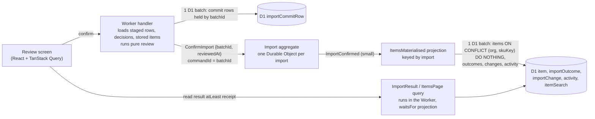
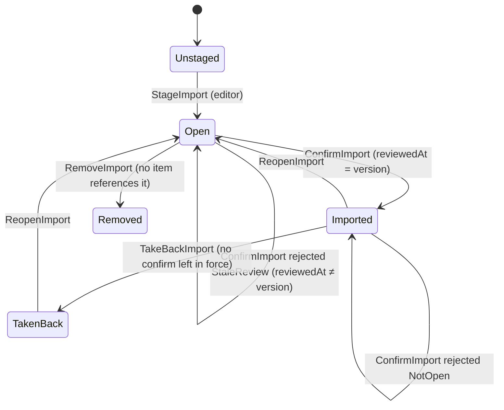
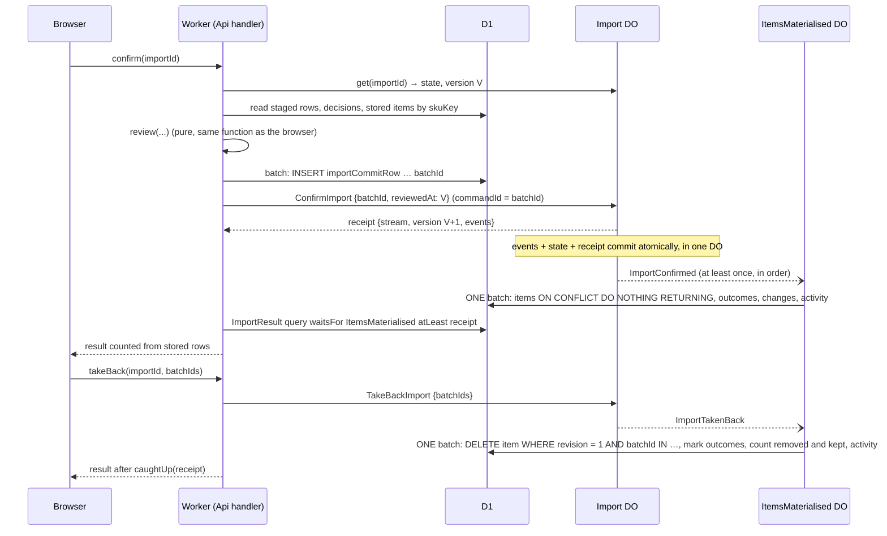

# Borrow Alchemy's domain ideas, keep D1's atomic core

> Reversed on 2026-11-19: Benjamin's answer to this report's recommendation was "Not borrow use." It stays as written, for the record; the current reading, pinned to two refs and checked by two trials, and the brief are in [the alchemy-domain packet](../../alchemy-domain/README.md).

`@alchemy.run/domain` is an event-sourced CQRS framework. You declare commands, events, rejections, aggregates, views, projections, streams, queries, policies, sagas and external systems as Effect classes, group them in a `Domain.Model`, and host the model in memory, on Rivet, on Effect Cluster or on Cloudflare. On Cloudflare every aggregate instance, view key, projection key and saga run becomes its own Durable Object. From one `Domain.Api` it can generate an RPC client, a JSON HTTP API with OpenAPI, an Effect CLI, an Effect AI toolkit and an MCP server. It also ships a given/when/then test DSL (`Story`) that runs the real model in memory. Two findings change the brief. **(a) The domain layer does not build on Effect's `schema/Model` at all.** `Domain.Model` is Alchemy's own container for one bounded context and shares only the name with Effect's `Model.Class`. The building blocks sit on `Schema.TaggedClass` and `Schema.TaggedError`, and nothing in `packages/domain/src` imports `effect/schema` ([src/Model.ts](https://github.com/alchemy-run/alchemy/blob/main/packages/domain/src/Model.ts), [src/Event.ts](https://github.com/alchemy-run/alchemy/blob/main/packages/domain/src/Event.ts)). **(b) The alchemy.run site documents the published npm beta, `2.0.0-beta.87`, while GitHub `main` has already changed the API.** Commit `dbda8cc16` (2026-11-17) removed `target` from commands, added `keyOf` to aggregates, changed `send(target, cmd)` to `send(cmd)`, and added `Domain.Decision` for atomic writes across several aggregates ([commit dbda8cc16](https://github.com/alchemy-run/alchemy/commit/dbda8cc16)). So which API you design against is itself a decision. My recommendation pushes back on adopting the engine. The app's hardest guarantees are a single atomic D1 batch for a confirm or take-back of thousands of rows, a unique index `(organizationId, skuKey)`, the same pure `review` run again on the server at confirm, and tenant keys on every table. The domain layer weakens or relocates each of these. Keep the Effect HttpApi and D1 core (modelling C below), adopt a few of its ideas, and keep "the Import aggregate as lifecycle authority" (modelling A) as a later, reversible step once a release containing `Decision` is on npm.

## Maturity: a fast-moving beta with no stability labels

| Item | Value | Source |
| --- | --- | --- |
| Package | `@alchemy.run/domain`, "Domain-driven backends for Alchemy: aggregates, commands, events, projections, sagas and stories over Effect." | [packages/domain/package.json](https://github.com/alchemy-run/alchemy/blob/main/packages/domain/package.json) |
| Version | `2.0.0-beta.87` is the npm `latest` tag. The published versions are `0.0.0-stage`, `0.0.0` and `2.0.0-beta.84`–`87` | [npm registry](https://registry.npmjs.org/@alchemy.run%2fdomain) |
| Cadence | beta.84 2026-10-24, beta.85 11-02, beta.86 and beta.87 both on 11-12 | npm registry |
| Licence and author | Apache-2.0, Sam Goodwin | package.json |
| Entry points | `.`, `./Cloudflare`, `./EffectCluster`, `./Rivet`, `./*`. The wildcard maps to `src/*.ts`, which is how `@alchemy.run/domain/Cli`, `/Http`, `/Story`, `/Foldkit` and `/Ai` resolve | package.json |
| Peers | `effect` is required, resolved through the workspace `catalog:` (exact Effect 4 version not resolved). Optional peers: `@alchemy.run/cloudflare`, `/rivet`, `/effect-cluster`, `foldkit`, `@effect/sql-pg`, `alchemy` | package.json |
| Stability labels | None. No domain page carries an alpha, beta, experimental or preview banner. The version string is the only maturity signal | [alchemy.run/domain](https://alchemy.run/domain/) |
| Agent skill | `skills add alchemy-run/alchemy --skill alchemy-domain` | [alchemy.run/domain](https://alchemy.run/domain/) |

**The site and `main` have split.** The live site matches the beta.87 tarball. In beta.87, `Command.ts` declares `readonly target: TargetSchema` and `Aggregate.ts` declares `send: (target, command, options?)`; there is no `Decision.ts` and no `TwoPhase.ts` ([beta.87 tarball](https://registry.npmjs.org/@alchemy.run/domain/-/domain-2.0.0-beta.87.tgz)). On `main`, `send: <Cmd>(command, options?)` takes the command alone, aggregates gain `keyOf?: (command) => Id["Type"]`, `Decision.ts` (+353 lines) and `TwoPhase.ts` (+403 lines) are new, and a `decision.mdx` page exists in the repository ([alchemy-run/alchemy: packages/domain/src/Aggregate.ts](https://github.com/alchemy-run/alchemy/blob/main/packages/domain/src/Aggregate.ts)). The live URL `https://alchemy.run/domain/decision` returns 404, and no npm version contains `Decision`. One consequence: the package README, which reads as "stale" against the site, actually matches `main`; it is the site that lags. Code copied from alchemy.run today compiles only against beta.87. Code that uses `Domain.Decision` needs an unreleased build. Expect another breaking change at the next beta.

**Effect modules underneath that are marked unstable.** Every export of `effect/packages/effect/src/schema/Model.ts` is `@stability unstable`, and so are `McpServer.layerHttp` and `McpServer.layerHttpRequestScoped` in `effect/packages/effect/src/ai/McpServer.ts`, which the MCP surface relies on. The domain package also imports `effect/rpc/*`, `effect/workflow` (sagas), `effect/ai` and `effect/cli`. Their stability labels were not checked; see the Effect modules report.

## Core building blocks: one class factory per concept, Durable Objects underneath

Everything follows one pattern. You `import * as Domain from "@alchemy.run/domain"`, take schemas from `effect/Schema`, and declare each block as `Domain.X("Name", { ...declaration }, { ...annotations })`. Behaviour that needs services goes in a separate Layer, `X.toLayer(...)`, and the model is hosted with `Model.layer(handlers)` above a platform Layer ([alchemy.run/domain/model](https://alchemy.run/domain/model)). This split fits the owner's design order: declarations are pure schemas, a handler is the implementation, and a port such as `LedgerStore` is a `Context.Service`. The bank example puts declarations and ports in `packages/domain` and adapters in `packages/server` ([examples/cloudflare-domain](https://github.com/alchemy-run/alchemy/tree/main/examples/cloudflare-domain)), which maps directly onto a public `@beep/*-domain` package plus server-side `internal/` adapters.

### Model, Command, Event, Rejection

**Model.** "A `Domain.Model` is one bounded context running as a whole." It lists the blocks it contains:

```ts
// site (beta.87) and main — https://alchemy.run/domain/model
export class Bank extends Domain.Model("Bank", { aggregates: [Account, Customer], views: [AccountSummary, Statement], policies: [MainAccountProvisioning] }) {}
// other keys: projections, streams, sagas, queries — https://alchemy.run/domain/query
// main only: decisions: [Transfer] — alchemy-run/alchemy: website/src/content/docs/domain/decision.mdx
Bank.layer(BankHandlers).pipe(Layer.provide(Domain.InMemory))
Bank.layer(Layer.empty, { lazy: ["AccountSummary"] })
```

`LayerOptions` has three fields: `telemetry?`, `legacyData?` (default `true`) and `lazy?` ([alchemy-run/alchemy: packages/domain/src/Model.ts](https://github.com/alchemy-run/alchemy/blob/main/packages/domain/src/Model.ts)). The commit path for a command runs in five steps. The command is routed to exactly one instance. "Each instance handles one command at a time." `decide` returns events or a rejection, and `evolve` applies the events. One atomic write stores the events, the new state and version, the reply and a delivery for each consumer. Finally, a receipt `{ stream, version, events, reply }` is kept under the command id, so a retry gets the same answer. Delivery to consumers is "at least once, and in the order its source instance recorded them". Views are eventually consistent; to read your own write, pass `{ atLeast: receipt }`. "One model never sends commands to another model's aggregates directly; it calls that model's Api" ([model](https://alchemy.run/domain/model)).

**Command.** The site and `main` differ here:

```ts
// site (npm beta.87) — https://alchemy.run/domain/command
export class WithdrawMoney extends Domain.Command("WithdrawMoney", {
  target: AccountId,
  input: { amount: Schema.Int },
  events: [MoneyWithdrawn],
  rejects: [NotOpen, InsufficientFunds],
  reply: { balance: Schema.Int },
}) {}
// main — alchemy-run/alchemy: examples/cloudflare-domain/packages/domain/src/Account/WithdrawMoney.command.ts
//   input: { accountId: AccountId, amount: Cents }   (no target; the aggregate declares keyOf: (cmd) => cmd.accountId)
```

A command can also take `middleware: [Session, MfaChallenge]`, and its third argument holds annotations. The target is a branded id, `Schema.String.pipe(Schema.brand("AccountId"))`, and naming the wrong aggregate's id is a type error. A command that reports a fact declares no `rejects`. Passing `{ commandId }` gives exactly-once handling; commands sent by a policy get ids "derived from the event that caused them". `SendOptions` is `{ commandId?: string }` and has no expected-version field. `DecideContext` carries `{ id, commandId, stream, version, now }`, where `version` is "The stream's version before this decision: 0 for a new instance", so an expected-revision check is a few lines you write yourself ([alchemy-run/alchemy: packages/domain/src/Aggregate.ts](https://github.com/alchemy-run/alchemy/blob/main/packages/domain/src/Aggregate.ts)).

**Event.** `export class MoneyWithdrawn extends Domain.Event("MoneyWithdrawn", { amount: Schema.Int, balanceAfter: Schema.Int }) {}`. "Events are created in exactly one place: an aggregate's `decide` handler." To evolve an event, add optional fields or new event types. The envelope carries `id`, `stream` (for example `Account/a-1`), `seq`, `at` and `commandId`, and `evolve` receives it as its third argument ([event](https://alchemy.run/domain/event)).

**Rejection.** `Domain.Rejection("NotOwner", {}, { httpApiStatus: 403, description: "…" })`. "`Domain.Rejection` is `Schema.TaggedError` with its own type filled in." `rejects` accepts any tagged error class, including `HttpApiError.Forbidden` ([command](https://alchemy.run/domain/command); [src/Rejection.ts](https://github.com/alchemy-run/alchemy/blob/main/packages/domain/src/Rejection.ts)).

### Aggregate, Decision, unique values, deadlines

**Aggregate.** The declaration is `Domain.Aggregate("Name", { id, state, initial, commands, decide, evolve })`, with an optional `reply` map. State is usually a `Schema.Union` of `Schema.TaggedStruct`s. A `decide` handler can be an `Effect.fn` that fails with `return yield* rejection` and reads a request context with `yield* CurrentActor`; `evolve` "must always accept" ([aggregate](https://alchemy.run/domain/aggregate); [examples/cloudflare-domain/.../Account.aggregate.ts](https://github.com/alchemy-run/alchemy/blob/main/examples/cloudflare-domain/packages/domain/src/Account/Account.aggregate.ts)). The aggregate page sets the hard boundary in one sentence: "An instance decides alone, from its own state" ([main aggregate.mdx](https://github.com/alchemy-run/alchemy/blob/main/website/src/content/docs/domain/aggregate.mdx)). `yield* Account` gives a client with `send`, `get`, `schedule`, `unschedule` and `Account.ref(id)`. `Account.predict(state, command, { now, ... })` runs `decide` on the client and returns `Accepted | Rejected | Unpredictable`.

On Cloudflare, the state is stored with every commit (`meta: { state, version }`), so there is no snapshot API and no replay on read. Each event is its own storage key (`event:<seq>`), and receipts are stored as `receipt:<commandId>` with no deletion path anywhere in `DurableObjects.ts` ([alchemy-run/alchemy: packages/domain/src/DurableObjects.ts](https://github.com/alchemy-run/alchemy/blob/main/packages/domain/src/DurableObjects.ts)). The documented ceilings are about 1,000 requests a second and 10 GB per object, and "An aggregate instance keeps its whole event history" ([backfill](https://alchemy.run/domain/backfill)).

**Decision (main only).** It decides one command against several instances and commits all of their events or none:

```ts
// main only — alchemy-run/alchemy: website/src/content/docs/domain/decision.mdx
export class Transfer extends Domain.Decision(TransferMoney, {
  reads: { from: Account, to: Account },
  keyOf: (cmd) => ({ from: cmd.from, to: cmd.to }),
  decide: ({ from, to }, cmd) =>
    cmd.amount > from.state.balance
      ? new InsufficientFunds({ balance: from.state.balance })
      : [ from.record(new TransferSent({ to: to.id, amount: cmd.amount })),
          to.record(new TransferReceived({ from: from.id, amount: cmd.amount })) ],
}) {}
```

`keyOf` may return an array of ids for one read, so a decision can fan out to N instances. On Durable Objects it is a two-phase commit led by a primary instance. `TwoPhase.finish` prepares the other instances one at a time in a `for` loop; the design doc counts "about three [calls] per other instance". Contention retries back off with `times: 90`, "about 20 seconds in all", and after that the decision fails ([alchemy-run/alchemy: packages/domain/src/TwoPhase.ts](https://github.com/alchemy-run/alchemy/blob/main/packages/domain/src/TwoPhase.ts); [docs/decision-design.md](https://github.com/alchemy-run/alchemy/blob/main/packages/domain/docs/decision-design.md)). A decision cannot be scheduled, cannot call an external system and has no `predict`. No maximum instance count is documented. The design doc lists "Keyed logs. A coarser partition (one log per tenant)" under "Not done".

**Unique values.** The pattern makes the value itself an aggregate keyed by that value. In beta.87, a `UsernameClaim` aggregate decides `ClaimUsername`; a repeat claim by the same owner returns `[]`, an accepted no-op, and a policy confirms or rejects the registration afterwards. On `main`, a `Registration` decision records `CustomerRegistered` and `UsernameClaimed` together, or rejects at once ([unique-values](https://alchemy.run/domain/unique-values); [main unique-values.mdx](https://github.com/alchemy-run/alchemy/blob/main/website/src/content/docs/domain/unique-values.mdx)). Neither version shows normalisation of the value or a per-tenant key, and the `main` test snippet has a duplicated `customerId` key and calls a non-existent `Registration.id`.

**Deadlines.** `transfers.schedule(source, new ExpireTransfer(), { after: APPROVAL_WINDOW, commandId: \`expire:${source.id}\` })` (site) or `transfers.schedule(new ExpireTransfer({ transferId: source.id }), { ... })` (`main`). A scheduled send returns `ScheduleReceipt { commandId, at }`, and `unschedule` fails with `AlreadyExecuted | AlreadyCancelled | NotScheduled`. "Only commands that cannot be refused can be scheduled" (the `Schedulable` type requires `rejects: []`). "The schedule is durable", and scheduling again with the same command id replaces the earlier one ([deadlines](https://alchemy.run/domain/deadlines)).

### View, Projection, Stream, Query

**View.** `Domain.View("AccountSummary", { from: [Account], key: Account, state, initial, evolve })`, or `events` plus `emit` in place of `evolve`. A view can be keyed by a string schema, `key: OrgId` with `keyOf: { Tour: ({ event }) => event.orgId }`. Reads are `get`, `list`, `watch`, `events` and `snapshot`. `atLeast` waits for a write and fails with `ConsistencyTimeout` after 10 seconds. Bump `version` whenever what a view computes changes ([view](https://alchemy.run/domain/view); [model](https://alchemy.run/domain/model)). The docs keep views for "one question about one key".

**Projection.** A projection writes into a store you own. The port is a `Context.Service` in the domain package and the D1 adapter lives in the server package:

```ts
// main — alchemy-run/alchemy: website/src/content/docs/domain/projection.mdx
export class Ledger extends Domain.Projection("Ledger", { from: [Account], key: Account, on: [MoneyDeposited, MoneyWithdrawn /* … */] },
  { description: "Every money movement on an account, oldest first." }) {}
export const LedgerLive = Ledger.toLayer(
  Effect.gen(function* () {
    const store = yield* LedgerStore;
    return Effect.fn(function* (batch) {
      yield* store.record(batch.map(({ key, event, envelope }) => ({ id: `${envelope.stream}:${envelope.seq}`, accountId: key.id, /* … */ })));
    });
  }),
  { batch: { size: 100, wait: "1 second" } },
);
// alchemy-run/alchemy: examples/cloudflare-domain/packages/domain/src/Ledger/LedgerStore.ts
export class LedgerStore extends Context.Service<LedgerStore, {
  readonly record: (rows: ReadonlyArray<LedgerRow>) => Effect.Effect<void, never, RuntimeContext>;
  readonly forAccount: (accountId: string, page: Domain.Query.PageRequest) => Effect.Effect<Domain.Query.Page<LedgerRow>, never, RuntimeContext>;
}>()("Bank/LedgerStore") {}
```

"It never sends commands." Writes must be idempotent (`ON CONFLICT (id) DO NOTHING`). `Ledger.caughtUp(receipt)` gives read-your-write. Bumping `version` replays the whole history, so "Empty or migrate the table first if a replayed write wouldn't overwrite the old row" ([projection](https://alchemy.run/domain/projection)). The example's D1 adapter uses raw `Cloudflare.D1.QueryDatabase(...)` with `prepare/bind/batch`, not Effect SQL ([D1LedgerStore.ts](https://github.com/alchemy-run/alchemy/blob/main/examples/cloudflare-domain/packages/server/src/Ledger/D1LedgerStore.ts)).

**Stream.** `Domain.Stream("AccountCard", { key: Account, entries: [CardChanged], middleware, rejects })` has exactly one writer, the projection that lists it in `writes`. Its reads are `peek`, `watch`, `events` and `list` ([stream](https://alchemy.run/domain/stream)).

**Query.** A query has no key, so it runs in the Worker rather than in a Durable Object:

```ts
// alchemy-run/alchemy: examples/cloudflare-domain/packages/domain/src/Ledger/AccountLedger.query.ts
export class AccountLedger extends Domain.Query("AccountLedger", {
  input: { account: AccountId }, success: LedgerRow, paged: true, waitsFor: [Ledger], middleware: [Session], rejects: [NotOwner],
}) {}
export const AccountLedgerLive = AccountLedger.toLayer(
  Effect.gen(function* () { const store = yield* LedgerStore; /* … */ return Effect.fn(function* ({ account }, page) { /* … */ return yield* store.forAccount(account, page); }); }),
  { take: { default: 50, max: 200 } },
);
```

Without `take`, the defaults are 50 and 500. "Keyset paging works under any order, as long as the order is total." Filters and sorts are fields of `input`. The cursor belongs to the store ([query](https://alchemy.run/domain/query)). The query page's `keyOf: { MoneyDeposited: (e) => e.branchId }` is wrong. Source shows `keyOf` handlers receive a routing object `{ event, source, state, envelope }` ([src/internal.ts](https://github.com/alchemy-run/alchemy/blob/main/packages/domain/src/internal.ts)).

### Policy, ExternalSystem, Saga

**Policy.** `Domain.Policy("MainAccountProvisioning", { from: Customer, on: [CustomerRegistered] })` reacts to events and sends commands. Its Layer takes a `retry` option, for example `retry: Schedule.exponential("1 second").pipe(Schedule.upTo({ duration: "1 minute" }))`. "Policies never receive history" and must be safe to run twice ([policy](https://alchemy.run/domain/policy)).

**ExternalSystem.** It declares outbound calls in the model's own words:

```ts
// https://alchemy.run/domain/external-system
export class Payments extends Domain.ExternalSystem("Payments", {
  refund: { args: { settlementId: Schema.String, amount: Cents }, success: { refundId: Schema.String }, error: [RefundDeclined, CardFrozen] },
}, { description: "The payment provider that refunds settlements." }) {}
export const StripePayments = Payments.toLayer(Effect.succeed({ refund: ({ settlementId }) => Effect.succeed({ refundId: `re_${settlementId}` }) }));
```

Policies and sagas call it. Aggregates and decisions cannot ("A decision that needs an external system belongs in a saga"). A value the schema rejects is a defect (`ExternalSystemSchemaError`). The operation's requirement channel is `never`, so an adapter must close over its dependencies when its Layer is built ([src/ExternalSystem.ts](https://github.com/alchemy-run/alchemy/blob/main/packages/domain/src/ExternalSystem.ts)). Alchemy's own examples break the owner's rule on numbers here: the fraud check returns `risk: Schema.Number` ([policy](https://alchemy.run/domain/policy)).

**Saga.** A saga is a thin wrapper over an Effect `Workflow`, idempotent by its key:

```ts
// site and main — https://alchemy.run/domain/saga
export class ExecuteTransfer extends Domain.Saga("ExecuteTransfer", {
  key: TransferId,
  input: { from: AccountId, to: AccountId, amount: Cents, requestedBy: Actor, needsApproval: Schema.Boolean },
  rejects: [NotOpen, NotOwner, Frozen, InsufficientFunds, DestinationClosed],
}) {}
yield* Activity.make({ name: "debit", error: Schema.Union([NotOpen, NotOwner, Frozen, InsufficientFunds]),
  execute: accounts.send(from, new DebitTransfer({ transferId: key, amount, requestedBy })),     // site send shape
}).pipe(ExecuteTransfer.withCompensation(() => Activity.make({ name: "refund", execute: accounts.send(from, new RefundTransfer({ transferId: key, amount })) })));
```

`start(key, input)` returns a `Run` with `status`, `result`, `signal` and `interrupt`. `Status` is `NotStarted | Running | Completed | Rejected | Interrupted | Died` ([src/Saga.ts](https://github.com/alchemy-run/alchemy/blob/main/packages/domain/src/Saga.ts)). "A saga runs a process that spans several aggregates… each committed on its own." On Cloudflare a run is one Durable Object with its journal in SQLite, and every wake-up "replays the run" ([effect-workflows](https://alchemy.run/cloudflare/compute/effect-workflows.md)). No limit is documented on steps, journal size or payload. The `DurableDeferred` named `Decision` on the site is renamed `Approval` on `main`, presumably so it does not collide with `Domain.Decision`.

### Api, verify, hosting, clients

**Api.** `Domain.Api("BankApi", { model: Bank, commands: [...names], views: [...], streams: [...], queries: [...] })`. A kind that is left out is served whole; `[]` serves none of it. `yield* BankApi` gives a `fetch` that the Worker returns ([api](https://alchemy.run/domain/api)). The statics are `client`, `clientHttp(url)`, `clientWebSocket(url)`, `clientInProcess` and their `layerClient*` forms. `Domain.protocolHttp(url)` is `RpcClient.layerProtocolHttp` over NDJSON ([src/Api.ts](https://github.com/alchemy-run/alchemy/blob/main/packages/domain/src/Api.ts)). `DomainHttp.toHttpApi(CustomerApi, { expose: [...] })` from `@alchemy.run/domain/Http` publishes a JSON HTTP API with OpenAPI, served through `HttpApiBuilder.layer(BankHttp.api, { openapiPath: "/openapi.json" })`. Its wire format is `POST /DepositMoney {"target":…,"input":…}`, and "A read's `where` filter is not published" ([http-api](https://alchemy.run/domain/http-api)).

**verify.** `Domain.verify(Bank)` returns `DefinitionError[]` without hosting the model, so `expect(Domain.verify(Bank)).toEqual([])` catches wiring mistakes such as `MissingKeyOf`, `TwoWriters` and `UnknownSource`. Problems that depend on what a handler returns surface only at run time ([src/Model.ts](https://github.com/alchemy-run/alchemy/blob/main/packages/domain/src/Model.ts); [src/DefinitionError.ts](https://github.com/alchemy-run/alchemy/blob/main/packages/domain/src/DefinitionError.ts)).

**Hosting on Durable Objects.** "Host your model on Cloudflare, and every aggregate instance, view key and policy gets its own Durable Object. You declare none of them yourself." The mapping is one object per aggregate instance, per view and key, per policy and key, per projection and key, per stream key and per saga run ([cloudflare](https://alchemy.run/domain/cloudflare)). The platform Layer is `DomainCloudflare.layerDurableObjects({ jurisdiction?, locationHint?, backfillTimeout? })`. `locationHint` exists in source but is not on the docs page ([src/Cloudflare/index.ts](https://github.com/alchemy-run/alchemy/blob/main/packages/domain/src/Cloudflare/index.ts)). "A model that already has data starts empty when you add a jurisdiction", and "Renaming a model renames its classes, and the model starts empty under the new names." D1 appears only as your own store behind a port. Worker, binding and stack wiring belong to the infrastructure report.

**In this app (building blocks as a whole).** The vocabulary is worth adopting and the engine is not. Every current write already pairs a guarded mutation with a guarded `activity` insert in one D1 batch (`src/server/Imports.ts`, `src/server/Items.ts`, `src/server/People.ts`). That is the "events, state and reply commit together" guarantee, delivered by D1 instead of a Durable Object. The concrete modelling choices are worked through in "The app expressed in the domain layer" below.

## AI and MCP: an Api becomes tools, with no approval step

**What it is.** `@alchemy.run/domain/Ai` "turns the calls of an Api you list into tools for an agent: an Effect AI `Toolkit` for an agent inside your app, and an MCP server for agents outside it" ([mcp](https://alchemy.run/domain/mcp)).

```ts
// https://alchemy.run/domain/mcp
const { toolkit, layer } = DomainAi.toToolkit(CustomerApi, {
  expose: ["RequestTransfer", "AccountSummary.get"],
  headers: Effect.map(CurrentSession, (session) => ({ authorization: `Bearer ${session.token}` })),
});
const BankMcp = DomainAi.toMcp(CustomerApi, { expose: ["DepositMoney", "AccountSummary.get"] }).pipe(
  Layer.provide(McpServer.layerHttp({ name: "bank", version: "1.0.0", path: "/mcp", protocols: [McpProtocol.v2025_11_25] })),
  Layer.provide(BankLive),
);
```

Each tool calls the Api in process through its real middleware. Tool names are `<api>_<name>_<operation>`. A command becomes a `send` tool marked `destructiveHint`; reads are `get`, `list`, `snapshot`, `peek` and `ask`. `watch` and `events` are never tools. In source, `toMcp` is `McpServer.toolkit(toolkit).pipe(Layer.provide(layer))`, and rejections come back with `failureMode: "return"` ([src/Ai.ts](https://github.com/alchemy-run/alchemy/blob/main/packages/domain/src/Ai.ts)). On a Worker the page says to use `McpServer.layerHttpRequestScoped` with the sessionless `McpProtocol.v2026_07_28`. Both names exist in Effect 4.1.4 and both are `@stability unstable` (`effect/packages/effect/src/ai/McpServer.ts`).

**Maturity, gaps and contradictions.** The page states its own limits plainly. "`tools/list` shows every tool to every MCP client." "Nothing asks a person before a dangerous write. `LanguageModel` can ask when a tool sets `needsApproval`, … but neither is set from the Api yet." Results are the raw reply or state, so fields added later leak to the agent ([mcp](https://alchemy.run/domain/mcp)). Effect's `Tool` does support `needsApproval` (`effect/packages/effect/src/ai/Tool.ts`), but Alchemy's `toolOf` never sets it. The middleware error is `Unauthenticated` on the MCP page and `Unauthorized` on the sessions page. The MCP page's `CurrentSession` service is never defined. There is no Cloudflare example of `layerHttpRequestScoped`.

**In this app.** The app's rule is that "a model proposes; it never writes", and agents run through `asAgent` capped at a `maxRole` and named in `activity` (`src/server/Agent.ts`, `src/server/Identity.ts`). `toMcp` breaks the first rule: exposing `ConfirmImport` would let an agent commit directly. It also loses the second unless the session middleware maps agents itself. Build MCP with Effect's `McpServer` and `Tool` directly, with hand-written result schemas. Expose reads (`ItemsPage`, `ImportResult`) plus one write that records a proposal (a suggestion row the person accepts), and set `needsApproval` on any write. Under modelling A, `toToolkit` restricted to reads is acceptable for an in-app agent.

## Local-first and optimistic updates: offline intents, foldkit only

**What it is.** "Two of them work with a domain model today": optimistic updates and offline intents ([local-first](https://alchemy.run/domain/local-first/)). An intent is "what the user asked for… never a fact only the server can establish". Intents are saved to `localStorage` under a per-customer key and sent in order on reconnect with stable `commandId`s; the aggregate deduplicates by `commandId`; a conflict is just a typed rejection. The page shows these shapes:

```ts
// https://alchemy.run/domain/local-first/
export const Intent = Schema.Struct({ commandId: Schema.String, kind: Schema.Literals(["deposit", "withdrawal"]), amount: Schema.Number });
const nextCommandId = (model: Model) => `${model.session}:${model.sent}`;
send.pipe(Effect.retry({ while: (error) => error._tag === "RpcClientError", schedule: Schedule.exponential("200 millis"), times: 3 }))
```

**Gaps and contradictions.** The page says "`@alchemy.run/domain` doesn't include" a sync engine, and the device-authoritative model "calls for a different tool". The page's code is older than the repository example. The example uses `@alchemy.run/domain/Foldkit`, PascalCase acks (`Pending | Queued | Confirmed | Rejected | Denied`) and an `Unknown` outcome, and its `Bank.ts` differs from the page by 867 diff lines ([examples/cloudflare-domain/packages/web/src/Bank.ts](https://github.com/alchemy-run/alchemy/blob/main/examples/cloudflare-domain/packages/web/src/Bank.ts)). The optimistic-updates page says "The adapter has no generic pending-state helper." **The only UI adapter is foldkit: no React, no TanStack.** A React client would use `Api.layerClientHttp(...)` through a `ManagedRuntime`, which is undocumented. The examples also break the owner's rules: `amount: Schema.Number`, `CommandIds.sent: Schema.Number`, and direct `localStorage`, `JSON.stringify` and `crypto.randomUUID()`.

**In this app.** The app already does the useful part. `useDecisionSaver` sends deltas, serialises saves and retries transient failures, `useSavedProgress` keeps undo history in local storage, and `useOptimisticWrite` covers the item editor and people (`src/web/lib/draft.ts`, `src/web/lib/optimistic.ts`). The one idea to take is the `commandId` discipline. The app already has a UUID-checked `RequestId` brand and a `newRequestId()` helper, but no endpoint carries a request id (`src/domain/Activity.ts`, `src/web/lib/api.ts`); idempotency rests on natural keys instead. Putting a request id on every write that has no natural key gives the receipt-style retry guarantee without the framework.

## Better Auth: a package wrapper and a domain recipe that disagree on failure

**What it is.** There are two pages. `/better-auth/` documents `@alchemy.run/better-auth` (2.0.0-beta.87, dist-tag `next` beta.72). `BetterAuth(options)` is an Effect constructor that owns `database`, `secondaryStorage` and `secret`. The database comes as a Layer, `CloudflareD1(AuthDb)`, which hands the raw D1 binding to Better Auth's Kysely adapter (`{ provider: "sqlite", runtime: client.raw }`) and registers an additive migration that runs at deploy. "Omit `secret` for a new application: Alchemy provisions a random signing secret once" with `Alchemy.Random`. The pinned stack is "Better Auth 1.7.5, Effect 4, and `kysely`" ([configuration](https://alchemy.run/better-auth/guides/configuration/); [packages/better-auth/src/CloudflareD1.ts](https://github.com/alchemy-run/alchemy/blob/main/packages/better-auth/src/CloudflareD1.ts)). The HTTP middleware guide uses `HttpApiMiddleware.Service<Authentication, { provides: CurrentUser }>()("app/Authentication", { error: [Unauthorized, AuthenticationUnavailable] })`. In it, "Only `null` becomes `Unauthorized` with HTTP `401`; typed lookup failures … become `AuthenticationUnavailable` with HTTP `503`" ([http-api-middleware](https://alchemy.run/better-auth/guides/http-api-middleware/)). `/domain/better-auth/` is one recipe: a notes app that bridges `auth.getSession(new Headers(Object.entries(headers))).pipe(Effect.orDie)` into an `RpcMiddleware` that provides `CurrentUser { userId, name }` ([domain/better-auth](https://alchemy.run/domain/better-auth/)).

**Gaps and contradictions.** The domain recipe's `Effect.orDie` turns a D1 outage into a defect, which the HTTP guide explicitly forbids. The recipe hand-types the `Auth` service as `user: { id, name }`, while the guides use `Effect.Success<typeof makeAuth>`, which keeps plugin fields such as the active organization. The recipe's install line omits `kysely` and leaves `better-auth` unpinned. The organization plugin appears once in `packages/better-auth`, in a schema-fingerprint test; no page shows organizations, roles or an active organization reaching domain commands. "Automatic migrations are additive". `migrate: false` "hands schema ownership to you". D1 cannot host plugins that need interactive transactions, SCIM among them ([cloudflare-d1](https://alchemy.run/better-auth/databases/cloudflare-d1/); [migrations](https://alchemy.run/better-auth/guides/migrations/)).

**In this app.** The app pins `better-auth` 1.7.22, ahead of Alchemy's tested 1.7.5. It relies on the organization plugin, with roles mapped admin→`ownerAc` and editor/viewer→`memberAc`, a `session.create` hook that sets the earliest membership active, and `member.name` as an additional field (`src/server/authOptions.ts`). It co-owns the `member` table, adding `removedAt`, a role `CHECK`, `UNIQUE(organizationId, id)` and composite foreign keys from every app table (`migrations/0001_init.sql`). An additive migrator would not produce those constraints. If the wrapper is adopted, take it for the constructor and the provisioned secret only, set `migrate: false`, and keep the HTTP guide's 401/503 split, which the current `SessionIdentityLive` already approximates (`src/server/SessionIdentity.ts`). Resource and secret wiring belong to the infrastructure report.

## Sessions: a typed request context carried with every command

**What it is.** "A request context is a service that travels with the request into the domain. It has a schema, because a command carries it to wherever its aggregate runs" ([sessions](https://alchemy.run/domain/sessions/)).

```ts
// https://alchemy.run/domain/sessions/
export class CurrentActor extends Domain.RequestContext<CurrentActor>()("Bank/CurrentActor", Actor) {}
export class Session extends RpcMiddleware.Service<Session, { provides: CurrentActor }>()("Bank/Session", { error: Unauthorized }) {}
Domain.Command("SetNickname", { target: AccountId, middleware: [Session], input: { /* … */ }, events: [/* … */], rejects: [NotOwner] })
```

`RequestContext.capture` JSON-encodes every registered context in the fiber, and `restore` decodes it inside `decide` or `validate`. An unregistered key dies with `UnknownRequestContext` ([src/RequestContext.ts](https://github.com/alchemy-run/alchemy/blob/main/packages/domain/src/RequestContext.ts)). A policy has no request, so "it provides `CurrentActor` itself … usually as the system".

**Gaps.** The page's signed-cookie session is "Demo only". Its HMAC tokens have no revocation or server-side store, so signing out only clears the cookie. The word "session" also names a page-load UUID on the local-first page. There is no tenant concept anywhere, so tenancy means putting an organization id into the context schema and comparing it in every `decide` and `validate`.

**In this app.** The app already has `CurrentActor` as an `HttpApiMiddleware` (`src/api/v1/Identity.ts`), fed from Better Auth with `activeOrganizationId` (`src/server/SessionIdentity.ts`). Under modelling A the same schema, `{ organizationId, memberId, role, agent? }`, becomes a `Domain.RequestContext`. Every command then carries it into the Durable Object, so keep it small and non-secret.

## Backfill: projection rebuilds run at deploy time

**What it is.** When a deploy adds a view or projection, or bumps a version, "the new consumer receives the history recorded before it. On Cloudflare the deploy does that work and waits for it". The work is a reconciled resource, `Cloudflare.Domain.Backfill`, driven by a Workflow. It walks a 16-way directory tree of Durable Objects through relays and paces itself to Cloudflare's rate limits. Runs are idempotent per generation and resumable. The deploy waits 30 minutes by default (`backfillTimeout`) and fails with `BackfillStillRunning`, while the run continues. The measured times are 13 s for 10,000 accounts and 100,000 events, 58 s for 100,000 and 1,000,000, and 8 min for 1,000,000 and 10,000,000, "about 2,000 keys a second" ([backfill](https://alchemy.run/domain/backfill); [src/Cloudflare/Backfill.ts](https://github.com/alchemy-run/alchemy/blob/main/packages/domain/src/Cloudflare/Backfill.ts)). Policies never backfill. Changing what a consumer reads without bumping its version fails the deploy.

**Gaps.** The page says relays split "six ways", but `defaultLimits.concurrency` in source is 5. Nothing is documented for backfill on Rivet or Effect Cluster.

**In this app.** It is relevant only under A. There, the D1 read store is a projection, so a schema change to `item` means bumping the projection version and replaying every import's events into an emptied or migrated table. That is a deploy-time event, not a SQL migration file. Under C, D1 migrations stay as they are.

## Observability: automatic spans and metrics, no audit log

**What it is.** "Every command, every event it commits, and every policy, view, projection and saga that reacts to it gets a span." Each span carries `domain.correlation_id`, and a decide span records `domain.outcome` (`accepted` or the rejection tag). The metrics are `domain.commands`, `domain.command.duration`, `domain.events`, `domain.lag`, `domain.runs`, `domain.projection.batch_size`, `domain.external.calls`, and `domain.queries`, which is in source but not on the page ([observability](https://alchemy.run/domain/observability); [src/Telemetry.ts](https://github.com/alchemy-run/alchemy/blob/main/packages/domain/src/Telemetry.ts)). Inputs are recorded only if a handler annotates them: "Use a plain `Effect.fn`: naming it would add a span of its own." Export goes through a Layer: `Alchemy.Telemetry.layerOtlp`, `Axiom.Telemetry`, or `Cloudflare.Telemetry()`, which splits a cross-object flow into separate traces. `Telemetry.relay` forwards browser spans through the Worker ([telemetry](https://alchemy.run/infrastructure-as-effects/telemetry)). **There is no built-in "who did what" log.** The only guidance is "events that need an audit trail record it as `by`".

**Gaps.** The `relay` `authorize` shape differs between the observability page and tutorial part 7, and so does the root span. The `alchemy/Telemetry` subpath versus `Alchemy.Telemetry` is unverified.

**In this app.** There is a rule conflict to settle. The app's standard is `Effect.fn("Service.method")` for every Effect function so that each is a span (`src/server/Observability.ts`), while Alchemy asks for unnamed `Effect.fn` inside handlers to avoid nested spans. Under A, follow Alchemy inside `decide` and projection handlers and the house rule everywhere else. The user-facing Activity page needs `by` on every event under A, or the existing `activity` table under C. Exporters belong to the infrastructure report.

## CLI: a typed client generator, not an admin tool

**What it is.** `toCli(Api, { name, expose, headers })` from `@alchemy.run/domain/Cli` builds an Effect CLI `Command` that calls the deployed Api over `Domain.protocolHttp` ([cli](https://alchemy.run/domain/cli)):

```ts
const bank = toCli(CustomerApi, { name: "bank", expose: ["DepositMoney", "AccountLedger", "AccountSummary.get"],
  headers: Config.redacted("BANK_TOKEN").pipe(Effect.map((token) => ({ authorization: `Bearer ${Redacted.value(token)}` }))) });
Command.run(bank, { version: "1.0.0" }).pipe(Effect.provide(Layer.mergeAll(Domain.protocolHttp("https://bank.example.com/api").pipe(Layer.provide(FetchHttpClient.layer)), BunServices.layer)), BunRuntime.runMain);
```

Exposed calls become kebab-case subcommands with typed flags or `--json`. `expose` defaults to `[]`. A rejection exits 1 with `CallRejected`. "`toCli` is its own module, so an app that builds no CLI never loads `effect/cli`" ([src/Cli.ts](https://github.com/alchemy-run/alchemy/blob/main/packages/domain/src/Cli.ts)). Backfills and other admin work happen through `alchemy deploy`, not this CLI.

**In this app.** It is useful only under A, for operators (`inventory take-back-import --target …`). A CLI import would need its own file reader and the chunked staging path, which no generated command covers. Under C, use `effect/cli` directly; see the Effect modules report.

## Story testing: given/when/then over the real model, in memory only

**What it is.** "A story describes one piece of behavior in the business's own words … It runs your real model in memory" ([story](https://alchemy.run/domain/story)).

```ts
// https://alchemy.run/domain/testing-models
const story = Story.make(Bank, { layer: BankHandlers.pipe(Layer.provide(MemoryLedgerStore)), stub: [FraudCheck, Payments] });
it.effect("an overdraft is rejected with the evidence", () =>
  story(Story.given(account, opened, new MoneyDeposited({ amount: 50, balanceAfter: 50 })), asSam,
        Story.when(account, new WithdrawMoney({ amount: 80 })), Story.rejected(new InsufficientFunds({ balance: 50, requested: 80 }))));
// main: Story.when(new WithdrawMoney({ accountId: account.id, amount: 30 }))
```

The exports are `make`, `given`, `when`, `then`, `anyOrder`, `inOrder`, `rejected`, `replied`, `state`, `view`, `emitted`, `streamed`, `query`, `call`, `succeed`, `fail`, `die`, `returned`, `failed`, `died`, `clock`, `advance`, `provide`, `signal`, `saga` and `none` ([src/Story.ts](https://github.com/alchemy-run/alchemy/blob/main/packages/domain/src/Story.ts)). A story "fails if an event is committed and no `then` step checks it", and the same goes for rejections and calls. It replays every order of concurrent writers, up to 256. The clock starts at `2026-01-01T00:00:00Z` and only moves forward. `/providers/domain/story/` is the auto-generated API reference page; the concept page is `/domain/story`.

**Gaps.** The `testing-models` snippet calls an `as(...)` that the `Story` export does not have. The reference example omits the `provide` step. Stories never touch D1, SQL or Worker bindings. Running stories under `bun test`, and how `Story.clock` relates to Effect's `TestClock`, are unverified.

**In this app.** The app has two copyable ideas: completeness ("anything unaccounted for fails") and "given writes history directly". Under C, write a small given/when/then helper over `@effect/vitest` that seeds D1 state, runs one command through the service, and asserts every outcome count. "Counts add up to the rows in the file" is exactly the "accounted for every outcome" rule. Keep the slow workerd D1 tests (`test/server/Imports.slow.test.ts`), because no story can prove the `ON CONFLICT (organizationId, skuKey)` behaviour. Under A, stories cover the Import aggregate and the D1 adapter still needs its slow tests.

## Effect `schema/Model`: already in the app, and its place is the D1 row

**What it is.** The real module is `effect/packages/effect/src/schema/Model.ts`, imported as `import { Model } from "effect/schema"`. It is built from `VariantSchema.make({ variants: ["select", "insert", "update", "json", "jsonCreate", "jsonUpdate"], defaultVariant: "select" })`. Its exports:

| Group | Exports |
| --- | --- |
| Class and helpers | `Class`, `Field`, `FieldExcept`, `FieldOnly`, `Struct`, `Union`, `extract`, `fieldEvolve`, `fields`, `Override`; types `Any`, `VariantsDatabase`, `VariantsJson` |
| Generated and private fields | `GeneratedByDb` (select and json only), `GeneratedByApp`, `Sensitive` (in no JSON variant) |
| Optional fields | `optionalOption`, `FieldOption` |
| Field types | `BooleanSqlite`, `Date`, `DateWithNow`, `JsonFromString` |
| Timestamps | `DateTimeWithNow`, `DateTimeFromDateWithNow`, `DateTimeFromNumberWithNow`, `DateTimeInsert`, `DateTimeInsertFromDate`, `DateTimeInsertFromNumber`, `DateTimeUpdate`, `DateTimeUpdateFromDate`, `DateTimeUpdateFromNumber` |
| Ids | `Uint8Array`, `UuidV4BytesWithGenerate`, `UuidV4BytesInsert`, `UuidV4WithGenerate`, `UuidV4Insert`, `UuidV7WithGenerate`, `UuidV7Insert` |

**Corrections.** There is no plain `Model.Generated`; the export is `GeneratedByDb`. `makeRepository` and `makeResolvers` live in `effect/packages/effect/src/sql/SqlModel.ts` (`effect/sql/SqlModel`), not in `Model.ts`. `makeRepository(Model, { tableName, spanPrefix, idColumn, softDeleteColumn? })` returns `Effect<{ insert, insertVoid, update, updateVoid, findById, delete }, never, SqlClient>`, and `findById` fails with `Cause.NoSuchElementError`. Every export is `@stability unstable`.

**In this app.** It already fits where Alchemy has nothing to say. `Activity` is a `Model.Class` with `Model.UuidV4Insert(ActivityId)` and `Model.DateTimeInsert` (`src/domain/Activity.ts`). `ItemRow` decodes with `BooleanFromBit` and `fromJsonString` for tags, dimensions and vendors (`src/server/Imports.ts`), which is `Model.BooleanSqlite` and `Model.JsonFromString` by hand. Use `Model.Class` for the D1 row schemas inside the server package's `internal/`. Under A those are the projection's store rows, the one place the brief's premise survives. `makeRepository` suits single-row work such as the item edit's read-back. The confirm and take-back batches stay hand-written, because they rely on `json_each` over one JSON parameter and on `ON CONFLICT … RETURNING`. D1 refuses more than 100 bound parameters per statement (`docs/patterns.md` §1). Importing both libraries is unambiguous if Alchemy is always namespace-qualified (`Domain.Model`).

## The app expressed in the domain layer

### What has to be expressed, and the constraints that resist it

The current data is 19 tables plus an FTS5 index (`migrations/0001_init.sql`). Better Auth owns `user`, `session`, `account`, `verification`, `invitation` and `rateLimit`, and shares `organization` and `member`. The app owns `item` (unique `(organizationId, skuKey)`, `revision`), the upload staging tables `importUpload` and `importUploadChunk`, the import tables `importDraft` (status `open | imported | takenBack`, `revision`), `importChunk` (500 rows each), `importDecision` (one row per file row), `importSuggestion`, `importBatch` (one confirm, plus its take-back), `importOutcome` and `importChange`, and finally `activity` and `modelCall`. The flows are upload (begin, chunk, finish, discard), match, review (save decision deltas, suggest), confirm, result, take back, reopen, remove, item edit by revision, items page and facets, table assistant, and people role changes (`src/api/v1/Api.ts`, `src/server/ImportHandlers.ts`).

Four constraints resist the domain layer, and each is a guarantee the person relies on:

| Constraint today | Where | What the domain layer offers | Gap |
| --- | --- | --- | --- |
| Confirm is **one atomic D1 batch** writing up to 50,000 items, their outcomes, changes and the activity line, all guarded by `stillOpen`/`thisConfirm`. Take-back is one batch deleting only `revision = 1` items | `src/server/Imports.ts` (`commit`, `takeBack`) | Atomic commit per **instance**. Sagas are explicitly non-atomic. `Decision` is atomic across N instances but prepares them in sequence and gives up after about 20 s | No primitive commits 3,000 instances at once. Atomicity has to stay in one D1 batch |
| "A second import adds nothing" rests on `UNIQUE(organizationId, skuKey)` plus `ON CONFLICT DO NOTHING`, with created versus already read back from what landed | `migrations/0001_init.sql`; `src/server/Imports.ts` | Unique values as one aggregate per value (a claim object per SKU, or the item keyed by SKU) | Either 3,000 claim objects or keep the index |
| The server **re-runs the same pure `review`** at confirm, against stored items read by `skuKey` | `src/server/ImportHandlers.ts` (`reviewOf`) | "An instance decides alone, from its own state." `decide` cannot call an external system | Review cannot run inside `decide`. It must run in the Worker, pinned to a version |
| Every table is tenant-keyed, and children reference parents by `(organizationId, id)` | `migrations/0001_init.sql`; `test/server/Tenancy.slow.test.ts` | Nothing built in. Tenancy is a field in the request context, checked by hand | Hand-rolled in every `decide` and `validate` |

The layer also has no audit log, no human approval for MCP writes and no React adapter (sections above). With those constraints on the table, three modellings follow.

### Modelling A: the Import aggregate owns the lifecycle, D1 owns the items

One `Import` aggregate per import, keyed `${organizationId}:${uuid}`, decides every lifecycle command. Its events are small: rows never travel in events, because per-event and per-state size limits are undocumented and the state is rewritten on every commit. Before a confirm, the Worker handler loads the staged rows, decisions and stored items from D1 and runs the pure `review`. It writes the resulting commit rows into a D1 holding table keyed by `batchId`, then sends `ConfirmImport { batchId, reviewedAt: version }`. `decide` accepts only if the import is still open and its version is still the one the review read. Every saved decision bumps the version, so a stale review is refused and never written. A projection keyed by the import turns `ImportConfirmed` into **one D1 batch**: it inserts items from the holding table with `ON CONFLICT (organizationId, skuKey) DO NOTHING`, writes outcomes from what actually landed, and writes changes and the activity line. Atomic visibility of items is therefore kept at the D1 level, and the unique index is kept as is.





The explicit state machine surfaces a current oddity. Today a take-back on a reopened import leaves its status `open`, because `settleDraft` flips only `imported` to `takenBack` (`src/server/Imports.ts`). An aggregate makes you decide that case on purpose.



The sketches below use the site (npm beta.87) shapes. On `main`, drop `target`, put `importId` in `input` and add `keyOf: (cmd) => cmd.importId` to the aggregate. Package names are illustrative; the beep-effect architecture report owns topology. `review`, `SavedDecisions`, `Field`, `ItemFields` and the readers for money, quantity and dates are today's pure exports of `src/domain/ItemImport.ts` and `src/domain/Item.ts`, unchanged.

```ts
// SKETCH — not compiled. Shapes follow alchemy.run/domain (npm 2.0.0-beta.87).
// @beep/inventory-domain/src/Identity.ts  (public)
import * as Domain from "@alchemy.run/domain"
import * as RpcMiddleware from "effect/rpc/RpcMiddleware"
import * as Schema from "effect/Schema"

export const OrganizationId = Schema.String.pipe(Schema.brand("OrganizationId"))
export const MemberId = Schema.String.pipe(Schema.brand("MemberId"))
export const Role = Schema.Literals(["viewer", "editor", "admin"]) // LiteralKit from @beep/schema in the real package

// Tenancy is in the context: the framework has none of its own.
export const Actor = Schema.Union([
  Schema.TaggedStruct("Member", { organizationId: OrganizationId, memberId: MemberId, role: Role }),
  Schema.TaggedStruct("Agent", { organizationId: OrganizationId, memberId: MemberId, agent: Schema.String, maxRole: Role }),
])
export class CurrentActor extends Domain.RequestContext<CurrentActor>()("Inventory/CurrentActor", Actor) {}
export class NotSignedIn extends Domain.Rejection("NotSignedIn", {}, { httpApiStatus: 401, description: "Sign in to continue." }) {}
export class Session extends RpcMiddleware.Service<Session, { provides: CurrentActor }>()("Inventory/Session", { error: NotSignedIn }) {}
```

```ts
// SKETCH — not compiled. @beep/inventory-domain/src/Import/Import.aggregate.ts
import * as Domain from "@alchemy.run/domain"
import * as Effect from "effect/Effect"
import * as Schema from "effect/Schema"

export const ImportId = Schema.String.pipe(Schema.brand("ImportId"))   // `${organizationId}:${uuid}`
export const BatchId = Schema.String.pipe(Schema.brand("BatchId"))

export class NotOpen extends Domain.Rejection("NotOpen", {}, { httpApiStatus: 409, description: "This import is not open for changes." }) {}
export class StaleReview extends Domain.Rejection("StaleReview", { current: Schema.Int }, { httpApiStatus: 409, description: "The review changed after it was read. Review again before importing." }) {}
export class NothingInForce extends Domain.Rejection("NothingInForce", {}, { httpApiStatus: 409 }) {}
export class NotPermitted extends Domain.Rejection("NotPermitted", { required: Role }, { httpApiStatus: 403 }) {}

// Events carry `by` (the only audit-trail guidance the docs give) and never the rows.
export class ImportStaged extends Domain.Event("ImportStaged", { by: MemberId, organizationId: OrganizationId, fileName: Schema.String, rowCount: Schema.Int, needsAtStart: Schema.Int }) {}
export class ColumnMatched extends Domain.Event("ColumnMatched", { by: MemberId, field: Field, column: Schema.NullOr(Schema.Int) }) {}
export class DecisionsSaved extends Domain.Event("DecisionsSaved", { by: MemberId, set: SavedDecisions, clear: Schema.Array(RowId) }) {} // a delta, capped per command
export class ImportConfirmed extends Domain.Event("ImportConfirmed", { by: MemberId, batchId: BatchId, ready: Schema.Int, updates: Schema.Int, notImported: Schema.Int }) {}
export class ImportTakenBack extends Domain.Event("ImportTakenBack", { by: MemberId, batchIds: Schema.Array(BatchId) }) {}

export class ConfirmImport extends Domain.Command("ConfirmImport", {
  target: ImportId,
  input: { batchId: BatchId, reviewedAt: Schema.Int, ready: Schema.Int, updates: Schema.Int, notImported: Schema.Int },
  events: [ImportConfirmed],
  rejects: [NotOpen, StaleReview, NotPermitted],
  reply: { batchId: BatchId },
  middleware: [Session],
}, { description: "Import the reviewed rows of an open import. Refused if the review is not the latest." }) {}

const Live = { organizationId: OrganizationId, fileName: Schema.String, inForce: Schema.Array(BatchId) }
const ImportState = Schema.Union([
  Schema.TaggedStruct("Unstaged", {}),
  Schema.TaggedStruct("Open", Live),
  Schema.TaggedStruct("Imported", Live),
  Schema.TaggedStruct("TakenBack", Live),
  Schema.TaggedStruct("Removed", {}),
])

// The house role check, applied to a context that crossed the wire.
const mayEdit = Effect.fn(function* (organizationId: typeof OrganizationId.Type) {
  const actor = yield* CurrentActor
  const ok = actor.organizationId === organizationId && hasRole(actor.role, "editor")
    && (actor._tag === "Member" || hasRole(actor.maxRole, "editor"))
  if (!ok) return yield* new NotPermitted({ required: "editor" })
  return actor.memberId
})

export class Import extends Domain.Aggregate("Import", {
  id: ImportId,
  state: ImportState,
  initial: { _tag: "Unstaged" },
  commands: [StageImport, MatchColumn, SaveDecisions, ConfirmImport, TakeBackImport, ReopenImport, RemoveImport],
  decide: {
    // Unnamed Effect.fn on purpose: the engine already opens a `Domain.decide` span.
    ConfirmImport: Effect.fn(function* (s, cmd, { version }) {
      if (s._tag !== "Open") return yield* new NotOpen()
      const by = yield* mayEdit(s.organizationId)
      if (cmd.reviewedAt !== version) return yield* new StaleReview({ current: version })
      return [new ImportConfirmed({ by, batchId: cmd.batchId, ready: cmd.ready, updates: cmd.updates, notImported: cmd.notImported })]
    }),
    TakeBackImport: Effect.fn(function* (s, cmd) {
      if (s._tag !== "Imported") return yield* new NothingInForce()
      const by = yield* mayEdit(s.organizationId)
      const listed = s.inForce.filter((id) => cmd.batchIds.includes(id))
      return listed.length === 0 ? yield* new NothingInForce() : [new ImportTakenBack({ by, batchIds: listed })]
    }),
    // StageImport, MatchColumn, SaveDecisions, ReopenImport, RemoveImport follow the same shape
  },
  evolve: {
    ImportConfirmed: (s, e) => s._tag === "Open" ? { ...s, _tag: "Imported" as const, inForce: [...s.inForce, e.batchId] } : s,
    ImportTakenBack: (s, e) => {
      if (s._tag !== "Imported") return s
      const inForce = s.inForce.filter((id) => !e.batchIds.includes(id))
      return inForce.length === 0 ? { ...s, _tag: "TakenBack" as const, inForce } : { ...s, inForce }
    },
    // …
  },
}) {}
```

```ts
// SKETCH — not compiled. Port in @beep/inventory-domain, D1 adapter in @beep/inventory-server/internal.
import * as Context from "effect/Context"
import type { RuntimeContext } from "alchemy"

export class ItemStore extends Context.Service<ItemStore, {
  // Each is ONE D1 batch, idempotent per batchId (a replay writes nothing twice).
  readonly applyConfirm: (importId: typeof ImportId.Type, e: ImportConfirmed) => Effect.Effect<void, never, RuntimeContext>
  readonly applyTakeBack: (importId: typeof ImportId.Type, e: ImportTakenBack) => Effect.Effect<void, never, RuntimeContext>
  readonly saveDecisions: (importId: typeof ImportId.Type, e: DecisionsSaved) => Effect.Effect<void, never, RuntimeContext>
  readonly outcomes: (importId: typeof ImportId.Type, page: Domain.Query.PageRequest) => Effect.Effect<Domain.Query.Page<ImportOutcomeRow>, never, RuntimeContext>
}>()("Inventory/ItemStore") {}

// Keyed by the import (not by tenant): a tenant-wide key would serialise every import through one object.
export class ItemsMaterialised extends Domain.Projection("ItemsMaterialised", {
  from: [Import], key: Import, on: [DecisionsSaved, ImportConfirmed, ImportTakenBack],
}, { description: "Writes each saved decision, confirm and take-back into the D1 tables." }) {}

export const ItemsMaterialisedLive = ItemsMaterialised.toLayer(
  Effect.gen(function* () {
    const store = yield* ItemStore
    return Effect.fn(function* (batch) {
      yield* Effect.forEach(batch, ({ key, event }) =>
        event._tag === "ImportConfirmed" ? store.applyConfirm(key.id, event)
        : event._tag === "ImportTakenBack" ? store.applyTakeBack(key.id, event)
        : store.saveDecisions(key.id, event), { discard: true })
    })
  }),
  { version: 1 },
)

export class ImportResult extends Domain.Query("ImportResult", {
  input: { importId: ImportId }, success: ImportOutcomeRow, paged: true,
  waitsFor: [ItemsMaterialised], middleware: [Session], rejects: [NotPermitted],
}) {}

// The model proposes, a person confirms: the LLM is an external system, called only from a policy.
export class ItemReviewer extends Domain.ExternalSystem("ItemReviewer", {
  propose: { args: { importId: ImportId, digest: SuggestDigest }, success: { answer: SuggestAnswer }, error: [AllowanceUsedUp, ModelUnavailable] },
}, { description: "The language model that proposes names, categories and column matches. It never writes." }) {}

export class Inventory extends Domain.Model("Inventory", {
  aggregates: [Import], projections: [ItemsMaterialised], policies: [SuggestionRun], queries: [ImportResult, ItemsPage],
}) {}
export class InventoryApi extends Domain.Api("InventoryApi", {
  model: Inventory,
  commands: ["StageImport", "MatchColumn", "SaveDecisions", "ConfirmImport", "TakeBackImport", "ReopenImport", "RemoveImport"],
  queries: ["ImportResult", "ItemsPage"],
}) {}
```

The rest of the app stays where it is under A. Upload chunks are bulk data, not facts, and remain D1 staging written by today's HttpApi endpoints. Item edit remains a revision-checked D1 `UPDATE` (`src/server/Items.ts`), and its interaction with take-back is still settled by D1's `revision = 1` guard. People and roles stay with Better Auth's tables: a Durable Object copy of membership would be a second writer that Better Auth never reads. The table assistant stays a Worker handler, because an `ExternalSystem` cannot be called from a synchronous request path. The model-call allowance could become a single-writer `ModelAllowance` aggregate per organization, which is a genuinely good fit at 40 calls a day, but it buys nothing over today's guarded `INSERT … WHERE (SELECT COUNT(*) …) < 40` (`src/server/ModelCalls.ts`).

**What A gives up.** The result screen is eventually consistent and must wait on `caughtUp(receipt)`. Each confirm is two writes (the D1 holding rows, then the Durable Object) whose failure modes need a cleanup rule for orphaned holding rows. Suggestions become asynchronous, a policy plus a watched view, where today they are a synchronous request. Tenancy is checked by hand in every `decide`. Schema changes to the item table become projection version bumps that replay history at deploy. A also binds the core to a beta whose command API changed two days ago. **What A gains.** Command receipts make retries safe, deadlines can expire abandoned imports, import status can be watched across two people's tabs, every command is traced, and HTTP, CLI and MCP surfaces come from one declaration.

### Modelling B: one aggregate per item, with a saga or policy fan-out

An `Item` aggregate keyed `${organizationId}:${skuKey}` gets uniqueness for free. `CreateFromImport` returns `[]` for an existing item, an accepted no-op that the importer counts as "already there" from `receipt.events.length === 0`. `EditItem` checks `cmd.revision === version` from `DecideContext`. `RemoveIfUnchanged` records `ItemRemoved` only at version 1.

```ts
// SKETCH — not compiled. Site (beta.87) shapes.
export const ItemKey = Schema.String.pipe(Schema.brand("ItemKey"))          // `${organizationId}:${skuKey}`
export class CreateFromImport extends Domain.Command("CreateFromImport", {
  target: ItemKey, input: { batchId: BatchId, fields: ItemFields }, events: [ItemCreated],   // no rejects: "already there" is []
}) {}
// decide: CreateFromImport: (s, cmd) => s._tag === "Unopened" ? [new ItemCreated({ batchId: cmd.batchId, ...cmd.fields })] : []
// decide: RemoveIfUnchanged: (s, cmd, { version }) => s._tag === "Live" && s.batchId === cmd.batchId && version === 1 ? [new ItemRemoved({ batchId: cmd.batchId })] : []
```

The confirm then becomes either a saga keyed by `batchId` with one `Activity` per row, or a policy on `ImportConfirmed` that sends one command per row with derived command ids. Both are non-atomic by design: a reader can see half an import, and a take-back racing an in-flight confirm needs its own rules. A 3,000-row saga stores 3,000 steps in one journal and replays them on every wake-up. A 3,000-instance `Decision` (main only) means roughly 9,000 cross-object calls with sequential prepares, 3,000 instances held, and a hard failure after about 20 seconds of contention. Each import creates at least 3,000 Durable Objects, each commit writing a receipt, events and `meta` plus outbox rows. The items table must still be projected into D1 for FTS5 search and paging. Note too that `version` counts events: an item removed and recreated has version 3, so "revision" no longer means what the edit form thinks it means.

### Modelling C: keep the Effect HttpApi and D1 core, adopt selected ideas

C keeps the system of record where the guarantees live. It takes the domain layer's discipline without its runtime: command, event and rejection schemas declared first in the domain package, a `Context.Service` contract per capability, pure rules called by the implementation, receipt-style idempotency, given/when/then tests, MCP through `effect/ai`, and Better Auth wiring choices.

```ts
// SKETCH — not compiled. Effect v4: schema → Context.Service contract → implementation.
// @beep/inventory-domain/src/Import/commands.ts  (public)
export const ConfirmImport = Schema.TaggedStruct("ConfirmImport", {
  importId: ImportId, reviewedAtRevision: Schema.Int, requestId: RequestId,   // RequestId exists today, unused
})
export const TakeBackImport = Schema.TaggedStruct("TakeBackImport", {
  importId: ImportId, confirms: Schema.Array(BatchId), requestId: RequestId,
})

// @beep/inventory-domain/src/Import/ImportLifecycle.ts  (public contract)
export class ImportLifecycle extends Context.Service<ImportLifecycle, {
  readonly confirm: (cmd: typeof ConfirmImport.Type) => Effect.Effect<ImportResult, ImportNotFound | AlreadyImported | StaleReview, CurrentActor>
  readonly takeBack: (cmd: typeof TakeBackImport.Type) => Effect.Effect<TakeBackResult, ImportNotFound, CurrentActor>
}>()("@beep/inventory-domain/ImportLifecycle") {}

// @beep/inventory-server/src/internal/ImportLifecycleD1.ts  (implementation)
const confirm = Effect.fn("ImportLifecycle.confirm")(function* (cmd: typeof ConfirmImport.Type) {
  yield* requireRole("editor")
  const input = yield* reviewInputs(cmd.importId)                 // staged rows, decisions, stored items by skuKey
  if (input.revision !== cmd.reviewedAtRevision) return yield* new StaleReview({ current: input.revision })
  const reviewed = review(input)                                   // the same pure function the browser runs
  yield* d1.batch(confirmStatements(cmd, reviewed))                // ONE batch, every statement guarded by stillOpen/thisConfirm
  return yield* resultOf(cmd.importId)                             // counted from what is stored
})
```

C adds the `reviewedAtRevision` guard that A gets from `DecideContext.version`. The app has the revision already (`importDraft.revision`, bumped on each saved decision), but today's commit re-sends the whole decision set instead of pinning a version (`src/web/pages/import/ReviewStep.tsx`).

### Recommendation: C now, A later for the lifecycle only, never B

| | A. Import aggregate + D1 items | B. Item aggregates + saga | C. HttpApi + D1, ideas adopted |
| --- | --- | --- | --- |
| Confirm atomic for the person | Yes, at the D1 projection batch; visible after catch-up | No | Yes, one D1 batch |
| Second import adds nothing | Unique index kept | Aggregate per SKU | Unique index kept |
| Same `review` at confirm | In the Worker, pinned by version | In the Worker, before the fan-out | In the service, pinned by revision |
| Tenancy | Hand check in `decide` plus D1 keys | Hand check in `decide` | D1 keys and FKs, already tested |
| Result screen | Waits on projection | Waits on saga plus projection | Immediate |
| Objects per 3,000-row import | 1 import + 1 projection key | ≥ 3,000 items (+ claims) + saga + projection keys | 0 |
| API churn exposure | Lifecycle code | Everything | None |
| Gains | Receipts, deadlines, watchable status, generated HTTP/CLI/MCP, traces | Per-item history | Nothing new at runtime; keeps every tested invariant |

Choose **C**. Every invariant the tests protect (`test/server/Imports.slow.test.ts`, `TakeBack.slow.test.ts`, `Tenancy.slow.test.ts`) survives unchanged. The domain package's schemas and pure functions are the same under C and A, so moving the lifecycle to A later rewrites only the server's confirm and take-back paths. Revisit A when a release that contains `Decision` has shipped to npm and the docs site matches it, and when cross-tab status or expiring imports become product needs. Reject **B**: it trades the app's one hard guarantee for per-item history nobody asked for.

## What replaces what (under the recommended modelling C, with A's counterpart)

| Today | Under C | Under A, if adopted later |
| --- | --- | --- |
| `src/domain/Item.ts` (fields, readers for decimal, count and date, `skuKey`) | Stays; public in the domain package | Stays; `ItemFields` reused by projection rows |
| `src/domain/ItemImport.ts` (`review`, schemas, rules) | Stays; `review` and the schemas public, `fault`/`proposeFor`/`ruleFor` in `internal/` | Same; `review` runs in the Worker before `ConfirmImport` |
| `src/domain/Identity.ts`, `Agent.ts` | Stay | Plus the `CurrentActor` `RequestContext` schema |
| `src/domain/Activity.ts` (`Model.Class`) | Stays as the D1 row schema | Row of the activity written by the projection |
| `src/domain/ItemQuery.ts`, `ItemSearch.ts`, `TableView.ts`, `Suggest.ts`, `Upload.ts`, `FileProblem.ts`, `Spreadsheet.ts`, `SheetLayout.ts` | Stay | Stay (`ItemQuery` becomes `ItemsPage` query input) |
| — | New: command, event and rejection schemas per capability; `Context.Service` contracts | `Domain.Command`/`Event`/`Rejection`/`Aggregate`/`Projection`/`Query`, `Inventory` model, `InventoryApi` |
| `src/api/v1/Api.ts`, `People.ts`, `Assistant.ts`, `Security.ts` | Stay as the Effect HttpApi contract | Import lifecycle via `InventoryApi` (optionally `toHttpApi`); uploads, items, people, assistant stay HttpApi |
| `src/api/v1/Identity.ts` (`CurrentActor`, `Identity` middleware) | Stays | Plus `RpcMiddleware` `Session` |
| `src/server/Imports.ts` | Split behind `internal/`: staging, lifecycle (confirm and take-back batches, revision-pinned), reads | Staging stays; confirm and take-back batches move into the `ItemStore` D1 adapter; `stillOpen`/`thisConfirm` guards become aggregate state and version |
| `src/server/ImportHandlers.ts` (`reviewOf`, `viewOf`) | Stays, calling `ImportLifecycle` | Confirm handler runs `review`, holds rows, sends the command |
| `src/server/Items.ts`, `People.ts`, `Members.ts`, `Activities.ts` | Stay | Stay; activity rows for import events come from the projection |
| `src/server/ModelCalls.ts`, `Ai.ts`, `TableAssistant.ts`, `Suggestions.ts` | Stay; new MCP module on `effect/ai` `McpServer` | Suggestions via policy + `ItemReviewer` external system; others stay |
| `src/server/Auth.ts`, `authOptions.ts` | Stay, or `@alchemy.run/better-auth` with `migrate: false` (decision 4) | Same, plus `Session` bridging into `CurrentActor` |
| `src/server/Observability.ts`, `Telemetry.ts`, `RequestTelemetry.ts`, `worker.ts`, `App.ts` | See the infrastructure report | Plus automatic `Domain.*` spans and metrics |
| `src/server/Sql.ts` | Stays | Stays, used by the D1 adapter |
| `item`, `itemSearch` and triggers | Stay | Stay, written only by the projection |
| `importUpload`, `importUploadChunk`, `importChunk`, `importSuggestion` | Stay | Stay |
| `importDraft`, `importBatch` | Stay | Become projections of `Import` events (or are dropped in favour of the aggregate's state and a view) |
| `importDecision`, `importOutcome`, `importChange`, `activity`, `modelCall` | Stay | Written by the projection; `modelCall` stays |
| — | — | New `importCommitRow` holding table keyed by `batchId` |
| Better Auth tables, `organization`, `member` | Stay | Stay |
| `test/domain/*`, `test/web/*` | Stay | Stay |
| `test/server/*.slow.test.ts` | Stay; add given/when/then helpers that assert every count | Stay for the D1 adapter; add `Story` tests and `expect(Domain.verify(Inventory)).toEqual([])` |

## What I would not adopt, and why

**Item aggregates (B), `Domain.Decision` for bulk writes, and sagas for confirm.** None of them can deliver all-or-nothing for thousands of rows; D1's batch can. **`DomainAi.toMcp` with write commands exposed.** It commits without a person, lists every tool to every client, and returns raw results. **The offline-intents pattern.** It is foldkit-only, uses `localStorage` and `Schema.Number`, and duplicates what `useDecisionSaver` already does. **The domain Better Auth recipe as written.** `Effect.orDie` on session lookup and a hand-narrowed `Auth` type that drops the active organization. **The sessions page's hand-signed HMAC tokens.** "Demo only", with no revocation. **Views for the items table.** The docs themselves say a view answers one question about one key; the page, facets and search stay a D1 query. **`toHttpApi` as the public contract.** `where` filters are not published and fields added later leak. **A projection keyed by tenant.** One object per tenant tops out near 1,000 requests a second. **Building from GitHub `main`.** **Copying code from alchemy.run without pinning beta.87.** **`Story` as the only test layer.** It never touches SQL.

## Decisions only Benjamin can make

1. **Which core modelling does the rebuild use?**

   | Option | What it does |
   | --- | --- |
   | C. Effect HttpApi + D1, ideas adopted (Recommended) | Every current invariant and test keeps holding; confirm stays one atomic batch; nothing depends on a beta runtime |
   | A. Import aggregate as lifecycle authority, D1 items | Adds receipts, deadlines, watchable status and generated surfaces; the result screen becomes eventually consistent; each confirm becomes two writes plus a projection |
   | B. Item aggregates with saga or policy fan-out | Per-item event history; confirm and take-back stop being atomic; ≥ 3,000 Durable Objects per import |

2. **If A is chosen at any point, which Alchemy API is designed against?**

   | Option | What it does |
   | --- | --- |
   | Wait for the first npm release that contains `Decision` (Recommended) | Domain schemas are written now as plain Effect schemas; Alchemy declarations come later against a published API that matches its docs |
   | Pin npm `2.0.0-beta.87` (site API) | Code compiles today; a port to the target-less API is certain |
   | Build from GitHub `main` | `Decision` is available; no published docs, and the next commit can break it |

3. **How do agents reach the app over MCP?**

   | Option | What it does |
   | --- | --- |
   | Own `effect/ai` `McpServer` tools: reads plus proposal-only writes, `needsApproval` on writes (Recommended) | Keeps "a model proposes, a person confirms"; agents stay capped by `maxRole` and named in `activity` |
   | `DomainAi.toMcp` (requires A) | Fast to generate; commands commit without a person and every tool is listed to every client |
   | No MCP | Nothing changes for the person; agents use the table assistant only |

4. **How is Better Auth wired?**

   | Option | What it does |
   | --- | --- |
   | Keep the app's own `Auth` service and hand-written migration (Recommended for now) | No change to users, sessions or organizations; `better-auth` stays at 1.7.22 |
   | `@alchemy.run/better-auth` with `CloudflareD1` and `migrate: false` | Gains the auto-provisioned secret and an Effect constructor; schema ownership stays with the app; requires checking 1.7.22 against Alchemy's tested 1.7.5 |
   | `@alchemy.run/better-auth` with Alchemy's deploy-time migrations | Alchemy creates Better Auth tables additively; the `member` table's app columns and composite keys must be split out or they are lost |

5. **Where does the audit trail ("who did what") come from?**

   | Option | What it does |
   | --- | --- |
   | The `activity` table, written in the same D1 batch as each change (Recommended) | Unchanged Activity page; every line is atomic with its change |
   | Derived from domain events carrying `by` (A only) | One source for history; activity lines appear after the projection catches up, and actions that are not domain commands (people, item edit) still need the table |

6. **Do writes carry a request id for safe retries?**

   | Option | What it does |
   | --- | --- |
   | Yes, on every write without a natural key, using the existing `RequestId` (Recommended) | A retried press writes once and returns the first answer; one stored key per write |
   | Keep natural keys only | No change; writes without a natural key (suggest, check AI) can double on retry |

7. **What does a take-back do to an import that was reopened?** (Today it removes the items but leaves the status `open`.)

   | Option | What it does |
   | --- | --- |
   | The import stays open, and the take-back is shown in its history (Recommended) | The person can keep reviewing; nothing they were editing is closed under them |
   | The import moves to Taken back | The open review closes; to continue, the person must reopen it again |

8. **Where is Effect `Model.Class` used?**

   | Option | What it does |
   | --- | --- |
   | D1 row schemas in the server package's `internal/` only (Recommended) | Insert, update and JSON variants replace hand-written row decoders; domain schemas stay plain classes; exposure to an `unstable` module stays contained |
   | Also as the domain entity schemas | One schema per entity; the domain package depends on database variants it does not need |
   | Not at all | `Activity` is rewritten as a plain schema; row decoding stays by hand |

## Not verified

Nothing in this report was compiled or run. Every SKETCH block is untested, including the holding-table confirm design in modelling A and the projection's `Effect.forEach` over a batch. Specific open points:

- The exact Cloudflare D1 resource and binding declaration in the bank example. `LedgerDatabase.ts` and `BankWorker.ts` were not read.
- Whether Better Auth itself documents a raw `D1Database` as a supported `database`. The claim rests on Alchemy's `Database.ts` comment and its D1 page.
- The `CloudflareD1` options beyond `(database)`, and whether the full inferred `Auth` type, with organization fields, flows through `getSession` into domain middleware.
- Size limits: per event, per aggregate state (rewritten on every commit), per saga step and journal, and Durable Object per-value limits for `event:<seq>`. None is documented.
- Receipt retention. No deletion of `receipt:<commandId>` keys was found, and none is documented.
- Which Durable Object storage API (SQLite-backed or KV) holds the event log.
- The `alchemy/Telemetry` subpath export versus `Alchemy.Telemetry`.
- React client usage (`ManagedRuntime` with `Api.layerClientHttp`). This is inference; no adapter or example exists.
- Whether `effect/sql` `SqlClient` works over D1 inside an Alchemy-hosted Worker. The app proves `@effect/sql-d1` in its own Worker; Alchemy's example uses raw D1.
- Whether a `decide` handler may yield a store port. The docs say an instance decides alone and forbid external systems in `decide`; the sketches assume it reads only the request context.
- Whether a Query handler may call an `ExternalSystem`.
- Whether activities inside a saga can run concurrently.
- Whether `expose` lists are type-checked against the Api.
- Stories under `bun test`, and `Story.clock` versus `TestClock`.
- The query page's `keyOf: (e) => e.branchId` presumably fails to type-check; not compiled.
- The "six-way" relay fan-out versus `concurrency: 5`; the meaning of "Domain version 0"; the behaviour of `locationHint`.
- The `ScheduleOptions` absolute-time field name.
- A maximum instance count per `Decision`, and when `Decision` ships to npm.
- Backfill on Rivet and Effect Cluster.
- A Cloudflare example of `McpServer.layerHttpRequestScoped`.
- The lines the Rivet and Effect Cluster pages gained on `main`.
- The exact Effect version behind the domain package's `catalog:` peer.
- Stability labels of `effect/workflow`, `effect/rpc` and `effect/cli`.
- In the current app, the `Members.inOrganization` read has no `removedAt` filter, which may contradict `docs/auth.md`. The take-back-after-reopen status is read from SQL, not exercised by a test.

## Sources

**alchemy.run (live site; documents npm 2.0.0-beta.87).** https://alchemy.run/llms.txt, https://alchemy.run/llms-full.txt, https://alchemy.run/domain/, https://alchemy.run/domain/model, https://alchemy.run/domain/command, https://alchemy.run/domain/event, https://alchemy.run/domain/aggregate, https://alchemy.run/domain/view, https://alchemy.run/domain/view-security, https://alchemy.run/domain/projection, https://alchemy.run/domain/stream, https://alchemy.run/domain/query, https://alchemy.run/domain/policy, https://alchemy.run/domain/saga, https://alchemy.run/domain/external-system, https://alchemy.run/domain/unique-values, https://alchemy.run/domain/deadlines, https://alchemy.run/domain/api, https://alchemy.run/domain/annotations, https://alchemy.run/domain/http-api, https://alchemy.run/domain/cli, https://alchemy.run/domain/mcp, https://alchemy.run/domain/cloudflare, https://alchemy.run/domain/rivet, https://alchemy.run/domain/effect-cluster, https://alchemy.run/domain/in-memory, https://alchemy.run/domain/backfill, https://alchemy.run/domain/observability, https://alchemy.run/domain/sessions/, https://alchemy.run/domain/local-first/, https://alchemy.run/domain/optimistic-updates/, https://alchemy.run/domain/foldkit, https://alchemy.run/domain/better-auth/, https://alchemy.run/domain/story, https://alchemy.run/domain/testing-models, https://alchemy.run/domain/testing-apis, https://alchemy.run/domain/tutorial/part-1 through part-8, https://alchemy.run/providers/domain/story/, https://alchemy.run/infrastructure-as-effects/telemetry, https://alchemy.run/cloudflare/compute/effect-workflows.md, https://alchemy.run/better-auth/, https://alchemy.run/better-auth/guides/configuration/, https://alchemy.run/better-auth/guides/migrations/, https://alchemy.run/better-auth/guides/http-api-middleware/, https://alchemy.run/better-auth/databases/cloudflare-d1/.

**npm.** https://registry.npmjs.org/@alchemy.run%2fdomain and https://registry.npmjs.org/@alchemy.run/domain/-/domain-2.0.0-beta.87.tgz.

**alchemy-run/alchemy, GitHub `main`.**
- Domain package source: `packages/domain/package.json`, `packages/domain/README.md`, and under `packages/domain/src/`: `index.ts`, `Model.ts`, `Command.ts`, `Event.ts`, `Rejection.ts`, `Aggregate.ts`, `Decision.ts`, `TwoPhase.ts`, `View.ts`, `Projection.ts`, `Query.ts`, `Saga.ts`, `ExternalSystem.ts`, `Api.ts`, `Ai.ts`, `Cli.ts`, `Story.ts`, `Telemetry.ts`, `RequestContext.ts`, `Middleware.ts`, `Foldkit.ts`, `DurableObjects.ts`, `internal.ts`, `DefinitionError.ts`, `Backfill.ts`, `Cloudflare/index.ts`, `Cloudflare/Backfill.ts`.
- Design doc: `packages/domain/docs/decision-design.md`.
- Docs sources: `website/src/content/docs/domain/decision.mdx`, `aggregate.mdx`, `projection.mdx`, `saga.mdx`, `unique-values.mdx`.
- Bank example, under `examples/cloudflare-domain/packages/`: `domain/src/Account/Account.aggregate.ts`, `domain/src/Account/WithdrawMoney.command.ts`, `domain/src/Ledger/LedgerStore.ts`, `domain/src/Ledger/AccountLedger.query.ts`, `domain/src/Transfer/ExecuteTransfer.saga.ts`, `domain/src/Customer/Registration.decision.ts`, `server/src/Ledger/D1LedgerStore.ts`, `web/src/Bank.ts`.
- Better Auth example: `examples/cloudflare-domain-better-auth/src/Auth.ts`.
- Better Auth package: `packages/better-auth/package.json`, and under `packages/better-auth/src/`: `BetterAuth.ts`, `CloudflareD1.ts`, `Database.ts`; test `packages/better-auth/test/SQLite.test.ts`.
- Alchemy core: `packages/alchemy/src/Telemetry.ts`.
- Commit: https://github.com/alchemy-run/alchemy/commit/dbda8cc16.

**Effect (local reference checkout, 4.1.4).** `effect/packages/effect/src/schema/Model.ts`, `effect/packages/effect/src/sql/SqlModel.ts`, `effect/packages/effect/src/ai/McpServer.ts`, `effect/packages/effect/src/ai/McpProtocol.ts`, `effect/packages/effect/src/ai/Tool.ts`.

**This repository.**
- Schema: `migrations/0001_init.sql`.
- Domain: `src/domain/Item.ts`, `src/domain/ItemImport.ts`, `src/domain/Identity.ts`, `src/domain/Activity.ts`, `src/domain/Agent.ts`, `src/domain/ItemQuery.ts`, `src/domain/ItemSearch.ts`, `src/domain/TableView.ts`, `src/domain/Suggest.ts`, `src/domain/Upload.ts`, `src/domain/FileProblem.ts`.
- API: `src/api/v1/Api.ts`, `src/api/v1/Identity.ts`.
- Server: `src/server/Imports.ts`, `src/server/ImportHandlers.ts`, `src/server/Items.ts`, `src/server/People.ts`, `src/server/Members.ts`, `src/server/ModelCalls.ts`, `src/server/Suggestions.ts`, `src/server/TableAssistant.ts`, `src/server/Agent.ts`, `src/server/Identity.ts`, `src/server/SessionIdentity.ts`, `src/server/authOptions.ts`, `src/server/Observability.ts`.
- Web: `src/web/lib/draft.ts`, `src/web/lib/optimistic.ts`, `src/web/lib/api.ts`, `src/web/pages/import/ReviewStep.tsx`.
- Tests: `test/server/Imports.slow.test.ts`, `test/server/TakeBack.slow.test.ts`, `test/server/Tenancy.slow.test.ts`.
- Docs: `docs/patterns.md`, `docs/auth.md`.
