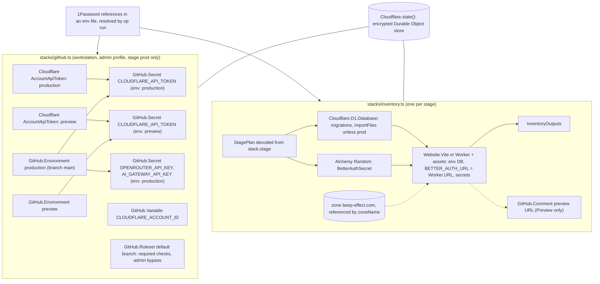

# Ship inventory on Alchemy, keep D1's SQL

Alchemy v2 can declare, test and ship this app end to end: one Stack holds a D1 database with the existing raw-SQL migrations, a Vite-built SPA served by the Effect Worker at `inventory.beep-effect.com` on the existing zone, a minted Better Auth secret, and a separate workstation-only stack that writes CI credentials and repository rules into GitHub. The `@beep/infra` package should be small and schema-first: a decoded `StageConfig` tagged union decides hostname, database, seed data and secrets per stage, and almost everything else is Alchemy resources rather than new services. Four parts of the original framing do not hold. Alchemy's cluster, workflow and singleton layer earns no place in this import flow today. Drizzle would add a second schema language next to Effect Schema without removing the hard SQL (FTS5, triggers, composite keys). The GitHub provider manages repository settings but does not write workflow YAML. And the 1Password distilled SDK cannot resolve `op://` references at all. Everything here is pre-1.0: `alchemy` and its packages are `2.0.0-beta.87` ("Expect breaking changes", alchemy repo: `README.md`), Effect's `cluster` and `workflow` modules are `@stability unstable`, and every distilled SDK is `1.0.0-rc.20`, so exact version pins are part of the design, not an afterthought. The one thing that must happen before any persistent stage exists is to finalise `migrations/0001_init.sql` and move its seed rows out of it, because Alchemy's migration history is forward-only and hash-checked.

## 1. Summary: what to do, and which assumptions were wrong

**The recommendation in one paragraph.** Use a single root Stack (`Alchemy.Stack("inventory", { providers: Cloudflare.providers(), state: Cloudflare.state() }, …)`) owned by `@beep/infra`. Declare one `Cloudflare.D1.Database` with `migrations` pointing at the existing flat SQL folder, and seed files only on non-production stages via `importFiles`. Declare one `Cloudflare.Website.Vite` (or a `Cloudflare.Worker` with an `assets.directory`, decision 1) with `domain: { name: "inventory.beep-effect.com", zoneName: "beep-effect.com" }` and `workersDev: false` in production. Mint `BETTER_AUTH_SECRET` with Alchemy's `Random` per stage. Feed third-party keys from 1Password by running the CLI under `op run`, so references stay references and values only exist in the deploying process and in the encrypted remote state store. A second stack, `stacks/github.ts`, run only from a workstation under an admin profile, mints the CI Cloudflare token and writes GitHub environments, secrets, variables and a default-branch ruleset; the deploy workflow YAML stays hand-written. Keep D1 with raw SQL (option i in section 5). Do not adopt Alchemy cluster, Drizzle, R2 or the distilled 1Password SDK now.

**Corrections to the assumptions behind the request.**

| Assumed | What the sources show |
| --- | --- |
| alchemy.run/git/ documents the GitHub provider | It documents `@alchemy.run/git`, "a pluggable, embeddable, self-hostable git server" on Workers, Durable Objects and R2, with "No issues, reviews, comments, checks, Actions, or GraphQL"; the GitHub provider is `@alchemy.run/github` at alchemy.run/github ([alchemy.run/git](https://alchemy.run/git/); alchemy repo: `website/src/content/docs/git/index.mdx`) |
| The "Add Drizzle ORM" page covers D1 | That page is Postgres via Hyperdrive (`Drizzle.Postgres(hd.connectionString)`) and redirects SQLite users elsewhere; D1 is on a different page ([Add Drizzle ORM](https://alchemy.run/cloudflare/data/drizzle); [Drizzle on D1](https://alchemy.run/cloudflare/data/d1-drizzle)) |
| There is one way to run Effect Cluster on Cloudflare | There are two unrelated implementations: Alchemy's `@alchemy.run/effect-cluster/Cloudflare` and Effect's own experimental `@effect/platform-cloudflare`. They disagree on `maxIdleTime`, `disableFatalDefects`, singleton lifetime, short durable sleeps and snowflakes (alchemy repo: `packages/effect-cluster/src/Cloudflare/`; effect repo: `packages/platform/cloudflare/README.md`) |
| Alchemy state is safe to keep locally | `encodeState` persists the inner string of every `Redacted` value "rather than the `<redacted>` placeholder", and `LocalState.ts` has no encryption, so `.alchemy/state/*.json` holds secrets in plaintext; only `Cloudflare.state()` documents encryption at rest (alchemy repo: `packages/alchemy/src/State/StateEncoding.ts`; [State Store](https://alchemy.run/state-store)) |
| The migration is pure schema | `migrations/0001_init.sql` inserts two "(test)" organizations and five members, so any database it is applied to, production included, receives them |
| `alchemy deploy` defaults to a dev stage | It defaults to `live_${USER}`; only `alchemy dev` defaults to `dev_${USER}`. The Stacks page says otherwise; the Stages page and source agree with each other ([Stages](https://alchemy.run/environments/stages); alchemy repo: `packages/alchemy/src/Cli/commands/flags.ts`) |
| The GitHub provider replaces the workflow file | It declares repository-side configuration only; nothing in `packages/github/src` writes `.github/workflows` (alchemy repo: `packages/github/src/Providers.ts`) |
| `@cloudflare/vite-plugin` stays | `Cloudflare.Website.Vite` is "not compatible" with it and it must be removed ([Vite](https://alchemy.run/cloudflare/frontend/vite)) |
| The distilled 1Password SDK can read `op://` references | It wraps the Connect, Events, Users, OAuth and Partnership REST APIs; it has no reference resolver and no service-account path, and returns field values as plain strings (distilled repo: `packages/onepassword/src/services/connect.ts`) |

## 2. What the repository has today: one Worker, one D1, no deploy pipeline

The current infrastructure is a single wrangler-configured Worker with no production identity: the database id is a committed zero UUID, no route or custom domain exists, and CI only checks and builds.

| Area | Today | Path |
| --- | --- | --- |
| Worker | Entry `src/server/worker.ts`, compatibility date `2026-11-01`, flag `nodejs_compat` (load-bearing: Better Auth's scrypt runs on `node:crypto`), Worker named with the placeholder name in wrangler.jsonc | `wrangler.jsonc`, `docs/auth.md` |
| Assets | `not_found_handling: "single-page-application"`, `run_worker_first: ["/api/*"]`; directory supplied by `@cloudflare/vite-plugin` | `wrangler.jsonc`, `vite.config.ts` |
| Bindings | One D1 binding `DB` (database also named with the placeholder), zero-UUID id, `migrations_dir: "migrations"`; no KV, R2, DO, Queues, Workflows, crons, routes or `workers_dev` setting | `wrangler.jsonc` |
| Plain settings | `AI_MODEL`, `AI_FALLBACK_MODELS` in `vars`; `AI_ENABLED`, `LOG_LEVEL`, `LOG_FORMAT`, `EFFECT_DEVTOOLS_URL`, `OTEL_EXPORTER_OTLP_ENDPOINT`, `OTEL_SERVICE_NAME`, `BETTER_AUTH_URL`, `PWNED_PASSWORD_CHECK`, `TEST_ACCOUNTS` read with defaults | `src/server/Settings.ts`, `src/server/env.d.ts` |
| Secrets | `BETTER_AUTH_SECRET` (≥32 chars, production refuses to start without it), `OPENROUTER_API_KEY`, `AI_GATEWAY_API_KEY` (both optional; the app answers by rules without them) | `src/server/Settings.ts`, `src/server/Auth.ts` |
| Config path | One `ConfigProvider.fromUnknown(env)`; nothing else reads `env` | `src/server/worker.ts` |
| Migration | One 439-line file: 21 tables + one FTS5 `trigram remove_diacritics 1` table, 22 indexes (incl. `lower(email)` expression and `COLLATE NOCASE`), 3 triggers, composite `(organizationId, id)` keys, CHECK lists, 2 seed INSERTs (7 rows) | `migrations/0001_init.sql` |
| Dev accounts | 5 users with pre-hashed passwords, applied locally only | `scripts/dev-accounts.sql`, `scripts/migrate-local.mjs` |
| Deploy | `tsc -b && vite build && wrangler d1 migrations apply DB --remote && wrangler deploy`; `deploy:setup` creates the D1 and rewrites the zero UUID; the identity check runs in `build` but not in `deploy` | `package.json`, `scripts/deploy-setup.mjs`, `scripts/check-production-identity.mjs` |
| Writes | No interactive transactions; every multi-statement write is one `D1Client.batch`; bulk rows 500 per statement as JSON | `src/server/Sql.ts`, `docs/patterns.md` |
| Uploads | Parsed in a browser worker, staged in D1 in ≤500-row chunks (`maxChunkChars = 1_500_000`), abandoned after 60 minutes and swept lazily by the next upload; cap 50,000 rows | `src/domain/Upload.ts`, `src/server/Imports.ts`, `src/domain/ItemImport.ts` |
| Allowance | 40 model calls per organization per rolling day, taken by one guarded `INSERT … SELECT … RETURNING` | `src/server/ModelCalls.ts` |
| Auth | Better Auth (email and password, organization and Have I Been Pwned plugins), Kysely D1 dialect on the raw binding, cookie prefix is the placeholder name, no email sending | `src/server/authOptions.ts`, `src/server/Auth.ts` |
| Headers | Strict CSP, HSTS `includeSubDomains`, COOP/COEP/CORP from `public/_headers` and `src/server/security.ts`; HTTP→HTTPS left to Cloudflare | `public/_headers`, `src/server/security.ts` |
| Tests | Vitest on Node, `fast` and `slow` projects; slow tests use `getPlatformProxy` with `test/server/support/wrangler.test.jsonc` and apply every `migrations/*.sql` | `vitest.config.ts`, `test/server/support/app.ts` |
| CI | One job, "Check, test and build": checkout, Node 22, Bun 1.4.4, `bun install --frozen-lockfile`, `check:full`, `build`; `contents: read`; no secrets, no deploy | `.github/workflows/ci.yml` |
| Package manager | Scripts run with bun, `packageManager` is `npm@11.19.1`, both lockfiles committed | `package.json` |

The placeholder name appears in the Worker and D1 names, the Better Auth `appName` and cookie prefix, the default `OTEL_SERVICE_NAME`, Effect service keys, Vite plugin names and scripts. It should be renamed before the first production deploy, while renaming the cookie prefix still logs nobody out.

## 3. What each Alchemy and distilled piece really is

Sources: the alchemy repo at `2.0.0-beta.87` (commit `33c10dd55f`), the effect repo at `4.1.4`, the distilled repo at `1.0.0-rc.20`, and the live pages named. Code below is copied from those sources unless labelled "proposed, not compiled".

### 3.1 Core model: a Stack is an Effect, state is required, Config becomes `secret_text`

**What it is.** A Stack is `Alchemy.Stack(name, { providers, state, secrets? }, Effect.gen(...))`; resources are Effects that register on the stack and expose lazy `Output<T>` values; providers are Layers; a missing provider is a compile-time error ([Stacks](https://alchemy.run/infrastructure-as-code/stack); [Resources](https://alchemy.run/infrastructure-as-code/resource); [Providers](https://alchemy.run/infrastructure-as-code/provider)).

```ts
// https://alchemy.run/infrastructure-as-code/stack
export default Alchemy.Stack(
  "MyApp",
  { providers: Cloudflare.providers(), state: Cloudflare.state() },
  Effect.gen(function* () {
    const bucket = yield* Cloudflare.R2.Bucket("Bucket");
    return { bucketName: bucket.bucketName };
  }),
);
```

**Stages** resolve as `--stage`, then `$ALCHEMY_STAGE`, then `live_${USER}` (deploy, destroy, plan, logs, drift) or `dev_${USER}` (`alchemy dev`), and must match `[a-z0-9][-_a-z0-9]*`; each stage has its own state and physical names ([Stages](https://alchemy.run/environments/stages)). The test harness adds `test_${USER}` (alchemy repo: `packages/alchemy-test/src/Core.ts`). Profiles (credentials) are orthogonal to stages.

**State** must be chosen explicitly. `Alchemy.localState()` writes `.alchemy/state/<Stack>/<stage>/<Resource>.json`; `Cloudflare.state()` "persists state in a Worker backed by a Durable Object with embedded SQLite, with the auth token and encryption key kept in your account's Secrets Store", bootstrapping a Worker named `alchemy-state-store` on `workers.dev`, with options `workerName`, `accountId` and `domain`. Under `CI=true` a missing store fails; provision it with `alchemy state bootstrap --profile <ci-profile>`. `postgresState({ url: Config.Redacted("STATE_DATABASE_URL") })` is the third choice ([State Store](https://alchemy.run/state-store)).

**Secrets.** Any `effect/Config` yielded in a Worker's construction phase "is automatically bound to its environment at deploy time. It is always bound as a secret (`secret_text` on Cloudflare)" ([Secrets & Config](https://alchemy.run/environments/secrets)). A Config read only inside `fetch` is never bound. The async-Worker `env` routing in source is `Config` → `secret_text`, literal `Redacted<string>` → `secret_text`, `string` → `plain_text`, anything else → `json`; there is no separate `vars` prop (alchemy repo: `packages/cloudflare/src/Workers/Worker.ts`). Values come from the shell and `.env` by default, or from a per-stage `secrets:` list; "Any Effect `Layer` that provides a `ConfigProvider` is a valid entry", and the process environment is always the implicit last entry ([Secret providers](https://alchemy.run/environments/secret-providers)). `Random("AuthTokenValue")` (`import { Random } from "alchemy"`) mints a value once and keeps it in state; the source calls it "A deterministic-in-state random secret generator" (alchemy repo: `packages/alchemy/src/Random.ts`; [Secrets & env on Cloudflare](https://alchemy.run/cloudflare/security/secrets-env)).

**CLI.** `deploy` (plan, approve, apply; `--yes`, `--dry-run`, `--force`, `--adopt`), `plan`, `destroy`, `drift`, `dev`, `logs --tail`, `profile …`, `state list|read|delete|bootstrap|teardown|logs`, `provider check-env`, `provider cloudflare token`. Plain mode (no TTY or `CI=1`) never prompts and fails without `--yes`. Run logs go to `.alchemy/log/*.ndjson` ([CLI](https://alchemy.run/cli)).

**Worker and Website.Vite.** `Cloudflare.Worker` props include `main`, `assets` (string dir, `{ directory, …AssetsConfig }`, or `{ hash }`), `compatibility`, `observability`, `env`, `crons`, `domain`, `routes`, `workersDev`, `limits`, `placement` and `access` (alchemy repo: `packages/cloudflare/src/Workers/Worker.ts`). `AssetsConfig` carries `notFoundHandling`, `runWorkerFirst` (glob array supported, "The same routing applies under `alchemy dev`"), `htmlHandling`, and raw `headers`/`redirects` that override a `_headers` file read from the directory (alchemy repo: `packages/cloudflare/src/Workers/Assets.ts`). `Cloudflare.Website.Vite` runs Vite itself and inherits `domain`, `env` and `compatibility`:

```ts
// https://alchemy.run/cloudflare/frontend/vite
const site = yield* Cloudflare.Website.Vite("Website", {
  rootDir: "./web",
  assets: {
    notFoundHandling: "single-page-application",
    runWorkerFirst: ["/api/*"],
  },
});
```

`Cloudflare.Worker.URL` resolves, before the build, to "its first custom domain, otherwise its `workers.dev` URL", and under `alchemy dev` to the local dev URL ([Vite](https://alchemy.run/cloudflare/frontend/vite); alchemy repo: `packages/cloudflare/src/Workers/Worker.ts`). That is exactly the value `BETTER_AUTH_URL` needs per stage. An Effect `HttpApi` on a Worker is returned as `fetch: yield* HttpRouter.toHttpEffect(HttpApiBuilder.layer(Api).pipe(...))` with an `HttpPlatformStub` because Workers have no FileSystem ([Effect HttpApi](https://alchemy.run/cloudflare/apis/effect-http-api)).

**Maturity and contradictions.** Beta (`README.md`: "Expect breaking changes"). The Stacks page says deploy defaults to `dev_$USER` (the source says `live_`); the State Store page says local state is the default while `state` is a required option; the Providers page's multi-provider example omits `state`; the custom Worker entry for a Vite app, `vite: { main: "src/worker.ts" }`, is documented in [Monorepo single stack](https://alchemy.run/project-structure/monorepo-single-stack) but marked `/** @internal used by Cloudflare.Website.Vite resource */` in `Worker.ts`. For compatibility dates on or after `2026-08-04` Alchemy no longer adds `nodejs_compat` itself (the `Worker.ts` JSDoc), while the Vite page says it "is enabled by default for every Worker"; declare the flag explicitly (supplied flags extend the defaults and duplicates are removed). Turborepo guidance does not exist (UNVERIFIED how Turborepo caching interacts with `.alchemy/`).

### 3.2 Cluster entities: classes over Effect Cluster, one Durable Object per entity id on Cloudflare

**What it is.** `@alchemy.run/effect-cluster` wraps Effect's `Entity` in a deployable class; on Cloudflare "there is no database: each instance is a Durable Object" ([Cluster](https://alchemy.run/cluster/); alchemy repo: `website/src/content/docs/cluster/index.mdx`).

```ts
// alchemy repo: website/src/content/docs/cluster/index.mdx
const Rooms = Entity.make("Room", [
  Rpc.make("Join", { payload: { name: Schema.String }, success: Schema.Int }),
]);
export default class Room extends Cluster.Entity<Room>()(
  Rooms,
  { main: import.meta.url },
  Effect.gen(function* () {
    return Effect.gen(function* () {
      const members = yield* Ref.make(new Set<string>());
      return Rooms.of({ Join: ({ payload }) => Ref.modify(members, /* … */) });
    });
  }).pipe(Effect.provide(Default)),
) {}
```

Underneath, Effect's `Entity.make(type, protocol)` builds an RPC group, `toLayer(build, { maxIdleTime, concurrency, mailboxCapacity, disableFatalDefects, … })` registers handlers, and RPCs are annotated with `ClusterSchema.Persisted`, `WithTransaction` and `Uninterruptible` (effect repo: `packages/effect/src/cluster/Entity.ts`, `ClusterSchema.ts`). Alchemy's props are `main`, `handler`, `maxIdleTime` (default 1 minute), `concurrency` (1), `mailboxCapacity` (4096) and `disableFatalDefects` (false) (alchemy repo: `packages/effect-cluster/src/Entity.ts`). Persisted messages are written to the object's own SQLite before running; a primary key makes a message run once; each stored value is capped at 2 MB ([Cluster on Cloudflare](https://alchemy.run/cluster/cloudflare/); alchemy repo: `packages/effect-cluster/src/Cloudflare/internal/Objects.ts`).

**Maturity.** `2.0.0-beta.87`; the package was first committed on 2026-11-06; the live pages carry no beta marker, but Effect's `cluster` barrel is `@stability unstable`. **Gaps.** Nothing in either implementation handles Worker CPU, memory or subrequest limits; message storage is per object, so nothing is queryable across instances from D1.

### 3.3 Workflows: durable functions with required idempotency keys, but no versioning

```ts
// alchemy repo: website/src/content/docs/cluster/workflows.mdx
export default class Invite extends Cluster.Workflow<Invite>()(
  "Invite",
  {
    payload: { room: Schema.String, guest: Schema.String },
    success: Schema.String,
    error: Declined,
    idempotencyKey: ({ room, guest }) => `${room}/${guest}`,
  },
  { main: import.meta.url },
  Effect.gen(function* () { /* … Activity.make({ name, success, execute }) … */ }).pipe(Effect.provide(Default)),
) {}
```

A client calls `invites.start({...})`, which "begins a run, or returns the run already started with the same key"; statuses are `NotStarted`, `Running`, `Completed`, `Failed`, `Interrupted`, `Died`; `DurableClock.sleep`, `DurableDeferred.await`, `withCompensation` (run "newest first" when a later step fails) and child `execute` are supported ([Workflows](https://alchemy.run/cluster/workflows/)). Effect's `Workflow.make` requires `idempotencyKey`; `Activity.make({ name, success?, error?, execute, interruptRetryPolicy? })` (effect repo: `packages/effect/src/workflow/Workflow.ts`, `Activity.ts`). On the Cloudflare pool every execution is its own Durable Object running Alchemy's `DurableObjectEngine`, which "replays the workflow from the top", retries a cut-short run after `"5 seconds"` and journals activities by `name/attempt` (alchemy repo: `packages/alchemy/src/Workers/DurableObjectEngine.ts`). A second engine runs on native Cloudflare Workflows with its own step and wait limits ([Effect workflows](https://alchemy.run/cloudflare/compute/effect-workflows)).

**Contradictions and gaps.** "Runners pick up due messages every 10 seconds" describes Effect's runner default (`entityMessagePollInterval`), not the Cloudflare pool, where alarms wake objects (effect repo: `packages/effect/src/cluster/ShardingConfig.ts`). No workflow versioning API exists in Effect (UNVERIFIED whether replay tolerates reordered activities). Whether `withCompensation` and child `execute` behave identically on Alchemy's DO engine and on Effect's `ClusterWorkflowEngine` is UNVERIFIED. An activity killed by a CPU limit re-runs in full.

### 3.4 Singletons: a fiber kept alive by a 10-second alarm

```ts
// alchemy repo: website/src/content/docs/cluster/singletons.mdx
export default class Sweeper extends Cluster.Singleton<Sweeper>()(
  "Sweeper",
  { main: import.meta.url },
  Effect.gen(function* () {
    const rooms = yield* Room;
    return Effect.gen(function* () { /* … */ })
      .pipe(Effect.repeat(Schedule.spaced("1 minute")), Effect.orDie);
  }).pipe(Effect.provide(Default)),
) {}
```

A singleton "can move once or twice. It never runs on two runners at once." On Cloudflare the fiber is re-forked on a `SINGLETON_HEARTBEAT = 10_000` alarm and a pool-wide `* * * * *` Cron Trigger re-wakes it, so its object never sleeps (alchemy repo: `packages/effect-cluster/src/internal/ObjectSharding.ts`, `src/Cloudflare/PoolWorker.ts`). The billing consequence of a permanently alarmed object is UNVERIFIED. **Contradiction:** Effect's own Cloudflare package says a singleton "runs once per wake and then may hibernate" and warns "do not make the singleton effect a forever loop", which is exactly what the Alchemy example does (effect repo: `packages/platform/cloudflare/README.md`). Effect core `Singleton.make(name, run, { shardGroup? })` converts failures to defects (effect repo: `packages/effect/src/cluster/Singleton.ts`).

### 3.5 The Cloudflare cluster runtime: two incompatible implementations

**Alchemy's.** `ClusterCloudflare.DurableObjectPool("Default")` generates a pool Worker exporting three SQLite-backed classes, `ClusterEntity`, `ClusterScheduled` and `ClusterWorkflow`, with a `nodejs_compat` flag, a redacted `CLUSTER_ENV`, a 32-byte `CLUSTER_GATEWAY_TOKEN`, an NDJSON RPC gateway and a `* * * * *` cron. The shard model is replaced: "there are no shards or runners to place an instance on, because a durable object … already is one instance per name" (alchemy repo: `packages/effect-cluster/src/Cloudflare/DurableObjectPool.ts`, `PoolWorker.ts`, `src/internal/ObjectSharding.ts`). Snowflakes are synthesised as `BigInt(now) << 22n`, which could collide within one millisecond (UNVERIFIED risk). Existing Effect Cluster programs die with `ExternalProgramOnWorkers`. An awake object "keeps its instance … and the version it started on until Cloudflare restarts it" after a deploy ([Cluster on Cloudflare](https://alchemy.run/cluster/cloudflare/)).

**Effect's.** `@effect/platform-cloudflare` 4.1.4 is "experimental. Its APIs may change in patch releases"; `CloudflareCluster.layer(...)` provides `Sharding | WorkflowEngine | PersistedQueueFactory`; it ignores `maxIdleTime`, `disableFatalDefects` and `mailboxCapacity` ("accepted for parity and have no effect"), makes every `DurableClock` durable, dies on `getSnowflake`, says kept-alive entities run old code "for about 5 minutes, then die without warning", and its `AlchemyCloudflareCluster` route says "The live deployment smoke has not yet been verified" (effect repo: `packages/platform/cloudflare/README.md`, `src/CloudflareCluster.ts`). Alchemy does not depend on it. Code written against one must not be ported to the other unchanged.

### 3.6 Drizzle in Durable Objects: migrations run on activation, per instance

```ts
// alchemy repo: packages/drizzle/src/Cloudflare.ts (JSDoc); https://alchemy.run/providers/drizzle/durableobject/
export class Users extends Cloudflare.DurableObject<Users>()(
  "Users",
  Effect.gen(function* () {
    const migrations = yield* Cloudflare.SqlMigrations("./drizzle");   // construction: read files
    return Effect.gen(function* () {
      const db = yield* Drizzle.DurableObject({ migrations, relations }); // activation: migrate + open
      return { listUsers: () => db.select().from(users) };
    });
  }),
) {}
```

It opens `drizzle-orm/effect-sqlite-do` over `@effect/sql-sqlite-do`; a migration that cannot apply kills the instance (`Effect.orDie`); transactions run on a synchronous scheduler. `SqlMigrations` embeds the files in the bundle and accepts flat SQL or drizzle-kit v1 directories (`<14-digit-ts>_<name>/migration.sql`); v0 layouts fail with `DrizzleV0LayoutError` (alchemy repo: `packages/cloudflare/src/Workers/SqlMigrations.ts`, `packages/sql/src/Migrations/Detect.ts`). Versions: `drizzle-orm`/`drizzle-kit` `1.0.0-rc.5`. **Gap:** no guidance on rolling a schema change across many existing instances; each tenant migrates lazily the first time it activates after a deploy.

### 3.7 D1 resource and Drizzle on D1: forward-only, hash-checked history in `__alchemy_migrations`

**The resource.** `Cloudflare.D1.Database("Database", { migrations: "./migrations" })`; props `name?` (default `${app}-${stage}-${id}`), `primaryLocationHint?`, `readReplication?`, `jurisdiction?`, `migrations?` (dir, `Drizzle.Schema`, or `{ dir, table? }`), `importFiles?` ("hash-tracked seed via the D1 import API") and `clone?` (alchemy repo: `packages/cloudflare/src/D1/Database.ts`). Flat files sort by numeric prefix then name. "Bookkeeping always lives in Alchemy's `__alchemy_migrations` table"; a wrangler-migrated database is adopted "by a ONE-WAY conversion on first deploy", with every recorded row required to match a local file by name and content hash; "History is forward-only and linear" (`NonLinearMigrationHistoryError`, `RewrittenMigrationHistoryError`); D1 migrations are "batched application (no transactions over HTTP)" ([SQL migrations](https://alchemy.run/sql/effect-sql/migrations)). `Database.lookup({ name | databaseId })` binds an unmanaged database read-only. **Data-loss risk the D1 guide does not mention:** with an explicit `name`, changing `primaryLocationHint` or `jurisdiction` returns `{ action: "replace", deleteFirst: true }`, and "The existing database and its data are deleted before the new one is created."

**Queries.** `yield* Cloudflare.D1.QueryDatabase(db)` with `Effect.provide(Cloudflare.D1.QueryDatabaseBinding)`, or `SQL.D1Layer(d1)` for an Effect `SqlClient`; D1 offers no interactive transactions, so `sql.withTransaction` and streaming queries are unavailable and atomic multi-statement writes use the native binding's `batch` ([D1](https://alchemy.run/cloudflare/data/d1); [Effect SQL on D1](https://alchemy.run/sql/effect-sql/d1)). Cloudflare's own limits: 100 bound parameters per query, 10 GB per database, 100,000-byte statements, 2,000,000-byte values, 1,000 queries per invocation, Time Travel 30 days on paid plans, and each database "processes queries one at a time" ([D1 limits](https://developers.cloudflare.com/d1/platform/limits/)).

**Drizzle on D1.** `const binding = yield* Cloudflare.D1.QueryDatabase(database); const db = yield* Drizzle.D1(binding);` over `drizzle-orm/effect-d1` and `@effect/sql-d1`; migrations from `drizzle-kit generate` with `dialect: "sqlite"` ([Drizzle on D1](https://alchemy.run/cloudflare/data/d1-drizzle)). That page links to a `/cloudflare/data/d1#migrations` anchor that does not exist.

**Better Auth on D1.** `@alchemy.run/better-auth` with `CloudflareD1(AuthDb)` "applies the auth schema through its HTTP API before updating the Worker", and omitting `secret` "provisions and binds a stable signing secret automatically"; `migrate: false` opts out "only when another process owns the schema" ([Better Auth on D1](https://alchemy.run/better-auth/databases/cloudflare-d1); [Better Auth migrations](https://alchemy.run/better-auth/guides/migrations)).

### 3.8 R2 presigned URLs: PUT only, signed locally, CORS required

```ts
// https://alchemy.run/cloudflare/data/r2-presigned-urls
const presignPut = yield* Cloudflare.R2.PresignPutObject(Uploads);
yield* presignPut({ key, contentType: "image/png", expiresIn: 300 });
Effect.provide(Layer.mergeAll(Cloudflare.R2.PresignPutObjectToken, Cloudflare.R2.PresignGetObjectToken))
```

`expiresIn` defaults to 900 seconds and caps at 7 days; deployed URLs point at `https://{accountId}.r2.cloudflarestorage.com`, so a same-origin SPA still needs `cors` on the bucket; "R2 doesn't support presigned POST"; the local endpoint ignores CORS, "so a missing origin or header only shows up once deployed". Deploys need "Account API Token Provisioning" so Alchemy can mint bucket-scoped tokens. **Gap:** no multipart presigned uploads documented. Not needed here: files are parsed in the browser and arrive as JSON rows.

### 3.9 Custom domains: reference the zone, never manage it

`domain?: string | WorkerDomainConfig | null` with `name`, `aliases?`, `redirects?`, `zoneId?`, `zoneName?`, `zone?`, `previews?` (private beta), `dns?`, `cnameTarget?`; "The zone must already exist in the account"; omitting the prop leaves custom domains unmanaged and `null` detaches (alchemy repo: `packages/cloudflare/src/Workers/Worker.ts`). "Cloudflare provisions the DNS record and certificate" ([Custom domains & routes](https://alchemy.run/cloudflare/networking/custom-domains)). `Zone.lookup` "reads a zone Alchemy doesn't manage … never created, updated or deleted":

```ts
// alchemy repo: packages/cloudflare/src/Zone/Zone.ts
const zone = Cloudflare.Zone.Zone.lookup({ name: "example.com" });
yield* Cloudflare.DNS.Record("Www", { zoneId: zone.zoneId, name: "www.example.com", type: "CNAME", content: "…", proxied: true });
```

Neither domain guide mentions `Zone.lookup`; both show only creation or `adopt(true)`. A managed `Zone` defaults to retain. DNS records have no local provider and deploy to the real cloud even in a personal stage ([Local development](https://alchemy.run/cloudflare/local-development)). **Gap:** no documented permission list for custom domains; the OAuth scope list includes `zone.*`, `dns.*` and `workers-routes.*` (alchemy repo: `packages/cloudflare/src/Auth/OAuthScopes.ts`).

### 3.10 Test harness: live-first, then local, then CI per pull request

Part 3 deploys the real Stack to `test_$USER` and asserts over HTTP; Part 4 runs the same file in workerd; Part 5 moves deploys to Actions with a `pr-{n}` stage destroyed on close ([part 3](https://alchemy.run/cloudflare/tutorial/part-3/); [part 4](https://alchemy.run/cloudflare/tutorial/part-4); [part 5](https://alchemy.run/cloudflare/tutorial/part-5)).

```ts
// https://alchemy.run/cloudflare/tutorial/part-3/
import * as Test from "@alchemy.run/test/Bun";
const { test, beforeAll, afterAll, deploy, destroy } = Test.make({
  providers: Cloudflare.providers(),
  state: Cloudflare.state(),
});
const stack = beforeAll(deploy(Stack));
test("PUT and GET round-trip an object", Effect.gen(function* () {
  const { url } = yield* stack;
  const put = yield* HttpClient.put(`${url}/hello.txt`, { body: HttpBody.text("Hello, World!") });
  expect(put.status).toBe(201);
}));
afterAll.skipIf(!process.env.CI)(destroy(Stack));
```

Options: `providers`, `state` (default `localState()`), `profile`, `stage`, `dev`, `adopt`, `sidecar`; `dev` precedence is `ALCHEMY_TEST_DEV`, then the option, then `ALCHEMY_DEV`; local resource ids are `dev:`-prefixed, "which doubles as proof no cloud call ran"; `ALCHEMY_TEST_STAGE=ci-pr-42` overrides the stage; `Test.getWhenReady(url)` retries 404/5xx; `beforeAll` defaults to 120 s ([test harness](https://alchemy.run/testing/test-harness); [testing a stack](https://alchemy.run/testing/testing-a-stack)). The Vitest adapter (`@alchemy.run/test/Vitest`) runs every test as an `@effect/vitest` `it.live`, so `TestClock` does not apply (alchemy repo: `packages/alchemy-test/src/Vitest.ts`). **Maturity and contradiction:** `@alchemy.run/test` declares `"engines": { "bun": ">=1.3" }` and depends on `@effect/platform-bun`, yet publishes compiled `lib/*.js` for Node and switches on `typeof Bun` at runtime; its only Vitest suite tests hook order, not a deploy. Whether it runs on Node is UNVERIFIED. The harness page calls `Cloudflare.state()` "R2-backed"; the state-store page says Durable Object and SQLite. How `importFiles` and migrations behave in `dev: true` mode was not checked.

### 3.11 GitHub provider, and what alchemy.run/git really is

`@alchemy.run/github` registers `BranchProtection, Collaborator, Comment, Environment, Label, Milestone, Issue, PersonalAccessToken, PullRequest, Release, Repository, Ruleset, Secret, TeamAccess, Variable, Webhook, WikiPage`, plus bulk `Secrets`/`Variables` and `GitHubEnv` (alchemy repo: `packages/github/src/Providers.ts`). `Secret` seals the value with libsodium against the repository or environment public key and re-uploads on every deploy because "GitHub never returns a secret's value"; it is deleted on destroy ([actions config](https://alchemy.run/github/actions-config)). `Environment` takes `waitTimer`, `preventSelfReview`, `reviewers` and `deploymentBranchPolicy`. `Ruleset` (JSDoc only, no narrative page) takes `enforcement`, `target`, `conditions.include` (`~DEFAULT_BRANCH` allowed), `bypassActors` (`RepositoryRole` ids "2 for write, 4 for maintain, and 5 for admin"), `requiredStatusChecks.checks[].context`, `pullRequest`, `requiredLinearHistory`, `nonFastForward`, `mergeQueue` (organization-owned repositories only); it retains on destroy and treats a same-name ruleset as foreign until `adopt(true)` (alchemy repo: `packages/github/src/Ruleset.ts`).

```ts
// alchemy repo: packages/github/src/Ruleset.ts (JSDoc)
yield* GitHub.Ruleset("ci-checks", {
  owner: "my-org", repository: "my-repo", name: "CI required", target: "branch",
  conditions: { include: ["refs/heads/main"] },
  requiredStatusChecks: { checks: [{ context: "ci/test" }, { context: "ci/lint" }],
                          strictRequiredStatusChecksPolicy: true },
})
```

A preview comment is a `GitHub.Comment` with a stable logical id, so each push updates it in place:

```ts
// https://alchemy.run/cloudflare/tutorial/part-5
const github = yield* GitHub.GitHubEnv;          // undefined outside Actions
if (github?.pr) {
  yield* GitHub.Comment("preview-comment", {
    owner: github.owner, repository: github.repository, issueNumber: github.pr,
    body: Output.interpolate`## Preview Deployed\n**URL:** ${app.url}`,
  });
}
```

 In CI the provider reads `GITHUB_ACCESS_TOKEN` or `GITHUB_TOKEN`; locally `gh auth token` or a stored PAT; "Browser/device OAuth is intentionally not implemented" despite two pages listing OAuth (alchemy repo: `packages/github/src/AuthProvider.ts`). **Cannot be declared:** workflow files, CODEOWNERS, Dependabot, secret scanning, `security_and_analysis`, org-level secrets/variables/rulesets, Actions permission settings, custom deployment protection rules, and the `DeployKey`/`User` bypass actors or `exempt` mode the API supports. **Contradictions:** pull-request stages are `pr-{n}` in the tutorial but `staging-{n}` in the root `action.yml`; the account id is a secret in the tutorial but `vars.CLOUDFLARE_ACCOUNT_ID` in the README; secrets need `repo`/`public_repo` on one page and `workflow` on another. **alchemy.run/git** is a self-hosted git server and is irrelevant to CI here.

### 3.12 distilled: generated Effect 4 SDKs, release candidates, uneven tests

Each `@distilled.cloud/<provider>` is generated from the provider's API description and patched to live behaviour; an operation is both a callable and an Effect (`OperationMethod<I, O, E, R>`), paginated ones add `.pages`/`.items`, and the default retry policy is "at most 2 retries (3 attempts)", with the note that "Deploy tools that should wait out longer outages install their own policy" (distilled repo: `packages/core/src/api.ts`, `packages/core/src/retry.ts`). All six SDKs are `1.0.0-rc.20`, peer on `effect` `^4.1.4`, and "A release can still change a public type" (distilled repo: `README.md`). Only `resend` and `onepassword` have package tests. Several `CredentialsFromEnv` layers read `process.env` directly rather than `Config`, so build credentials with `fromApiKey(...)`/`credentials(...)` and a `Redacted` instead.

### 3.13 grafana: a Grafana instance API, not Grafana Cloud

250 operations against a Grafana instance (default `http://localhost:3000`, `Authorization: Bearer`, optional `X-Grafana-Org-Id`): data sources, `importDashboard`, annotations, service accounts and tokens, Prometheus-format rule groups; no dashboard or folder create, no Grafana-managed alert-rule writes, no Grafana Cloud stacks or OTLP credentials. `createToken` returns `key` as a plain `string` (distilled repo: `packages/grafana/src/services/grafana.ts`, `src/credentials.ts`). The README calls `GRAFANA_ORG_ID` required; the code makes it optional. Why the dashboard and folder writes are absent is UNVERIFIED (likely the `skipDeprecated: true` filter).

### 3.14 github: the SDK beneath Alchemy's GitHub resources

About 1,238 operations across 47 modules; `credentials({ token, apiBaseUrl?, userAgent? })`; `installationCredentials` for GitHub Apps via WebCrypto; `Link`-header pagination. Secret writes take an already-sealed `encrypted_value` and `key_id`; there is no sealing helper (distilled repo: `packages/github/src/services/actions.ts`). Use Alchemy's resources, and reach for the SDK only for reads Alchemy lacks.

### 3.15 docker: an Engine API client that cannot dial a Unix socket with fetch

106 operations against `http://localhost/v1.56`, optional bearer token, no tests (distilled repo: `packages/docker/src/services/docker.ts`). Alchemy's own `@alchemy.run/docker` does not use it; it drives the `docker` CLI and offers `Docker.Container` with `image`, `ports`, `environment` (string or `Redacted`), `restart` (alchemy repo: `packages/docker/src/Container.ts`). The repository's optional local collector (`telemetry/compose.yaml`) could become one `Docker.Container`; that is a nicety, not part of deployment.

### 3.16 discord: cannot create an OAuth application or set redirect URIs

250 operations, Bot or Bearer tokens, no pagination profiles. There is no `createApplication`, `UpdateMyApplicationRequest` has no `redirect_uris`, and the client secret is never returned (distilled repo: `packages/discord/src/services/discord.ts`). Better Auth's Discord provider needs `DISCORD_CLIENT_ID`/`DISCORD_CLIENT_SECRET` from the Developer Portal and a `/api/auth/callback/discord` redirect ([Better Auth Discord](https://www.better-auth.com/docs/authentication/discord)). The app has no social sign-in today.

### 3.17 onepassword: Connect REST, values as plain strings, no `op://`

Five APIs (Connect, Events, Users, OAuth, Partnership); Connect needs a running Connect server (`OP_CONNECT_TOKEN`, `OP_CONNECT_HOST`, default `http://localhost:8080/v1`); `getVaultItemById` returns `Field { value?: string }` with no `SensitiveValue`; a search for `op://`, "secret reference" or "service account" found nothing (distilled repo: `packages/onepassword/README.md`, `src/services/connect.ts`). Alchemy has no 1Password provider (it has Doppler and Infisical).

### 3.18 resend, and Resend's own API

The most mature SDK: 138 operations, six live-response patch files, protocol and webhook tests, rich tagged errors (`UnverifiedSender`, `DailyQuotaExceeded`, `DomainNotFound`, `AlreadyExists`), cursor pagination, `createApiKey`'s `token` and `createWebhook`'s `signing_secret` decoded as `Redacted`, and a workerd-safe Svix verifier `Resend.Webhooks.constructEvent({ payload, headers, secret })` (distilled repo: `packages/resend/`).

```ts
// distilled repo: packages/resend/src/services/resend.ts
interface CreateDomainRequest { name: string; region?: "us-east-1"|"eu-west-1"|"sa-east-1"|"ap-northeast-1";
  custom_return_path?: string; open_tracking?; click_tracking?; tls?; capabilities?; tracking_subdomain? }
interface CreateApiKeyRequest { name; permission?: "full_access" | "sending_access"; domain_id? }
```

Resend's API returns DKIM `resend._domainkey` TXT, SPF `send` MX (`feedback-smtp.us-east-1.amazonses.com`, priority 10) and TXT `v=spf1 include:amazonses.com ~all`, and an optional tracking CNAME ([create domain](https://resend.com/docs/api-reference/domains/create-domain.md)). Records must match exactly, CNAMEs must not be proxied, sending from a subdomain is "strongly" recommended, verification can take up to 72 hours, and DMARC comes after verification ([add a domain](https://resend.com/docs/add-a-domain.md)). Limits: 10 requests per second per team; quotas reset at midnight UTC and are not retried; the free tier is 100 emails a day and 3,000 a month ([rate limit](https://resend.com/docs/api-reference/rate-limit.md); [quotas](https://resend.com/docs/knowledge-base/account-quotas-and-limits.md)). Better Auth calls `sendResetPassword`, `sendVerificationEmail` and the organization plugin's `sendInvitationEmail`; Resend's guide sends without awaiting under `waitUntil` ([Resend with Better Auth](https://resend.com/docs/send-with-better-auth.md)). Alchemy's own Better Auth email guide uses a plain `HttpClientRequest.post("https://api.resend.com/emails")`, not distilled (alchemy repo: `website/src/content/docs/better-auth/sign-in-providers/email-password.mdx`). There is no Alchemy Resend provider; one would be a custom provider modelled on `GitHub.Secret` ([custom provider](https://alchemy.run/infrastructure-as-code/custom-provider)).

## 4. The `@beep/infra` design: schemas first, one service, two stacks

The governing rule: infra code decides **which** resources exist for a stage from a decoded value, and nothing else branches on raw strings. Alchemy resources are already Effects with typed outputs, so the package needs schemas and almost no services.

### 4a. Schemas and the resource graph

All code in this section is proposed, not compiled. It uses Effect 4.1 names checked against the effect repo (`Schema.isPattern`, `Schema.brand`, `Schema.TaggedUnion`, `Schema.Literals`, `Schema.Class`, `Schema.Int`, `Schema.isGreaterThan`); in the `@beep/*` repository the literal unions would use `LiteralKit` from `@beep/schema` (its API is UNVERIFIED here).

```ts
// packages/infra/src/schema/Stage.ts — proposed, not compiled
import { Schema } from "effect"

/** A stage name as Alchemy accepts it. */
export const StageName = Schema.String.check(Schema.isPattern(/^[a-z0-9][-_a-z0-9]*$/)).pipe(Schema.brand("StageName"))

/** A 1Password secret reference, kept as a reference; only `op run` ever resolves it. */
export const OnePasswordRef = Schema.String.check(Schema.isPattern(/^op:\/\/[^/\s]+\/[^/\s]+\/[^/\s]+$/)).pipe(
  Schema.brand("OnePasswordRef"),
)

export const Hostname = Schema.String.check(Schema.isPattern(/^([a-z0-9-]{1,63}\.)+[a-z]{2,63}$/)).pipe(Schema.brand("Hostname"))

/** Where one secret's value comes from. Never holds a value. */
export const SecretSource = Schema.TaggedUnion({
  OnePassword: { ref: OnePasswordRef, env: Schema.String }, // env name `op run` fills
  Minted: { id: Schema.String },                            // an Alchemy Random, lives in encrypted state
  Absent: {},                                               // the feature answers by rules
})

/** The kind of stage, decoded from the stage name; unknown names are refused. */
export const StageConfig = Schema.TaggedUnion({
  Personal: { stage: StageName, mode: Schema.Literals(["dev", "test"]) },
  Preview: { stage: StageName, pullRequest: Schema.Int.check(Schema.isGreaterThan(0)) },
  Production: { stage: Schema.Literal("prod") },
})

export class DomainConfig extends Schema.Class<DomainConfig>("DomainConfig")({
  hostname: Hostname,
  zoneName: Schema.Literal("beep-effect.com"), // referenced, never managed
}) {}

/** Everything a stage gets, derived purely from StageConfig. */
export class StagePlan extends Schema.Class<StagePlan>("StagePlan")({
  config: StageConfig,
  domain: Schema.Option(DomainConfig),            // None → workers.dev or the local dev URL
  workersDev: Schema.Boolean,
  seed: Schema.Literals(["none", "organizations", "organizationsAndAccounts"]),
  authSecret: SecretSource,
  openRouterKey: SecretSource,
  aiGatewayKey: SecretSource,
}) {}

/** The stack's outputs, decoded again by the integration tests. */
export class InventoryOutputs extends Schema.Class<InventoryOutputs>("InventoryOutputs")({
  stage: StageName,
  url: Schema.String,
  databaseName: Schema.String,
  databaseId: Schema.String,
}) {}
```

Two deliberate choices sit in these shapes. `live_*` is not a case of `StageConfig`, so a bare `alchemy deploy` (which picks `live_${USER}`) fails to decode and deploys nothing: a typed guard rail instead of a convention. And `SecretSource` cannot carry a value, so no schema in the package can ever serialise a secret.



### 4b. Service contracts: one, and a shared settings contract with the server

The temptation is to model every resource group as a `Context.Service`. That would wrap Effects that are already typed, already composable and already Layer-provided by Alchemy, and add indirection without a second implementation to swap in. The single service worth having is the resolved plan, so resources can read it without threading arguments:

```ts
// packages/infra/src/InfraStage.ts — proposed, not compiled
import { Context, Effect, Layer, Schema } from "effect"
import { Stack } from "alchemy/Stack"

export class InfraStage extends Context.Service<InfraStage, StagePlan>()("@beep/infra/InfraStage") {
  static readonly layer = Layer.effect(
    InfraStage,
    Effect.gen(function* () {
      const { stage } = yield* Stack // stack.name and stack.stage, per https://alchemy.run/infrastructure-as-code/stack
      return yield* planFor(stage)   // Effect.fn: StageName → StageConfig → StagePlan, fails UnknownStage
    }),
  )
}
```

The real contract is between infra and the Worker: the binding names. Today `src/server/Settings.ts` reads names by string and `src/server/env.d.ts` repeats them by hand. Put one schema of binding names (plain settings and secrets, split) in the server's config package, have `Settings.ts` read through it and have `@beep/infra` build `env` from the same keys. Then a renamed setting is a type error in the stack, not a Worker that boots without its secret. `Cloudflare.InferEnv` can type the Worker side from the stack ([Vite](https://alchemy.run/cloudflare/frontend/vite)), but it cannot see Config names read inside the app, so the shared schema stays the source of truth.

### 4c. Module and file list

| Path in `packages/infra/` | Holds |
| --- | --- |
| `package.json` | `@beep/infra`; exact pins: `alchemy`, `@alchemy.run/cloudflare`, `@alchemy.run/github`, `@alchemy.run/test` (dev) at one `2.0.0-beta.N`; `effect` at the 4.1.x the workspace overrides to (Alchemy's catalog overrides `effect: 4.1.4`) |
| `src/schema/Stage.ts` | `StageName`, `OnePasswordRef`, `Hostname`, `SecretSource`, `StageConfig`, `DomainConfig`, `StagePlan`, `InventoryOutputs` |
| `src/StagePlan.ts` | Pure `planFor`: the per-stage table in 4d as code, and `UnknownStage` as a `Schema.TaggedError` |
| `src/InfraStage.ts` | The one `Context.Service` above |
| `src/resources/Database.ts` | `Cloudflare.D1.Database` with the migrations directory (anchored with `import.meta`, since paths otherwise resolve from where Alchemy runs) and the seed files per `StagePlan.seed` |
| `src/resources/Site.ts` | `Website.Vite` (or `Worker` + `assets.directory`), `env` built from the shared settings schema, `domain`, `workersDev`, `compatibility` |
| `src/stacks/inventory.ts` | The app Stack; the repository root `alchemy.run.ts` re-exports it so the CLI's default lookup works from the workspace root |
| `src/stacks/github.ts` | The bootstrap stack: tokens, environments, secrets, variables, ruleset |
| `env/op.env` | Committed: only `NAME=op://vault/item/field` lines, no values |
| `test/StagePlan.test.ts` | Fast: every stage name maps to the right plan; `live_x` is refused; production never seeds |
| `test/inventory.integ.test.ts` | The harness rungs in section 7 |

The migrations folder belongs to the data package that owns the SQL (with `Settings` and the Worker in their server packages); `@beep/infra` references it rather than owning schema. Turborepo's `deploy` task must not be cached, and `.alchemy/` must be git-ignored and never a task output.

```ts
// packages/infra/src/stacks/inventory.ts — proposed, not compiled
export default Alchemy.Stack(
  "inventory",
  { providers: Cloudflare.providers(), state: Cloudflare.state() },
  Effect.gen(function* () {
    const plan = yield* InfraStage
    const db = yield* Cloudflare.D1.Database("Database", {
      migrations: migrationsDir,
      ...(plan.seed === "none" ? {} : { importFiles: seedFiles(plan.seed) }),
    })
    const authSecret = yield* Random("BetterAuthSecret")          // value persisted in encrypted state
    const site = yield* Cloudflare.Website.Vite("Inventory", {
      rootDir: webRoot,
      vite: { main: "src/worker.ts" },                            // documented; @internal in source (decision 1)
      assets: { notFoundHandling: "single-page-application", runWorkerFirst: ["/api/*"] },
      compatibility: { date: "2026-11-01", flags: ["nodejs_compat"] },
      workersDev: plan.workersDev,
      ...Option.match(plan.domain, {
        onNone: () => ({}),
        onSome: (d) => ({ domain: { name: d.hostname, zoneName: d.zoneName } }),
      }),
      env: {
        DB: db,
        BETTER_AUTH_URL: Cloudflare.Worker.URL,                   // custom domain, else workers.dev, else local
        BETTER_AUTH_SECRET: authSecret.text,                      // Redacted → secret_text (UNVERIFIED for an Output)
        ...plainSettings(plan),                                   // AI_MODEL, AI_FALLBACK_MODELS, LOG_FORMAT, …
        ...aiSecrets(plan),                                       // Config.Redacted(...) only when the plan says OnePassword
      },
    })
    return { stage: plan.config.stage, url: site.url.as<string>(), databaseName: db.databaseName, databaseId: db.databaseId }
  }).pipe(Effect.provide(InfraStage.layer)),
)
```

### 4d. Stages: what each one gets

| Stage | Name | Started by | Hostname and `BETTER_AUTH_URL` | D1 | Seed | AI keys | Better Auth secret |
| --- | --- | --- | --- | --- | --- | --- | --- |
| Personal dev | `dev_<user>` | `alchemy dev` | Local dev URL (`Worker.URL` resolves to it under `alchemy dev`) | Local D1 simulator, migrations applied on reconcile | Organizations and test accounts | Optional, via `op run` | `Random`, per stage |
| Personal test | `test_<user>` | Harness `deploy(Stack)` | `workers.dev` URL | Real D1, its own | Organizations and test accounts | Absent: rules answer | `Random` |
| Preview | `pr-<n>` | CI on `pull_request`; destroyed on close | `workers.dev`, or a one-label host such as `inventory-pr-<n>.beep-effect.com` (decision 7) | Real D1, created and destroyed with the stage | Organizations only, unless previews sit behind Cloudflare Access (decision 6) | Absent | `Random` |
| Production | `prod` | CI on push to `main`, `environment: production` | `https://inventory.beep-effect.com`, `workersDev: false` | Real D1, never seeded, never destroyed by the workflow | None | From 1Password via the production environment's secrets | `Random` (decision 5) |

Because `BETTER_AUTH_URL` becomes the single trusted origin and switches on `Secure` cookies (`src/server/authOptions.ts`, `src/server/Auth.ts`), deriving it from `Cloudflare.Worker.URL` is what lets every stage sign in on its own address without hand-kept strings. With `workersDev: false` in production the `workers.dev` address disappears, which also removes a second origin the cookie and same-origin checks would refuse anyway. A two-label preview host such as `pr-42.inventory.beep-effect.com` raises a certificate-coverage question that the sources do not settle (UNVERIFIED), so the one-label form avoids it.

### 4e. Secrets: `op run` for third-party keys, `Random` for the auth secret, encrypted remote state

| Route | How a value moves | Printed or in plaintext anywhere? | Verdict |
| --- | --- | --- | --- |
| `op run --env-file packages/infra/env/op.env -- alchemy deploy --stage prod` | 1Password fills env vars for the Alchemy process only; the Worker reads `Config.Redacted("OPENROUTER_API_KEY")` in construction (or the stack passes it in `env`), bound as `secret_text` ([Secrets & Config](https://alchemy.run/environments/secrets)) | References in git; values only in process memory and in state. Whether `op run` also masks values in output is UNVERIFIED | **Chosen** for OpenRouter, AI Gateway and (later) Resend keys |
| distilled onepassword via Connect | `Connect.getVaultItemById` → `Redacted.make(field.value)` in a custom `ConfigProvider` layer listed in `secrets:` | Needs a Connect server and token; the SDK hands back a plain string first | Rejected: extra running infrastructure for what `op run` already does |
| A custom `ConfigProvider` that shells out to `op read` | A layer in the Stack's `secrets:` list ("Any Effect `Layer` that provides a `ConfigProvider` is a valid entry", [Secret providers](https://alchemy.run/environments/secret-providers)) | Same as `op run`, but the resolver lives in code | Possible later; only worth it if CI should resolve references itself |
| Alchemy `Random("BetterAuthSecret")` | Minted once per stage, persisted in state, bound as a secret | Never leaves Alchemy state and the Worker | **Chosen** for `BETTER_AUTH_SECRET` |

The **state-store consequence** decides the rest. Every route ends with the value inside Alchemy state, because `encodeState` persists the inner string of `Redacted` props, and Alchemy states that a minted API token is stored in state because Cloudflare reveals it once ([part 5](https://alchemy.run/cloudflare/tutorial/part-5)). With `localState()` that is plaintext on disk; therefore **every stage, the test harness included, uses `Cloudflare.state()`** (the harness defaults to `localState()` and must be overridden). Encryption at rest is documented but its code was not read (UNVERIFIED). Losing the state store loses the `Random` secret, which logs every user out on the next deploy; that is the accepted cost of not keeping the auth secret in 1Password.

CI never resolves `op://` references. The bootstrap stack, deployed from a workstation under `op run`, writes the AI keys as **environment** secrets of `production` only, and the deploy job reads them from env. Previews receive no AI keys, so code from a pull request cannot exfiltrate them, and the app answers by rules there as it already does without a key.

### 4f. DNS: one `domain` prop, the zone untouched

Production declares `domain: { name: "inventory.beep-effect.com", zoneName: "beep-effect.com" }` and `workersDev: false`. Cloudflare creates the record and certificate; Alchemy looks the zone up by name and never manages it, so nothing else in `beep-effect.com` is at risk; no `Zone` resource and no `adopt(true)` ([Custom domains & routes](https://alchemy.run/cloudflare/networking/custom-domains)). The repository's HSTS `includeSubDomains` binds only `inventory.beep-effect.com` and below. "Always Use HTTPS" on the zone is assumed by `src/server/security.ts`; whether it is on is not knowable from the repository (UNVERIFIED).

If email is adopted (decision 9), Resend gets a sending subdomain (for example `mail.beep-effect.com`) through a custom `Resend.Domain` provider; its returned `records` become `Cloudflare.DNS.Record`s with `zoneId: Cloudflare.Zone.Zone.lookup({ name: "beep-effect.com" }).zoneId` and `proxied: false`; verification is polled outside the deploy path because it can take up to 72 hours; then a `sending_access` key restricted to that domain becomes a Worker secret and the `full_access` key stays in 1Password for infra only. Whether `DNS.Record.name` accepts Resend's relative names (`send`, `resend._domainkey`) or needs the full name, and whether the `send` MX host changes by region, are UNVERIFIED.

### 4g. CI/CD and repository rules: declared from a workstation, executed by hand-written YAML

**Declared in `stacks/github.ts`** (deployed only as `op run --env-file … -- alchemy deploy --config packages/infra/src/stacks/github.ts --stage prod --profile admin`): two `AccountApiToken`s (production, preview) written as environment-scoped `CLOUDFLARE_API_TOKEN` secrets; `CLOUDFLARE_ACCOUNT_ID` as a `GitHub.Variable` (it is not secret; the tutorial and README disagree on this); `GitHub.Environment("production", { deploymentBranchPolicy: { customBranchPolicies: ["main"] } })` and `preview`; the AI keys as production-environment secrets; and a `GitHub.Ruleset` on `~DEFAULT_BRANCH` requiring the existing check plus the preview deploy, with `bypassActors: [{ actorType: "RepositoryRole", actorId: 5, bypassMode: "always" }]`. The tutorial's token policy lists account permission groups only ("Secrets Store Write", "Workers Scripts Write", "D1 Write", …); a token that attaches `inventory.beep-effect.com` also needs zone permissions on `beep-effect.com`, whose exact group names are UNVERIFIED.

**Still hand-written:** `.github/workflows/deploy.yml`. A sketch, proposed, not compiled:

```yaml
on:
  pull_request: { types: [opened, synchronize, reopened, closed] }
  push: { branches: [main] }
concurrency: { group: deploy-${{ github.ref }}, cancel-in-progress: false }
jobs:
  deploy:
    if: github.event.action != 'closed'
    environment: ${{ github.event_name == 'push' && 'production' || 'preview' }}
    permissions: { contents: read, pull-requests: write }
    steps:
      - run: bun install --frozen-lockfile
      - run: bun alchemy deploy --stage ${{ github.event_name == 'push' && 'prod' || format('pr-{0}', github.event.number) }} --yes
        env:
          CLOUDFLARE_API_TOKEN: ${{ secrets.CLOUDFLARE_API_TOKEN }}
          CLOUDFLARE_ACCOUNT_ID: ${{ vars.CLOUDFLARE_ACCOUNT_ID }}
          PULL_REQUEST: ${{ github.event.number }}
          GITHUB_TOKEN: ${{ secrets.GITHUB_TOKEN }}
  cleanup:
    if: github.event.action == 'closed'
    environment: preview
    steps:
      - run: '[[ "pr-${{ github.event.number }}" =~ ^pr-[0-9]+$ ]]'   # allowlist: never anything but pr-N
      - run: bun alchemy destroy --stage pr-${{ github.event.number }} --yes
```

This follows the tutorial's job split, its refusal to destroy `prod`, and the alchemy repository's own allowlist ("destroy must only ever remove pr-N stages") ([part 5](https://alchemy.run/cloudflare/tutorial/part-5); alchemy repo: `.github/workflows/website.yml`). Pin the CLI version; do not use `alchemy-run/alchemy@main`. **Bootstrap order:** create the state store once (`alchemy state bootstrap`), deploy `stacks/github.ts` from the workstation, then merge the workflow.

**Lock-out risks.** A required check is named by its `context` string, which for an Actions job is (UNVERIFIED) the job's `name`, today "Check, test and build"; renaming the job in YAML blocks every merge until the ruleset is redeployed, which is why the admin bypass must exist. Deploying the ruleset from CI would mean a CI-held token with Administration write that can rewrite its own protections; the docs only show workstation deploys. `adopt(true)` on an existing ruleset converges it and deletes undeclared rules. Rulesets retain on destroy, secrets are deleted on destroy. Merge queues need an organization-owned repository (owner type UNVERIFIED). Every GitHub-stack deploy re-uploads every secret, so a typo in an env var silently overwrites a stored secret. And the honest limit of same-account previews: a preview token with "Workers Scripts Write" at account scope can overwrite the production Worker, so environment separation in GitHub narrows exposure but only a separate Cloudflare account isolates it (decision 6).

## 5. Keep D1 with raw SQL; migrate the seed out first

| | (i) D1, raw SQL folder via the D1 resource | (ii) D1 with Drizzle schema | (iii) DO SQLite + Drizzle per organization or per import | (iv) D1 for tenancy, auth and records; a DO per import for staging |
| --- | --- | --- | --- | --- |
| Transactions | None; one `batch` is atomic, which the code already relies on | Same | Real, per object (`transactionSync`) | D1 batch for confirm and take-back; DO transactions for staging only |
| 100-parameter limit | Already handled with JSON + `json_each` | Same limit; Drizzle does not lift it | Not stated on the DO SQL page (UNVERIFIED) | Unchanged for confirm |
| Cross-tenant queries | One query | One query | Fan-out across objects or a separate aggregate store | Records stay queryable |
| Better Auth | Kysely D1 dialect on the raw binding, unchanged | Needs its tables in Drizzle too, or two schema owners | Users span organizations, so auth cannot live in a per-organization object | Unchanged |
| FTS5 trigram + 3 triggers | As written; production support of `trigram remove_diacritics 1` is UNVERIFIED (never deployed) | Custom SQL in Drizzle migrations | Per object, duplicated | As (i) |
| Composite keys, CHECKs, `COLLATE NOCASE`, `lower(email)` | As written | Each needs Drizzle escape hatches | Same | As (i) |
| Migration timing | At deploy, before the Worker updates | At deploy | Lazily, per instance, on activation | Two timings to reason about |
| Backups | Cloudflare Time Travel, 30 days; no Alchemy wrapper | Same | DO PITR 30 days, per object | Both |

**Recommendation: (i).** It keeps every invariant the code is written against (single-batch confirm and take-back, tenancy by `organizationId`, one FTS index), keeps Better Auth on its existing adapter, and needs no runtime change. Drizzle (ii) is the weakest option for this codebase specifically: it introduces a second schema language next to Effect Schema, which is supposed to be the source of truth, while the hardest SQL (FTS5, triggers, composite foreign keys, expression indexes) stays raw anyway; it also switches the folder to drizzle-kit's v1 directory layout, which is a new history. (iii) breaks auth and cross-tenant reads. (iv) is the only serious alternative, and only if staging itself becomes the bottleneck; it does not help the heavy part, which is the single large confirm batch into D1.

**Migration-history consequence.** Today's rule is "edit `0001_init.sql`, then reset". Under Alchemy, once any persistent stage (`test_<user>`, `prod`) has applied a file, editing it fails with a history error and only new numbered files are accepted ([SQL migrations](https://alchemy.run/sql/effect-sql/migrations)). Previews are created and destroyed, so they tolerate edits; persistent personal stages need `alchemy destroy` after an edit. No production database appears to exist (no real id or URL is recorded anywhere; UNVERIFIED), so no wrangler `d1_migrations` adoption is expected. How Alchemy's D1 applier splits a file whose trigger bodies contain semicolons is UNVERIFIED; the repository's own splitter treats a semicolon at end of line as a boundary except inside trigger bodies (`migrations/0001_init.sql` header), so this must be proven on a real D1 at rung 3 before production.

**The seed-data problem.** The two `INSERT`s that create the "(test)" organizations and five members must leave `0001_init.sql` before its first persistent apply, into `seeds/organizations.sql`, with `scripts/dev-accounts.sql` becoming `seeds/accounts.sql`. `importFiles` (hash-tracked, applied on reconcile, locally too) then seeds only the stages whose `StagePlan.seed` asks for it. The slow tests in `test/server/support/app.ts` apply only `migrations/*.sql`, so they must also apply the organizations seed or the tenancy tests lose their two organizations. Production never receives accounts with known passwords. One more hazard: never set `primaryLocationHint` or `jurisdiction` on the production database after its first deploy without an export, because a change with a kept `name` deletes it first (alchemy repo: `packages/cloudflare/src/D1/Database.ts`).

## 6. Cluster, workflows and singletons: no verdict comes out "yes" today

| Use | Verdict | Reason |
| --- | --- | --- |
| Staging a long upload | No | Already resumable and idempotent: browser-chosen request keys, chunk primary keys, three requests in flight with retries (`src/web/lib/upload/index.ts`). An entity per import would move staged rows out of D1, where the confirm needs them, and cap each message at 2 MB |
| Parsing | No | It runs in a browser worker; the server never parses files (`docs/patterns.md`) |
| Confirm | No, until measured | The invariant is one atomic D1 batch. A workflow can wrap that batch as one activity keyed by the import id (exactly-once start, replay-safe result), but cannot split it, and an activity cut short by a CPU limit re-runs in full. Measure a 50,000-row confirm against the Workers CPU limit first (UNVERIFIED whether it fits) |
| Take-back | No | It is a user-initiated atomic batch guarded by a fresh marker; `withCompensation` is a saga that runs only when a later step of the same run fails, not an undo |
| Housekeeping abandoned uploads | Not a singleton. Keep the lazy sweep; if a schedule is wanted, a plain Worker `crons` entry (prop shape UNVERIFIED) | An Alchemy singleton keeps a Durable Object awake on 10-second alarms forever; Effect's Cloudflare package forbids the forever loop Alchemy's example uses. A `Cluster.Cron` works but drags in the whole pool for one `DELETE` |
| Daily model-call allowance | No | One guarded `INSERT … RETURNING` on D1 is already atomic per organization; an entity per organization would serialise the same thing through an RPC hop |

Cluster becomes worth its maturity cost only if a later feature needs serialized per-key state that must survive restarts, such as a live collaborative review of one import. If that happens, pick one of the two Cloudflare implementations and never mix them.

## 7. The testing ladder, rung by rung

**Rung 0, fast Vitest (stays).** Pure domain rules, `it.prop` and `TestClock` on Node. Add `StagePlan.test.ts` here: every stage name decodes to the expected plan, `live_x` is refused, production never seeds and never gets a `workers.dev` URL. This is where time-dependent rules stay, since the harness's `it.live` has no `TestClock`.

**Rung 1, slow Vitest with `getPlatformProxy` (stays).** The Worker's own `fetch` against an in-memory D1 built from `migrations/*.sql` plus, after the seed move, the organizations seed. It needs `wrangler` and `test/server/support/wrangler.test.jsonc` to remain as dev dependencies even though production no longer uses wrangler. Alchemy offers no replacement for this rung.

**Rung 2, harness local (`ALCHEMY_DEV=1` or `dev: true`).** One `inventory.integ.test.ts` with `Test.make({ providers: Cloudflare.providers(), state: Cloudflare.state() })` that proves what rung 1 cannot: the real stack wiring. The binding is named `DB`; migrations apply through Alchemy's D1 applier (trigger splitting, FTS5); `runWorkerFirst` sends `/api/*` to the Worker and everything else to the SPA shell; `_headers` is served; `BETTER_AUTH_URL` equals the URL the stack returns; local ids start with `dev:`.

**Rung 3, harness live (`test_<user>` locally, `pr-<n>` in CI).** The same file against real D1 over HTTPS, so `Secure` cookies are exercised: sign up, create an organization, import the sample through the API, confirm, read the counts back, import again and see nothing added, take back. Decode the outputs with `InventoryOutputs`. `afterAll.skipIf(!process.env.CI)(destroy(Stack))`, so personal stages persist and CI stages do not. This is the rung that settles the FTS5-on-D1 and trigger-splitting questions.

**Rung 4, production smoke.** The harness's `SKIP_DEPLOY` + `STACK_URL` pattern against `https://inventory.beep-effect.com`, read-only: `GET /api/v1/system/status`, the sign-in page and the security headers. No writes to production from tests. Browser checks on the preview URL sit beside rungs 3 and 4.

**The open question: Vitest on Node.** The repository runs Vitest on Node and never Bun's runner; `@alchemy.run/test` declares a Bun engine and depends on `@effect/platform-bun`, but ships Node builds and branches on `typeof Bun` (section 3.10). Two options: run the integ file under the Vitest adapter on Node and accept the risk until it is proven, or run only that file with `bun test` and the Bun adapter, which is the path the tutorial actually exercises. Alchemy's workspace pins Vitest `^5.0.4` and keeps a separate Vitest 4 catalog because "Cloudflare's worker test plugin does not yet support Vitest 5" (alchemy repo: `pnpm-workspace.yaml`); the repository uses Vitest 5.1, which matches the main catalog.

## 8. What each distilled package would do here

| Package | Use in this app | Why |
| --- | --- | --- |
| `@distilled.cloud/github` | Not used directly | Alchemy's `GitHub.*` resources wrap it; direct calls would be imperative, with no state or destroy |
| `@distilled.cloud/resend` | Not used now; if email is adopted, deploy-time `createDomain`/`verifyDomain`/`createApiKey` inside custom providers, and optionally `createEmail` in the Worker | Typed quota and sender errors a screen can word; Alchemy's own guide shows a plain HTTP post works too |
| `@distilled.cloud/onepassword` | Not used | Needs a Connect server; no `op://` resolver; plain-string values |
| `@distilled.cloud/grafana` | Not used | Production telemetry is Workers Logs; the optional local Grafana needs no declared data sources to be useful, and Grafana Cloud stacks are out of its scope |
| `@distilled.cloud/docker` | Not used | `Docker.Container` from `@alchemy.run/docker` covers the optional local collector through the CLI |
| `@distilled.cloud/discord` | Not used | Cannot create the OAuth app or its redirect URIs; there is no social sign-in |
| `@distilled.cloud/core` | Indirect only | Comes in through Alchemy's providers |

## 9. What not to adopt

Do not adopt **Effect Cluster through either Cloudflare implementation** for this flow (section 6), and never both: their semantics conflict and neither handles CPU limits. Do not use **`Alchemy.localState()`** for any stage, the test harness included, because it writes secrets in plaintext. Do not adopt **Drizzle** on D1 or in Durable Objects: a second schema language, a release-candidate ORM, and no relief for the SQL that is actually hard. Do not let **`@alchemy.run/better-auth` migrate** the auth tables while `migrations/0001_init.sql` owns them; two owners of one schema is how drift starts (if adopted, use `migrate: false`). Do not declare a **managed `Zone`** or `adopt(true)` the zone; `zoneName` on the domain is enough. Do not deploy **`stacks/github.ts` from CI**, and do not use the **composite action at `@main`**. Do not use **R2 presigned uploads**: rows arrive as JSON, so a bucket adds CORS, token minting and a cross-origin PUT for nothing. Do not use a **cluster singleton** for housekeeping. Do not seed **test accounts with known passwords** into anything public. Do not pin an **explicit D1 `name`** together with a location or jurisdiction hint you might later change.

## 10. Decisions only Benjamin can make

1. **Deploy unit.** (a) `Cloudflare.Website.Vite` with `vite: { main }`: one resource, Vite's own dev server under `alchemy dev`, but relies on a prop marked `@internal`. (b) `Cloudflare.Worker` with `assets: { directory, notFoundHandling, runWorkerFirst }` and the SPA built by Turborepo: only public props, but no SPA dev server under `alchemy dev`. **Recommend (a)** with an exact version pin, because it is the documented monorepo path and keeps one deploy unit; fall back to (b) if the prop changes.
2. **State store.** `Cloudflare.state()`, `postgresState`, or local. **Recommend `Cloudflare.state()`**: encrypted at rest per the docs, shared by workstation and CI, no extra service.
3. **Data shape.** Options (i)–(iv) in section 5. **Recommend (i)**, for the invariants and adapter it keeps.
4. **Better Auth schema owner.** The hand-written migration (with `AuthSchema.slow.test.ts` as the drift check), or `@alchemy.run/better-auth` migrating at deploy. **Recommend the hand-written migration**, because the auth tables share a file and a history with the tenancy tables.
5. **`BETTER_AUTH_SECRET` source.** Alchemy `Random` per stage, or one 1Password item per stage. **Recommend `Random`**: no human ever sees it and previews get distinct secrets automatically; the cost is that losing the state store logs everyone out.
6. **Preview isolation.** (a) A separate Cloudflare account for previews and tests, with `workers.dev` hosts; (b) the same account with environment-scoped tokens. Also: previews public, or behind Cloudflare Access (the Worker has an `access` prop) so test accounts can be seeded. **Recommend (a) plus organizations-only seeding**, because an account-wide preview token can overwrite production otherwise.
7. **Preview hostnames.** `workers.dev` or `inventory-pr-<n>.beep-effect.com`. **Recommend `workers.dev`** if decision 6 picks a separate account (a domain would need the zone there); otherwise the one-label form.
8. **AI keys outside production.** **Recommend none** in previews and test stages: the rules path is complete and keys stay out of pull-request code.
9. **Email.** Adopt Resend now (password reset, verification, organization invitations) or not. **Recommend not now**: today's auth sends no email by design, and adopting it adds a custom provider, DNS records and a deliverability surface; revisit when invitations are wanted.
10. **Rename the placeholder.** Worker and D1 names, Better Auth `appName` and cookie prefix, default `OTEL_SERVICE_NAME`, Effect service keys. **Recommend renaming before the first production deploy**, while a cookie-prefix change costs nobody a sign-in.
11. **Integration-test runner.** Vitest adapter on Node (unproven) or `bun test` for the integ file only. **Recommend trying Vitest on Node at rung 2** and switching that one file to `bun test` if it fails, rather than bending the repository-wide rule pre-emptively.
12. **Repository rules as code.** Declare the ruleset in `stacks/github.ts`, or keep rulesets in the GitHub UI and declare only environments, secrets and variables. **Recommend declaring it**, with the admin bypass, so required-check names live next to the workflow that produces them.

## 11. Everything unverified

- Whether `@alchemy.run/test`'s Vitest adapter runs on Node in live and `dev: true` modes.
- How `importFiles` and migrations behave under the harness's `dev: true` mode.
- Whether Alchemy's D1 migration applier splits trigger bodies containing semicolons correctly.
- Whether production D1 supports the FTS5 `trigram remove_diacritics 1` tokenizer as the local runtime does.
- Whether a 50,000-row confirm fits the Workers CPU limit and D1 batch and statement limits.
- Whether `Cloudflare.state()` encryption at rest is implemented as documented (the code was not read).
- Whether `op run` masks resolved values in command output.
- Whether `Random(...).text` (an Output of `Redacted`) is accepted in `env` and bound as `secret_text`.
- Whether `Cloudflare.Worker.URL` works under a non-`VITE_` env name on `Website.Vite` (the docs show it for `VITE_PUBLIC_URL` and say server code sees it).
- Whether `nodejs_compat` is on by default in the runtime for compatibility dates from 2026-08-04 (Alchemy stops adding it; the Vite page says it is always on).
- The exact Cloudflare permission groups a CI token needs to attach a Worker custom domain on `beep-effect.com`.
- Whether a two-label preview host such as `pr-42.inventory.beep-effect.com` gets a valid certificate.
- Whether "Always Use HTTPS" is enabled on the `beep-effect.com` zone.
- Whether any database for this app was ever deployed (no evidence in the repository).
- The shape of the Worker `crons` prop.
- Whether a GitHub Actions job's required-check context equals its `name`, and how a ruleset behaves when a required check has never run.
- Whether the repository is organization-owned (merge queues need that).
- The correct token scope for writing Actions secrets and variables (`repo`/`public_repo` versus `workflow`; the docs contradict each other).
- Whether `GITHUB_TOKEN` can post `GitHub.Comment` from fork pull requests.
- Whether `withCompensation` and child workflows behave the same on Alchemy's Durable Object engine as on Effect's cluster engine, and whether replay tolerates reordered activities (no versioning API).
- The billing effect of an Alchemy singleton's permanent 10-second alarms, and whether the pool's `* * * * *` cron counts against an account cron limit.
- The collision risk of Alchemy's synthesised snowflakes.
- Whether the DO SQLite API has a bound-parameter limit and what the per-object storage limit is.
- `Resend.Domain` field names (`domain_id` versus `id`), whether `Cloudflare.DNS.Record` accepts Resend's relative record names, and whether the `send` MX host or API base URL changes by region.
- The API of `LiteralKit` in `@beep/schema`.
- How Turborepo caching interacts with `.alchemy/`.
- That every proposed code block in sections 4 and 7 compiles; none was compiled.

## Conclusion

The useful surprise is how little new runtime machinery the right design needs. The app's hardest correctness properties (one atomic confirm batch, idempotent chunked staging, lazy cleanup, a one-statement allowance) were already built for a platform without transactions, and Alchemy's most advanced features would mostly re-solve problems the code has solved. Where Alchemy does pay off is at the edges the repository never had: a decoded stage that refuses to deploy by accident, a database whose migration history cannot be silently rewritten, a URL and secret per stage without hand-kept strings, and CI credentials minted and rotated as code.

The real risks are maturity and ownership rather than capability. A beta CLI, an `@internal` prop, a test harness built for Bun and two conflicting cluster runtimes argue for exact pins and a thin package that can be rewritten if Alchemy changes under it. The unglamorous work that unblocks everything comes before any infra code: finalise `0001_init.sql`, move its seed rows out, rename the placeholder, and prove the migration on a real D1 at rung 3.
