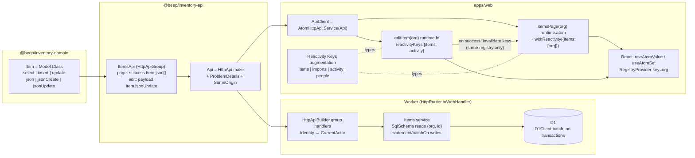

# Effect v4 modules for the inventory-import rebuild

## 1. Conclusions first

These are the conclusions a reader must not miss:

- **One `Model` per stored entity, a hand-declared HttpApi that references its variants, and the app's own batch helper for writes.** `Model.Class` gives `select`, `insert`, `update`, `json`, `jsonCreate` and `jsonUpdate` from one field list, and it replaces the four hand-synced item structs in use today. Nothing in `effect/http-api` derives endpoints from a Model: the contract still declares each endpoint and points at a variant. `SqlModel.makeRepository` does not fit. It keys every statement on one id column, while every table here is keyed by `(organizationId, id)`. Each of its statements also runs alone, so it cannot join a D1 atomic batch.
- **Atoms can replace TanStack Query, but they are a different machine.** Invalidation works by key hash inside one registry, not by key prefix. An array key `["items", orgId]` is two unrelated keys, not a tuple. A record key `{ items: [orgId] }` re-runs every `items` query whatever its id. An `AtomHttpApi` mutation invalidates nothing unless the caller passes keys, and it turns transport and decode errors into defects. Per-change undo, "invalidate after the last write of a kind", keep-previous-data paging and `setQueryData` all have to be rebuilt by hand.
- **Cluster and workflow cannot run on the current Worker plus D1.** Their SQL message storage wraps writes in `sql.withTransaction`, and the D1 client dies on any transaction. The only Workers path is `@effect/platform-cloudflare`, which is experimental and stores state in Durable Objects. The app already gets atomic, idempotent confirm and take-back from one D1 batch. Recommendation: not now.
- **`effect/graphql` is a GraphQL client only.** It has no server and adds nothing over HttpApi for this app.
- **`@effect/ai-openrouter` replaces the Vercel AI SDK almost one to one.** `LanguageModel.generateObject` sends the Effect Schema and decodes the reply with it. Failures are one `AiError` class with a typed `reason`. Two traps: OpenRouter's out-of-credit reply (HTTP 402) arrives as `UnknownError`, and the library's `isRetryable` is `true` for bad structured answers, which contradicts the app's rule that a bad answer is not retried.
- **TypeSafe does not score another model's output.** `@effect/ai-typesafe` is a provider for `DecisionModel`, not for `LanguageModel`. Its model, Jev, answers its own typed questions with a probability distribution. A number on an OpenRouter suggestion therefore costs a second call that asks Jev about that suggestion. For closed questions such as which unit or which column, Jev can make the decision directly instead. Every threshold in this report is a placeholder until it is calibrated on the app's own labelled files.
- **Every module here is `unstable` or `experimental`.** Pin `effect` and every `@effect/*` package to one exact version together.

**Source version.** Everything was read from the Effect-TS/effect repository at commit `57c88736db365c7152abedbbd2c2de330e945c1e` (2026-11-18). There, `effect`, `@effect/atom-react`, `@effect/ai-openrouter` and `@effect/ai-typesafe` are all version 4.1.4 (`effect/packages/effect/package.json`, `effect/packages/atom/react/package.json`, `effect/packages/ai/openrouter/package.json`, `effect/packages/ai/typesafe/package.json`). The app pins `effect` 4.1.4 and `@effect/sql-d1` 4.1.4 (`package.json`). The TypeSafe service docs were read from https://docs.typesafe.ai (pages cited by URL where used).

**What "Unverified" means here.** A statement marked "Unverified:" was not confirmed, either by reading the cited source file at that commit or by the cited documentation page. No code in this report was compiled or run. A shape copied from source is labelled with its file. A shape assembled from verified signatures is labelled "derived, not compiled": the names and signatures exist, but the composition has not been type-checked. No model, OpenRouter or TypeSafe request was made, and no package registry was queried.

## 2. The modules one by one

### 2.1 `effect/schema` Model

**What it is for.** You keep one field list per entity and get six schemas from it. The `select`, `insert` and `update` variants describe the database row as it is read and as it is written. The `json`, `jsonCreate` and `jsonUpdate` variants describe what the API sends, what a create payload may set, and what an update payload may set. Internally it is `VariantSchema.make({ variants: ["select","insert","update","json","jsonCreate","jsonUpdate"], defaultVariant: "select" })` (`effect/packages/effect/src/schema/Model.ts`, lines 28–40).

**Exported API.** Copied from `effect/packages/effect/src/schema/Model.ts` unless noted:

```ts
// Model.ts: the toolkit, re-exported from VariantSchema
Class, Field, FieldExcept, FieldOnly, Struct, Union, extract, fieldEvolve
// FieldOnly / FieldExcept, from effect/packages/effect/src/schema/VariantSchema.ts:449-458
FieldOnly: <const Keys extends ReadonlyArray<Variant>>(keys: Keys) => <S extends Schema.Top>(schema: S) => Field<{ [K in Keys[number]]: S }>
FieldExcept: <const Keys extends ReadonlyArray<Variant>>(keys: Keys) => <S extends Schema.Top>(schema: S) => Field<{ [K in Exclude<Variant, Keys[number]>]: S }>
```

| Helper | Variants it appears in |
| --- | --- |
| a plain schema (not a `Field`) | all six |
| `GeneratedByDb(s)` | select, json (read only) |
| `GeneratedByApp(s)` | select, insert, update, json |
| `Sensitive(s)` | select, insert, update (never JSON) |
| `FieldOption(s)` | DB: `OptionFromNullOr`; JSON: optional key, null or missing decodes to `Option.none` |
| `BooleanSqlite` | DB: `BooleanFromBit` (0/1); JSON: `Boolean` |
| `JsonFromString(s)` | DB: JSON text; JSON: `s` itself |
| `Date` | a `YYYY-MM-DD` string decoded to `DateTime.Utc` |
| `DateTimeInsert` | select/json `DateTimeUtcFromString`; insert defaults to now; absent from update |
| `DateTimeUpdate` | insert and update both default to now |
| `UuidV4Insert(brand)`, `UuidV7Insert(brand)` | id generated on insert; absent from jsonCreate and jsonUpdate; V7 reads `Clock` |

The app already uses this form for the audit trail (copied from `src/domain/Activity.ts`):

```ts
export class Activity extends Model.Class<Activity>("Activity")(
  { id: Model.UuidV4Insert(ActivityId), organizationId: OrganizationId, actorId: MemberId, /* … */ createdAt: Model.DateTimeInsert },
  { description: "One line of the audit trail: who did what, in words a person can read" }
) {}
// Activity (select), Activity.insert, Activity.update, Activity.json, Activity.jsonCreate, Activity.jsonUpdate
```

An insert value is built with `User.insert.makeEffect(input)`. It fills the generated id and timestamps from the Effect clock, so `TestClock` controls them (`effect/ai-docs/src/51_http-server/fixtures/server/Users.ts`, lines 96–110).

**Import specifier.** `import { Model } from "effect/schema"`. The barrel is `effect/packages/effect/src/schema/index.ts`.

**Stability.** `@stability unstable`, `@since 4.0.0`. Unstable means "new features in patch releases and breaking changes in minor releases" (`effect/MIGRATION.md`, lines 40–68).

**Traps.**
- `Model.Generated` (v3) is now `Model.GeneratedByDb`, and it is read only: it appears in select and json only. To keep v3's writable behaviour, use `Model.Field` with select, update and json (`effect/migration/v3-to-v4.md`, line 8304).
- `@effect/sql/Model` is split in two. `effect/schema/Model` holds the variants. `effect/sql/SqlModel` holds `makeRepository` and `makeResolvers`, which replaces v3's `makeDataLoaders` (`effect/migration/v3-to-v4.md`, lines 179, 187, 8312).
- `Model.fieldFromKey` is now `Schema.encodeKeys`, and `Model.BooleanFromNumber` is now `Schema.BooleanFromBit` (`effect/migration/v3-to-v4.md`, lines 8292–8312).
- A plain field lands in all six variants. Only `Field`, `FieldOnly` and `FieldExcept` restrict where a field appears.
- Only `select`, the class itself, decodes to a class instance. The JSON variants are plain structs.
- `extend` replaces a same-named field in every variant. A replacement that leaves a field out of the default variant does not remove it from the class schema (`effect/packages/effect/src/schema/VariantSchema.ts`, lines 335–341).
- Two helpers change decoded types. `FieldOption` gives `Option<T>` where today's code has `T | null`, and `Model.Date` gives `DateTime.Utc` where today's code has a `YYYY-MM-DD` string. Each ripples into `review` and the screens (Decision 2 in section 7).

### 2.2 `effect/http-api`

**What it is for.** It declares the HTTP contract once, as values. The same contract builds the server handlers, the typed browser client, the OpenAPI document and an in-memory test client.

**Exported API** (`effect/packages/effect/src/http-api/`):

```ts
// HttpApiEndpoint.ts:1196-1314, 1676-1746: one call per endpoint, options object
HttpApiEndpoint.get | post | put | patch | delete | head | options | query
  (identifier, path, { params?, query?, headers?, payload?, success?, error?, disableCodecs? })
// HttpApiGroup.ts:55-145
HttpApiGroup.make(identifier, { topLevel? }).add(...endpoints).prefix(p).middleware(m).annotate(...)
// HttpApi.ts:58-128
HttpApi.make(identifier).add(...groups).addHttpApi(other).prefix(p).middleware(m).annotate(...)
// HttpApiMiddleware.ts:344-405
class Identity extends HttpApiMiddleware.Service<Identity, { provides: CurrentActor; requires: never }>()(
  "id", { error: NotSignedIn }) {}
// HttpApiMiddleware.ts:520-608: RFC 9457 problem documents for decode failures
HttpApi.make("api").add(G).middleware(HttpApiMiddleware.ProblemDetails)
Layer.provide(HttpApiMiddleware.layerProblemDetails({ includeDetails: true }))
// HttpApiBuilder.ts:70-180
HttpApiBuilder.layer(api, { openapiPath? })
HttpApiBuilder.group(api, "items", Effect.fn(function*(handlers) { const s = yield* Items; return handlers.handleAll({ ... }) }))
// effect/packages/effect/src/http/HttpRouter.ts:1425-1527
HttpRouter.toWebHandler(appLayer, { memoMap? })   // build at module scope on Workers
// HttpApiClient.ts:625-744
HttpApiClient.make(api, { baseUrl?, transformClient?, transformResponse? })
// HttpApiTest.ts:1-110: same encoding, routing and decoding, no server
HttpApiTest.groups(api, ["items"])
```

Errors are `Schema.TaggedError` classes whose status comes from an annotation, as in `class ItemNotFound extends Schema.TaggedError<ItemNotFound>()("ItemNotFound", {}, { httpApiStatus: 404 }) {}` (`effect/packages/effect/src/Schema.ts`, lines 17961–17990). The built-in `HttpApiError.BadRequest`, `Forbidden`, `NotFound` and the others are in `effect/packages/effect/src/http-api/HttpApiError.ts`.

**Import specifier.** `import { HttpApi, HttpApiBuilder, HttpApiClient, HttpApiEndpoint, HttpApiError, HttpApiGroup, HttpApiMiddleware, HttpApiSchema, OpenApi } from "effect/http-api"`. Serving uses `effect/http`. D1 is the separate package `@effect/sql-d1`.

**Stability.** Every module is `@stability unstable`, `@since 4.0.0` (`effect/packages/effect/src/http-api/index.ts`). `ProblemDetails` is `@since 4.0.6`.

**Traps.**
- `@effect/platform/HttpApi*` is now `effect/http-api/*`, with no `unstable` segment and no compatibility exports (`effect/migration/v3-to-v4.md`, lines 140–143; `effect/MIGRATION.md`).
- The fluent setters (`addSuccess`, `setPayload`, `addError`) and tagged-template paths are gone. Everything goes in the options object (`effect/migration/v3-to-v4.md`, lines 6956–7008).
- `HttpApi.make` no longer takes API-wide errors. Declare errors on endpoints and in middleware (`effect/migration/v3-to-v4.md`, line 6902).
- `HttpApiBuilder.api` is now `HttpApiBuilder.layer`, and `HttpApiBuilder.toWebHandler` is now `HttpRouter.toWebHandler` (`effect/migration/v3-to-v4.md`, lines 6922–6938).
- A declared error with no status is a 500 (`effect/packages/effect/src/http-api/HttpApiSchema.ts`, lines 1614–1616).
- Two endpoints with the same method and path are rejected when the layer is built. Declare the variants of one operation as a single endpoint (`HttpApiEndpoint.ts`, lines 12–28).
- URL parameters are flat. A query or no-body payload field that encodes to a nested object is dropped. Use `Schema.fromJsonString` for structured values (`HttpApiEndpoint.ts`, lines 1182–1191).
- On Workers, build the web handler at module scope. The construction of the layer must not need request-time I/O (`effect/packages/effect/src/http/HttpRouter.ts`, lines 1425–1527). The app already does this (`src/server/App.ts`, `src/server/worker.ts`).

### 2.3 `effect/reactivity` (Reactivity, Atom, AtomHttpApi, AsyncResult, AtomRegistry)

**What it is for.** `Reactivity` is an in-memory registry of invalidation handlers. Writes name keys, and reads registered under those keys run again. It caches nothing. `Atom` is the reactive cell that does cache, evaluated by an `AtomRegistry`. `AtomHttpApi` derives query and mutation atoms from an `HttpApi`.

**Exported API.**

```ts
// effect/packages/effect/src/reactivity/Reactivity.ts:115-147 (service), 321-414 (accessors)
interface Reactivity {
  readonly invalidate: (keys: KeysInput) => Effect.Effect<void>
  readonly mutation: <A, E, R>(keys: KeysInput, effect: Effect.Effect<A, E, R>) => Effect.Effect<A, E, R> // invalidates only on success
  readonly query: <A, E, R>(keys: KeysInput, effect: Effect.Effect<A, E, R>) => Effect.Effect<Queue.Dequeue<A, E>, never, R | Scope.Scope>
  readonly stream: <A, E, R>(keys: KeysInput, effect: Effect.Effect<A, E, R>) => Stream.Stream<A, E, Exclude<R, Scope.Scope>>
  readonly withBatch: <A, E, R>(effect: Effect.Effect<A, E, R>) => Effect.Effect<A, E, R>
  // plus invalidateUnsafe, registerUnsafe
}
// KeysInput = ReadonlyArray<unknown> | ReadonlyRecord<string, ReadonlyArray<unknown>>, narrowed by augmentation (Reactivity.ts:43-106):
declare module "effect/reactivity/Reactivity" { interface Keys { readonly items: string } }

// effect/packages/effect/src/reactivity/Atom.ts
Atom.make(effect | stream | (get) => A | value)
Atom.runtime(layer)                              // AtomRuntime: .atom(...), .fn(...), .pull(...)
runtime.fn<Arg>()(fn, { initialValue?, reactivityKeys?, concurrent? })   // Atom.ts:680-711
Atom.withReactivity(keys)(atom)
Atom.family(f)                                   // cached by structural equality (MutableHashMap)
Atom.keepAlive, Atom.setIdleTTL(d), Atom.swr({ staleTime, revalidateOnFocus? }), Atom.refreshOnWindowFocus
Atom.optimistic(atom), Atom.optimisticFn({ reducer, fn })   // Atom.ts:2055-2228

// effect/packages/effect/src/reactivity/AtomHttpApi.ts:160-210
AtomHttpApi.Service<Self>()(id, { api, httpClient, transformClient?, transformResponse?, baseUrl?, runtime? })
  // → a Context.Service of the HttpApi client, plus:
  //   .runtime
  //   .query(group, endpoint, request & { reactivityKeys?, timeToLive?, serializationKey? })   → Atom<AsyncResult>
  //   .mutation(group, endpoint, { responseMode? }) → AtomResultFn<request & { reactivityKeys? }>

// effect/packages/effect/src/reactivity/AsyncResult.ts: Initial | Success | Failure, each with `waiting`
AsyncResult.builder(result).onInitial(...).onErrorTag(...).onDefect(...).onSuccess(...).render()
```

**Import specifier.** Use `import { AsyncResult, Atom, AtomHttpApi, AtomRegistry, Reactivity } from "effect/reactivity"`. The key augmentation targets `"effect/reactivity/Reactivity"` (`effect/packages/effect/package.json`, line 51).

**Stability.** Every module is `@stability unstable`, `@since 4.0.0` (`effect/packages/effect/src/reactivity/index.ts`).

**Traps.**
- An array key is not a tuple: each element is hashed as its own key. A record key emits the bare name *and* `name:id`. Verified in `keysToHashes`:

  ```ts
  // effect/packages/effect/src/reactivity/Reactivity.ts:428-445
  if (Array.isArray(keys)) { for (...) f(stringOrHash(keys[i])); return }
  for (const key in keys) { f(key); for (...) f(`${key}:${stringOrHash(ids[i])}`) }
  ```

  So `invalidate({ items: [orgA] })` also emits `"items"`, which every query registered with `{ items: [anyId] }` listens to. The id narrows nothing. Unverified: no test in the checkout covers the semantics between two different ids. This conclusion comes from reading the code.
- `Reactivity.mutation` does not invalidate on failure. A `Reactivity.query` stops for good after one failure (`Atom.test.ts`, lines 3107–3123).
- Reactivity is per registry. A mutation in one registry does not refresh another (`effect/packages/effect/test/reactivity/Atom.test.ts`, lines 3182–3207). It is also per process: a server write never invalidates a browser atom.
- A plain `Atom.fn` has no `reactivityKeys` option. Only `runtime.fn` has it (`Atom.ts`, lines 1221–1238).
- `AtomHttpApi` turns `SchemaError` and `HttpClientError` into `Effect.die`. Transport failures are therefore defects, not typed errors (`AtomHttpApi.ts`, lines 212–214).
- `AtomHttpApi.mutation` invalidates only when the write argument carries `reactivityKeys` (`AtomHttpApi.ts`, lines 217–237).
- A non-concurrent `fn` interrupts its previous run on every new write, which gives "switch to latest". Two in-flight edits need `concurrent: true` or one atom per target through `family`. Unverified: no test reads the interrupt path directly. This comes from `Atom.ts`, lines 568–631.
- `idleTTL` and `timeToLive` are like TanStack's `gcTime`. Staleness is `swr({ staleTime })`.
- `Atom.searchParam` writes with `pushState` and listens only to `popstate` and a `pushstate` event. It would not hear the app's own `navigate` (`src/web/lib/route.ts`).
- v3's `@effect/experimental/Reactivity` is now `effect/reactivity/Reactivity`. `query` returns a `Queue.Dequeue`, and the unsafe methods carry the `Unsafe` suffix (`effect/migration/v3-to-v4.md`, lines 6298–6308). Unverified: renames from the old community `@effect-atom/*` packages, such as `Result` → `AsyncResult`. That source is not in the checkout.

### 2.4 `@effect/atom-react`

**What it is for.** React bindings over an `AtomRegistry` taken from React context, built on `useSyncExternalStore`.

**Exported API** (`effect/packages/atom/react/src/`):

```ts
// Hooks.ts:143-583 ("use client")
useAtomValue(atom) / useAtomValue(atom, select)
useAtom(atom, { mode? })                    // [value, write]
useAtomSet(atom, { mode?: "value" | "promise" | "promiseExit" })   // also mounts the atom
useAtomMount, useAtomRefresh, useAtomSuspense(atom, { suspendOnWaiting?, includeFailure? }),
useAtomSubscribe, useAtomInitialValues, useAtomRef, useAtomRefProp, useAtomRefPropValue
// RegistryContext.ts:25-112
RegistryContext, RegistryProvider({ children, initialValues?, scheduleTask?, timeoutResolution?, defaultIdleTTL? }), scheduleTask
// ReactHydration.ts, ScopedAtom.ts
HydrationBoundary, ScopedAtom.make(...)
```

Tests swap layers with `<RegistryProvider initialValues={[Atom.initialValue(runtime.layer, TestLayer)]}>` (`effect/packages/atom/react/test/index.test.tsx`, lines 35–65).

**Import specifier.** Use `import { RegistryProvider, useAtomSet, useAtomValue } from "@effect/atom-react"`.

**Stability.** The reactivity modules it binds to are `@stability unstable`, and all Effect packages share one version, released together (`effect/packages/atom/react/CHANGELOG.md`, lines 82, 99–103). The version is 4.1.4. The app does not depend on it today (`package.json`).

**Traps.**
- Peer dependencies are `react >=19.0.0 <20.0.0` and `scheduler >=0.25.0 <0.29.0` (`effect/packages/atom/react/package.json`).
- `RegistryProvider` does not default `defaultIdleTTL` to 400 the way the context's default registry does. Pass it explicitly (`RegistryContext.ts`, lines 92–97).
- Option changes after the first render do not rebuild the registry. Use a React `key` to get a fresh one.
- A component that only writes must call `useAtomSet` (which mounts the atom), or its run can be disposed mid-flight.
- `useAtomSuspense` throws `Cause.squash(cause)` on failure unless `includeFailure: true`.
- There are no atom devtools in the checkout. `AtomRegistry`'s `onNodeAdded`/`onNodeRemoved` hooks exist, but nothing uses them.
- `HydrationBoundary` and `serializationKey` exist for SSR. This app is a Vite single-page app, so they have no use here.

### 2.5 `effect/cluster` with `effect/workflow`

**What it is for.** Cluster gives actors addressed by id, durable messaging, singletons and cron. Workflow gives durable multi-step executions with memoised activities, durable sleep and compensation.

**Exported API.**

```ts
// effect/packages/effect/src/cluster/Entity.ts (~495-527, 74-235)
const ImportEntity = Entity.make("Import", [Rpc.make("Confirm", { payload: { key: Schema.String }, primaryKey: ({ key }) => key })])
  .annotateRpcs(ClusterSchema.Persisted, true)
ImportEntity.toLayer(handlers, { concurrency?, mailboxCapacity?, maxIdleTime?, disableFatalDefects?, defectRetryPolicy? })
ImportEntity.client   // Effect<(entityId) => RpcClient<..., MailboxFull | AlreadyProcessingMessage | PersistenceError | EntityNotAssignedToRunner>, never, Sharding>
// Singleton.ts, ClusterCron.ts, EntityProxy.ts (derives an HttpApiGroup: POST /<tag>/:entityId)
Singleton.make(name, run), ClusterCron.make({ name, cron, execute }), EntityProxy.toHttpApiGroup(name, entity)
// Testing: Entity.makeTestClient(entity, layer); TestRunner.layer (memory storage)

// effect/packages/effect/src/workflow/Workflow.ts:453-496
const Pass = Workflow.make("SuggestPass", { payload: { importId: Schema.String }, idempotencyKey: ({ importId }) => importId, success: Schema.Void })
Pass.toLayer((payload, executionId) => Effect)   // also execute, poll, interrupt, resume, withCompensation
// Activity.ts, DurableClock.ts, DurableDeferred.ts, WorkflowEngine.ts
Activity.make({ name, execute, success?, error? }); DurableClock.sleep({ name, duration }); WorkflowEngine.layerMemory
```

**What it needs to run.** Classic cluster needs `Sharding`, `MessageStorage`, `RunnerStorage` and a runner transport in a long-lived process. `SingleRunner.layer` runs on one node and still uses SQL message storage (`effect/packages/effect/src/cluster/SingleRunner.ts`). On SQLite, `SqlMessageStorage` inserts inside `sql.withTransaction` (`effect/packages/effect/src/cluster/SqlMessageStorage.ts`, lines 384–427). The D1 driver's transaction acquirer is `Effect.die("transactions are not supported in D1")` (`effect/packages/sql/d1/src/D1Client.ts`, line 340). The one Workers path is `@effect/platform-cloudflare` (added in commit `1a2c5a645b`, 2026-11-10). Its README says "Every entity instance is one Durable Object… This package is experimental. Its APIs may change in patch releases." That package is out of scope here except as a constraint.

**Import specifier.** Use `effect/cluster`, `effect/workflow` and `effect/rpc`. The `@effect/cluster`, `@effect/workflow` and `@effect/rpc` packages no longer exist (`effect/MIGRATION.md`, lines 25–68).

**Stability.** Cluster and workflow are `@stability unstable`. `@effect/platform-cloudflare` is experimental.

**Traps.**
- v3 imports from `@effect/cluster` and the v4 beta's `effect/unstable/...` paths do not resolve on 4.1.4.
- Entity handlers receive the envelope (`envelope.payload`), not the bare payload (`effect/packages/effect/test/cluster/TestEntity.ts`).
- Every entity client call carries four cluster errors on top of the RPC's own.
- Messages are volatile unless they carry `ClusterSchema.Persisted`. On the Cloudflare path a non-persisted message is "best-effort in-request only".
- `withCompensation` runs only when the whole workflow fails, and only for top-level effects. A take-back is a later user action, not compensation.
- An activity that suspends runs its body again on replay, so its side effects must be idempotent (`effect/packages/effect/src/workflow/Activity.ts`).
- Execution ids are SHA-256 derivations that are persisted, so the idempotency key must stay byte-for-byte stable (`effect/packages/effect/test/workflow/Workflow.test.ts`).
- On the Cloudflare path, `maxIdleTime`, `mailboxCapacity` and `disableFatalDefects` "are accepted for parity and have no effect" (`effect/packages/platform/cloudflare/README.md`).

### 2.6 `effect/graphql`

**What it is for.** It is a typed client for someone else's GraphQL API. It provides Schema-typed operations, groups, client middleware, HTTP plus graphql-sse and graphql-ws transports, `RequestResolver` batching of lookups, and cursor paging. A separate generator, `@effect/graphql-generator` (`graphqlgen`), emits operations from `.graphql` files. **It has no server, no schema-from-Schema builder and no HttpRouter mounting.**

**Exported API.**

```ts
// effect/packages/effect/src/graphql/GraphQL.ts
const RepoIssues = GraphQL.query("RepoIssues", { document: "query RepoIssues(...){...}", variables: { owner: Schema.String }, result: Schema.Struct({ ... }) })
// GraphQLGroup.ts, GraphQLClient.ts, GraphQLProtocol.ts, GraphQLResolver.ts
GraphQLGroup.make(...operations)            // names must be unique; they become method names
GraphQLClient.make(group)                   // needs GraphQLProtocol; also pages / items for cursor paging
GraphQLProtocol.layerHttp(...), GraphQLProtocol.layerWebSocket(...)
GraphQLResolver.ordered | findById | aliased, then .request
```

**Import specifier.** `import { GraphQL, GraphQLClient, GraphQLGroup, GraphQLProtocol } from "effect/graphql"`.

**Stability.** `@stability experimental` throughout: "may receive new features and breaking changes across patch versions" (`effect/MIGRATION.md`). It was added in commit `ab90be98ea` (2026-10-13) and first shipped in 4.0.4 (`effect/packages/effect/CHANGELOG.md`). A later fix, `d4272bd087`, made calls fail on non-2xx HTTP responses.

**Traps.**
- "GraphQLResolver" means client-side lookup batching, not server resolvers.
- Nothing in the module reuses HttpApi. It sits on `effect/http`'s HttpClient.

### 2.7 `@effect/ai-openrouter` (over `effect/ai`)

**What it is for.** It is the OpenRouter provider for Effect's provider-neutral `LanguageModel` service. It replaces `ai` and `@openrouter/ai-sdk-provider` in `src/server/Ai.ts`.

**Exported API.**

```ts
// effect/packages/ai/openrouter/src/OpenRouterClient.ts
OpenRouterClient.layer({ apiKey?: Redacted<string>, apiUrl?, siteReferrer?, siteTitle?, transformClient? })
  : Layer<OpenRouterClient, never, HttpClient.HttpClient>
OpenRouterClient.layerConfig({ apiKey?: Config<...>, ... })   // no default key name: the caller names the Config
// effect/packages/ai/openrouter/src/OpenRouterLanguageModel.ts:541-705
OpenRouterLanguageModel.model(modelId, config?): AiModel.Model<"openrouter", LanguageModel.LanguageModel, OpenRouterClient>
OpenRouterLanguageModel.layer({ model, config? }): Layer<LanguageModel.LanguageModel, never, OpenRouterClient>
OpenRouterLanguageModel.withConfigOverride(overrides)(effect)   // per-call max_tokens, temperature, models, provider, ...
// Config = Partial<Omit<ChatRequest, "messages"|"response_format"|"tools"|"tool_choice"|"stream"|"stream_options">> & { strictJsonSchema?: boolean }

// effect/packages/effect/src/ai/LanguageModel.ts:1989-2016
LanguageModel.generateObject({ prompt, schema, objectName?, allowEmpty?, toolkit?, toolChoice? })
  : Effect<GenerateObjectResponse<..., A>, AiError, LanguageModel | Schema["DecodingServices"]>
// response: .value, .text, .finishReason, .usage, .content (the finish part carries metadata.openrouter.usage.cost)
// effect/packages/effect/src/ai/Prompt.ts:2142, 2470
Prompt.make(input), Prompt.setSystem(prompt, content)
// effect/packages/effect/src/ai/AiError.ts:1680-1710
class AiError { module; method; reason: AiErrorReason; get isRetryable(); get retryAfter(): Duration | undefined }
// effect/packages/effect/src/ExecutionPlan.ts:178-240, effect/packages/effect/src/Effect.ts:4560-4643
ExecutionPlan.make({ provide: Layer | Context, attempts?, while?, schedule? }, ...); Effect.withExecutionPlan(effect, plan, { onEvent? })
```

How OpenRouter's HTTP statuses map to error reasons (`effect/packages/ai/openrouter/src/internal/errors.ts`, lines 240–330):

| Status | Reason |
| --- | --- |
| 400, 404, 409, 422 | `InvalidRequestError` |
| 401 | `AuthenticationError("InvalidKey")` |
| 403 | `AuthenticationError("InsufficientPermissions")` |
| 429 with `insufficient_quota` | `QuotaExhaustedError` |
| any other 429 | `RateLimitError` with `retryAfter` |
| 529 and ≥500 | `InternalProviderError` |
| anything else, **402 included** | `UnknownError` |

Transport failures become `NetworkError`.

**Import specifier.** `import { OpenRouterClient, OpenRouterLanguageModel } from "@effect/ai-openrouter"` and `import { AiError, LanguageModel, Prompt } from "effect/ai"`. The AI module ships inside `effect`. There is no `@effect/ai` package and no `effect/unstable/ai` path.

**Stability.** Every export is `@stability unstable`. Release 4.1.4 of `@effect/ai-openrouter` was a breaking regeneration of `Generated.ts` that "removed some intermediate schema exports" (`effect/packages/ai/openrouter/CHANGELOG.md`). Depend only on `LanguageModel`, `AiError`, `Response`, `Prompt` and the `Config` keys, never on `Generated.*`.

**Traps.**
- None of the v3 or AI SDK names exist here: no `AiLanguageModel`, `AiInput`, `Completions`, `generateText({ output: Output.object })`, `system`, `maxOutputTokens`, `maxRetries` or `abortSignal`. The system message goes into the prompt. Token caps go into `Config` as `max_tokens`. Cancellation is fiber interruption, and `FetchHttpClient` passes the abort signal on (`effect/packages/effect/src/http/FetchHttpClient.ts`, lines 108–139).
- The secret is read with `Config.Redacted`, not `Config.redacted`.
- No retry is built in, neither in the provider nor in core.
- `AiError.isRetryable` is `true` for `StructuredOutputError`, `InvalidOutputError` and some tool reasons.
- Out of credit (402) is `UnknownError`, not `QuotaExhaustedError`.
- Logprobs can be requested through `Config`, but `OpenRouterLanguageModel` never reads them. They reach no response part (grep over `effect/packages/ai/openrouter/src/OpenRouterLanguageModel.ts`).
- Structured-output constraints apply (section 4.2).

### 2.8 `@effect/ai-typesafe`

**What it is for.** It is the provider that lets Effect's `DecisionModel` service call TypeSafe's Jev. Jev is a non-generative model that answers typed questions with distributions: Choice, Score, Noul (a yes-or-no probability) and Box. "The model does not generate text… It returns decisions and probabilities" (https://docs.typesafe.ai/introduction/machine-learning-primer.md). **The package does not touch `LanguageModel`, `generateObject` or OpenRouter, and has no way to score another model's response.**

**Exported API.**

```ts
// effect/packages/ai/typesafe/src/TypeSafeClient.ts
TypeSafeClient.layer({ apiKey?: Redacted<string>, apiUrl?, transformClient? }): Layer<TypeSafeClient, never, HttpClient.HttpClient>
TypeSafeClient.layerConfig()   // reads Config.Redacted("TYPESAFE_API_KEY"); base URL https://api.typesafe.ai/v1; no retry, no timeout
// effect/packages/ai/typesafe/src/TypeSafeDecisionModel.ts:31, 183
TypeSafeDecisionModel.model("jev-latest"): Model<"typesafe", DecisionModel.DecisionModel, TypeSafeClient>
TypeSafeDecisionModel.layer({ model: "jev-latest" | "jev-preview" | "jev-1.13.0" | "jev-1.14.0" | (string & {}) })

// The core it implements: effect/packages/effect/src/ai/Decision.ts:461-699
Decision.classify({ instructions, criteria: { [label]: Description | null } })   // ≥ 2 labels, else throws
Decision.rate({ instructions, criteria: [levels] })                               // ≥ 2 distinct levels
Decision.probability({ instructions, criteria?: { false, true } })
Decision.make({ input: Schema, decisions: Record<string, Decision> })            // non-empty, else throws
// effect/packages/effect/src/ai/DecisionModel.ts:703-760
DecisionModel.decide(definition, { input }): Effect<DecideResponse, AiError, DecisionModel | Input["EncodingServices"]>
DecisionModel.decideSettled(...)   // a Result per decision; provider and transport failures still fail the whole call
// Answers: ClassifyAnswer { label; probabilities; confidence? }, ProbabilityAnswer { probability } (no confidence)
```

All decisions in one definition go out as one HTTP request (`TypeSafeDecisionModel.ts`, lines 60–139). `OpenRouterDecisionModel`, backed by "OpenRouter's alpha Decisions API", implements the same `DecisionModel` service (`effect/packages/ai/openrouter/src/OpenRouterDecisionModel.ts`).

**Import specifier.** `import { TypeSafeClient, TypeSafeDecisionModel } from "@effect/ai-typesafe"` and `import { Decision, DecisionModel } from "effect/ai"`. The app does not depend on this package today.

**Stability.** Every export is `@stability unstable`. The first commit is `8cb0a4f28f` (2026-09-18). The 4.1.0 release removed `DecideOptions.images`, a breaking change (`effect/packages/ai/typesafe/CHANGELOG.md`). The README states: "TypeSafe's rounding behavior has not been verified against the live API."

**Traps.**
- TypeSafe's `confidence` measures how concentrated a distribution is, not how likely the answer is to be correct. For a Choice it is `(p_max − 1/n)/(1 − 1/n)`, so it changes with the number of options. TypeSafe itself advises thresholding "the probability of the option you will act on, or the top-to-second ratio, rather than confidence alone" (https://docs.typesafe.ai/confidence.md).
- Noul answers have no confidence field.
- `ClassifyAnswer.label` "need not have the highest probability" (`Decision.ts`, lines 270–295).
- The vendor lists these weaknesses (https://docs.typesafe.ai/model-jaggedness.md):
  - "Jev is not a calculator."
  - Jev "treats dates as text".
  - Score levels are "weakly calibrated".
  - "Jev leans toward the first option."
  - Content injected into the input state can change answers.
- Calibration is a vendor claim. It describes "groups of predictions, not a guarantee about any single answer", and no metric is published (https://docs.typesafe.ai/introduction/machine-learning-primer.md).
- Context is limited to 64k tokens per request and 32k per question by default (https://docs.typesafe.ai/models.md).

## 3. How the modules compose for this app

### 3.1 Schema first: one Model per entity

The item table has a composite key `PRIMARY KEY (organizationId, id)` and columns the API never shows: `skuKey`, `importId`, `batchId`, `sourceRow`, `sourcePart`, `createdById` and `updatedById` (`migrations/0001_init.sql`, lines 276–314). Today four structs describe it: `ItemFields` and `StoredItem` in `src/domain/Item.ts`, and `ItemRow` and `ItemInsert` in `src/server/Imports.ts`, with a hand-listed `itemColumns`. One Model replaces them:

```ts
// @beep/inventory-domain/src/Item.ts (derived, not compiled)
import { Schema } from "effect"
import { Model } from "effect/schema"

export const ItemId = Schema.String.pipe(Schema.brand("ItemId"))

export class Item extends Model.Class<Item>("Item")(
  {
    id: Model.UuidV4Insert(ItemId),
    organizationId: Model.Sensitive(OrganizationId),             // from the actor, never from a payload or a response
    sku: Model.FieldExcept(["update", "jsonUpdate"])(Sku),        // the item's identity: never changes
    name: ItemName,                                               // plain: in all six variants
    // ... description, category, uom, unitCost, quantityOnHand, reorderPoint, firstReceivedOn, discontinuedOn
    isActive: Model.BooleanSqlite,
    lotTracked: Model.BooleanSqlite,
    tags: Model.Field({
      select: Schema.fromJsonString(Tags), insert: Schema.fromJsonString(Tags), update: Schema.fromJsonString(Tags),
      json: Tags, jsonCreate: Tags                                // absent from jsonUpdate: only an import sets tags
    }),
    dimensions: Model.Field({
      select: Schema.NullOr(Schema.fromJsonString(Dimensions)), insert: Schema.NullOr(Schema.fromJsonString(Dimensions)),
      update: Schema.NullOr(Schema.fromJsonString(Dimensions)), json: Schema.NullOr(Dimensions), jsonCreate: Schema.NullOr(Dimensions)
    }),                                                           // SQL NULL stays NULL, not the text "null"
    skuKey: Model.FieldOnly(["select", "insert"])(Schema.String),
    importId: Model.FieldOnly(["select", "insert"])(ImportId),
    revision: Model.FieldExcept(["jsonCreate"])(Schema.Int),      // jsonUpdate carries the revision the person saw
    createdAt: Model.DateTimeInsert,
    updatedAt: Model.DateTimeUpdate
  },
  { description: "One inventory item of one organization" }
) {}
// Item (select: a D1 row)  Item.insert  Item.update  Item.json  Item.jsonCreate  Item.jsonUpdate
```

The import pipeline's staged rows, decisions and outcomes (`ImportView`, `RowOutcome`, `ImportResult` in `src/api/v1/Api.ts`) are views, not tables with create, read, update and delete. They stay plain `Schema.Struct` or `Schema.Class`.

### 3.2 Contract second: the HttpApi references variants

```ts
// @beep/inventory-api/src/ItemsApi.ts (derived, not compiled; mirrors src/api/v1/Api.ts:876-907)
export const ItemPage = Schema.Struct({ data: Schema.Array(Item.json), total: Schema.Int })

export class ItemsApi extends HttpApiGroup.make("items")
  .add(
    HttpApiEndpoint.get("page", "/", { query: ItemQueryParams, success: ItemPage }),
    HttpApiEndpoint.put("edit", "/:id", {
      params: { id: ItemId },
      payload: Item.jsonUpdate,
      success: Item.json,
      error: [Forbidden, ItemNotFound, ItemChanged, ItemInvalid]
    })
  )
  .middleware(Identity)
  .prefix("/items") {}

// the app package composes, as today:
export class Api extends HttpApi.make("inventory")
  .add(SystemApi, IdentityApi, ActivityApi, ImportsApi, ItemsApi, PeopleApi, AssistantApi)
  .middleware(HttpApiMiddleware.ProblemDetails)
  .middleware(SameOrigin)
  .prefix("/api/v1") {}
```

`ItemEdit` today carries its own `messageMissingKey` texts per field (`src/domain/Item.ts`, lines 205–235). Those would move to `Model.fieldEvolve` or stay in a separate payload struct. Unverified: that either form is cleaner than today's.

### 3.3 Service third: reads by SqlSchema, writes by the batch helper

`SqlModel.makeRepository(Model, { tableName, spanPrefix, idColumn })` builds `findById`, `update` and `delete` as `where <idColumn> = ?` (`effect/packages/effect/src/sql/SqlModel.ts`, lines 35–226). Two caveats follow:

- **The two-part key.** With only `idColumn: "id"`, a repository `findById` or `update` would not filter on `organizationId`. That breaks the rule that every query filters by organization, unless every caller re-checks. Keep `SqlSchema` reads with explicit `organizationId` predicates (`src/server/Items.ts`, lines 497–501).
- **D1 has no transactions.** Atomic writes go through `D1Client.batch([...])`. "D1 batches execute on the binding directly and intentionally cannot participate in SqlClient transactions" (`effect/packages/sql/d1/src/D1Client.ts`, lines 63–108, 184). Repository effects run one statement each, so they cannot join an edit's "audit line, then update under the same guard" batch (`src/server/Items.ts`, lines 511–560). Keep the app's `statement`, `run` and `batchOn` helper (`src/server/Sql.ts`) and pass it Model variants as Request and Result schemas:

```ts
// @beep/inventory-server/src/Items.ts (derived, not compiled)
const editItem = statement({
  Request: Schema.Struct({ ...Item.update.fields, seen: Schema.Int }),
  Result: Schema.Array(Item),          // select variant decodes the RETURNING row
  execute: (r) => sql`UPDATE item SET ... WHERE organizationId = ${r.organizationId} AND id = ${r.id} AND revision = ${r.seen} RETURNING *`
})
export class Items extends Context.Service<Items, {
  readonly edit: (actor: Member, id: ItemId, edit: typeof Item.jsonUpdate.Type) => Effect.Effect<typeof Item.json.Type, ItemNotFound | ItemChanged | ItemInvalid>
}>()("@beep/inventory-server/Items") {}
// implementation: Effect.fn("Items.edit")(function*(actor, id, edit) { ...; yield* batchOn(d1)([editedLine(r), editItem(r)]); ... })
```

The confirm writes items with one statement over `json_each(...)`, which stays under D1's 100-bound-parameter limit (`src/server/Imports.ts`, lines 1009–1021). The Model's `insert` variant can be the encode schema for each element of that JSON parameter.

### 3.4 Client: keys, atoms, components

**Key declaration.** "Only applications should augment this interface, never libraries" (`effect/packages/effect/src/reactivity/Reactivity.ts`, lines 43–106). In the Turborepo the augmentation therefore lives in the web app package, never in a shared `@beep/*` library.

```ts
// apps/web/src/keys.ts (derived, not compiled)
declare module "effect/reactivity/Reactivity" {
  interface Keys {
    readonly items: string     // organizationId
    readonly imports: string
    readonly activity: string
    readonly people: string
  }
}

// apps/web/src/ApiClient.ts (derived, not compiled; the class-extends form is inferred from `new(_: never)` at AtomHttpApi.ts:47)
export class ApiClient extends AtomHttpApi.Service<ApiClient>()("@beep/inventory-web/ApiClient", {
  api: Api,
  httpClient: Layer.fresh(FetchHttpClient.layer).pipe(Layer.provide(Layer.succeed(FetchHttpClient.Fetch, fetchOrEarly)))
}) {}

// one atom whose effect reads the params atom: recomputing keeps the previous page with `waiting: true` (Atom.ts:556-601)
export const itemsQuery = Atom.make<ItemQueryParams>(defaultItemsQuery)
export const itemsPage = Atom.family((org: string) =>
  ApiClient.runtime.atom(Effect.fnUntraced(function*(get: Atom.AtomContext) {
    const query = get(itemsQuery)
    const client = yield* ApiClient
    return yield* client.items.page({ query })     // HttpClientError stays typed: no catchErrors on this path
  })).pipe(Atom.withReactivity({ items: [org] }))
)

// a write with fixed keys, typed transport errors, one retry rule and no interruption between two edits
export const editItem = Atom.family((org: string) =>
  ApiClient.runtime.fn<{ readonly id: ItemId; readonly edit: typeof Item.jsonUpdate.Type }>()(
    Effect.fnUntraced(function*({ id, edit }) {
      const client = yield* ApiClient
      return yield* client.items.edit({ params: { id }, payload: edit }).pipe(Effect.retry(writeRetry))
    }),
    { reactivityKeys: { items: [org], activity: [org] }, concurrent: true }
  )
)

// ItemsTable.tsx
function ItemsTable({ org }: { readonly org: string }) {
  const page = useAtomValue(itemsPage(org))
  const save = useAtomSet(editItem(org), { mode: "promiseExit" })
  return AsyncResult.builder(page)
    .onInitial(() => <TableSkeleton />)
    .onErrorTag("Forbidden", () => <NoAccess />)
    .onSuccess((p, r) => <Table rows={p.data} dimmed={r.waiting} onSave={(id, edit) => save({ id, edit })} />)
    .render()
}
// root: <RegistryProvider key={activeOrganizationId} defaultIdleTTL={400}>
```

`writeRetry` is today's `callWrite` policy (`src/web/lib/api.ts`, lines 55–92): `{ schedule: Schedule.exponential("400 millis").pipe(Schedule.jittered), times: 2, while: isTransient }`. Writes are safe to send twice because each names a request id. `ApiClient.mutation("items", "edit")` would also work, but it turns `HttpClientError` into a defect, so `isTransient` could no longer see it. It also needs `reactivityKeys` passed on every call. Unverified: whether `onErrorTag` accepts the full error union of `items.edit` including the `Identity` middleware's client errors. That type was not checked.

### 3.5 One diagram



### 3.6 What does and does not keep one organization's data apart

| Mechanism | Keeps organizations apart? |
| --- | --- |
| `Identity` middleware plus `organizationId` in every SQL predicate and index (`src/server/SessionIdentity.ts`, `src/server/Items.ts`) | **Yes.** This is the only real boundary. |
| `<RegistryProvider key={orgId}>`: a fresh registry, so a fresh memo map, fresh `Reactivity` and fresh atoms | Yes, for what the browser holds in memory after a switch |
| A full page reload on sign-in-as and sign-out (`src/web/lib/actor.ts`) | Yes. Keep it. |
| `orgId` inside `AtomHttpApi.query(..., { reactivityKeys })`: the keys are part of the family key, so each organization gets its own atom (`AtomHttpApi.ts`, lines 290–344) | Separates cached entries |
| The record-form id in `invalidate({ items: [orgA] })` | **No.** It also emits `"items"` and re-runs every `items` query. |
| The array form `["items", orgId]` | **No.** These are two unrelated hashes, and invalidating `[orgId]` hits every query that lists it. |
| Server-side `Reactivity` (`SqlClient.reactive`, `D1Client` provides `Reactivity.layer`) | Not applicable. It lives per isolate and never reaches the browser. |

### 3.7 What TanStack Query behaviour must be rebuilt by hand

Today the app runs TanStack Query over one `ManagedRuntime` (`src/web/lib/api.ts`, `src/web/lib/queries.ts`, `src/web/lib/optimistic.ts`). If atoms replace it, these are rebuilt:

- **Per-change undo.** `rollback.ts` takes out only this write's change when another write touched the same entry. `Atom.optimistic` instead rolls back to the whole latest source value (`Atom.ts`, lines 2069–2160). The 409 `ItemChanged` path (show the server's row, keep the form, toast "Edit again") becomes app code around `useAtomSet(..., { mode: "promiseExit" })`.
- **Invalidate only after the last write of a kind.** `optimistic.ts` checks `isMutating(...) > 1` before invalidating. There is no equivalent: `Reactivity.mutation` invalidates after each success, and `withBatch` batches only within one effect.
- **Keep previous data while paging.** This works only when one atom reads a params atom, as `itemsPage` above does. Separate `query(...)` atoms per page lose it. `isPlaceholderData` becomes `result.waiting`.
- **`setQueryData` after match, suggest, upload and commit.** Rebuild these with writable or optimistic wrappers, or rely on invalidation plus a refetch.
- **`prefetchQuery`.** Rebuild it with `registry.mount(atom)`.
- **Query retry on transient errors.** There is no `retry` option on atoms. Retry is `Effect.retry`, or an `HttpClient.retryTransient` in `transformClient`. Unverified: the full options of `retryTransient` beyond the JSDoc examples' `{ times, schedule }` (`effect/packages/effect/src/http/HttpClient.ts`, line 981).
- **`isPending` and `variables` per row.** The People page shows "saving" on the row being changed. That needs one `fn` atom per member (`family`), because a single atom's `waiting` flag does not say which row is saving.
- **Timing.** `staleTime` maps to `Atom.swr({ staleTime })`, `gcTime` to `setIdleTTL`/`timeToLive`, `refetchOnWindowFocus: "always"` to `swr({ revalidateOnFocus: "always" })`, and `Infinity` to `keepAlive`.
- **One runtime, one DevTools connection.** The atom runtime builds its own layer through the registry's memo map. Move `devToolsLayer` and browser telemetry into `Atom.runtime.addGlobalLayer(...)` and retire the `ManagedRuntime`. Otherwise two runtimes exist, which `src/web/lib/devtools.ts` forbids.
- **Query devtools.** There are none for atoms.

### 3.8 Does GraphQL add anything over HttpApi here?

**No.** `effect/graphql` calls GraphQL servers, and the app has none. Effect offers no server to build one, so a third-party server would have to run inside the Worker next to HttpApi. That means a second contract style, and an OpenAPI document that no longer covers the API. The candidate gains do not hold up:

- **Nested selection** (import → rows → proposals) is one import's rows, which the existing endpoints already page.
- **Subscriptions for progress** are not needed, because upload progress is computed in the browser while it sends chunks.
- **`GraphQLResolver` batching** solves N+1 lookups that a single-table API does not have.

The only legitimate use is a future integration that reads from or writes to an external GraphQL system, through a small `@beep/*` adapter package. Unverified: no such integration is named in the app.

## 4. The model path

### 4.1 Provider layer

The app treats a missing or blank `OPENROUTER_API_KEY` as "AI off", reading it through its single settings door (`src/server/Settings.ts`, lines 49–76). So build the client with `layer`, not `layerConfig`, and only when the key is present.

```ts
// @beep/inventory-server/src/Models.ts (derived, not compiled)
const clientLayer = (apiKey: Redacted.Redacted<string>) =>
  OpenRouterClient.layer({ apiKey }).pipe(Layer.provide(FetchHttpClient.layer))

const modelStep = (modelId: string, fallbacks: ReadonlyArray<string>) =>
  OpenRouterLanguageModel.model(modelId, { models: [modelId, ...fallbacks] })   // OpenRouter's own in-call fallback list
```

The configured default is `AI_MODEL = "anthropic/claude-haiku-5.5"`, with `AI_FALLBACK_MODELS = "google/gemini-3.8-flash"` (`wrangler.jsonc`, lines 25–28). Today's `usage: { include: true }` has no slot in the closed `Config` type. Unverified: whether OpenRouter fills `usage.cost` without it.

### 4.2 Structured output by Schema, and its constraints

`generateObject` sends `responseFormat: { type: "json", objectName, schema }` with `toolChoice: "none"`. It then joins the text parts and decodes them with `Schema.fromJsonString(codec)` (`effect/packages/effect/src/ai/LanguageModel.ts`, lines 1008–1068 and 2658–2697). The constraints found in source:

- **Root shape.** The root must be an object, with no top-level union. With OpenRouter the decode codec is always `toCodecOpenAI` (`OpenRouterLanguageModel.ts`, lines 610–611), and it "throws when the resulting root is not an object or contains `anyOf`" (`effect/packages/effect/src/ai/OpenAiStructuredOutput.ts`, lines 20–82).
- **Rewrites.**
  - Optional properties become required-nullable, so write `Schema.NullOr` explicitly instead of relying on `optional`.
  - Tuples become objects with numeric keys.
  - Records become arrays of `[key, value]`.
  - `oneOf` becomes `anyOf`.
  - Unsupported constraints are dropped from the schema sent to the provider, but the codec still checks them.
- **Recursive schemas** throw in the Anthropic transformer (`effect/packages/effect/src/ai/AnthropicStructuredOutput.ts`, lines 30–68).
- **The transformer is chosen by model id.** `anthropic/` and `claude-` get the Anthropic JSON schema. `openai/`, `gpt-` and `o1`/`o3`/`o4` get the OpenAI one with `strict: true`. Anything else gets the default, with `strict: null` (`OpenRouterLanguageModel.ts`, lines 1836–1851 and 1914–1934). Unverified: whether a reply from a model with an omitted optional key (sent with the default transformer) decodes cleanly through the OpenAI codec.
- **Decoding services.** The schema's `DecodingServices` must be `never`, because they flow into the requirements.
- **Cost of a bad schema.** The codec check runs *after* the paid call. A schema the codec cannot express fails with `UnsupportedSchemaError` after spending, unless the provider-side transformer already failed before the call (`LanguageModel.ts`, lines 1032–1053; `OpenRouterLanguageModel.ts`, lines 1853–1870).
- **Failure kinds.** A decode failure is `AiError` with reason `StructuredOutputError`, and it keeps `responseText` for the log. Empty text is also `StructuredOutputError`.

### 4.3 Where a confidence score can really come from

**TypeSafe scores its own typed questions through `DecisionModel`, and does not score another model's output.** No code path in `@effect/ai-typesafe` takes a `LanguageModel` response. OpenRouter logprobs are not surfaced by the provider (section 2.7). There are two ways to use TypeSafe:

1. **Verify a suggestion with a second call.** The language model proposes through `generateObject`. One `DecisionModel.decide` then asks Noul (`Decision.probability`) or Choice questions *about* each proposal, with the cell, its row and the proposed value as input. This follows TypeSafe's "verify LLM outputs" recipe (https://docs.typesafe.ai/cookbooks/verify_llm_outputs.md). Use it only where the answer is open text, such as a name for a row with none.
2. **Decide closed questions directly.** Skip the language model and ask Jev the decision itself:
   - which file heading fills a field: a Choice over the file's headings;
   - which unit a spelling means: a Choice over the `uom` list;
   - whether two rows are the same item: a Noul per candidate pair.

   This costs one call instead of two, and the distribution comes natively. Do not ask Jev to read dates ("treats dates as text") or to do arithmetic.

Both batch every row's questions into one `Decision.make` (one HTTP request), within the 64k-token request limit. The free, always-on signal stays what it is today: whether the model agrees with the rules (`src/domain/Suggest.ts`, line 266, "agree * 2 > kin.length").

```ts
// direct decision for unit spellings (derived, not compiled)
const UnitCells = Schema.Struct({ cells: Schema.Array(Schema.Struct({ row: Schema.Int, written: Schema.String })) })
const unitDecision = Effect.fnUntraced(function*(cells: ReadonlyArray<UnitCell>) {
  if (cells.length === 0) return Option.none()                     // Decision.make throws on empty decisions
  return Option.some(Decision.make({
    input: UnitCells,
    decisions: Rec.fromEntries(Arr.map(cells, (c) => [`row-${c.row}.uom`, Decision.classify({
      instructions: `Which unit of measure does "${c.written}" in row ${c.row} mean?`,
      criteria: { EA: "each, one piece", BX: "a box", KG: "kilogram", M: "metre", L: "litre" }
    })] as const))
  }))
})
```

Because Jev "leans toward the first option" in a Choice, the calibration run should also ask with the labels reordered.

### 4.4 Schemas: Suggestion, Score, thresholds, route

The app's current invariant stays: "the guard, never the model, sets the confidence" (`src/domain/Suggest.ts`, lines 1–7). Code decides the band. A score only feeds that decision.

```ts
// @beep/inventory-domain/src/Suggestion.ts (derived, not compiled)
export const Probability = Schema.Finite.check(Schema.isBetween({ minimum: 0, maximum: 1 }))
  .annotate({ description: "The chance, 0 to 1, that the suggested value is right, as a scoring model measured it" })

export const SuggestionKind = Schema.Literals(["unit", "column", "duplicate", "date", "name", "category"])

export const Score = Schema.Struct({
  probability: Probability,                    // p of the value that would be applied: probabilities[value], or a Noul's p
  runnerUp: Schema.NullOr(Probability),        // the second-highest p, for the top-to-second margin
  scoredBy: Schema.Literals(["typesafe", "openrouter-decisions"]),
  model: Schema.String                         // the model id the response reports
}).annotate({ description: "A measured probability for one suggested value" })

export const Suggestion = Schema.Struct({
  kind: SuggestionKind,
  rowNumber: Schema.NullOr(Schema.Int),
  field: Field,
  before: Schema.String,                       // exactly as the file has it
  after: Schema.String,
  reason: Schema.String,                       // written by code from the file's rows, never by a model
  rulesValue: Schema.NullOr(Schema.String),    // what the pure rules say for the same cell, if anything
  rowDoubtful: Schema.Boolean,                 // the pure review finds the row probably wrong for another reason
  answeredBy: Schema.Literals(["model", "rules"]),
  score: Schema.NullOr(Score)                  // null = unscored: no key, error, allowance used up, or rules answered
}).annotate({ description: "One proposed change to one cell, with what proposed it and how sure a scorer was" })

export const Band = Schema.Struct({
  apply: Schema.NullOr(Probability),           // null: this kind is never preselected
  ask: Probability,                            // below this, the model's value is not shown as its own
  margin: Probability                          // the minimum p - runnerUp to count as a clear winner
})
export const Thresholds = Schema.Struct({
  version: Schema.String,                      // recorded on each stored suggestion
  byKind: Schema.Struct({ unit: Band, column: Band, duplicate: Band, date: Band, name: Band, category: Band })
})
export const Route = Schema.Literals(["apply", "ask", "rules"])
```

`apply` means *preselected in the review*. The row shows before → after, the person can reject it, and nothing is written before Confirm. `ask` means a question with nothing preselected, though it may carry a suggestion in words. `rules` means the rules path's own proposal or outcome stands.

### 4.5 The pure `decide` function and the threshold rule

```ts
// @beep/inventory-domain/src/Suggestion.ts (derived, not compiled)
const same = (a: string, b: string): boolean => Str.toLowerCase(Str.trim(a)) === Str.toLowerCase(Str.trim(b))
const fallback = (s: Suggestion): Route => (s.rulesValue === null ? "ask" : "rules")

/** Chooses what the review does with one suggestion. A model never sets the route; this function does. */
export const decide = (s: Suggestion, t: Thresholds): Route => {
  if (s.answeredBy === "rules" || s.score === null) return fallback(s)       // missing score = the lowest band
  if (s.rulesValue !== null && !same(s.rulesValue, s.after)) return "ask"    // two readings: the person decides
  const band = t.byKind[s.kind]
  const p = s.score.probability
  if (p < band.ask) return fallback(s)
  const clearWinner = s.score.runnerUp === null || p - s.score.runnerUp >= band.margin
  if (band.apply !== null && p >= band.apply && clearWinner && !s.rowDoubtful) return "apply"
  return "ask"
}
```

The threshold rule for each kind:

- **`apply`** is the lowest p at which precision on a held-out labelled sample reaches a target set by how much harm a wrong change does.
- **`ask`** is the p below which the model's value is wrong more often than right on that sample.

The starting values below are **placeholders until calibrated on the app's own labelled files**: the sample files plus messy variants generated from them by a script, labelled by a person or by the rules where the rules are certain. TypeSafe's recipes choose thresholds by sweeping a labelled set (https://docs.typesafe.ai/cookbooks/sde_cascade.md). They warn that items used to choose the questions "are not a fair test" (https://docs.typesafe.ai/cookbooks/verify_llm_outputs.md).

| Kind | `apply` (placeholder) | Why |
| --- | --- | --- |
| unit | 0.99 | A spelling with one reading is low harm and easy to undo |
| column | 0.98 | One choice settles a whole column. Show it once with its counts. |
| date | `null` | Two readings of a date are a question by house rule, and Jev reads dates as text |
| duplicate | `null` | Merging or skipping a record is the most harmful change |
| name, category | `null` | These guess values the file does not hold |

Unverified: the rule that a kind with fewer than about 50 labelled cases keeps `apply: null` is an inference, not a sourced figure. Bulk "accept all" takes only `apply` routes, and shows them as their own counted group ("12 unit spellings preselected by a model"). It never includes a row with `rowDoubtful`. The row's outcome is still computed by the pure `review`.

One property is worth testing: `decide` is monotone. Raising p never moves a suggestion from `apply` to `ask`.

### 4.6 What happens in each failure case

| Case | Where it shows | Route and what the person sees |
| --- | --- | --- |
| No key, or `AI_ENABLED=false` | `Settings` has no key; status `available: false` | No call is made. `answeredByRules` gives `answeredBy: Rules`, so the route is `rules` or `ask`, and the screen says the rules answered. |
| Daily allowance used up | `ModelCalls.take(actor, kind)` returns false (`src/server/ModelCalls.ts`) | No call is made. The screen says the allowance is used up, and the route is `rules` or `ask`. |
| Language model error | `AiError` reason after the retry policy and plan | Mapped to an `AiTrouble` (below) and then `AiUnavailable`. `answeredByRules` gives the route `rules` or `ask`. |
| Out of credit | OpenRouter 402 arrives as `UnknownError` | An explicit status check maps it to `refused`. It is not retried, and the route is `rules`. Unverified: that OpenRouter returns 402 for an exhausted balance (the app's own claim, `src/server/Ai.ts`, line 121), and the exact field path to the status on `UnknownError`. |
| Bad structured answer | `StructuredOutputError`, `InvalidOutputError` or `InvalidResponseError` | `badAnswer`. Not retried today; see Decision 4. Route `rules` or `ask`. |
| Score missing | The scoring call failed, timed out, was refused, or `take(actor, "score")` returned false | The suggestion is kept and stored unscored (`score: null`). Route `rules` or `ask`, never `apply`, and never silently dropped. |
| Model and rules disagree | `rulesValue` differs from `after` | `ask`, with both readings shown, the rules' first. Where the rules' proposal is lossless and form-only, it stays in force and the model's value is shown as the alternative. |

The mapping from `AiError` to the app's five troubles, an exhaustive switch on `reason._tag`:

```ts
// derived, not compiled; AiTrouble is src/api/v1/ModelTrouble.ts
const troubleOf = (e: AiError.AiError): AiTrouble => {
  switch (e.reason._tag) {
    case "AuthenticationError":
    case "QuotaExhaustedError": return "refused"
    case "RateLimitError": return "busy"
    case "StructuredOutputError":
    case "InvalidOutputError":
    case "InvalidResponseError": return "badAnswer"
    case "UnknownError": return isPaymentRequired(e.reason) ? "refused" : "down"   // 402: out of credit
    default: return "down"
  }
}
```

### 4.7 One retry policy

The app has one policy, `aiPolicy`: a 15-second attempt timeout, 2 retries, exponential jittered backoff from 500 ms, and a 40-second deadline (`src/server/Ai.ts`, lines 39–51). It stays the only one. The predicate is explicit, because `AiError.isRetryable` would also retry bad answers:

```ts
const transient = (e: AiError.AiError): boolean =>
  e.reason._tag === "RateLimitError" ||
  e.reason._tag === "InternalProviderError" ||
  (e.reason._tag === "NetworkError" && e.reason.reason === "TransportError")
```

It runs as each plan step's `attempts`, `schedule` and `while` (below), not as a separate `Effect.retry` around the plan. The TypeSafe scoring call goes through the same predicate, because TypeSafe also maps 429 to `RateLimitError` and 500/529 to `InternalProviderError` (`effect/packages/ai/typesafe/src/internal/errors.ts`). TypeSafe has no timeout of its own, so it gets the same `Effect.timeoutOrElse`.

Unverified: how a schedule should honour `AiError.retryAfter` (no combinator was traced). Also unverified: whether a step's `while` returning false stops the whole plan or moves to the next step. `ExecutionPlan.ts` was read for its types, not its runtime behaviour.

### 4.8 The fallback chain with ExecutionPlan

```ts
// derived, not compiled
export class Models extends Context.Service<Models, {
  readonly status: AiStatus
  readonly generateObject: <S extends AnswerSchema>(actor: Member, ask: Ask<S>) => Effect.Effect<ModelAnswer<S["Type"]>, AiUnavailable>
}>()("@beep/inventory-server/Models") {}

const plan = (s: AiSettings) => ExecutionPlan.make(
  { provide: modelStep(s.model, s.fallbackModels), attempts: 3, schedule: aiPolicy.backoff, while: transient },
  { provide: modelStep(s.secondModel, []) }                // optional second step, if Benjamin keeps one
)

const ask = Effect.fn("Models.generateObject")(function*<S extends AnswerSchema>(settings: AiSettings, a: Ask<S>) {
  const response = yield* LanguageModel.generateObject({
    prompt: Prompt.setSystem(Prompt.make(a.prompt), a.system), schema: a.schema, objectName: a.objectName
  }).pipe(
    OpenRouterLanguageModel.withConfigOverride({ max_tokens: a.maxOutputTokens }),
    Effect.timeoutOrElse({ duration: aiPolicy.attemptTimeout, orElse: () => Effect.fail(timedOut) }),
    Effect.withExecutionPlan(plan(settings)),
    Effect.timeoutOrElse({ duration: aiPolicy.deadline, orElse: () => Effect.fail(timedOut) })
  )
  return toModelAnswer(response)          // value, answeredBy Model, usage, finishReason, cost from metadata.openrouter.usage.cost
})
```

The chain has three layers:

1. **Inside one HTTP call:** OpenRouter's own `models` list.
2. **Across calls:** the plan's steps.
3. **After the plan:** `answeredByRules`, the step that always works with no model and no key. It stays the single catch (`src/server/Ai.ts`, lines 351–365).

Two further points:

- `Effect.withExecutionPlan(..., { onEvent })` replaces today's per-attempt `tapError` log line.
- The `ModelName` service, or the `response-metadata` part's `modelId`, tells which step answered.

The Vercel AI Gateway route has no Effect provider package in `effect/packages/ai/`. Unverified: whether `@effect/ai-openai-compat` can point at it.

Two further unverified points: that `withExecutionPlan` accepts a `Model` value directly as `provide` (inferred from `Model extends Layer` and `provide: Layer.Any` at `ExecutionPlan.ts`, line 224), and the placement of the per-attempt timeout inside versus outside the plan.

### 4.9 Testing all of it with no key and no spend

- **The model service.** Provide a fake `LanguageModel` from `LanguageModel.make({ generateText: () => Effect.succeed([{ type: "text", text: "{...}" }]), streamText })`, as `effect/packages/effect/test/ai/utils.ts` (`withLanguageModel`) does. Script failures with `AiError.make({ module, method, reason: new AiError.RateLimitError({...}) })` to cover "retry, then succeed". Use `TestClock` for backoff and deadlines.
- **Provider mapping.** Use the real `OpenRouterClient.layer({ apiKey: Redacted.make("test") })` over a scripted `HttpClient`, as `effect/packages/ai/openrouter/test/OpenRouterLanguageModel.test.ts` does. Assert the request body (`models`, `max_tokens`, `response_format.json_schema.strict`) and the 402 → `UnknownError` → `refused` mapping.
- **Scoring.** Provide `DecisionModel` from `DecisionModel.make({ decide: () => Effect.succeed({ answers, usage }) })` with chosen distributions. This is provider-neutral and needs no vendor package. Alternatively, use `TypeSafeClient.layer` over a scripted `HttpClient` returning canned `SystemOneResponse` JSON, as `effect/packages/ai/typesafe/test/TypeSafeDecisionModel.test.ts` (lines 787–836) does.
- **`decide`.** It is a pure function. Use `it.prop` over the `Probability` schema for monotonicity, plus fixed cases: missing score, disagreement, a doubtful row, and an `apply: null` kind.
- **Calibration.** It needs real Jev answers on the labelled sample, which means a key and money. It is a one-off measurement for Benjamin to approve, not a test.

## 5. What each piece replaces

| Current file | Replacement | Or stays |
| --- | --- | --- |
| `src/domain/Item.ts` (`ItemFields`, `StoredItem`), `src/server/Imports.ts` (`ItemRow`, `ItemInsert`, `itemColumns`) | One `Item` Model in `@beep/inventory-domain` | |
| `src/domain/Item.ts` `ItemEdit` | `Item.jsonUpdate`, or kept as its own payload struct for its per-field messages | open |
| `src/domain/Activity.ts` | Already a Model. Write it through `Activity.insert` inside batches instead of raw `INSERT ... SELECT`. | Model stays |
| `src/api/v1/Api.ts` (one large file) | Per-entity groups in `@beep/inventory-api` referencing variants. The app package composes them. | `ProblemDetails`, `SameOrigin`, `Identity`, the error classes and `PayloadParseOptions` stay |
| `src/server/Sql.ts` (`statement`, `run`, `batchOn`), the `SqlSchema` reads | | Stay, taking Model variants as Request and Result |
| `SqlModel.makeRepository` (not used today) | | Not adopted |
| `src/server/Imports.ts` confirm and take-back batches, the lazy upload clean-up | | Stay. No cluster, workflow or cron. |
| `src/web/lib/api.ts` (`ApiClient`, `call`, `callWrite`, `appRuntime`) | `AtomHttpApi.Service`, `runtime.fn` with `Effect.retry` (if atoms are chosen) | Decision 1 |
| `src/web/lib/queries.ts` (`queryKeys`, `QueryClient`) | `Reactivity` `Keys` augmentation in the web app, `swr`/`timeToLive` per atom | Decision 1 |
| `src/web/lib/optimistic.ts`, `src/web/lib/rollback.ts` | `Atom.optimistic`/`optimisticFn` plus app code for per-change undo and the 409 path | Decision 1 |
| `src/web/main.tsx` `QueryClientProvider` | `RegistryProvider key={orgId} defaultIdleTTL={400}` | Decision 1 |
| `src/web/lib/actor.ts` `resetQueries` on organization switch | A fresh registry by `key` | The full reload on sign-in-as and sign-out stays |
| `src/web/lib/route.ts` | | Stays (not `Atom.searchParam`) |
| `src/web/lib/saved-progress/` | | Stays (an Effect on the runtime; no atom helper for IndexedDB blobs) |
| `src/server/Ai.ts`: `createOpenRouter`, `generateText({ output: Output.object })`, `toAiSchema` | `OpenRouterClient.layer`, `OpenRouterLanguageModel.model`, `LanguageModel.generateObject` | |
| `src/server/Ai.ts`: `createGateway` route | No Effect provider. Drop it, or use the unverified `openai-compat` route. | Decision 7 |
| `src/server/Ai.ts`: `describeModelFailure` on SDK error names | `troubleOf` on `AiError.reason._tag` plus the 402 check | |
| `src/server/Ai.ts`: `ExecutionPlan` of `CurrentRoute` contexts, `retryModelCall` | `ExecutionPlan` of `Model` layers whose steps carry the one policy | `aiPolicy` values stay |
| `src/server/Ai.ts`: cost cast | Finish part `metadata.openrouter.usage.cost` (typed by augmentation) | |
| `src/server/Ai.ts`: `abortSignal` | Fiber interruption | `Effect.timeoutOrElse` stays |
| `answeredByRules`, `AiUnavailable`, `AnsweredBy`, `src/api/v1/ModelTrouble.ts` | | Stay |
| `src/server/ModelCalls.ts` | Add a `"score"` kind (and to the `modelCall` table check) if scoring is adopted | `take` before every call stays |
| `src/domain/Suggest.ts` guard, `src/domain/ItemImport.ts` suggestion `confidence: "medium" \| "low"` | `Suggestion` with `score`, `Thresholds`, `decide`. The word band shown on screen is derived from the route. | The guard stays as the rules path |
| `test/server/Ai.test.ts` (`MockLanguageModelV4`) | A fake `LanguageModel.make` and a scripted `HttpClient` | |
| `package.json`: `ai`, `@openrouter/ai-sdk-provider`, `@tanstack/react-query` | `@effect/ai-openrouter`, optionally `@effect/atom-react` and `@effect/ai-typesafe`, all pinned to the `effect` version | |

## 6. What not to adopt, and why

- **`SqlModel.makeRepository` and `makeResolvers`.** They key on one id column, while every table is keyed by `(organizationId, id)`. Their statements cannot join a D1 batch.
- **`SqlClient.withTransaction` and anything built on it**, including cluster's `SqlMessageStorage` and `SingleRunner`. The D1 driver dies on any transaction.
- **An Import entity, a confirm workflow, or `ClusterCron`/`Singleton` for the allowance or upload expiry.** Confirm and take-back are already one atomic, self-guarding batch. The allowance is a rolling 24-hour count that needs no reset. Abandoned uploads are deleted lazily by the next upload (`src/domain/Upload.ts`, `src/server/ModelCalls.ts`). An entity would add four client errors and either a volatile mailbox or a second system of record.
- **`@effect/platform-cloudflare` now.** It is experimental, its APIs can break in patches, and it puts state in Durable Objects next to D1.
- **`effect/graphql`.** It is a client only, and there is no GraphQL server to call.
- **`AtomHttpApi.mutation` for writes that must retry on transport errors.** Those errors become defects. Use `runtime.fn` around the client.
- **Array-form reactivity keys such as `["items", orgId]`.** They are not tuples.
- **`Atom.searchParam`.** It does not hear the app's `navigate`, and it adds history entries.
- **`Hydration`, `HydrationBoundary`, `serializationKey`.** There is no SSR.
- **`AiError.isRetryable` as the retry predicate.** It retries bad answers.
- **OpenRouter `Generated.*` schemas.** They broke in a patch release.
- **`OpenRouterClient.layerConfig` and `TypeSafeClient.layerConfig`.** The app reads every secret through `src/server/Settings.ts`.
- **TypeSafe's `confidence` field as the routing threshold.** It depends on the number of options and is absent on Noul answers. Route on the applied value's probability and the top-to-second margin.
- **Self-consistency sampling for confidence.** It multiplies calls against a 40-call daily allowance.
- **Logprobs through OpenRouter.** The provider does not surface them.

## 7. Decisions only Benjamin can make

1. **Atoms or TanStack Query on the client?**
   - Options:
     - Move to `@effect/atom-react` with `AtomHttpApi` and Reactivity keys.
     - Keep TanStack Query over the `HttpApiClient`, and only move its Effect runtime into the shared packages.
     - A hybrid: atoms for new screens, TanStack Query kept.
   - **Recommendation: keep TanStack Query for the rebuild's first version, and move to atoms as a separate, later change.** Reason: atoms remove the Promise bridge and the hand-kept key list. But the behaviours the app relies on have no atom equivalent and must be rebuilt by hand: per-change undo, invalidate-after-last-write, the 409 path, per-row pending state and query devtools. The module is also `unstable`. A hybrid would run two caches and two runtimes, which `src/web/lib/devtools.ts` already forbids.

2. **Should `Option` and `DateTime` field types from the Model helpers replace today's `null` and string fields?**
   - Options:
     - Adopt `FieldOption`, `Model.Date` and `DateTimeInsert` everywhere.
     - Keep `NullOr` and ISO strings in the domain, using Model only for variant selection.
     - Adopt `DateTimeInsert`/`DateTimeUpdate` for timestamps only (as `Activity` already does), and keep `NullOr` and `YYYY-MM-DD` strings for the file's own values.
   - **Recommendation: the third.** Reason: timestamps are produced by code, and `DateTime.Utc` with `TestClock` is a gain. The file's own values flow through the pure `review`, the screens and the comparisons with stored rows. Changing them to `Option` and `DateTime` ripples through all of those for no gain the person sees.

3. **Is a second scoring call, with a second vendor seeing the file's rows, acceptable?**
   - Options:
     - No second vendor: agreement between model and rules is the only signal.
     - TypeSafe Jev behind `DecisionModel`, behind a flag, used to decide closed questions directly where possible.
     - `OpenRouterDecisionModel`, which keeps one vendor but uses OpenRouter's alpha Decisions API.
     - TypeSafe in verify mode on every suggestion.
   - **Recommendation: no second vendor until a labelled calibration run (which needs a key and spend) shows a gain over model-and-rules agreement. If it does, use TypeSafe in direct-decision mode, behind `DecisionModel`, so the provider stays a layer choice.** Reasons:
     - The row contents of a customer's file would go to `api.typesafe.ai` as well as OpenRouter.
     - TypeSafe's data terms on retention and region were not read (Unverified).
     - Verify mode costs two calls per press against the allowance.
     - Calibration on inventory questions is unmeasured.

4. **Does a bad structured answer earn one retry?**
   - Options:
     - Never (today's rule, `src/server/Ai.ts`, lines 33–37).
     - One retry on the same model, taking a second call from the allowance.
     - One retry on the next plan step's model, taking a second call from the allowance.
   - **Recommendation: never, and fall to the rules.** Reason: the library would happily retry (`isRetryable` is true), but a schema the model failed once is likely to fail again on the same prompt. Each retry is a paid call. The rules path already answers.

5. **Cluster and workflow: now, later or never?**
   - Options: now (adds `@effect/platform-cloudflare` and Durable Objects); later, only for a resumable model pass over large files that must wait for the allowance; never.
   - **Recommendation: later, and only if a model pass outgrows one request.** In that case write it as a `Workflow` tested on `WorkflowEngine.layerMemory`. Reason: every write today is one atomic, idempotent D1 batch, and cluster's only Workers path is experimental. Unverified: whether such a pass outgrows one request. Nothing measured it.

6. **What is the pinning and upgrade policy for modules marked unstable or experimental?**
   - Options:
     - Exact pins for `effect` and every `@effect/*` package, all at the same version, upgraded together only after reading each CHANGELOG.
     - Caret ranges.
     - Exact pins, plus a test suite that runs on the next minor before upgrading.
   - **Recommendation: the third.** Reason: unstable modules may break in minors, experimental ones in patches, and `@effect/ai-openrouter` 4.1.4 already broke `Generated.ts` in a patch. All Effect packages "share one version number and are released together".

7. **Keep a second model route beyond OpenRouter's own `models` list?**
   - Options: drop the Vercel AI Gateway route and rely on OpenRouter's in-call fallback list; or add a second plan step through `@effect/ai-openai-compat` (Unverified).
   - **Recommendation: drop it.** Reason: there is no Effect provider for the gateway, and the rules path is the real last step.

8. **Do model-preselected values count as Ready before the person looks?**
   - Options: yes, shown as their own counted group; or no, they stay "Needs a decision" until accepted.
   - **Recommendation: no.** Reason: the house rule is that a row that could be right is never auto-accepted. A preselected change still shows before → after and waits for the person.

9. **What harm targets set the `apply` thresholds per kind, and may the calibration run spend money?**
   - Options: the placeholder table in section 4.5; stricter (no `apply` at all); or looser for units and columns.
   - **Recommendation: the placeholder table, with the calibration run approved once.** Reason: thresholds without measurement on the app's own files are guesses, and TypeSafe itself says "test with your own data, and adjust" (https://docs.typesafe.ai/confidence.md).

## 8. Everything unverified

- No code in this report was compiled or run. Every "derived, not compiled" shape must be type-checked against `effect` 4.1.4.
- No type test for `schema/Model` was found. Type-level guarantees were read from source types only.
- That `makeRepository`'s `insert ... returning *` works against real D1, as opposed to the test harness.
- How `OpenApi.fromApi` uses the `"<Model>.<variant>"` id annotations for component names.
- That moving `ItemEdit`'s messages to `Model.fieldEvolve` is cleaner than a separate payload struct.
- Whether a custom `VariantSchema.make` toolkit (for example `row | csv | json` for staging) is a good fit.
- Whether the Worker needs the sync scheduler for shared fibers that the `toWebHandler` JSDoc recommends.
- That the record-form reactivity id narrows nothing between two different ids. This is from reading `keysToHashes`; no test covers it.
- The interrupt-on-rewrite behaviour of a non-concurrent `fn` atom. This is from reading the code; no test covers it.
- That `AtomHttpApi.Service` can be used in the class-extends form. The test uses the bare call.
- That `onErrorTag` accepts the full error union of an endpoint with the `Identity` middleware.
- That a `runtime.atom` effect leaves `HttpClientError` typed.
- That no end-to-end "mutation then query refreshes" test exists through `AtomHttpApi` itself.
- Whether a browser `KeyValueStore` layer exists for `Atom.kvs`.
- The full options of `HttpClient.retryTransient`, and whether it retries non-idempotent methods.
- Renames from the community `@effect-atom/*` packages, such as `Result` → `AsyncResult`.
- That `registry.reset()` behaves as a full reset downstream.
- `Sharding` internals (rebalancing, shard locks). `Sharding.ts` was not read end to end.
- The default entity `concurrency` in classic cluster, and how per-RPC and entity-wide `Persisted` annotations take precedence.
- The dialect string `D1Client` reports. It does not change the transaction finding.
- `DurableQueue` and the exact signature of `DurableDeferred.await`.
- Whether a model-suggestion pass over a large file outgrows one Worker request.
- Whether any external GraphQL integration is needed.
- Whether a third-party GraphQL server would run on Workers.
- Whether a reply from a model with an omitted optional key, under the default transformer, decodes through the OpenAI codec.
- Whether OpenRouter fills `usage.cost` without `usage: { include: true }`.
- That OpenRouter returns HTTP 402 for an exhausted balance, and the field path to the status on `UnknownError`.
- Whether `Effect.withExecutionPlan` accepts a `Model` value directly as `provide`.
- What a step's `while` returning false does: stop the plan, or move to the next step.
- How a retry schedule should honour `AiError.retryAfter`.
- How many tool round trips `generateText` performs per call. No step-count option was found.
- Whether `@effect/ai-openai-compat` can target the Vercel AI Gateway.
- Whether the app's span tests assert names that would change.
- Whether the web consumers of `AnsweredBy` need changes. The contract is kept unchanged.
- Whether `@effect/ai-typesafe` 4.1.4 is published on npm.
- Whether TypeSafe's forwarded `confidence` can disagree with the rescaled distribution.
- Jev's latency, numeric rate limits, retention period, processing region and subprocessors.
- Jev's calibration metrics. None are published.
- How well Jev handles unit abbreviations, near-duplicate SKUs and spreadsheet tables.
- Whether TypeSafe is reachable through OpenRouter.
- Whether OpenRouter's Decisions API is calibrated like Jev, and its cost and availability.
- Which OpenRouter models return logprobs.
- The default `HttpClient` timeout on Workers fetch.
- How TypeSafe maps an HTTP 402.
- That stubbing `DecisionModel.make` in the app's Vitest setup is cheap.
- Every threshold number in section 4.5, and the minimum count of labelled cases per kind.
- Vendor maturity (funding, service levels, uptime), and the text of TypeSafe's data processing agreement and privacy policy.
